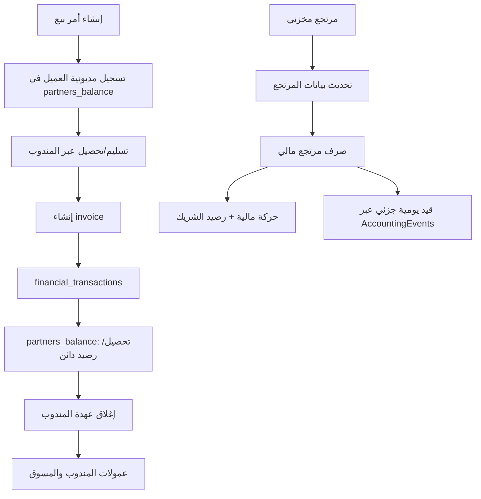

# 09 — دراسة المحاسبة والمالية في النظام القديم Just-M

> **حالة الوثيقة:** دراسة ساكنة للكود وملفات SQL الموجودة في أرشيف المشروع. لا تعني أن العمليات جُرّبت على قاعدة بيانات تشغيلية.  
> **الهدف:** توثيق ما ينفذه النظام القديم فعلًا، وكشف التداخلات والفجوات التي يجب عدم نقلها كما هي إلى النسخة الجديدة.

## 1. الخلاصة التنفيذية

النظام القديم لا يعتمد على دفتر أستاذ عام واحد متكامل. توجد فيه منظومتان متداخلتان:

1. **منظومة الأرصدة والحركات القديمة:** `partners_balance` و`financial_transactions` و`invoices` و`transaction_categories`، وهي المستخدمة في أغلب عمليات التحصيل والصرف وأرصدة العملاء والموردين والمندوبين والمسوقين.
2. **بداية منظومة دفتر أستاذ عام:** مجلد `inc/Classes/Accounting` وفيه `AccountManager` و`JournalManager` و`AccountingEvents` و`AccountSettings`، لكنها غير مكتملة في ملفات المشروع؛ كما أن بعض الكود يعتمد على أعمدة وجداول لا تظهر تعريفاتها في `createDatabase.sql`.

**النتيجة:** لا يصح اعتبار وجود `JournalManager` دليلًا على أن كل الحركات المالية القديمة أصبحت مرحّلة إلى الأستاذ العام. المسارات التي أمكن تتبعها تؤكد أن الترحيل الجديد محدود/جزئي، بينما التحصيلات والمدفوعات اليومية ما زالت تعتمد أساسًا على الجداول القديمة.

## 2. الشاشات والواجهات المالية

| الشاشة | الملف | الوظيفة الظاهرة |
|---|---|---|
| استلام المدفوعات / عهدة المندوب | `inc/Views/ReceivePayments.php` + `dist/js/ReceivePayments.js` | عرض أوامر المندوب، تصفية الحالات، مراجعة العهدة وتسجيل التحصيل |
| إذن صرف نقدية | `inc/Views/PaymentDisbursement.php` + `dist/js/PaymentDisbursement.js` | صرف مستحقات مندوب أو مسوق أو مورد، وصرف مرتجع عميل، وصرف مفتوح |
| إذن استلام نقدية | `inc/Views/CashReceiptVouchers.php` + `dist/js/CashReceiptVouchers.js` | واجهة استلام من مندوب/مسوق/مورد/عميل أو استلام مفتوح، لكن ربطها الخلفي غير مكتمل في الملفات المفحوصة |
| كشف حساب شريك | `inc/Views/AccountStatementReport.php` | كشف حساب حسب نوع الشريك والفترة |
| رصيد المسوق | `inc/Views/MarketerBalance.php` | واجهة كشف حساب المسوق |

الصلاحيات ومسارات العرض موجودة في `inc/Classes/user_permission.php`، وتظهر صلاحيات مستقلة لاستلام المدفوعات والصرف وإيصالات الاستلام وكشوف حساب العملاء والموردين والمسوقين والمندوبين.

### ملاحظة مهمة عن إذن استلام النقدية

ملف `CashReceiptVouchers.js` يستخدم نقاط نهاية مستقلة بأسماء مثل `get_mandob_data.php` و`get_mandob_balance.php` و`get_masouq_data.php` و`get_morad_data.php` و`get_client_data.php` و`get_orders_for_client.php` و`get_return_amount.php`. لم تظهر هذه النقاط ضمن مسارات الكنترولر التي تم تتبعها في هذا المشروع، والملف يحتوي على تعليقات توضح أن البيانات تجريبية/مفترضة. لذلك تُسجّل الشاشة كواجهة موجودة، ولا تُعتبر دورة مالية عاملة حتى يتم العثور على ملفات endpoints أو إثباتها من نسخة التشغيل.

## 3. الجداول المالية القديمة

### 3.1 `invoices`

تخزن مرجع الفاتورة ونوعه (`SALES` أو `PURCHASES`) وإجمالي السعر والمرتجع والمبلغ المدفوع وحالة الدفع. الفاتورة مرتبطة بالمرجع عن طريق `REFERENCE_ID` و`REFERENCE_TYPE`، ولا يظهر في تعريف الجدول قيد فريد يمنع تكرار الفاتورة لنفس المرجع.

### 3.2 `financial_transactions`

تخزن الحركة المالية: الفرع، المستخدم، الفاتورة، نوع الشريك ومعرّفه، المبلغ، طريقة الدفع، التصنيف، الحالة والملاحظة. الحالات المعرفة: `COMPLETED` و`CANCELLED` و`DEFERRED`.

### 3.3 `partners_balance`

دفتر أرصدة فرعي للشركاء، ويحتوي على:
- نوع الشريك: `CLIENT` أو `DELIVERY` أو `MARKETER` أو `SUPPLIER`.
- `PARTNER_ID` و`REFERENCE_ID`.
- نوع الحركة: `CREDIT` أو `DEBIT`.
- المبلغ والملاحظة والتصنيف.
- `USE_OF_CREDIT` لتمييز/تتبع بعض الأرصدة الدائنة.

هذا الجدول ليس دفتر يومية مزدوج القيد؛ هو سجل رصيد تشغيلي يعتمد عليه النظام في استخراج مستحقات الأطراف.

### 3.4 `transaction_categories` و`payment_methods`

جدول التصنيفات يقسم الحركات إلى `REVENUE` و`EXPENSES`، ومن التصنيفات المعرفة في SQL:
- 6 مرتبات.
- 7 إيرادات أخرى.
- 8 فواتير مبيعات.
- 9 تحصيلات مبيعات.
- 10 فواتير مشتريات.
- 11 مدفوعات مشتريات.
- 12 مدفوعات مرتبات.
- 13 مدفوعات فواتير خدمات.
- 14 استردادات مبيعات.
- 15 استردادات مشتريات.

توجد ملاحظة تستحق التحقق: الكود يستخدم تصنيفات أخرى مثل 16 و18، وبعضها لا يظهر في مقطع إدراج التصنيفات الذي تمت مراجعته. يجب الرجوع إلى قاعدة التشغيل أو كل ملفات SQL/النسخ الاحتياطية قبل اعتماد قاموس نهائي للأرقام.

## 4. معنى CREDIT وDEBIT في دفتر الشريك

تعليق `finance_BE.php` يعرّف:
- `CREDIT` = إضافة/له.
- `DEBIT` = صرف/عليه.

هذا اصطلاح دفتر أرصدة الشريك، وليس بديلًا عن معنى المدين والدائن المحاسبي في القيد العام. يجب عدم نقل نفس التسميات إلى دفتر الأستاذ دون فصل واضح بين `partner_balance_direction` وبين `journal debit/credit`.

## 5. دورة التحصيل من المندوب

المسار:
- الواجهة `ReceivePayments.php` و`ReceivePayments.js`.
- الكنترولر `accounts.control.php` يستقبل `CONTROL=ReceivePayments` للعرض، ويستقبل `CollectingFinancialPledge` من خلال `finance.control.php`.
- التنفيذ في `finance_BE::registerCollection()`.

### ما تنفذه الدالة

1. تجلب أوامر المندوب من `custody_orders` مع تفاصيل المنتجات والتسليم والعمولات.
2. تتحقق من وجود الأمر ومن عدم تغيّر `LAST_UPDATE` منذ تحميل الشاشة.
3. تمنع التحصيل في بعض الحالات غير المسموح بها، مثل أوامر الشحن غير المكتملة أو حالات الرفض/التسليم الجزئي قبل إتمام المرتجعات.
4. تنشئ فاتورة مبيعات.
5. تنشئ حركة `financial_transactions` من نوع العميل وتصنيف التحصيل.
6. تضيف رصيدًا دائنًا للعميل في `partners_balance`.
7. تضيف مستحقات عمولة المندوب والمسوق وقائد الفريق عند انطباق الشروط.
8. تحدّث `orders.ORDER_SUCCESS` وتحذف عهدة الأمر وتسجل سجل الطلب وحركة الشحن رقم 7.
9. تقارن إجمالي المبالغ المنفذة مع `totalAmount` المرسل من الواجهة، ثم تعتمد المعاملة أو تتراجع عنها.

### عيوب ومخاطر مؤكدة في الكود

- في فرع رسوم الشحن، يوجد استدعاء `Add_transaction()` مرتين متتاليتين بنفس القيم. هذا قد يسجل حركة مالية مكررة لرسوم الشحن، بينما رصيد العميل الدائن يضيف قيمة الشحن مرة واحدة فقط.
- قيمة التحصيل من العميل للمنتجات تسجل في حركة، ورسوم الشحن تسجل كحركة منفصلة، لكن يجب التأكد من مطابقة إجمالي الفاتورة والتحصيل والرصيد الدائن عند اختلاف حالات التجميد والمرتجعات.
- منطق التحصيل يجمع بين فاتورة وحركات مالية ورصيد شريك وتحديث عهدة في معاملة واحدة، لكنه لا ينشئ قيد يومية عام في هذا المسار.
- `registerCollection()` يستقبل `$delivery_id` لكن استعلام الأوامر يعتمد على مفاتيح الأوامر وبيانات العهدة؛ يجب التحقق من أن هوية المندوب المرسلة تُستخدم وتُتحقق منها بشكل كافٍ في كل المسار.
- لا يجوز اعتماد إجمالي التحصيل من المتصفح؛ يجب إعادة حساب المبلغ المستحق والتحقق منه بالكامل في الخادم.

## 6. أرصدة العملاء والتحصيلات

الدوال الأساسية في `finance_BE.php`:
- `addClientDebt()` تسجل مديونية العميل على أمر البيع، غالبًا بتصنيف 8.
- `addClientCredit()` تسجل التحصيل كرصيد دائن مرتبط بأمر البيع، بتصنيف 9.
- `reduceClientCredit()` تحسب مرتجعات المنتجات وتحدّث/تضيف سجل التصنيف 14.
- `useClientCredit()` تستخدم رصيد العميل الدائن في تسوية مديونية.
- `restClientdebt()` تعيد حساب مديونية الأمر عند تغيّر بياناته.

هذه الدوال تستخدم `partners_balance` مباشرة. يجب في النسخة الجديدة استبدالها بمصدر رصيد واحد مستخرج من قيود الأستاذ العام/حساب العميل المساعد، مع الاحتفاظ بمرجع الأمر والتوزيع على الفواتير.

## 7. أرصدة الموردين

الدوال:
- `addSupplierDebt()` تضيف مديونية للمورد مرتبطة بأمر الشراء، تصنيف 10.
- `reduceSupplierDebt()` تخصم/تحدّث المديونية.
- `addSupplierCredit()` تسجل رصيدًا دائنًا للمورد نتيجة مرتجع مشتريات، تصنيف 15.
- `useSupplierCredit()` تستخدم رصيد المورد.

تفاصيل إنشاء أوامر الشراء والاستلام والمرتجع موثقة في الوثيقة 08. أما سداد الموردين فتوجد فيه فجوة مهمة موضحة في القسم التالي.

## 8. إذن صرف النقدية

الواجهة تعرض خمسة مسارات:
1. صرف مستحقات المندوب.
2. صرف مستحقات المسوق.
3. صرف مستحقات المورد.
4. صرف مستحقات عميل (مرتجع).
5. صرف مفتوح.

الكنترولر `finance.control.php` يوجّه العمليات إلى:
- `PaymentOfDeliveryDues()`.
- `PaymentOfMarketerDues()`.
- `PaymentOfSupplierDues()`.
- `PaymentOfCustomerDues()`.

### 8.1 سداد المورد

الواجهة تحمل أوامر المورد وتسمح بتوزيع مبلغ الصرف على أوامر محددة. لكن حلقة توزيع المدفوعات على الأوامر داخل `PaymentOfSupplierDues()` معلّقة في الكود. التنفيذ الفعلي يسجل حركة مالية إجمالية للمورد وتصنيف 11، ثم يضيف `DEBIT` إلى `partners_balance` بقيمة الإجمالي، ولا يثبت التوزيع الذي أرسله المستخدم على كل أمر شراء.

**أثر ذلك:** لا يمكن اعتبار كشف المبالغ المتبقية لكل أمر شراء صحيحًا اعتمادًا على هذا المسار وحده، كما أن `purchases_orders.TOTAL_PAYMENTS` لا يظهر أنه يُحدّث في هذه الدالة.

### 8.2 سداد المندوب والمسوق

الدالتان تسجلان حركة صرف ومستند رصيد شريك. يجب تتبع تفاصيلهما مع قيم العمولة والرصيد المرسل من الواجهة قبل نقل قواعدهما، لأن الدوال تستقبل `total_balance` و`total_amount` من العميل، ويجب ألا يكون المبلغ المرسل مصدر الحقيقة.

### 8.3 صرف مرتجع العميل

`PaymentOfCustomerDues()`:
- يجلب أمر المرتجع ومعلومات العميل والمرتجع والعمولات.
- يحدث فاتورة المبيعات.
- ينشئ حركة مالية تصنيف 18.
- يستدعي `AccountingEvents::salesReturnPayment()` لإنشاء قيد يومية.
- يضيف حركة في `partners_balance` للعميل.
- يخصم عمولات المسوق/قائد الفريق عند انطباقها.
- يحدّث حالة الأمر ويحذف عهدة المرتجع ويسجل الحركة رقم 11.

يجب التحقق من ترتيب استلام المرتجع المخزني قبل الصرف المالي في المسارات الفعلية. وجود الدالة المالية لا يثبت وحده تحقق شرط الاستلام المخزني لكل سيناريو.

## 9. نظام دفتر الأستاذ العام الموجود جزئيًا

### 9.1 `AccountManager`

ينشئ حسابًا في `accounts` مع كود واسم ونوع وطبيعة ورقم مستوى وحالة السماح بالترحيل. الأنواع: `ASSET` و`LIABILITY` و`EQUITY` و`REVENUE` و`EXPENSE`. يتحقق من كود الحساب والحساب الأب ونوعه.

### 9.2 `AccountSettings`

يربط مفاتيح إعدادات بحسابات مثل العملاء والموردين والمخزون والمبيعات والمردودات وتكلفة البضاعة والشحن والعمولات والمرتبات والمصروفات والإيرادات. كما يبحث عن حساب صندوق حسب الفرع من جدول `cash_boxes`.

### 9.3 `JournalManager`

يدير رأس القيد وسطور اليومية، ويحتوي على:
- إنشاء القيد وإضافة/تعديل/حذف السطور.
- التحقق من وجود الحساب وصلاحيته والسماح بالترحيل.
- التحقق من الشريك عند وجوده.
- التأكد من توازن إجمالي المدين والدائن.
- توليد رقم قيد بصيغة `JV-YYYY-######`.
- إنشاء سنة مالية تلقائيًا عند عدم وجود سنة تغطي التاريخ.
- عكس القيد عن طريق إنشاء قيد معاكس.

### 9.4 جداول الأستاذ العام غير موجودة في ملف إنشاء القاعدة المفحوص

الكود يعتمد على جداول:
- `accounts`
- `account_settings`
- `journal_entries`
- `journal_entry_details`
- `financial_years`
- `cash_boxes`

لكن لم نعثر على تعريفات `CREATE TABLE` لهذه الجداول في `inc/Databases/createDatabase.sql` أو ملفات SQL الظاهرة في مجلد `inc/Databases`. هذا لا يثبت عدم وجودها في قاعدة تشغيلية أو ملف ترحيل خارجي، لكنه يعني أن ملف إنشاء القاعدة المرفق لا يكفي لإعادة بناء دفتر الأستاذ.

## 10. أخطاء/تعارضات في كود دفتر الأستاذ العام

هذه نتائج مراجعة ساكنة للكود وتحتاج اختبارًا منفصلًا قبل اعتبارها أعطال تشغيل مثبتة:

1. **عكس القيد:** `JournalManager::reverse()` يستدعي `addLine()` بوسائط موضعية، بينما الدالة الفعالة `addLine(array $line)` تقبل مصفوفة واحدة فقط. هذا تعارض واضح قد يمنع تنفيذ العكس.
2. **التحقق من الشريك:** مصفوفة أسماء الجداول/الأعمدة في `validatePartners()` تبدو غير صحيحة لبعض الأنواع؛ مثل `SUPPLIER` حيث اسم العمود مضبوط على `suppliers` بدل مفتاح المورد المتوقع، و`DELIVERY`/`MARKETER` تستخدم جدول `users` وعمود `users`، وهو ما يحتاج مطابقة مع بنية الجداول الفعلية.
3. **أعمدة الترحيل المفقودة من SQL:** `AccountingEvents` يقرأ/يحدث `financial_transactions.accounting_posted` و`accounting_entry_id`، لكن تعريف `financial_transactions` في `createDatabase.sql` لا يحتوي عليهما.
4. **مراجع القيود في أوامر البيع:** `AccountingEvents` يستخدم `orders.SALE_ENTRY_ID` و`orders.RETURN_ENTRY_ID`، لكن تعريف جدول `orders` في `createDatabase.sql` لا يظهر هذين العمودين.
5. **دالة جلب تحصيل البيع المباشر:** `getDirectSalePayment(int $orderId)` تستقبل قيمة باسم `orderId` وتنفذ الاستعلام على `orders.ORDER_ID`، بينما `directSalePayment(int $transactionId)` يمرر إليها معرف حركة مالية. يوجد خلط محتمل بين رقم الأمر ورقم الحركة.
6. **حساب مبلغ مرتجع البيع:** الاستعلام المشترك `getSalesOrder()` يحسب `RETURN_AMOUNT` من `DELIVERED_QTY` وليس `RETURNED_QTY`، رغم أن `salesReturn()` تستخدمه كقيمة مرتجع. يلزم تصحيح مصدر الحساب قبل الاعتماد على قيد المرتجع.
7. **شرط حالة المرتجع:** `validateSalesReturn()` يقبل الحالات 6 و7، لكن يجب ربطها بدقة بحالة استلام المرتجع المخزني وعدم الاكتفاء بحالة الطلب وحدها.
8. **تاريخ/فرع القيد:** بعض الأحداث تستخدم فرع الجلسة، وأخرى تستخدم الفرع المستخرج من المخزن/الحركة. يجب توحيد قاعدة تحديد الفرع.
9. **غياب ربط كل الحركات:** لا يوجد دليل في المسارات المفحوصة أن جميع معاملات التحصيل والصرف والمشتريات والعمولات تُرحّل تلقائيًا إلى `journal_entries`.

## 11. أحداث محاسبية ظهرت في `AccountingEvents`

| الحدث | المرجع | القيد المقصود |
|---|---|---|
| `directSale()` | بيع مباشر | مدين العملاء / دائن المبيعات، ومدين تكلفة المبيعات / دائن المخزون |
| `directSalePayment()` | تحصيل بيع مباشر | مدين الصندوق / دائن العملاء |
| `salesReturn()` | مرتجع بيع | مدين مردودات المبيعات / دائن العملاء، ومدين المخزون / دائن تكلفة المبيعات |
| `salesReturnPayment()` | صرف قيمة مرتجع | مدين العملاء / دائن الصندوق |

الترحيل المباشر الذي أمكن العثور عليه في `shipment_BE.php` يستدعي `AccountingEvents::directSale()` بعد مسار بيع مباشر. أما بقية المسارات فوجود الدوال لا يعني بالضرورة أنها مستدعاة في كل العمليات.

## 12. نموذج التدفقات المالية القديم — ملخص

هذا الرسم يصف المكونات التي ظهرت في الكود، وليس ضمانًا بأن كل خطوة متصلة تلقائيًا أو أن القيود متوازنة على مستوى كل العمليات.

## 13. ما يجب أن يكون في النسخة الجديدة

بناءً على توجه المشروع المعتمد، دفتر الأستاذ العام هو المصدر الوحيد للحقيقة المالية، وليس شاشة إضافية بجانب `partners_balance` و`invoices` و`financial_transactions`.

### 13.1 الكيانات الأساسية المقترحة

- شجرة حسابات متعددة المستويات، مع منع الترحيل على الحسابات التجميعية.
- قيود يومية برأس وحقول مرجعية واضحة، وسطور مدينة/دائنة.
- أبعاد مساعدة: الفرع، المخزن، مركز التكلفة، الشريك، أمر البيع/الشراء، وطريقة الدفع.
- حسابات فرعية للعملاء والموردين والمندوبين والمسوقين والموظفين.
- خزائن وبنوك وحسابات عهدة منفصلة لكل مندوب/موظف عند الحاجة.
- سنوات مالية وفترات محاسبية مغلقة مع منع الترحيل للفترات المغلقة.
- سياسة عكس القيود بدل تعديل/حذف القيود المرحلة.
- رقم مرجعي فريد يمنع ترحيل الحدث التشغيلي أكثر من مرة.

### 13.2 أحداث يجب أن تنتج قيودًا تلقائية

- فاتورة/إثبات البيع عند نقطة الاعتراف المعتمدة.
- تحصيل العميل نقدًا أو تحويلًا أو عبر مندوب.
- تسوية عهدة المندوب وإيداع النقدية بالخزينة/البنك.
- عمولة المندوب والمسوق وقائد الفريق.
- فاتورة شراء واستلام المخزون.
- سداد المورد.
- مرتجع مشتريات بعد الاستلام الفعلي.
- مرتجع مبيعات بعد الاستلام المخزني.
- رد نقدي للعميل أو إبقاء المبلغ رصيدًا دائنًا.
- مصروفات تشغيلية وإيرادات أخرى.
- تحويل بين الخزائن والبنوك.
- تسويات الجرد والعجز والزيادة والتالف.

### 13.3 قاعدة عهدة المندوب المعتمدة للمشروع الجديد

عند تحصيل المندوب من العميل، لا تعتبر الأموال دخلت خزينة الشركة بعد؛ بل تسجل:
- تخفيض مديونية العميل.
- إثبات النقدية في عهدة المندوب.
- إثبات العمولة حسب طريقة الاحتساب المعتمدة.
- عند التسوية: تخفيض عهدة المندوب وإثبات دخول صافي/كامل المبلغ إلى الصندوق أو البنك.

ويجب دعم طريقتي العمولة اللتين اعتمدهما المستخدم:
1. **العمولة خارج المبلغ المحصل:** تسجيل كامل التحصيل وعهدة المندوب، مع إثبات العمولة كمصروف/مستحق منفصل، وصافي المستحق للشركة بعد العمولة.
2. **العمولة ضمن المبلغ المحصل:** تسجيل المبلغ المحصل كاملًا، ثم إثبات الجزء الخاص بالعمولة كرصيد مستحق للمندوب.

يجب أن يكون اختيار الطريقة إعدادًا افتراضيًا قابلًا للقفل أو اختيارًا من أمين الخزينة وفق الصلاحية.

### 13.4 تخصيص التحصيلات على أوامر البيع

عند إدخال مبلغ إجمالي، يوزع آليًا على أقدم الأوامر غير المسددة أولًا (FIFO)، مع دعم:
- سداد جزئي.
- سداد كامل.
- فائض يبقى رصيدًا دائنًا للعميل.
- استخدام الرصيد الدائن في أمر آخر مع تسجيل رابط الاستخدام.
- منع التحصيل الزائد غير المبرر أو تكرار التخصيص.

### 13.5 المرتجعات

- استلام المرتجع المخزني هو الحدث السابق اللازم لمرتجع البضاعة المباعة.
- بعد تأكيد الاستلام، يُثبت رصيد العميل الدائن فورًا: يخصم أولًا من المديونية، والزائد يظل رصيدًا دائنًا قابلًا للاستخدام في أمر آخر.
- رد النقدية للعميل عملية مستقلة عن إثبات المرتجع/الرصيد.
- إلغاء حركة مالية مرحلة يكون بقيد عكسي، وليس حذفًا أو تعديلًا صامتًا.
- إلغاء أمر غير مسلّم مع وجود دفعة مقدمة يعالج كتسوية دفعة مقدمة، وليس كمرتجع بضاعة.

## 14. قائمة المخاطر والاختبارات المطلوبة

| ID | الاختبار | المتوقع |
|---|---|---|
| ACC-01 | تحصيل مندوب لأمر كامل | تخفيض العميل وإثبات عهدة المندوب مرة واحدة وإغلاق العهدة التشغيلية بشكل صحيح |
| ACC-02 | تحصيل أمر عليه رسوم شحن | حركة رسوم واحدة فقط، وتطابق الفاتورة والرصيد والحركة المالية |
| ACC-03 | تحصيل عدة أوامر بمبلغ إجمالي | توزيع موثق على الأوامر مع مطابقة الإجمالي |
| ACC-04 | تحصيل جزئي | بقاء المتبقي مستحقًا وعدم إغلاق الأمر خطأً |
| ACC-05 | تحصيل زائد | تحويل الزيادة إلى رصيد دائن وفق السياسة ومنع التكرار |
| ACC-06 | استخدام رصيد العميل | ربط الاستهلاك بالأمر المصدر والأمر المستفيد |
| ACC-07 | صرف مورد على عدة أوامر | حفظ تخصيص كل مبلغ وتحديث المتبقي لكل أمر |
| ACC-08 | صرف عمولة مندوب | تخفيض المستحق وإثبات خروج النقدية/البنك |
| ACC-09 | تسوية عهدة مندوب | العهدة تساوي صفرًا بعد تسوية صحيحة ولا يتكرر الإيداع |
| ACC-10 | مرتجع جزئي/كامل | حساب قيمة المرتجع من الكميات المرتجعة فقط |
| ACC-11 | مرتجع قبل الاستلام المخزني | رفض الترحيل المالي للبضاعة المرتجعة |
| ACC-12 | رد مبلغ مرتجع | قيد رد منفصل وربطه بحدث المرتجع |
| ACC-13 | عكس قيد يومية | إنشاء قيد معاكس صحيح ومتزن مع مرجع للأصل |
| ACC-14 | محاولة ترحيل الحدث مرتين | رفض التكرار بقيد فريد/مفتاح idempotency |
| ACC-15 | فترة مالية مغلقة | رفض القيد وعدم إنشاء حركة جزئية |
| ACC-16 | تحويل خزينة إلى بنك | مدين حساب الوجهة ودائن المصدر دون تغيير إجمالي النقدية |
| ACC-17 | تقرير الأستاذ وميزان المراجعة | مجموع المدين = مجموع الدائن، وإمكانية تتبع الرصيد إلى القيود |

## 15. نقاط لم تُحسم بعد

1. هل جداول الأستاذ العام موجودة في قاعدة الإنتاج أو في ملف SQL خارجي غير موجود بالأرشيف؟
2. هل أعمدة `SALE_ENTRY_ID` و`RETURN_ENTRY_ID` و`accounting_posted` و`accounting_entry_id` أضيفت يدويًا في قاعدة الإنتاج؟
3. هل توجد شاشات إدارة الحسابات والقيود والسنة المالية خارج قائمة ملفات `inc/Views` التي فُحصت؟
4. ما هو قاموس التصنيفات الكامل المعتمد في قاعدة التشغيل، خاصة التصنيفات 16 و18؟
5. هل توجد نقاط endpoints فعلية لإذن استلام النقدية أم أن الواجهة نموذج قديم غير مكتمل؟
6. ما قواعد العمولة الفعلية لكل نوع مندوب/مسوق/قائد فريق عند المرتجع والإلغاء والتحصيل؟

## 16. ملفات المصدر الأساسية التي تمت مراجعتها

- `inc/controller/finance.control.php`
- `inc/controller/accounts.control.php`
- `inc/controller/BackEnd/finance_BE.php`
- `inc/controller/BackEnd/accounts_BE.php`
- `inc/Classes/Accounting/AccountManager.php`
- `inc/Classes/Accounting/AccountSettings.php`
- `inc/Classes/Accounting/JournalManager.php`
- `inc/Classes/Accounting/AccountingEvents.php`
- `inc/Views/ReceivePayments.php`
- `inc/Views/PaymentDisbursement.php`
- `inc/Views/CashReceiptVouchers.php`
- `inc/Views/AccountStatementReport.php`
- `inc/Views/MarketerBalance.php`
- `dist/js/ReceivePayments.js`
- `dist/js/PaymentDisbursement.js`
- `dist/js/CashReceiptVouchers.js`
- `inc/Databases/createDatabase.sql`
- `inc/Classes/user_permission.php`

## 17. حالة الفحص والاختبار

- تمت مراجعة كود PHP وSQL ساكنًا.
- لم يتم تشغيل قاعدة البيانات أو تنفيذ تحصيل/صرف فعلي.
- لم يتم إثبات وجود أو غياب جداول الأستاذ العام في قاعدة الإنتاج.
- لم يتم إجراء مطابقة أرصدة بين `partners_balance` و`financial_transactions` والقيود اليومية.
- جميع الملاحظات المتعلقة بالأعطال التشغيلية تحتاج اختبارًا على نسخة قاعدة بيانات معزولة قبل أي تعديل.

**الخطوة التالية:** إكمال تتبع كشوف الحساب وتقارير الأرصدة، ومراجعة دوال صرف المندوب والمسوق بالتفصيل، ثم إعداد خريطة أحداث محاسبية نهائية (كل حدث تشغيلي ← الحسابات المدينة والدائنة ← مرجع الحدث ← شروط الترحيل والعكس).
