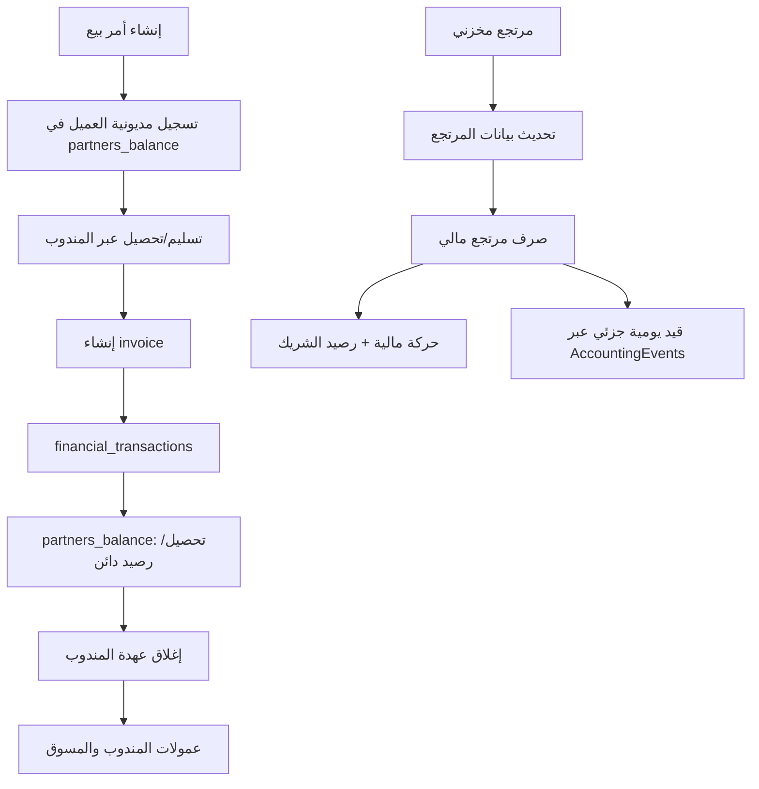

# Just-M — المرجع الموحد لوثائق المشروع

> **الغرض:** تجميع محتويات وثائق Markdown الخاصة بالمشروع في ملف مرجعي واحد، مع الحفاظ على نصوص الوثائق الأصلية وترتيبها ومصدر كل وثيقة.
>
> **المصدر:** مستودع `Mahmoud-reda-hassan/justm-new-app`، الفرع `main`.
> **لقطة المصدر:** commit `d381362e996715fb5b654e86284e2af233c1983f` بتاريخ 2026-11-08.
>
> **تنبيه مهم:** هذا تجميع توثيقي وليس إعادة اعتماد لكل ما ورد. قد تحتوي الوثائق على أوضاع تاريخية أو قرارات وملاحظات تم تحديثها لاحقًا. عند التعارض، يُرجع إلى أحدث تحديث مؤرخ وإلى الكود الحالي، ولا يُعامل الفحص الساكن باعتباره اختبارًا تشغيليًا. لم تُحذف الوثائق الأصلية أو تُعدّل.

## فهرس المحتويات

سيُدرج أدناه كل ملف من مجلد `docs/` ومجلد `docs/finance/`، مع مساره الأصلي ومحتواه الكامل.

---


---

# المصدر: `docs/01_LEGACY_SYSTEM_REQUIREMENTS_AR.md`

# Just-M --- دراسة النظام القديم ومتطلباته الوظيفية

-   الإصدار: 0.1 --- خط أساس توثيقي.
-   مصدر الكود: `justmNewApp-04-11-2026.zip`.
-   مصدر قاعدة البيانات: `cptest (17).sql`.
-   التاريخ: 2026-11-04.

> هذه الوثيقة مبنية على فحص بنية المشروع، ملفات التوجيه والقائمة
> الجانبية والشاشات الرئيسية وطبقات التحكم ووثائق المالية. وهي خريطة
> تأسيسية وليست ادعاءً بأن كل سطر في ملفات المشروع قد تمت مراجعته. عند
> اختلاف الوثيقة عن الكود أو قاعدة البيانات الفعلية، تكون الأولوية
> للمصدر الفعلي مع تسجيل الفرق.

## 1. تعريف النظام والتقنيات

Just-M نظام لإدارة المبيعات والطلبات والعملاء والمنتجات والمخزون والشحن
والمشتريات والمندوبين والمسوقين والعمليات المالية. البنية الظاهرة في
الحزمة:

-   PHP مخصص وPDO دون Laravel.
-   MariaDB/MySQL وإجراءات مخزنة.
-   Bootstrap 4 وAdminLTE بواجهة RTL.
-   JavaScript/jQuery، وDataTables وSelect2 وSweetAlert2.
-   `inc/Views`: واجهات الشاشات.
-   `inc/routes`: مسارات حسب نوع المستخدم.
-   `inc/template`: القالب والقائمة.
-   `inc/controller`: نقاط الدخول والتحكم.
-   `inc/controller/BackEnd`: منطق الأعمال.
-   `inc/Classes`: كلاسات المجال والبيانات.
-   `inc/Databases`: ملفات SQL والإجراءات.
-   `dist/js` و`dist/css`: ملفات الواجهة.

## 2. الأدوار

تظهر الحزمة أدوارًا/مناطق: ADMIN، DELIVERY، AFFILIATE/MARKETER،
INTERMEDIARY، MERCHANT، وSUPPLIER. تختلف القوائم والصلاحيات بحسب
`USER_SCRIPT` والجلسة. يجب أن يتحقق الخادم من الصلاحيات، ولا يكفي إخفاء
الزر في الواجهة. توجد Routers منفصلة للإدارة والمندوب والمسوق والمورد،
كما توجد بوابة `AdminZone` لاختيار منطقة المستخدم.

## 3. دليل الشاشات

### 3.1 الإعدادات والبيانات الأساسية

  -----------------------------------------------------------------------
  الشاشة                              الوظيفة
  ----------------------------------- -----------------------------------
  لوحة التحكم `dashboard`             ملخصات ومؤشرات ورسوم؛ يجب التحقق من
                                      مصادر الأرقام، لأن بعض القيم
                                      الظاهرة في القالب قد تكون ثابتة.

  المؤسسة `Enterprise`                بيانات المؤسسة.

  الهيكل الإداري                      تنظيم الهيكل الإداري.
  `Administrative-Structure`          

  الفروع `Branches`                   تعريف الفروع.

  المخازن `Warehouse`                 تعريف المخازن.

  المستخدمون `Users`                  إدارة الحسابات والبيانات والأدوار
                                      والصلاحيات.

  الدول `Countries`                   تعريف الدول.

  المحافظات `Gov`                     تعريف المحافظات ضمن شاشة إعدادات
                                      المناطق.

  المدن `City`                        تعريف المدن.

  الشحن المحلي `LocalShipping`        إعداد مناطق/قواعد الشحن المحلي.

  الشحن الدولي                        إعداد الشحن الدولي؛ تفاصيل التشغيل
  `International-Shipping`            تحتاج تتبعًا إضافيًا.

  العملاء `Clients`                   إضافة وتعديل وعرض العملاء ووسائل
                                      الاتصال والعناوين.

  الموردون `Suppliers`                بيانات الموردين.

  أقسام المنتجات `Product-Categories` تصنيف المنتجات.

  صفات المنتجات `ProductOption`       مجموعات وخصائص خيارات المنتجات.

  المنتجات `Products`                 عرض وإضافة وتعديل المنتج ووصفه
                                      وبيانات الشحن والصورة
                                      والخيارات/الأكواد.
  -----------------------------------------------------------------------

### 3.2 المبيعات وخدمة الطلبات

  -----------------------------------------------------------------------
  الشاشة / المسار                     الوظيفة
  ----------------------------------- -----------------------------------
  أمر جديد `NewOrder`                 البحث عن العميل، إضافة عميل عند
                                      الحاجة، اختيار المنتجات والكميات،
                                      مراجعة السعر والشحن والموعد
                                      والملاحظات، ثم الحفظ.

  تحرير أمر البيع `EditOrder`         تعديل أمر قائم وفق الحالة
                                      والصلاحية.

  تتبع طلبات العملاء `ex=0`           قائمة متابعة الطلبات.

  تأكيد طلبات العملاء `ex=1`          مراجعة/تأكيد الطلبات.

  المؤجلات `ex=2`                     الطلبات المؤجلة.

  غير متوفر `ex=3`                    حالات عدم توافر المنتج/الطلب.

  لا يستجيب `ex=4`                    حالات عدم استجابة العميل.

  أوامر البيع الملغاة `ex=5`          متابعة الملغى.

  تأكيد الشحن والتوصيل `ex=6`         متابعة تأكيد الشحن والتوصيل.

  تتبع تأكيد الشحن من المندوبين       متابعة نتائج المندوبين.
  `ex=12`                             

  خدمة ما بعد البيع                   مدخل ظاهر بالقائمة؛ التفاصيل تحتاج
  `SupportAfterSales`                 تتبعًا.

  طلبات المنسقين والعملاء             مدخل ظاهر بالقائمة؛ التفاصيل تحتاج
  `SupportOrders`                     تتبعًا.

  طلبات قيد التجهيز `ex=7`            تجهيز الطلبات.

  طلبات تم التجهيز `ex=8`             الطلبات المجهزة.

  طلبات قيد الشحن `ex=9`              الطلبات التي دخلت الشحن.

  تسوية عهدة المندوبين `ex=10`        مدخل لإدارة تسويات عهدة المندوب.

  تقرير حركة المبيعات والتسليمات      تقرير حركة المبيعات والتسليم.

  سجل حركات التسليم                   سجل عمليات التسليم.
  `ListOrdersDelivered`               
  -----------------------------------------------------------------------

لا تخلط بين `EXISTS_ID` و`ORDER_STATUS` و`ORDER_SUCCESS`: الأولى
تصنيف/حالة وجود أو متابعة الطلب، الثانية مرحلة الشحن والتسليم والمرتجع،
والثالثة مؤشر قديم لمعالجة/ترحيل مالي. في الـBackup الذي تمت مراجعته،
`order_exists.EXISTS_ID=5` تعني إلغاء أمر البيع، بينما 12 مرتبطة بتتبع
تأكيد الشحن من المندوبين، فلا تستخدم 12 كحالة إلغاء.

### 3.3 المخزون والمشتريات

  -----------------------------------------------------------------------
  الشاشة                              الوظيفة
  ----------------------------------- -----------------------------------
  إذن استلام مخزني `AddStock`         استلام توريدات/مشتريات أو مرتجعات
                                      بحسب نوع الإذن، مع اختيار المخزن
                                      والأصناف والكميات.

  إذن صرف مخزني `StockIssue`          صرف أصناف من مخزن.

  إذن تحويل مخزني `StockTransfer`     تحويل أصناف بين مخازن.

  جرد ومطابقة `StockAudit`            تسجيل الجرد ومقارنة الفعلي بالرصيد.

  طلب توريد `AddPurchaseOrder`        إنشاء طلب توريد/شراء ومتابعة
                                      الاستلام.

  تقرير الأصناف الحرجة                متابعة النواقص.

  تقرير حركة عهدة المندوبين           متابعة العهدة/الشحن لدى المندوب.

  تقرير الاستلامات المخزنية           متابعة حركات الاستلام/المرتجعات.

  تقرير استلامات الموردين             متابعة الكميات المستلمة من
                                      الموردين.

  تقرير حركة المخزون اليومية          ملخص وتفاصيل حركة المخزون بحسب
                                      الفترة.

  تقارير المشتريات `PurchasesReports` متابعة أوامر واستلامات المشتريات.
  -----------------------------------------------------------------------

### 3.4 المالية القديمة

  -----------------------------------------------------------------------
  الشاشة                              الوظيفة الظاهرة
  ----------------------------------- -----------------------------------
  استلام عهدة المندوبين               استلام/تسجيل مبالغ جمعها المندوب من
  `ReceivePayments`                   العملاء.

  إذن صرف نقدية `PaymentDisbursement` تسجيل صرف نقدي.

  إذن استلام نقدية                    سندات استلام؛ الواجهة تتضمن
  `CashReceiptVouchers`               اختيارات لمندوب ومسوق ومورد
                                      وعميل/مرتجع وأرصدة مفتوحة بحسب
                                      السيناريو.

  كشف حساب عميل                       عرض حركات العميل.

  كشف حساب مورد                       عرض حركات المورد.

  كشف حساب مسوق                       عرض حركات المسوق.

  كشف حساب موظف شحن                   عرض حركات المندوب.

  تقرير المندوبين `DelegatesReport`   حركة عهدة/تسليم المندوب.

  `MarketerBalance`                   كشوف/أرصدة الأطراف.
  و`AccountStatementReport`           
  -----------------------------------------------------------------------

النظام القديم يستخدم في أجزاء منه `partners_balance`, `invoices`,
`financial_transactions`, و`transaction_categories`. توجد أيضًا طبقة
محاسبة جديدة جزئيًا؛ لذلك الحزمة ليست نظامًا ماليًا موحدًا مكتملًا بعد.

### 3.5 صفحات إضافية

`Profile` الملف الشخصي؛ `AdminZone` بوابة المناطق؛ `Reports` تقارير
عامة؛ `InventoryMovement-report` حركة المخزون؛ `InventoryReconciliation`
المطابقة؛ `WarehouseShortageReport` النواقص؛ `shipping_report` تقارير
الشحن؛ وصفحات `404` و`PublicError` و`suspended_login` حالات مساعدة.

## 4. دورة البيع الكاملة

### 4.1 إنشاء الطلب

1.  فتح أمر جديد.
2.  البحث عن العميل برقم الهاتف.
3.  عرض بياناته وطلباته السابقة عند وجودها.
4.  إضافة عميل جديد عند الحاجة مع وسائل الاتصال والعنوان.
5.  اختيار المنتجات والكميات والخيارات المطلوبة.
6.  حساب قيمة المنتجات والخصومات.
7.  إدخال قيمة الشحن مرة واحدة على مستوى الطلب.
8.  تحديد موعد الشحن وملاحظات العميل.
9.  مراجعة التفاصيل ثم حفظ الأمر.
10. تخزين رأس الطلب وتفاصيل المنتجات والعنوان والخدمات والسجل المرتبط
    وفق الجداول.

واجهة الحزمة `inc/Views/Neworder.php` تتضمن البحث عن العميل وإضافته،
كتالوج المنتجات، الاختيارات، ملخص الحساب والشحن والموعد والملاحظات. قرار
واجهة النسخة المعدلة الأحدث موثق في ملف المتطلبات الجديدة؛ لا تعتبر
الواجهة القديمة في ZIP هي القرار النهائي.

### 4.2 المتابعة والتأكيد

تنتقل الطلبات بين قوائم المتابعة حسب حالات CRM، مثل المؤجل وغير المتوفر
وعدم الاستجابة والإلغاء. التأجيل وعدم الرد ليسا إلغاءً. يحتفظ النظام بسجل
الطلب والمتابعات.

### 4.3 التجهيز

تظهر الطلبات في قوائم قيد التجهيز ثم تم التجهيز. يجب التأكد من توافر
الكميات وتسجيل حركة المخزون الفعلية وفق الإجراء الصحيح، لا الاكتفاء
بتغيير حالة الطلب.

### 4.4 الشحن وعهدة المندوب

يتم إسناد الطلب للمندوب، وتسجيل حركة الشحن في `shipping_movement` وحركة
مخزون من نوع `SALES` عبر `InventoryManager`. سجلات العهدة تحفظ العلاقة
بين المندوب والطلب والمنتجات. خروج البضاعة مع المندوب لا يعني أن البيع
تم تحصيله.

### 4.5 نتيجة التسليم

القيم المستخدمة في الكود: - `ORDER_STATUS=2`: قيد الشحن. - `3`: تسليم. -
`4`: تسليم جزئي. - `5`: رفض/عدم تسليم. - `6`: مرتجع كامل. - `7`: مرتجع
جزئي.

يجب تأكيد النصوص النهائية من جدول `order_statuse` في الـBackup. لا
تستخدم الحالة وحدها كدليل على حركة مخزون أو تحصيل.

### 4.6 قيد البيع في الحزمة الحالية

في مسار تأكيد التسليم المباشر في `shipment_BE.php`، ينفذ الكود ضمن
معاملة: حركة المخزون `SALES`، سجل الطلب، ثم
`AccountingEvents::directSale($orderId)`، ثم `commit`. قيد البيع المباشر
يحاول إثبات: - مدين العملاء / دائن المبيعات بقيمة المنتجات المسلمة. -
مدين تكلفة المبيعات / دائن المخزون بتكلفة المنتجات المسلمة.

`getSalesOrder()` يحسب `(PRICE-DISCOUNT) * DELIVERED_QTY` والتكلفة من
`COST_PRICE * DELIVERED_QTY`. قيمة الشحن لا تدخل في هذا القيد، رغم أنها
تدخل مرة واحدة في مديونية العميل القديمة؛ هذه فجوة محاسبية يجب حسمها.

### 4.7 التحصيل

التحصيل المباشر والتحصيل بواسطة المندوب يجب التمييز بينهما. في المسار
القديم تُستخدم `invoices` و`financial_transactions` و`partners_balance`.
تحصيل المندوب من العميل ينشئ عهدة على المندوب، وتوريد المندوب للشركة حدث
مستقل يسدد العهدة. لا يجوز اعتبارهما حركة واحدة.

### 4.8 المرتجعات والإلغاء

ثلاثة سيناريوهات مختلفة: 1. رجوع شحنة لم تُسلّم من المندوب: تسوية عهدة
ومخزون، وليس مرتجع مبيعات بعد التسليم. 2. مرتجع مبيعات بعد التسليم:
العميل أعاد بضاعة سبق استلامها؛ الاستلام المخزني المقبول يسبق الأثر
المالي. 3. إلغاء قبل التسليم مع مقدم: تسوية مقدم فعلي ورد المستحق، دون
اشتراط حركة مرتجع مخزني لبضاعة لم يستلمها العميل.

## 5. دورة المشتريات

تعريف المورد ← طلب توريد/شراء ← إضافة أصناف وكميات وأسعار ← استلام
جزئي/كلي ← حركة مخزون واردة ← دفعة/تسوية للمورد ← مردود مشتريات عند
الحاجة. المراجعة السابقة وجدت فجوات في ترحيل الاستلام والمردودات وربطها
بالأستاذ؛ يجب عدم افتراض اكتمالها.

## 6. الجداول المحورية

-   العملاء والعناوين: `client`, `telephones`, `addresses`.
-   الطلبات: `orders`, `order_product`, `order_service`,
    `order_service_text`, `order_type`, `order_statuse`, `order_exists`,
    `orders_log`.
-   المنتجات: `product_category`, `products`, `product_option_group`,
    `product_option`, `product_codes`, `product_join_option_group`,
    `product_code_join_option`.
-   المخزون: `stores`, `stores_product`, `inventory_movement`,
    `inventory_product_movement`.
-   الشحن والعهدة: `shipping_movement`, `custody_orders`,
    `custody_product`, `custody_return_orders`,
    `custody_return_product`, `sales_return_orders`,
    `sales_return_products`.
-   المشتريات: `suppliers`, `purchases_orders`, `purchases_products`,
    `purchases_return_orders`, `purchases_return_products`,
    `supply_orders`, `supply_order_details`, `purchases_payments`.
-   القديم ماليًا: `partners_balance`, `invoices`,
    `financial_transactions`, `transaction_categories`.
-   الجديد جزئيًا: `accounts`, `financial_years`, `account_settings`,
    `cash_boxes`, `journal_entries`, `journal_entry_details`,
    `payment_method_accounts`, `accounting_line_allocations`.
-   تسوية المندوب: `delivery_accounting_settings`,
    `delivery_customer_collections`,
    `delivery_collection_order_allocations`,
    `delivery_company_settlements`, `delivery_commission_payments`,
    `delivery_settlement_collection_links`.

## 7. قواعد لا يجوز كسرها

1.  لا تحذف أوامر البيع؛ الإلغاء تغيير حالة مع حفظ السجل.
2.  الشحن يُحسب مرة واحدة على مستوى الطلب.
3.  افصل رفض الشحنة عن مرتجع المبيعات.
4.  لا ترحل مرتجع مبيعات قبل استلام البضاعة مخزنيًا.
5.  إلغاء قبل التسليم مع مقدم له مسار مستقل.
6.  لا ترد أكثر من المستحق بعد احتساب المدفوعات والردود السابقة.
7.  افصل تحصيل العميل بواسطة المندوب عن توريده للشركة.
8.  لا تكرر استحقاق/صرف العمولة.
9.  كل حركة قابلة للتتبع لمصدرها.
10. لا تعتمد على حالة الطلب وحدها لإثبات المخزون أو المال.
11. لا تنفذ ترحيلًا تاريخيًا أو حذفًا دون نسخة اختبار ومطابقة.

## 8. خريطة الملفات

-   `inc/Views/`: الشاشات.
-   `inc/template/SidebarMenu.php`: القائمة.
-   `inc/routes/*.php`: المسارات حسب الدور.
-   `inc/router.php`: التوجيه.
-   `inc/Classes/user_permission.php`: الصلاحيات واختيار الصفحة.
-   `inc/Api.php`: API عام.
-   `inc/controller/*.control.php`: نقاط دخول الواجهة الخلفية.
-   `inc/controller/BackEnd/*`: منطق الطلبات والشحن والمالية والمخزون.
-   `inc/Classes/Order_tbl.php`: منطق الطلب.
-   `inc/Classes/InventoryManager.php`: المخزون.
-   `inc/Classes/Accounting/*`: المحاسبة الجديدة.
-   `inc/Databases/`: SQL والإجراءات.
-   `dist/js/`: JavaScript.
-   `docs/finance/`: وثائق مراحل المالية.

## 9. فجوات الدراسة التي يجب استكمالها

-   توثيق كامل لواجهات التاجر والوسيط والمورد.
-   تتبع كل زر من View إلى JS ثم API ثم Backend ثم SQL/Procedure.
-   توثيق جميع الإجراءات المخزنة وآثارها الجانبية.
-   توثيق كل قواعد الأسعار والخصومات والعمولات.
-   استكمال دورة المشتريات والمردودات.
-   توثيق الصلاحيات الدقيقة لكل إجراء.
-   حسم حساب رسوم الشحن وسياسة الاعتراف بالمبيعات.
-   مقارنة DDL بالكامل مع الـBackup المعتمد.


---

# المصدر: `docs/02_NEW_VERSION_REQUIREMENTS_AR.md`

# Just-M --- متطلبات النسخة الجديدة والتصميم المستهدف

-   الإصدار: 0.1 --- خط أساس للمتطلبات.
-   الهدف: الحفاظ على وظائف التشغيل المعتمدة وإعادة بناء النظام المالي
    والمحاسبي بالكامل.
-   المبدأ الحاكم: **دفتر الأستاذ العام هو المصدر الوحيد للحقيقة المالية
    لكل حسابات المنشأة.**

## 1. الرؤية

النسخة الجديدة ليست إضافة شاشة دفتر أستاذ إلى النظام القديم. المطلوب
إلغاء طريقة النظام المالي القديمة كمحرك تشغيل، وبناء كل العمليات المالية
على قيود مزدوجة في الأستاذ العام. لا يجوز وجود مصدرين متوازيين للأرصدة.

### نحافظ على

العملاء والموردون والمنتجات والخيارات والفروع والمخازن؛ إنشاء الطلبات؛
التجهيز والشحن والتسليم؛ الرفض والمرتجعات؛ المشتريات والاستلام والتحويل
والجرد؛ المستخدمون والصلاحيات؛ التقارير التشغيلية وسجلات التتبع.

### نعيد بناءه

دليل الحسابات، اليومية والأستاذ العام، القيود والترحيل والعكس، الخزائن
والبنوك ووسائل الدفع، التحصيل والصرف، حسابات الأطراف، العمولات
والاستحقاقات، التخصيصات، المرتجعات والإلغاءات، المشتريات ومردوداتها،
والتقارير المالية.

## 2. مبادئ معمارية إلزامية

1.  **General Ledger First:** كل حدث مالي يرحّل بقيد مزدوج متوازن.
2.  **Single Source of Truth:** الأرصدة تُحسب من القيود المرحلة؛ لا جدول
    رصيد مستقل.
3.  **Subledger as Detail:** تفاصيل العميل/المورد/المندوب والتخصيصات
    تحليلية مرتبطة بسطر الأستاذ، وليست مصدرًا ثانيًا للرصيد.
4.  **Immutable Posted Entries:** لا تعديل أو حذف للقيد المرحّل؛ التصحيح
    بقيد عكسي/تسوية.
5.  **Atomic Posting:** حفظ الحدث والقيد وربط المصدر في معاملة ذرية.
6.  **Idempotency:** منع تكرار الترحيل عند إعادة الطلب أو التزامن.
7.  **Traceability:** كل قيد مرتبط بنوع المصدر ومعرفه والفرع والمستخدم
    والتاريخ.
8.  **Balanced Journal:** المدين يساوي الدائن.
9.  **Audit Trail:** تسجيل المنشئ والمعتمد والمرحل والعكس وسبب التغيير.
10. لا حذف للجداول القديمة قبل تحويل كل الاعتمادات ومطابقة البيانات.

## 3. نموذج الأستاذ العام

### 3.1 دليل الحسابات

شجرة حسابات مرنة تدعم الكود والاسم والحساب الأب والمستوى والطبيعة
(أصول/خصوم/حقوق ملكية/إيرادات/مصروفات) والتجميعي/التفصيلي والحالة
وقابلية الترحيل والعملة عند الحاجة. لا تنشئ حسابًا لكل عميل تلقائيًا دون
قرار؛ يمكن حساب مراقبة مشترك مع `partner_type` و`partner_id` على سطور
اليومية.

### 3.2 اليومية والأستاذ

الجداول الموجودة جزئيًا في المشروع: - `accounts` - `financial_years` -
`journal_entries` - `journal_entry_details` - `account_settings`

يجب التحقق من وجود حقول رقم القيد وحالته وتاريخه والفرع والسنة المالية
والمصدر والمستخدم والوصف. سطور القيد تحتاج الحساب والمدين والدائن والطرف
التحليلي ومركز التكلفة والعملة عند الحاجة. يجب إنشاء فهارس وقيود تمنع
تكرار المصدر بعد فحص البيانات.

### 3.3 النقدية وطرق الدفع

-   الصندوق والبنك والمحفظة حسابات أستاذ.
-   كل طريقة دفع مرتبطة بحساب أستاذ فعلي، مع مراعاة الفرع.
-   لا يفترض أن كل وسيلة دفع صندوق نقدي.
-   إذا لم يوجد ربط معتمد، يتوقف الترحيل ولا يستخدم حسابًا بديلًا تخمينيًا.
-   التحويل بين الصناديق/البنوك قيد تحويل، لا إيراد ولا مصروف.

### 3.4 دفاتر الأطراف المساعدة

كشف العميل/المورد/المندوب/المسوق يستخرج من سطور حسابات الأستاذ ذات الطرف
التحليلي. جداول التخصيص تربط السطور المدينة والدائنة وتدعم الجزئي
والعكس؛ ولا تنشئ رصيدًا مستقلًا.

## 4. الفرق بين المستند التشغيلي والمستند المالي والقيد

-   المستند التشغيلي: أمر بيع، أمر شراء، شحنة، إذن مخزني، مرتجع.
-   المستند المالي: سند قبض، سند صرف، تسوية عهدة.
-   القيد المحاسبي: الأثر المزدوج النهائي على الحسابات. ليس كل مستند
    تشغيلي ينشئ قيدًا لحظة إنشائه؛ توقيت الاعتراف يحدد حسب الحدث
    الاقتصادي والسياسة المعتمدة.

## 5. مصفوفة الأحداث المالية المطلوبة

  -----------------------------------------------------------------------
  الحدث                   القيد المبدئي           الضابط
  ----------------------- ----------------------- -----------------------
  بيع مسلم                مدين العملاء / دائن     الكميات المسلمة فقط
                          المبيعات؛ مدين تكلفة    
                          المبيعات / دائن المخزون 

  رسوم الشحن              مدين العميل مقابل حساب  مرة واحدة للطلب؛ الحساب
                          إيراد/مستحق شحن         النهائي غير محسوم

  تحصيل عميل مباشر        مدين صندوق/بنك / دائن   حسب طريقة الدفع والفرع
                          العملاء                 

  تحصيل العميل بواسطة     مدين عهدة المندوب /     تخصيص على الطلبات
  المندوب                 دائن العملاء            

  توريد المندوب           مدين صندوق/بنك / دائن   حدث منفصل
                          عهدة المندوب            

  استحقاق عمولة           مدين مصروف عمولة / دائن مرة واحدة
                          مستحقات المندوب         

  صرف عمولة               مدين مستحقات المندوب /  لا يتكرر بعد المقاصة
                          دائن صندوق/بنك          

  شراء مخزون              مدين مخزون/حساب شراء    عند الاستلام والاعتراف
                          مناسب / دائن الموردين   المعتمد

  سداد مورد               مدين الموردين / دائن    تخصيص على مستندات
                          صندوق/بنك               المورد

  مرتجع مشتريات           عكس أثر المخزون/المورد  بعد الاستلام
                          أو إثبات مطالبة         

  مرتجع مبيعات            مدين مردودات المبيعات / بعد استلام مخزني معتمد
                          دائن العملاء؛ مدين      
                          المخزون / دائن تكلفة    
                          المبيعات                

  رد مبلغ عميل            مدين رصيد               بحد أقصى المستحق
                          العميل/الالتزام / دائن  
                          صندوق/بنك               

  إلغاء قبل التسليم مع    تسوية المقدم ورد        لا يحتاج مرتجع مخزني
  مقدم                    المستحق                 لبضاعة لم تسلم

  مصروف                   مدين المصروف / دائن     سند وموافقة
                          الصندوق أو البنك أو     
                          المورد                  

  إيراد آخر               مدين وسيلة التحصيل /    حسب التصنيف
                          دائن الإيراد            

  تحويل نقدي              مدين الحساب المستلم /   لا يمر بالإيراد/المصروف
                          دائن الحساب المصدر      
  -----------------------------------------------------------------------

هذه مصفوفة تصميم أولية وليست اعتمادًا نهائيًا للمعالجة الضريبية أو
الحسابات. يلزم اعتماد سياسة محاسبية للحسابات وتوقيت الاعتراف.

## 6. دورة البيع الجديدة

### 6.1 إنشاء أمر البيع --- معتمد وظيفيًا

1.  اختيار العميل.
2.  اختيار المنتجات وتحديد الكميات.
3.  الضغط يدويًا على **مراجعة أمر البيع**.
4.  مراجعة العميل والمنتجات والأسعار والخصومات والشحن والموعد والملاحظات
    والإجمالي.
5.  حفظ أو إلغاء.
6.  لا انتقال تلقائي عند إضافة المنتجات.
7.  لا أزرار السابق/التالي؛ أيقونات خطوات وأسهم توضيحية فقط عند الحاجة.
8.  إزالة السلة الجانبية المكررة التي لا يحتاجها المستخدم.
9.  الحفاظ على روح الواجهة الأصلية مع تحسين الألوان والأزرار وتسريع
    تحميل المنتجات.
10. المستخدم أكد أن إنشاء أمر البيع مكتمل؛ لا تعِد تعديله دون طلب أو عيب
    مثبت.

### 6.2 الشحن والتسليم

الاحتفاظ بدورة التشغيل القديمة بعد توثيقها: التجهيز، إسناد المندوب، حركة
الشحن، عهدة الأصناف، التسليم الكامل أو الجزئي أو الرفض. لا يثبت قيد
البيع إلا عند الحدث الذي تعتمد عليه سياسة الاعتراف. التسليم الجزئي يرحّل
الجزء المسلم فقط.

### 6.3 التحصيل وFIFO

-   تخصيص التحصيل لأقدم المديونيات المفتوحة:
    `DATE_CREATED ASC, ORDER_ID ASC`.
-   الدفعة قد تغطي أكثر من طلب.
-   الطلب المسدد بالكامل لا يظهر في المفتوح؛ الجزئي يظهر بالمتبقي.
-   لا يتجاوز التخصيص رصيد الطلب.
-   الفائض يبقى رصيدًا دائنًا غير مخصص، يمكن استخدامه أو رده.
-   التخصيص مرتبط بسطور القيد ولا يمثل مصدر رصيد مستقل.

## 7. دورة المندوب والعمولة

الإعداد `commission_settlement_mode`: - `DEDUCT_FROM_CUSTODY`: خصم
العمولة من العهدة عند التوريد. - `SEPARATE`: توريد كامل المبلغ وصرف
العمولة منفصلًا. - `USER_CHOICE`: المستخدم يختار طريقة التسوية.

القواعد: 1. إذا ثبت الإعداد على طريقة، لا يستطيع المستخدم تجاوزها. 2.
تحفظ الطريقة الفعلية في مستند التسوية. 3. تحصيل العميل ينشئ عهدة على
المندوب. 4. توريد الشركة يسدد العهدة. 5. العمولة استحقاق مستقل. 6. لا
تجاوز للعهدة ولا تكرار للتحصيل أو العمولة. 7. كل تخصيص مرتبط بالطلب.

مثال: جمع المندوب 1000 وعمولته 100. في وضع الخصم يورد 900 وتسوّى 100 من
العهدة مقابل مستحق العمولة. في وضع الفصل يورد 1000 كاملة ثم تصرف العمولة
بقيد مستقل.

## 8. المرتجعات والإلغاء

### مرتجع بعد التسليم

1.  تحديد الكميات المرتجعة لكل صنف.
2.  رفض أي كمية أكبر من المسلم بعد طرح المرتجع السابق.
3.  استلام مخزني واعتماد الكميات المقبولة.
4.  قيد مردودات المبيعات وعكس تكلفة/مخزون الجزء المقبول.
5.  رد القيمة أو تحويلها لرصيد العميل بحدث مستقل.
6.  منع تكرار المرتجع أو الصرف.

### إلغاء قبل التسليم

-   تغيير حالة الأمر دون حذف.
-   حساب المقدم من التحصيلات المكتملة فعليًا.
-   رد المستحق بعد خصم ما سبق رده/تسويته.
-   لا يلزم مرتجع مخزني لبضاعة لم تصل للعميل.
-   إذا خرجت الشحنة، تسوى عهدة المندوب وعودة المخزون الفعلية.
-   لا تفرض رسوم إلغاء غير معتمدة.

## 9. المشتريات والموردون

طلب شراء ← استلام جزئي/كلي ← حركة مخزون ← إثبات مديونية المورد حسب
السياسة ← دفعة مورد وتخصيصها ← مردود مشتريات بعد استلام مخزني. يجب
التمييز بوضوح بين فاتورة شراء ومرتجع شراء، ومعالجة الخصومات ومصاريف
النقل.

## 10. الشاشات المحاسبية الجديدة

### الإعدادات

-   دليل الحسابات.
-   السنوات والفترات المالية.
-   مراكز التكلفة.
-   ربط الأحداث بالحسابات.
-   ربط طرق الدفع بالحسابات والفروع.
-   الصناديق والبنوك والمحافظ.
-   سياسات الترحيل والموافقة.

### العمليات

-   القيود اليومية: مسودة/اعتماد/ترحيل/عكس.
-   سند قبض وسند صرف.
-   تحويل بين حسابات نقدية.
-   تحصيل العملاء وتخصيص FIFO.
-   تسوية عهدة المندوب.
-   استحقاق وصرف العمولات.
-   دفعات الموردين وتخصيصها.
-   المرتجعات ورد المبالغ.
-   قيود افتتاحية وتسويات.

### التقارير

-   دفتر اليومية والأستاذ العام.
-   ميزان المراجعة.
-   كشف حساب حساب وطرف.
-   قائمة الدخل والميزانية العمومية.
-   التدفقات النقدية.
-   أعمار ديون العملاء والموردين.
-   حركة الصندوق والبنك.
-   عهدة المندوبين ومستحقاتهم.
-   مصادر لم ترحل أو تكررت.
-   تقرير مطابقة القديم والجديد.

## 11. إيقاف النظام القديم

لا تحذف فورًا `partners_balance`, `invoices`, `financial_transactions`,
`transaction_categories`. نفذ: 1. جرد كل قراءات وكتابات الجداول
والإجراءات. 2. إكمال المحرك الجديد. 3. تحويل الشاشات والتقارير. 4. تحويل
كل الأحداث المالية. 5. ترحيل أرصدة/تاريخ افتتاحي معتمد. 6. مطابقة كل
الحسابات والأطراف والصناديق. 7. إيقاف الكتابة القديمة. 8. إثبات عدم وجود
أي اعتماد. 9. حذف الجداول في Migration مستقل بعد موافقة صريحة.

## 12. متطلبات تقنية

-   PHP/PDO مخصص دون Laravel.
-   توافق مع IIS/Plesk ونسخة MariaDB الفعلية.
-   Prepared Statements وفحص صلاحيات خادمي وCSRF.
-   معاملات DB وأقفال تمنع التكرار.
-   سجل تدقيق.
-   عدم تغيير عقود API دون مراجعة.
-   تحسين تحميل المنتجات والقوائم دون كسر وظائفها.
-   لا تستخدم ميزة SQL غير مدعومة على MariaDB المستهدفة.

## 13. معايير القبول

-   لا قيد غير متوازن.
-   لا ترحيل مزدوج لنفس الحدث.
-   كل قيد له مصدر واضح.
-   الأرصدة مشتقة من القيود المرحلة فقط.
-   تفاصيل الأطراف والتخصيصات لا تنشئ رصيدًا ثانيًا.
-   سيناريوهات البيع والتحصيل والشراء والمرتجع والصرف والتسوية مختبرة.
-   لا فقد للوظائف التشغيلية.
-   ملف تثبيت نظيف ينجح على نسخة MariaDB مطابقة للإنتاج.
-   خطة ترحيل ومطابقة وRollback موثقة.


---

# المصدر: `docs/03_IMPLEMENTATION_ROADMAP_AND_TESTS_AR.md`

# Just-M --- خطة التنفيذ والاختبارات ونتائجها

-   الإصدار: 0.1
-   الحالة: خطة تأسيسية. لا تعتبر المرحلة مكتملة إلا بدليل اختبار.
-   المبدأ: لا تعديل إنتاج، ولا حذف بيانات، ولا ادعاء اختبار لم ينفذ.

## 1. قواعد إدارة التنفيذ

1.  كل اختبار على قاعدة مستقلة.
2.  Backup قبل كل Migration.
3.  تسجيل الملفات المتغيرة وسبب التغيير.
4.  التفريق بين Static Review وSyntax Check وUnit وIntegration وE2E
    وReconciliation.
5.  `php -l` و`node --check` لا يثبتان صحة الحسابات أو SQL.
6.  النتيجة غير المنفذة تسجل `NOT RUN`.
7.  لا تحذف الجداول القديمة قبل تحويل كل الاعتمادات والمطابقة.

## 2. مراحل التنفيذ

### المرحلة 0 --- تثبيت خط الأساس

**المهام:** تثبيت نسخة الكود والـBackup؛ استخراج DDL والفهارس والعلاقات
والإجراءات والـViews؛ مقارنة Backup بملفات الإنشاء؛ تحديد PHP/MariaDB؛
إنشاء بيئة اختبار قابلة لإعادة الإنشاء.

**الاختبارات:** استيراد Backup، إنشاء قاعدة نظيفة، مقارنة الجداول
والأعمدة والفهارس والقيود والإجراءات والـViews، اختبار اتصال وتسجيل
وتصفح.

**الحالة:** جزئي. تم فحص ZIP وBackup وملفات SQL؛ لم يثبت استيراد ملف
التثبيت المدمج فعليًا على MariaDB.

### المرحلة 1 --- دراسة النظام القديم

**المهام:** جرد Routers والأدوار والشاشات؛ تتبع كل زر إلى JS ثم API ثم
Backend ثم SQL/Procedure؛ توثيق حالات الطلب والمخزون والشحن والمالية
والتقارير.

**المخرجات:** وثيقة النظام القديم، خريطة التدفقات، مصفوفة الشاشات
والصلاحيات، سجل الفجوات.

**الحالة:** تأسيسية/جزئية. تم جرد الشاشات والمسارات والملفات الرئيسية
ودراسة مسارات البيع والمالية المعروفة؛ يلزم تتبع تفصيلي لكل إجراء وزر
قبل إعلان اكتمال الدراسة التنفيذية.

### المرحلة 2 --- اعتماد السياسة المحاسبية

**المهام:** اعتماد دليل الحسابات؛ حسابات المراقبة؛ حسابات المبيعات
والمردودات والتكلفة والمخزون؛ حسابات الصناديق والبنوك؛ رسوم الشحن؛ توقيت
الاعتراف؛ الضرائب والخصومات والعمولات؛ الفترات والإقفال.

**اختبارات القبول:** كل حدث له قيد متوازن؛ كل حساب نشط ومعتمد؛ لا حسابات
افتراضية تخمينية؛ اعتماد المحاسب/صاحب النظام.

**الحالة:** غير مكتملة. حساب رسوم الشحن وبعض سياسات الاعتراف تحتاج
قرارًا.

### المرحلة 3 --- قاعدة البيانات

**المهام:** اعتماد DDL من Backup؛ استكمال جداول الأستاذ والمستندات
والتخصيصات؛ إضافة مفاتيح مصدر فريدة بعد فحص التكرار؛ ربط طرق الدفع؛
Migrations مرتبة؛ Installer نظيف.

**اختبارات:** استيراد نظيف على MariaDB مماثلة للإنتاج؛ نجاح FK؛ توافق
الأعمدة مع الكود؛ اختبار Procedures وViews.

**الحالة:** غير معتمدة. ملف الدمج الأولي موجود، لكنه لم يثبت باختبار
استيراد حقيقي.

### المرحلة 4 --- محرك الأستاذ العام

**المهام:** قواعد التوازن؛ مسودة/اعتماد/ترحيل/عكس؛ سنة وفترة مالية؛ منع
الترحيل في فترة مغلقة؛ أرقام القيود والمراجع؛ Audit؛ Idempotency؛ مراكز
تكلفة وأطراف تحليلية.

**اختبارات:** قبول قيد متوازن؛ رفض غير متوازن أو حساب غير نشط أو فترة
مغلقة؛ منع تكرار المصدر؛ عكس بقيد عكسي؛ Rollback عند الفشل.

**الحالة:** توجد كلاسات محاسبة، لكنها تحتاج مراجعة وتوحيد واختبارات DB.

### المرحلة 5 --- الأستاذ والتقارير

**المهام:** دفتر اليومية والأستاذ؛ ميزان مراجعة؛ كشف حساب؛ قائمة دخل؛
ميزانية؛ تدفقات نقدية؛ كشف أطراف؛ أعمار ديون؛ حركة صندوق وبنك.

**اختبارات:** ميزان المراجعة متوازن؛ رصيد الحساب يساوي سطوره؛ كشف الحساب
يطابق الأستاذ؛ افتتاحي + حركة = ختامي.

**الحالة:** توجد `Accounting/Reports.php` و`AccountStatementReport.php`؛
لم يثبت اكتمال التقارير ومطابقتها.

### المرحلة 6 --- المبيعات

**المهام:** ربط التسليم بقيد البيع؛ التسليم الجزئي؛ تكلفة المبيعات
والمخزون؛ رسوم الشحن بعد اعتماد السياسة؛ منع التكرار.

**اختبارات:** تسليم كامل وجزئي؛ رفض؛ تكرار التأكيد؛ عدة منتجات؛ خصومات؛
فشل القيد بعد المخزون؛ إلغاء؛ عدم تكرار الشحن.

**الحالة:** يوجد استدعاء `AccountingEvents::directSale()` في مسار تسليم
البيع المباشر. رسوم الشحن وحقول الربط في DDL فجوات. لا اختبار MariaDB حي
مثبت.

### المرحلة 7 --- التحصيل وFIFO

**المهام:** سند قبض؛ تحصيل مباشر وعن طريق مندوب؛ تخصيص على أقدم
المديونيات؛ جزئي وزائد؛ رصيد دائن؛ ربط التخصيص بسطر القيد.

**اختبارات:** دفعة كاملة وجزئية؛ تغطي عدة طلبات؛ فائض؛ تجاوز؛ إعادة
إرسال؛ فرع/وسيلة دفع؛ اختفاء الطلب المسدد؛ رصيد غير مخصص.

**الحالة:** توجد `PartnerLedger` وتخصيصات `accounting_line_allocations`؛
التحويل الكامل غير مثبت.

### المرحلة 8 --- عهدة المندوب والعمولة

**المهام:** تحصيل العميل؛ عهدة المندوب؛ توريد الشركة؛ صرف/مقاصة العمولة؛
حفظ وضع التسوية.

**اختبارات:** تحصيل 1000 وعمولة 100 في وضع الخصم يورد 900 ويقاص 100؛ في
وضع الفصل يورد 1000 ثم يصرف 100؛ منع تجاوز العهدة؛ عدم تكرار العمولة؛
حفظ الإعداد التاريخي.

**الحالة:** توجد جداول وكلاس `DeliverySettlementManager` ووثيقة مرحلة 14
وواجهة عمل؛ اختبار التكامل غير مثبت.

### المرحلة 9 --- المرتجعات والإلغاء

**المهام:** مرتجع مخزني؛ قيد عكس المبيعات/التكلفة؛ رد أو رصيد؛ إلغاء قبل
التسليم مع مقدم؛ تسوية رجوع الشحنة.

**اختبارات:** مرتجع كامل/جزئي؛ استلام جزئي؛ رفض مالي قبل الاستلام؛ إلغاء
بمقدم وبدونه؛ تسليم جزئي؛ رد مكرر؛ فشل معاملة؛ حفظ الطلب دون حذف.

**الحالة:** توجد وثائق مراحل 6 و9 و10 و13 وبوابة تحقق في نسخة عمل؛ لا
اختبار DB حي مثبت.

### المرحلة 10 --- المشتريات

**المهام:** استلام؛ إثبات المورد؛ دفعات وتخصيص؛ مردودات؛ خصومات ومصاريف؛
تقارير.

**اختبارات:** استلام كامل وجزئي؛ دفع جزئي وكامل؛ دفعة لعدة مستندات؛
مرتجع؛ منع التجاوز؛ مطابقة مخزون وأستاذ ومورد.

**الحالة:** فجوات محاسبية معروفة؛ لا مسار كامل مثبت.

### المرحلة 11 --- المصروفات والإيرادات والتحويلات

إعادة ربط سندات الصرف والقبض والمصروفات والإيرادات والتحويلات إلى
الأستاذ العام. اختبار الحساب الصحيح والفرع والمرفقات والصلاحيات ومنع
التكرار.

**الحالة:** الشاشات القديمة موجودة؛ ربطها الجديد غير مكتمل.

### المرحلة 12 --- التقارير والتدقيق

تقارير مصادر غير مرحلة أو مكررة، أرصدة افتتاحية، فروق النظامين، سجل
العكس والتعديلات، ومطابقة الصندوق والبنك والأطراف.

### المرحلة 13 --- التحويل النهائي وإيقاف القديم

**شروط:** كل الأحداث والشاشات والتقارير تستخدم الجديد؛ مطابقة معتمدة؛ لا
كتابات قديمة؛ E2E ناجح؛ Rollback جاهز.

**الخطوات:** إيقاف الكتابة القديمة؛ Snapshot؛ ترحيل افتتاحي؛ مطابقة؛
مراقبة؛ إزالة الجداول القديمة في Migration منفصل وبعد موافقة.

## 3. سجل الاختبارات المنفذة حتى 2026-11-04

  -----------------------------------------------------------------------
  الفحص             النتيجة           النوع             الحالة
  ----------------- ----------------- ----------------- -----------------
  استخراج أرشيف     تم استخراج 5854   جرد               ناجح مع تحذير
  المشروع           ملفًا تقريبًا مع                      
                    تحذير أسماء عربية                   
                    داخل ZIP                            

  عد ملفات PHP      792               جرد               معلومة

  عد ملفات SQL      17                جرد               معلومة

  مراجعة Routers    استخرجت مسارات    Static Review     جزئي
  والقائمة          الإدارة والمندوب                    
                    والمسوق                             

  جرد Views         تم حصر ملفات      Static Review     جزئي
                    `inc/Views`                         

  قراءة وثائق       تمت مراجعة وثائق  Document Review   ناجح
  المالية           المراحل المالية                     
                    المتاحة                             

  تتبع تسليم البيع  تم تحديد استدعاء  Static Review     ناجح
                    `directSale()`                      
                    داخل معاملة                         
                    التسليم                             

  رسوم الشحن        ظهر اختلاف بين    Static Review     فجوة
                    مديونية النظام                      
                    القديم وقيد البيع                   
                    المباشر                             

  توافق DDL         توجد فروق بين     Schema Review     يحتاج حسم
                    Backup وملفات SQL                   
                    القديمة وحقول                       
                    الربط                               

  استيراد Installer لم ينفذ/لم يثبت   Integration       NOT RUN
  على MariaDB                                           

  بيع فعلي على DB   لم ينفذ           E2E               NOT RUN

  تحصيل FIFO        لم ينفذ           Integration       NOT RUN

  عهدة مندوب        لم ينفذ           Integration       NOT RUN

  مرتجع ورد أموال   لم ينفذ           Integration       NOT RUN

  شراء ومورد        لم ينفذ           Integration       NOT RUN

  مطابقة تاريخية    لم تنفذ           Reconciliation    NOT RUN
  -----------------------------------------------------------------------

## 4. قالب توثيق كل اختبار

-   Test ID:
-   التاريخ:
-   البيئة وإصدار DB/PHP:
-   الملفات وMigration:
-   بيانات الإدخال والخطوات:
-   المتوقع والفعلي:
-   SQL التحقق:
-   القيود الناتجة:
-   أثر المخزون والطرف:
-   اختبار التكرار:
-   اختبار Rollback:
-   الحالة: PASS / FAIL / BLOCKED / NOT RUN.
-   الدليل: Log / Screenshot / Query.

## 5. تعريف «تم التنفيذ»

لا تعتبر المرحلة مكتملة بسبب إنشاء ملف أو نجاح `php -l` أو ظهور الشاشة.
الاكتمال يتطلب اختبار المسار والحالات الحدية والصلاحيات والتزامن
والتكرار ومطابقة القيد والمخزون والطرف وتوثيق الأدلة.

## تحديث التنفيذ — 2026-11-04

تم دمج إصلاحات المرحلة 15، وفحص 774 ملف PHP و1,277 ملف JavaScript و504 ملفات CSS، ونجحت الفحوص النحوية/الساكنة. تمت مواءمة أعمدة `inventory_movement.UNIQUE_ID` و`inventory_product_movement.ORDER_ID` التي يستخدمها `InventoryManager` ولم تكن معرفة في DDL. أضيفت اختبارات القبول الساكنة في `tests/run_static_acceptance.py`.

لا تزال اختبارات استيراد MariaDB ودورات البيع والتحصيل والمرتجعات والمشتريات وE2E غير منفذة لعدم وجود خادم/Driver قاعدة بيانات أو متصفح متصل في بيئة البناء. راجع `docs/15_RELEASE_IMPLEMENTATION_AND_TESTS_AR.md` للحالة التفصيلية.


---

# المصدر: `docs/04_IMPLEMENTATION_LOG_AND_AI_HANDOFF_AR.md`

# 04 — سجل التنفيذ وملف تسليم العمل

**الإصدار:** 0.1 — **التاريخ:** 2026-11-04

## الغرض
هذا الملف نقطة بداية لأي مطور أو مساعد ذكاء اصطناعي يستكمل Just-M. يميز بين ما تمت مراجعته، وما ثبت من المصدر، وما لم يتم التحقق منه. لا تعتبر الوثائق إثباتًا لمراجعة كل ملف أو مسار سطرًا بسطر.

## المصادر التي تمت مراجعتها
- `justmNewApp-04-11-2026.zip`
- `cptest (17).sql`
- `JUSTM_DATABASE_INSTALL.sql` و`createDatabase.sql`
- ملفات `docs/finance/`
- ملفات التوجيه والقوائم والواجهات والمنطق الخلفي ذات الصلة.

ظهر أثناء فك الأرشيف تحذير متعلق بأسماء بعض الملفات العربية؛ افحص هذه الملفات عند الحاجة ولا تفترض سلامتها.

## جرد ساكن
- نحو 5,854 ملفًا مستخرجًا.
- 792 ملف PHP و17 ملف SQL.
- نحو 73 تعريف `CREATE TABLE` في `JUSTM_DATABASE_INSTALL.sql`.
- نحو 59 تعريفًا في `createDatabase.sql`.
- توجد واجهات في `inc/Views`، ومسارات في `inc/routes`، وقائمة في `inc/template/SidebarMenu.php`، ومنطق خلفي في `inc/controller/BackEnd`، وكلاسات مساعدة في `inc/Classes`.
- وجود بنية محاسبية أحدث بجانب الجداول القديمة لا يثبت اكتمال الانتقال أو اعتمادها تشغيليًا.

هذه أرقام جرد ساكن للأرشيف الذي تمت مراجعته، وليست إحصاءً مضمونًا لكل نسخة منشورة على الخادم.

## ما ثبت في مسار المبيعات
في `shipment_BE.php` تمت مراجعة تسلسل يتضمن:
1. `InventoryManager->processInventory('SALES', ...)`.
2. تسجيل سجل الطلب.
3. استدعاء `AccountingEvents::directSale($orderId)`.
4. `commit`، مع `rollback` عند الخطأ.

وفي `AccountingEvents::directSale()`:
- الترحيل لنوع `ORDER_TYPE == 1` وحالتي `ORDER_STATUS` ضمن `[3,4]`.
- المبيعات والتكلفة تعتمد على `DELIVERED_QTY`.
- يتم فحص `SALE_ENTRY_ID` قبل إنشاء القيد.
- ينشأ قيد المبيعات/العملاء وقيد التكلفة/المخزون، ثم يربط القيد بالطلب.

**فجوة:** `getSalesOrder()` لا يضم الشحن في قيمة المبيعات، بينما `Order_tbl::addOrders()` يضيف `shipping_val` مرة واحدة ويستدعي `finance_BE::addClientDebt()`. يلزم حسم معالجة إيراد الشحن في الأستاذ العام.

## نتائج مالية ومواطن تحقق
1. النظام القديم يكتب أرصدة العملاء في `partners_balance`، ومنها الفئة 8 عبر `finance_BE::addClientDebt()`.
2. الكود يشير إلى `SALE_ENTRY_ID` و`RETURN_ENTRY_ID`، ولم تظهر هذه الحقول في ملفات التثبيت التي تمت مراجعتها؛ يجب فحص قاعدة البيانات الفعلية.
3. توجد إشارات في `AccountingEvents` إلى `financial_transactions` و`invoices` في مسارات دفع.
4. لم يثبت أن `directSalePayment()` مستخدم في كل المسارات؛ تتبع الاستدعاءات مطلوب.
5. استعلام `finance_BE::restClientdebt()` الذي تمت مراجعته يحتاج تحققًا بسبب عدم تقييده بفئة الحركة في موضع المراجعة.
6. يجب فصل استلام المرتجع مخزنيًا عن رد المبلغ ماليًا.
7. وثائق `docs/finance/` قد تتضمن أعمالًا مقترحة أو منفذة في فرع عمل؛ لا تفترض نشرها على النسخة التشغيلية.

## قرارات صاحب المشروع
- تغيير الطريقة المالية والمحاسبية بالكامل؛ ليس مجرد إضافة شاشة أستاذ عام.
- الأستاذ العام هو المصدر الوحيد للحقيقة المالية لكل حسابات الشركة، وليس العملاء والموردين فقط.
- القيود متوازنة وقابلة للتتبع، ولا تعدل بعد الترحيل؛ التصحيح بقيد عكسي أو تسوية موثقة.
- لا تُنشأ أرصدة موازية في `partners_balance` بعد اكتمال الانتقال.
- هذه الجداول ليست جزءًا من النظام المستهدف؛ تُستخدم مؤقتًا للحصر والترحيل فقط، ثم تُوقف وتُؤرشف/تحذف بعد تحويل الاعتماديات والمطابقة.
- رسوم الشحن مرة واحدة للطلب لا لكل منتج.
- لا تحذف الطلبات؛ الإلغاء بتغيير الحالة وتسجيل الأثر.
- المرتجع المالي للبضاعة المستلمة مشروط بالاستلام المخزني.
- إلغاء طلب غير مسلم مع دفعة مقدمة مسار مختلف عن مرتجع بضاعة.
- منع تكرار الترحيل والتراجع الآمن عند الفشل.
- توزيع التحصيل تلقائيًا على أقدم المديونيات أولًا، مع دعم الجزئي والرصيد الدائن.
- طريقة عمولة مندوب التوصيل وتسويتها يجب أن تكون واضحة على مستند التحصيل/التسوية.
- تدفق إنشاء أمر البيع المعتمد: اختيار العميل والمنتجات ثم «مراجعة أمر البيع»، وبعدها الحفظ أو الإلغاء. لا تعد تصميم التدفق دون طلب.

## ما لم يثبت اكتماله
- استيراد ملفات التثبيت إلى MariaDB من قاعدة فارغة.
- مقارنة كل الجداول والحقول والفهارس والإجراءات بين النسخة الاحتياطية وملفات التثبيت.
- خريطة كاملة لكل شاشة إلى `route/controller/API/class/table`.
- تتبع كل الاستدعاءات المالية القديمة والجديدة.
- اختبارات تكامل المبيعات والتسليم الجزئي والكامل والرفض والمرتجعات.
- اختبارات التحصيل وFIFO والزيادة وعهدة المندوب والعمولة والتسوية.
- اختبارات المشتريات ومرتجعات الموردين.
- مطابقة الأرصدة التاريخية واختبارات التزامن ومنع التكرار.
- اعتماد السياسات غير المحسومة للضرائب والخصومات والشحن والإيرادات والمصروفات.

## تعليمات للمساعد التالي
1. اقرأ الوثائق الأربعة وملفات `docs/finance/` ذات الصلة.
2. تتبع مسار التنفيذ الفعلي ولا تعتمد على اسم الشاشة.
3. قارن السلوك القديم المطلوب بالسلوك الحالي قبل التعديل.
4. ميّز بين الحقائق والاستنتاجات والنقاط التي تحتاج قرارًا.
5. لا تغير قواعد مالية أو مخزنية أو حالات الطلب دون موافقة.
6. لا تنشئ جدول أرصدة موازٍ للأستاذ العام.
7. لا تحذف مسارًا قديمًا قبل حصر مستهلكيه وإثبات البديل.
8. قبل التعديل الكبير اعرض الملفات المتأثرة والخطة والمخاطر والاختبارات.
9. اذكر الاختبارات الفعلية فقط؛ المراجعة الساكنة ليست اختبار تشغيل.
10. حدّث هذا السجل في كل تسليم.

## قالب سجل تغيير
### [التاريخ] — [عنوان التغيير]
- الهدف:
- القرار المعتمد:
- الملفات المتأثرة:
- التغييرات:
- تعديلات قاعدة البيانات:
- الاختبارات ونتائجها:
- الاختبارات غير المنفذة:
- المخاطر:
- الخطوة التالية:

## نقطة الاستكمال
ابدأ بتثبيت خط أساس قاعدة البيانات من النسخة الاحتياطية وملفات التثبيت، ثم ارسم خريطة الأحداث المالية من المستند التشغيلي إلى الأثر المالي، واعتمد تصميم الأستاذ العام والترحيل المرحلي. لا تحذف النظام القديم قبل نجاح المطابقة والاختبارات.

**قاعدة التسليم:** إذا لم تجد معلومة في الوثائق أو المصدر، صرّح بأنها غير معروفة أو غير مثبتة واسأل قبل الافتراض.

## تحديث سجل التنفيذ — 2026-11-04

- تم دمج المرحلة 15 وإضافة حماية تكلفة كل سطر مباع.
- تم إصلاح نقص حقلي `UNIQUE_ID` و`ORDER_ID` في مخطط حركات المخزون، وإضافة Migration متوافق مع النسخ القائمة.
- تم تحديث `createDatabase.sql` وفصل علاقات المفاتيح الخارجية في `createRelations.sql`.
- تم إضافة مرسل SMTP آمن يعتمد على متغيرات بيئة الخادم بدل بيانات دخول ثابتة.
- نتيجة الفحوص الساكنة: 23/23 PASS، و774 PHP، و1,277 JavaScript، و504 CSS.
- اختبارات MariaDB وE2E والمطابقة التاريخية ما زالت NOT RUN.
- المرحلة 16 فعّلت التوزيع التشغيلي لدفعات الموردين على الفواتير مع تسجيل الزيادة كمقدم، لكن استخدام المقدم على فواتير لاحقة وترحيل المورد للأستاذ العام ما زالا يحتاجان استكمالًا. مقدم العميل عند إلغاء طلب قبل التسليم تقرر تحويله إلى رصيد دائن، لكن النسخة لا تحتوي حتى الآن على مسار قبض مقدم قبل التسليم وربطه بالطلب؛ لا يتم إنشاء رصيد بلا حركة قبض أصلية. كما لم يكتمل تحويل جميع الشاشات المالية القديمة.
- التفاصيل: `docs/15_RELEASE_IMPLEMENTATION_AND_TESTS_AR.md`.


## توجيه معماري جديد — إعادة بناء الدورة المالية بالكامل

اعتبارًا من تحديث التصميم في 2026-11-05، لا تُستكمل المحاسبة باعتبارها مجموعة ترقيعات مرحلية فوق `partners_balance` و`financial_transactions` و`invoices`. المطلوب إعادة بناء الدورة المالية من الحدث التشغيلي حتى القيد والتخصيص والتسوية والتقارير، مع الأستاذ العام مصدر الحقيقة الوحيد بعد القطع النهائي.

- الوثيقة المرجعية الملزمة: `docs/13_NEW_ACCOUNTING_ARCHITECTURE_AND_MIGRATION_PLAN_AR.md`.
- وثائق `docs/09` إلى `docs/12` هي دراسات للنظام القديم ومخططه، وتستخدم لفهم السلوك والاعتماديات فقط.
- مراحل التنفيذ المالي السابقة توثق محاولات وقرارات جزئية؛ لا تعني اعتماد الكود الحالي كدورة نهائية.
- لا تُبقِ الجداول القديمة كجزء من النظام الجديد. احصر استخدامها مؤقتًا، ثم انقل البيانات والوظائف، وحوّل المستهلكين واختبر المطابقة، وبعدها أوقف القراءة والكتابة التشغيلية وأرشف/احذف القديم وفق خطة معتمدة. يمنع تشغيل مسارين ماليين إنتاجيين بالتوازي.
- الخطوة التالية هي رسم خريطة القراءة والكتابة لكل مسار مالي، ثم اعتماد مصفوفة الأحداث والقيود قبل أي إعادة هيكلة للكود أو DDL.

## متابعة 2026-11-05 — تدقيق محرك الأستاذ العام
- تمت مراجعة JournalManager وAccountingEvents وAccountSettings وأجزاء التسوية والتخصيص في DeliverySettlementManager.
- تم إصلاح حماية عكس القيود في JournalManager::reverse() لمنع عكس قيد غير مرحل أو عكس نفس القيد مرة ثانية، مع معاملة وقفل للقيد الأصلي.
- Commit: f9d12b484f69e83d32e2929535df20c1b63bc919.
- لم يتم تشغيل PHP lint أو اختبارات DB في هذه البيئة؛ لا تعتبر هذه الجولة مختبرة تشغيليًا.
- ملاحظات متابعة إلزامية: لا يزال AccountingEvents مرتبطًا بمصدر financial_transactions القديم في أحداث التحصيل؛ لا يوجد idempotency عام لكل الأحداث؛ ربط الصندوق يختار أول صندوق للفرع؛ ويجب إحكام التخصيصات لمنع تكرار/تجاوز المبالغ.
- لا تعديل SQL ولا نشر على الاستضافة في هذه الجولة.

## متابعة 2026-11-05 — أول تنفيذ لسجل الأحداث المالية
- أضيف `inc/Classes/Accounting/FinancialEventManager.php` كخدمة مستقلة لمنع تكرار ترحيل الحدث المالي.
- أضيف جدول `accounting_events` في Installer داخل مجلد قواعد البيانات ونسخة الجذر.
- يربط السجل الحدث بقيد واحد، ويتحقق من تطابق هوية الحدث وبصمة payload عند إعادة المحاولة.
- يعتمد على نفس PDO والمعاملة لإنشاء القيد واعتماد الحدث كوحدة واحدة.
- لم يتم تحويل AccountingEvents أو أي endpoint بعد؛ لا يزال القديم مستخدمًا في التشغيل.
- لم يتم تشغيل PHP lint أو DB import أو اختبارات runtime؛ لم يحدث deploy أو تعديل لقاعدة الاستضافة.

### تحويل البيع المباشر — 2026-11-05
- تم تعديل `inc/Classes/Accounting/AccountingEvents.php` لتمرير البيع المباشر عبر `FinancialEventManager`.
- البيع المباشر يثبت قيمة المنتجات فقط؛ لا يضيف `SHIPPING_VAL` ولا إيراد شحن.
- تكلفة المنتجات المسلمة وتخفيض المخزون مستمران كما كانا.
- تمت إضافة مفتاح ثابت لمنع تكرار حدث البيع لكل طلب، مع التحقق من تطابق لقطة بيانات الطلب قبل إنشاء القيد.
- لا يزال البيع عبر الشحن والتحصيل والمقدمات خارج التحويل.
- لم يتم تشغيل PHP lint أو DB import أو runtime tests أو deploy.

### اختبارات البيع المباشر الآلية — 2026-11-05
- أضيفت اختبارات ثابتة في `tests/accounting/direct_sale_static_test.php` وWorkflow في `.github/workflows/accounting-php-validation.yml`.
- نجح فحص PHP syntax واختبارات قواعد البيع المباشر على PHP 8.0 و8.4 في GitHub Actions.
- شملت الاختبارات ملفات AccountingEvents وFinancialEventManager وJournalManager وAccountSettings، وقاعدة عدم إدخال الشحن في البيع المباشر.
- لم يتم بعد اختبار قاعدة MariaDB فعلية أو سيناريوهات التزامن/التكرار على قاعدة بيانات؛ يجب إتمامها قبل اعتماد التشغيل الإنتاجي.


## اختبارات موسعة للمحاسبة — 2026-11-05

تم توسيع الاختبارات على GitHub Actions، وآخر تشغيل ناجح على commit:
`b62539f965098b1a8ab44558d99b4b37a0c33424`

- نتيجة Workflow: **SUCCESS** على PHP 8.0 وPHP 8.4.
- تم تنفيذ PHP lint على جميع ملفات PHP داخل `inc/Classes/Accounting/` وملفات `tests/accounting/`.
- الفحوص الثابتة أكدت أن البيع المباشر يرحّل قيمة المنتجات فقط ولا يضيف الشحن، وأن مسار عكس القيد يحتوي على القفل ومنع التكرار وقلب المدين والدائن وتغيير حالة القيد الأصلي.
- تمت مقارنة نسختي Installer في الجذر وداخل `inc/Databases` وتأكد تطابقهما، ووجود جدول `accounting_events` وفهرس منع التكرار.
- تمت إضافة MariaDB 10.11 مؤقتة داخل CI، دون الاتصال بقاعدة الاستضافة أو تنفيذ أي SQL عليها.

### نتائج اختبارات MariaDB الفعلية

- إنشاء الحدث المالي والقيد المرتبط به بنجاح.
- إعادة نفس الحدث بنفس المفتاح والبيانات تعيد رقم القيد السابق ولا تعيد تنفيذ callback.
- إعادة المفتاح نفسه ببيانات مختلفة تُرفض.
- الحدث الموجود بحالة `PROCESSING` يُرفض ولا يعاد ترحيله تلقائيًا.
- فشل callback أو عدم وجود القيد الناتج يؤدي إلى rollback لسجل الحدث.
- عكس قيد فعلي يقلب المدين والدائن، وينشئ مرجعًا إلى القيد الأصلي، ويغيّر حالة الأصلي إلى `REVERSED`.
- محاولة عكس القيد مرة ثانية تُرفض.
- فشل العكس بسبب حساب غير نشط يتراجع بالكامل ويترك القيد الأصلي `POSTED`.

### إصلاح إضافي أثناء الاختبار

في `FinancialEventManager` تم تعديل معالجة SQLSTATE 23000: إذا لم يُعثر على حدث بنفس مفتاح منع التكرار، يُعاد خطأ قاعدة البيانات الأصلي بدل إخفائه برسالة تعارض مفتاح عامة.

### ما لم يتم اختباره بعد

هذه الاختبارات لا تعني اكتمال اختبار النظام المحاسبي كله. ما زال يلزم:
- استيراد Installer كاملًا إلى MariaDB فارغة والتحقق من جميع الجداول والعلاقات والإجراءات والـ Views.
- اختبار `AccountingEvents::directSale()` على قاعدة تطبيق كاملة ببيانات طلب وحسابات ومخزون فعلية؛ فاختباره الحالي ثابت وليس تشغيلًا end-to-end.
- اختبار البيع عبر الشحن، والتحصيل والمقدمات، والمرتجعات، والتسليم الجزئي والرفض، وعهدة المندوب والعمولة والتسوية.
- اختبار تخصيصات FIFO والرصيد الدائن والتزامن ومطابقة الأرصدة التاريخية.
- لا يوجد deploy، ولم يتم تعديل قاعدة بيانات الاستضافة.

الـ Workflow أصبح يعمل عند تعديل ملفات المحاسبة أو اختبارات المحاسبة أو أي من نسختي Installer.


## تدقيق تحصيل العميل وعهدة المندوب — 2026-11-05

- تمت مراجعة مسار الشاشة الفعلي: `ReceivePayments.js` ما زال يستدعي `CollectingFinancialPledge` الذي يصل إلى `finance_BE::registerCollection()` القديم.
- يوجد endpoint جديد `RegisterDeliveryCustomerCollection` وخدمة `DeliverySettlementManager::registerCustomerCollection()`، لكنه غير موصول بواجهة تسجيل التحصيل الحالية.
- التحصيل المباشر في `AccountingEvents::directSalePayment()` لا يستخدم `FinancialEventManager` حتى الآن.
- تم رصد تعارض يحتاج معالجة قبل التحويل: البيع المباشر يثبت المنتجات فقط، بينما المسار القديم ينشئ حركة تحصيل شحن منفصلة ويرسلها إلى نفس دالة التخصيص التي تخصص على سطر مديونية المنتجات فقط. يلزم حدث شحن مستقل للطلبات المشحونة وسطر مديونية واضح قبل تحويل الشاشة.
- خدمة تحصيل المندوب الجديدة تنشئ إيصالًا عشوائيًا ولا تستقبل مفتاح idempotency ثابتًا من طلب الواجهة؛ لذلك يلزم تصميم منع تكرار طلب HTTP قبل تفعيلها.
- تفاصيل التدقيق وخطة التنفيذ: `docs/finance/PHASE17_CUSTOMER_COLLECTION_FLOW_AUDIT_AR.md`.
- لم يتم تعديل كود التشغيل أو Installer، ولم يتم تشغيل SQL أو نشر على الاستضافة. هذه مراجعة ساكنة فقط.
- نقطة الاستكمال: تصميم وترحيل حدث إيراد/مديونية الشحن المستقل، ثم تخصيص التحصيل على أسطر الطلب الصحيحة، ثم ربط الواجهة الجديدة واختبارها على MariaDB مؤقتة.


## استكمال بعد المرحلة 17 — حدث إيراد الشحن المستقل (2026-11-05)

- تمت مراجعة `docs/finance/PHASE17_CUSTOMER_COLLECTION_FLOW_AUDIT_AR.md` و`PHASE14_DELIVERY_COLLECTION_AND_SETTLEMENT_AR.md` ومسار `Order_tbl::addOrders()` وتعريفات `ORDER_TYPE`.
- ثبت من Installer أن `ORDER_TYPE_ID = 5` هو «بيع مباشر»، وأن الأنواع 1–4 ليست البيع المباشر.
- أضيفت `AccountingEvents::postOrderShippingCharge()` في commit `94eb7d9ae04dcfa834dfdc109d281a28d04be18a`.
- الحدث `SHIPPING_REVENUE_RECOGNIZED` مستقل عن `SALE_RECOGNIZED`، ومفتاحه `ORDER_SHIPPING:ORDER:{orderId}:SHIPPING_REVENUE`.
- يثبت مدين العملاء ودائن `SHIPPING_REVENUE)، مرة واحدة لكل طلب، بعد التسليم الكامل/الجزئي، ويستثني البيع المباشر (النوع 5) والرسوم الصفرية.
- تم ربط استدعاء حدث الشحن بعد حدث بيع المنتجات في `directSale()`؛ قيد المنتجات لم يتغير ولا يحتوي على رسوم الشحن.
- أضيفت فحوص ثابتة في commit `b4f11819440e016995d68a754dcb8e70533c496b`.
- حالة CI لهذين التعديلين يجب مراجعتها من GitHub Actions قبل اعتبارهما ناجحين؛ لم يتم الادعاء باختبار تشغيل محلي.
- **الخطوة التالية:** تحديث `DeliverySettlementManager::registerCustomerCollection()` لتخصيص المبلغ بين سطر مديونية المنتجات وسطر مديونية الشحن، ثم إضافة idempotency لطلب التحصيل، ثم توصيل واجهة `ReceivePayments`.
- لا يزال `ReceivePayments.js` على endpoint القديم `CollectingFinancialPledge`، ولم يتم إيقاف الجداول القديمة.
- لا Installer changes، لا SQL على الاستضافة، ولا deploy.


### نتيجة CI لحدث الشحن المستقل — 2026-11-05

- Workflow run `42074459801` على commit `cd0695509182fb63b467c1f6ad194f8bc360862b` نجح بالكامل على PHP 8.0 و8.4.
- نجح lint، والفحص الثابت لاستثناء البيع المباشر وفصل قيد الشحن، واختبارات MariaDB 10.11 الموجودة.
- حصل فشل أولي في اختبار assertions بسبب interpolation لمتغيرات PHP؛ تم إصلاحه ثم نجح التشغيل المشار إليه.
- لا تعتبر هذه النتيجة اختبارًا end-to-end لحدث شحن على مخطط التطبيق الكامل؛ ذلك الاختبار ما زال مطلوبًا.


### استكمال المرحلة 17 — تخصيص تحصيل المندوب وفصل الواجهة (2026-11-05)

- تم تحديث `DeliverySettlementManager::registerCustomerCollection()` لاستخدام `FinancialEventManager` بحدث `COURIER_COLLECTION` ومفتاح طلب إلزامي `request_key`.
- تم نقل فحص إعادة الإرسال إلى ما قبل فحص الرصيد المفتوح، حتى لا يؤدي retry بعد نجاح التحصيل إلى رفضه بسبب انخفاض الرصيد.
- أصبح التخصيص يوزع المبلغ على مديونية المنتجات ثم مديونية الشحن في قيدها المستقل، مع رفض غياب حدث الشحن أو عدم تطابق قيمته.
- استحقاق العمولة أصبح حدثًا مستقلًا `COMMISSION_ACCRUED` مع منع التكرار.
- endpoint `RegisterDeliveryCustomerCollection` أصبح يتطلب `request_key`.
- تمت مراجعة `ReceivePayments.php` و`ReceivePayments.js` و`finance_BE::registerCollection()`: زر `#btnPay` القديم هو إجراء استلام الشركة للتحصيل من المندوب وإغلاق العهدة التشغيلية، وليس مجرد تسجيل دفع العميل للمندوب.
- آثار المسار القديم التي يجب نقلها قبل استبداله: invoices، financial_transactions، partners_balance (عميل/مندوب/مسوق/قائد)، ORDER_SUCCESS، حذف custody_orders، shipping_movement type 7، ORDERS_LOG، والتحقق من إجمالي المبلغ.
- لوحة المرحلة 14 في نفس الصفحة هي لتسوية تحصيلات سبق تسجيلها من العملاء؛ ليست واجهة تسجيل تحصيل العميل.
- **ممنوع** توصيل زر `#btnPay` مباشرة بـ `RegisterDeliveryCustomerCollection` أو حذف المسار القديم قبل نقل آثاره التشغيلية واختبارها.
- لا توجد واجهة مستقلة حتى الآن لتسجيل تحصيل العميل لدى المندوب. هذه هي الخطوة التالية بعد حصر سلوك العهدة والمرتجعات.
- اختبارات الكود: GitHub Actions run `42074880290` نجح على PHP 8.0 و8.4، بما في ذلك lint والفحوص الثابتة واختبارات MariaDB العامة للأحداث والقيود. هذا لا يثبت اختبار خدمة التحصيل الجديدة end-to-end.
- لا تعديل SQL/Installer، لا نشر، ولا تشغيل على قاعدة الاستضافة.


---

# المصدر: `docs/05_LEGACY_SCREENS_ROUTING_PERMISSIONS_MAP_AR.md`

# 05 — خريطة الشاشات والتوجيه والصلاحيات في النظام القديم

**الإصدار:** 0.1  
**تاريخ الفحص:** 2026-11-04  
**المصادر الأساسية:** `inc/template/SidebarMenu.php`، `inc/Classes/user_permission.php`، `inc/routes/*.php`، `Admin.php`، `Affiliate.php`، `inc/template/body.php`، ومجلد `inc/Views`.

> هذا المستند يصف ما ظهر في نسخة المصدر المفحوصة. أسماء الروابط والعناوين قد تختلف في بعض المواضع، وبعض الصفحات لا يظهر لها تعريف متطابق في كل ملفات التوجيه. لا تعتبر هذه الخريطة بديلًا عن تتبع الـ API والـ Controller لكل عملية داخل الشاشة.

## 1. معمارية فتح الشاشة

المسار الفعلي الظاهر في ملفات الدخول:

1. `Admin.php` يجهز الاتصال بقاعدة البيانات والمصادقة، ثم ينشئ `user_permission`.
2. يحدد `pageType = 1` و`loginType = 1` ثم يستدعي `app_request()`.
3. `user_permission::app_request()` يقرأ `Go` ومعاملات مثل `ex` و`ty` و`ptr`، ويحدد `Pagelink` واسم الصفحة والـ JavaScript/CSS.
4. `inc/template/header.php` يحمّل القالب، ثم `inc/template/body.php` يضمّن `inc/Views/{Pagelink}.php`.
5. `SidebarMenu.php` يعرض الروابط بحسب `USER_SCRIPT` ونوع المستخدم.

ملفات `inc/routes/admin_router.php` و`affiliate_router.php` و`delivery_router.php` و`inc/router.php` تحتوي على بنية Router بديلة تعتمد على مصفوفات تعريف المسارات. لكن في نقاط الدخول التي تمت مراجعتها (`Admin.php` و`Affiliate.php`) الاستدعاء الفعلي هو `app_request()` من `user_permission.php`، كما أن `inc/router.php` مستدعى بالتعليق وليس بالتنفيذ في هذه الملفات. لذلك يجب عدم اعتبار مصفوفات routes هي وحدها مصدر التوجيه الفعلي.

## 2. أنواع المستخدمين ولوحاتهم

| النوع | `pageType` | متغير الجلسة | ملف الدخول الذي تمت مراجعته |
|---|---:|---|---|
| الإدارة | 1 | `ADMIN_TYPE` | `Admin.php` |
| المسوق بالعمولة | 2 | `AFFILIATE_TYPE` | `Affiliate.php` |
| مندوب الشحن | 3 | `DELIVERY_TYPE` | منطق `user_permission.php`؛ ملف الدخول يحتاج تتبعًا مستقلًا |
| وسيط البيع | 4 | `INTERMEDIARY_TYPE` | منطق `user_permission.php` |
| التاجر | 5 | `MERCHANT_TYPE` | منطق `user_permission.php` |

`home.php` يوجه المستخدم تلقائيًا إلى مسار الدور إذا كان لديه دور واحد، أو يعرض `AdminZone.php` إذا كانت لديه عدة أدوار. أسماء المسارات الظاهرة: `/Admin` و`/Merchant` و`/Affiliate` و`/Intermediary` و`/Shipping`.

## 3. خريطة شاشات الإدارة

### أ. المنتجات

| الوظيفة/الرابط | الواجهة الفعلية | ملفات JS الظاهرة في التوجيه |
|---|---|---|
| أقسام المنتجات `Product-Categories` | `Categoris.php` | `Categoris.js` |
| صفات المنتجات `ProductOption` | `ProductOption.php` | `productOption.js` |
| المنتجات `Products` | `AddProduct.php` | `products.js`، `summernote-bs4.min.js` |

### ب. المبيعات والطلبات

| الوظيفة/الرابط | الواجهة الفعلية | ملاحظات |
|---|---|---|
| أمر جديد `NewOrder` | `Neworder.php` | `selectProduct.js` و`sreach_client.js` |
| تحرير أمر `EditOrder` | `Neworder.php` | نفس واجهة إنشاء الأمر |
| قوائم الطلبات `Orderlist` مع `ex` | `viewOrders.php` | تستخدم ملفات `filterOrderList.js` و`viewOrders.js` و`viewOrderData.js` و`DatatablesFromObject.js` |
| خدمة ما بعد البيع `SupportAfterSales` | `viewOrders.php` | واجهة مشتركة مع قوائم الطلبات |
| طلبات المنسقين والعملاء `SupportOrders` | `viewOrders.php` | واجهة مشتركة مع قوائم الطلبات |
| عهدة المندوبين `OrdersCustody` | `viewOrders.php` | واجهة مشتركة مع قوائم الطلبات |
| تقرير حركة/مبيعات `SalesMovementReport` | `WarehouseShortageReport.php` حسب `user_permission.php` | اسم الرابط لا يطابق اسم الواجهة؛ يحتاج تحققًا من المقصود الوظيفي |

قيم `ex` التي تظهر في جدول العناوين داخل `user_permission.php`:

| `ex` | العنوان الظاهر |
|---:|---|
| 0 | طلبات العملاء |
| 1 | تأكيد طلبات العملاء |
| 2 | طلبات مؤجلة |
| 3 | طلبات غير متوفرة |
| 4 | طلبات لم يتم التأكيد مع العميل |
| 5 | أوامر البيع الملغاة |
| 6 | تأكيد الشحن والتوصيل |
| 7 | قيد التجهيز |
| 8 | جاهز للشحن |
| 9 | طلبات جاري الشحن |
| 10 | طلبات تم شحنها |
| 11 | طلبات بيع مباشر |
| 12 | تتبع تأكيد الشحن |

هذه عناوين قوائم وليست تعريفًا كاملًا لقواعد الحالات أو انتقالاتها. يجب ربط كل قيمة باستعلام API وحقول الحالة الفعلية قبل كتابة دورة العمل النهائية.

### ج. المخازن والتوريد

| الوظيفة/الرابط | الواجهة الفعلية | JS |
|---|---|---|
| إذن استلام مخزني `AddStock` | `AddStockPermission.php` | `AddStockPermission.js`، ويضاف `viewOrderData.js` في المسار القديم |
| إذن صرف مخزني `StockIssue` | `inventoryIssue.php` | `inventoryIssue.js` |
| إذن تحويل مخزني `StockTransfer` | `StockTransfer.php` | `StockTransfer.js` |
| جرد ومطابقة `StockAudit` | `InventoryReconciliation.php` | `InventoryReconciliation.js` |
| طلب توريد `AddPurchaseOrder` | `AddPurchaseOrder.php` | `AddPurchaseOrder.js` |
| الأصناف الحرجة `stockShortageReport` | `WarehouseShortageReport.php` | `reports.js` |
| حركة عهدة المندوبين `DelegatesShipmentReport` | `DelegatesReport.php` | لا يوجد JS إضافي في تعريف المسار |
| تقرير استلامات/حركة المرتجعات `DelegatesInventoryReport` | `InventoryMovement-report.php` في `user_permission.php` | لا يوجد JS إضافي ظاهر |
| تقرير استلامات الموردين `SuppliersQtyReport` | `PurchasesReports.php` | لا يوجد JS إضافي ظاهر |

### د. المالية القديمة

| الوظيفة/الرابط | الواجهة الفعلية | ملاحظة |
|---|---|---|
| استلام المدفوعات `ReceivePayments` | `ReceivePayments.php` | يحمل `ReceivePayments.js`، وتضيف مصفوفة routes ملف `DeliverySettlement.js` |
| إذن صرف نقدية `PaymentDisbursement` | `PaymentDisbursement.php` | `PaymentDisbursement.js` |
| إذن استلام نقدية `CashReceiptVouchers` | `CashReceiptVouchers.php` | `ReceivePayments.js` و`CashReceiptVouchers.js` |
| كشف حساب مورد | `AccountStatementReport.php` | `ptr=SUPPLIER` |
| كشف حساب عميل | `AccountStatementReport.php` | `ptr=CLIENT` |
| كشف حساب مسوق | `AccountStatementReport.php` | `ptr=MARKETER` |
| كشف حساب مندوب | `AccountStatementReport.php` | `ptr=DELIVERY` |

هذه أسماء ووظائف الواجهات القديمة فقط، وليست اعتمادًا لاستمرار تصميمها المالي في النسخة الجديدة؛ توجه المشروع المعتمد هو استبدال النظام المالي القديم بدفتر الأستاذ العام كمصدر وحيد للحقيقة.

### هـ. الإعدادات والبيانات الأساسية

| الوظيفة/الرابط | الواجهة الفعلية |
|---|---|
| الدول `Countries` | `Countries.php` |
| المحافظات `Gov` | `Countries.php` |
| المدن `City` | `Countries.php` |
| الشحن المحلي `LocalShipping` | `Countries.php` |
| الشحن الدولي `International-Shipping` | `International-Shipping.php` |
| بيانات المؤسسة `Enterprise` | `Enterprise.php` |
| الهيكل الإداري `Administrative-Structure` | `Administrative-Structure.php` |
| الفروع `Branches` | `Branches.php` |
| المخازن `Warehouse` | `Warehouse.php` |
| المستخدمون `Users` | `Users.php` |
| العملاء `Clients` | `Clients.php` |
| الموردون `Suppliers` | `Suppliers.php` |
| التقرير العام `PublicReports` | `Reports.php` وفق التوجيه القديم |

### و. صفحات أخرى

- `Profile` ← `Profile.php`
- `AdminZone` ← `AdminZone.php`
- لوحة الإدارة ← `cp_admin.php`
- لوحة المسوق ← `cp_affiliate.php`
- لوحة الشحن ← `cp_shipping.php`
- صفحات تقارير/مساعدة إضافية: `Reports.php`، `InventoryMovement-report.php`، `SalesMovementReport.php`، `shipping_report.php`، `marketerDailyReport.php`، `MarketerBalance.php`.

وجود ملف View لا يثبت أنه متاح في قائمة كل الأدوار أو أن مساره الحالي فعال.

## 4. صفحات المسوق والمندوب

### المسوق

المسارات التي ظهرت في القائمة ومنطق الدور:

| الرابط | الواجهة |
|---|---|
| `NewOrder` | `Neworder.php` |
| `EditOrder` | `Neworder.php` |
| `ListOrdersMarketer` | `viewOrders.php` |
| `MyEarnings` | `MarketerBalance.php` في `user_permission.php` |
| `mDailyReport` | `marketerDailyReport.php` |
| `Profile` | `Profile.php` |

### مندوب الشحن

| الرابط | الواجهة |
|---|---|
| `ShippingConfirmation` | `viewOrders.php` |
| `ListOrdersDelivery` | `viewOrders.php` |
| `ListOrdersDelivered` | `viewOrders.php` |
| `EditOrder` | `Neworder.php` |
| `Profile` | `Profile.php` |

مصفوفة `delivery_router.php` تضيف `DelegatesShipmentReport` إلى `DelegatesReport.php`، لكن منطق `app_request()` الخاص بالدور 3 الذي تمت مراجعته لا يظهر نفس الحالة ضمن switch؛ يجب التأكد من مسار الدخول المستخدم فعليًا قبل الحكم على إتاحتها.

## 5. اختلافات وتعارضات تستحق التتبع

هذه نقاط مكتشفة من مقارنة الملفات، وليست اقتراحات تعديل فوري:

1. **وجود Router بديل:** `inc/router.php` ومصفوفات `inc/routes/*.php` موجودة، لكن ملفات الدخول التي تمت مراجعتها تستدعي `user_permission::app_request()`، ولا يظهر أنها تستخدم Router البديل.
2. **اختلاف تغطية قوائم الطلبات:** `admin_router.php` يعرّف `Orderlist0` و`Orderlist1` و`Orderlist2` فقط، بينما `user_permission.php` يتعامل مع `ex` من 0 إلى 12.
3. **تحرير الطلب:** فرع `EditOrder` في `user_permission.php` يعتمد على `Go=EditOrder` و`ty=1`، ولا يظهر في نفس الشرط تحقق صريح من صلاحية `Create_Order` مثل شرط `NewOrder`. يلزم اختبار صلاحيات مباشر قبل أي تغيير.
4. **طلب التوريد:** `AddPurchaseOrder` في `admin_router.php` معرف بصلاحية `true` تعليقًا على صلاحية قديمة، وشرط `user_permission.php` الظاهر لا يتحقق من مفتاح صلاحية قبل فتح الصفحة.
5. **التقرير العام:** شرط `PublicReports` داخل `user_permission.php` يتحقق أيضًا من صلاحية الموردين `Suppliers.View`، وهو ربط غير معتاد يحتاج تأكيد المقصود.
6. **تقرير حركة المبيعات:** `SalesMovementReport` يوجه إلى `WarehouseShortageReport.php`، رغم وجود ملف مستقل باسم `SalesMovementReport.php`.
7. **تقرير المرتجعات/المندوبين:** `DelegatesInventoryReport` يوجه في `user_permission.php` إلى `InventoryMovement-report.php`، بينما تعريف `admin_router.php` يربطه بـ`PurchasesReports.php`.
8. **ملفات JavaScript:** بعض قوائم routes لا تطابق تمامًا ملفات JS التي يضيفها `user_permission.php`؛ يجب توثيق الاعتماد الفعلي من Network/DOM أو مراجعة `array_body_JS()` قبل النقل.
9. **فحص الصلاحية ليس موحدًا:** بعض الشروط تفحص القيمة `"true"`، وبعضها يكتفي بوجود المفتاح، وبعضها يمرر قيمة صلاحية إلى مصفوفة routes. يجب مراجعة مولد `USER_SCRIPT` ومصدر الصلاحيات قبل إعادة بناء RBAC.

## 6. ما نحتاجه في المرحلة التالية

لكل شاشة من هذه الخريطة، يجب استكمال الأعمدة التالية من المصدر:

- الهدف التشغيلي للشاشة.
- عناصر الإدخال والبحث والفلاتر والأزرار.
- API أو طلب AJAX الذي ينفذ كل زر.
- Controller/Backend class المستدعى.
- الجداول التي تتم قراءتها أو تعديلها.
- حالات النجاح والفشل والتحقق.
- الآثار الجانبية على المخزون والشحن والحسابات.
- الصلاحيات المطلوبة لكل عملية، لا مجرد صلاحية فتح الصفحة.

**الأولوية التالية المقترحة:** تفكيك دورة الطلب من `Neworder.php` وملفات `selectProduct.js` و`sreach_client.js` وواجهات الـ API إلى `Order_tbl.php`، ثم متابعة التأكيد والتجهيز والتسليم والمرتجعات. لا نبدأ تعديلًا برمجيًا في هذه المرحلة؛ هذه مرحلة توثيق وفهم.


---

# المصدر: `docs/06_ORDER_CREATION_FLOW_CUSTOMER_PRODUCTS_SAVE_AR.md`

# 06 — تحليل دورة إنشاء أمر البيع: العميل والمنتجات والحفظ

**الإصدار:** 0.1  
**تاريخ الفحص:** 2026-11-04  
**نطاق الفحص:** `Neworder.php`، `selectProduct.js`، `sreach_client.js`، `custom.js`، `Api.php`، `Client_tbl.php`، `Products_tbl.php`، `Order_tbl.php`، و`CHANGELOG_ORDER_UI_V4.txt`.

> هذه الوثيقة تصف نسخة المصدر الموجودة في الأرشيف المفحوص. لم يتم تنفيذ طلب حقيقي على قاعدة البيانات أو اختبار تفاعلي بالمتصفح في هذه المرحلة. يجب عدم تعميم نتائجها على نسخة الخادم دون مطابقة الملفات المنشورة.

## 1. ملخص التدفق

إنشاء أمر البيع الجديد في المصدر المفحوص يستخدم ثلاث خطوات:

1. اختيار العميل ورقم الهاتف وعنوان التوصيل.
2. اختيار المنتجات والمواصفات والكميات والأسعار.
3. مراجعة الأمر ثم الحفظ أو الإلغاء.

تدفق الخطوات موجود في `dist/js/selectProduct.js` داخل `jmBuildOrderWizard()` و`jmSetOrderWizardStep()`. يتم بناء الخطوات على عناصر الواجهة الأصلية ونقلها إلى لوحات الخطوات، وليس إنشاء واجهات إدخال بديلة لكل وظيفة. المعالج يعمل عند `Go === 'NewOrder'`؛ لذلك لا يصح افتراض أن تحرير الطلب (`EditOrder`) يستخدم نفس معالج الخطوات.

## 2. تهيئة مسودة الطلب

في بداية `selectProduct.js`:

- `jmReadOrderDraft()` يقرأ `localStorage.newOrder` ويتأكد أن القيمة كائن غير فارغ.
- `jmInitializeNewOrderDraft()` ينشئ مسودة أولية إذا لم تكن هناك مسودة موجودة، ولا يستبدل مسودة موجودة.
- المسودة الأولية تشمل `uid`, `uname`, `umail`, `telid`, `telstr`, `addid`, `addstr`, `orderby`, `oty`, `stoid`, `shipval`, `shiplow`, `shipmax`, `shipDays`, `shipWaiting`, `shipDate`, `cliComment`.
- يبدأ `itemarr` ككائن فارغ و`orderlog` كمصفوفة فارغة.

البيانات المؤقتة الأساسية محفوظة في Local Storage، وليست مرسلة إلى الخادم مع كل تعديل. لا تُحذف المسودة إلا بعد نجاح الحفظ أو الإلغاء أو إعادة ضبط الشاشة.

## 3. اختيار العميل

### 3.1 البحث برقم الهاتف

الواجهة في `inc/Views/Neworder.php` تحتوي على:

- `#clisreach`: رقم هاتف العميل.
- `#btnSearchClient`: زر البحث.
- `#btnAddClient`: فتح نموذج عميل جديد.
- `#result`: عرض بيانات العميل ووسائل الاتصال والعناوين.
- `#tblClintOrders`: جدول أوامر العميل السابقة.

عند البحث:

1. `#btnSearchClient` يستدعي `searchClientData()` في `sreach_client.js`.
2. الدالة تستدعي `getClientData(0, 0, 0, searchVal)`.
3. `getClientData()` في `custom.js` يرسل GET إلى `Api.php` مع `CONTROL=searchClient` و`cli_search` ورموز العميل والهاتف والعنوان.
4. `Api.php` ينشئ `Client_tbl` ويستدعي `searchClient()`.
5. `Client_tbl::searchClient()` يبحث عن الهاتف المطابق، ثم يجلب أرقام الهاتف وعناوين العملاء وبيانات العميل.
6. يتم تحميل جدول الطلبات السابقة بالتوازي عبر `ClientOrderlist`، وبعد اكتمال عرض بيانات العميل والجدول تظهر النتيجة.

البحث في `Client_tbl::searchClient()` يستخدم مطابقة رقم الهاتف `TEL_NUMBER = ?` عند عدم إرسال `cli_id`، وليس بحثًا جزئيًا يبدأ أو يحتوي على الرقم.

### 3.2 بيانات الهاتف

كل هاتف يعرض كراديو مع:

- `TEL_ID` كمعرف اختيار.
- رقم الهاتف.
- `DEFAULTTELL` لتمييز الرقم الافتراضي.
- معلومات WhatsApp وTelegram.

اختيار الهاتف لا يحدّث المسودة وحده؛ يتم التقاط الهاتف المختار عند الضغط على زر استخدام بيانات العميل `#btnAddNewOrder`.

### 3.3 بيانات العنوان والشحن والمخزن

`Client_tbl::searchClient()` يربط:

- `ADDRESSES`
- `CITY`
- `GOV`
- `COUNTRIES`
- `ZONES`

ويستخرج من المنطقة:

- `SHIPPING_LOWEST` الحد الأدنى للشحن.
- `SHIPPING_RATE` قيمة الشحن الافتراضية/المعروضة.
- `SHIPPING_TIME_MAX` زمن الشحن.
- `STORE_ID` المخزن المرتبط بعنوان العميل.

يتم وضع هذه القيم على عنصر اختيار العنوان في HTML كـ data attributes، كما يوضع `STORE_ID` في الخاصية `date-stoid` (هذا الاسم غير المعتاد هو المستخدم في JavaScript أيضًا).

العنوان الذي لا يرتبط بمنطقة شحن (`ZONE_ID` فارغ) يعرض تنبيه «الشحن غير متاح حاليا» ولا ينتج عنه اختيار radio صالح. العنوان الافتراضي يتم تحديده تلقائيًا فقط إذا كان `DEFAULTADD=1` والمنطقة موجودة؛ وإلا يختار المستخدم عنوانًا صالحًا يدويًا.

### 3.4 اعتماد العميل المختار

عند الضغط على `#btnAddNewOrder`:

- يقرأ معرف العميل واسمه وبريده من خصائص الزر.
- يلتقط الهاتف المحدد من `.telradio`.
- يلتقط العنوان المحدد من `.addradio`.
- يقرأ الحد الأدنى والأقصى للشحن، المدينة، والمخزن من خصائص العنوان.
- يحتفظ بقيمة الشحن السابقة إذا كان العنوان نفسه وحد الشحن لم يتغير؛ وإلا يبدأ بقيمة `SHIPPING_RATE`.
- يحدد `shipWaiting=1`، ويحسب `shipDate` باستخدام مدة الشحن `SHIPPING_TIME_MAX`.
- يسجل اختيار العميل والهاتف والعنوان في `orderlog`.
- يحفظ بيانات الأمر في `localStorage.newOrder`.
- ينتقل إلى الخطوة الثانية (اختيار المنتجات) في معالج الطلب.

شرط الاختيار يتطلب الهاتف والعنوان وبيانات الشحن والمخزن. لا يكفي اختيار العميل وحده.

## 4. إضافة عميل جديد

### 4.1 واجهة الإدخال

نموذج `#addClientform` يحتوي على اسم العميل والبريد الإلكتروني والهاتف والعنوان والمدينة والدولة والمحافظة، ونوع الهاتف والعنوان، وعلامات WhatsApp وTelegram والرقم/العنوان الافتراضي.

### 4.2 الحفظ

1. زر `#btnSave` يجمع حقول `.cli` والخيارات.
2. يتحقق JavaScript من الاسم والهاتف والمدينة والعنوان، ومن البريد إن تم إدخاله.
3. يرسل POST إلى `Api.php` مع `CONTROL=addClient`.
4. يتحقق `Api.php` من الحقول الإلزامية وينشئ `Client_tbl`.
5. `Client_tbl::addClient()` يبدأ Transaction.
6. يفحص تكرار رقم الهاتف أو البريد.
7. إذا لم يوجد تكرار، ينشئ سجلًا في `CLIENT`، ثم عنوانًا في `ADDRESSES`، ثم هاتفًا في `TELEPHONES`، ثم يعمل Commit.
8. يرجع JSON بصيغة `['done', client_id, address_id, tel_id]`.
9. بعد النجاح يعرض مربعًا حواريًا، ثم يعيد البحث برقم الهاتف. يجب على المستخدم استخدام بيانات العميل الظاهرة لاختيارها وإكمال الأمر.

إذا وجد الهاتف أو البريد مسبقًا، يرجع `['msg', ...]` بدل إنشاء عميل جديد. إذا فشل إنشاء أحد السجلات، يتم Rollback.

**ملحوظة مصدرية:** كود واجهة ما بعد إنشاء العميل يبني كائنًا في `preConfirm`، لكنه لا يحفظ ذلك الكائن مباشرة في `localStorage.newOrder`؛ بل يعيد البحث ويعتمد على اختيار العميل من نتيجة البحث.

## 5. تعديل بيانات العميل

- الواجهة تعرض تعديل الاسم والهاتف والعنوان وإضافة/حذف أرقام أو عناوين وفق الوظائف الموجودة في `sreach_client.js` وواجهات `Client_tbl`.
- عند تعديل بيانات العميل من سياق الأمر، زر `.editcliOrder` يجلب بيانات العميل ثم يعرض نموذج التعديل في الخطوة الأولى.
- في معالج الخطوات، يتم إخفاء ملخص العميل مؤقتًا والعودة للخطوة الأولى، ولا يظهر زر الانتقال حتى إتمام التعديل.
- بعد حفظ تعديل الهاتف أو العنوان، يعاد البحث عن العميل لتحديث البيانات.
- منطق الاحتفاظ بسلة المنتجات عند تعديل العميل مذكور في `CHANGELOG_ORDER_UI_V4.txt`، ويظهر في كود `#btnAddNewOrder` أنه يحفظ `itemarr` السابق قبل بناء بيانات العميل.

## 6. تحميل كتالوج المنتجات

### 6.1 نقطة الاستدعاء

`selectProduct.js` يستدعي `initializeStorefrontCatalog()` عند تهيئة صفحة `NewOrder` أو `EditOrder`. تحميل البيانات يتم عبر:

`GET Api.php?CONTROL=ProductsData&start=0`

ثم `Products_tbl::ProductsData()`.

### 6.2 ما يرجعه API

الاستجابة تبني `PRODUCT` مفهرسة حسب `PRO_ID`. كل منتج يتضمن معلومات مثل:

- `PRO_ID`, `PRO_NAME`, `CAT_ID`, `CAT_NAME`
- `PRO_VISBLE`, `PER_BOOKING`
- الوصف والصورة
- أقل وأعلى سعر من أكواد المنتج
- `OPTION_GROUP` للمواصفات
- `CODES` للأكواد/التركيبات، ولكل كود `PRO_CODE`, `CODE_PRICE`, `LOWEST_PRICE`, `CODE_COST_PRICE`, `OPTION_VAL_ID`, `OPTION_TEXT`, `BOOKING`
- `STORSQTY` لكميات الكود حسب `STO_ID`

مصدر البيانات يقرأ من `PRODUCTS`, `PRODUCT_CODES`, `PRODUCT_CATEGORY`, `PRODUCT_CODE_JOIN_OPTION`, `PRODUCT_OPTION`, `PRODUCT_OPTION_GROUP`, `STORES_PRODUCT`, `ORDERS`, `ORDER_PRODUCT`, `ORDER_EXISTS`, و`STORES`.

### 6.3 المخزون والحجز

- اختيار المخزن يأتي من `newOrder.stoid` الذي تم استخراجه من عنوان العميل.
- `getStorageId()` يعيد هذا المخزن.
- عند تحديد تركيبة المنتج، `prepareProductData()` يقرأ كمية المخزن المحدد من `STORSQTY` ويطرح الكمية القديمة الموجودة في السلة عند تعديل الصنف.
- المنتج الذي `BOOKING=1` يمكن أن يسمح بالحجز عند عدم كفاية المخزون، بينما المنتج غير القابل للحجز لا يسمح بتجاوز المتاح في الواجهة.
- الخادم يعيد فحص الكمية عند الحفظ، ولا يعتمد على تحقق المتصفح وحده.

### 6.4 بحث وتصنيف المنتجات

- البحث في كتالوج المتجر يتم محليًا بعد تحميل `productData`.
- الفئات يتم بناؤها من بيانات المنتجات حسب `CAT_ID` و`CAT_NAME`.
- سجل `CHANGELOG_ORDER_UI_V4.txt` يذكر أن البحث يشمل الاسم والمعرف والفئة وأكواد المنتجات المتداخلة داخل `CODES`.
- التحميل الحالي يجلب مجموعة بيانات المنتجات في طلب واحد؛ لا يوجد إثبات من هذه المراجعة أن هناك تحميلًا كسولًا حقيقيًا أو صفحات API مستقلة لكل دفعة.

**ملاحظة أداء:** `ProductsData()` يفحص `$_POST['start']` رغم أن الواجهة ترسل `start` في GET؛ لذلك لا يظهر أن معامل البداية يحقق Pagination في هذا المسار. يجب اختبار ذلك وإصلاحه فقط ضمن تحسين الأداء المعتمد، بعد قياس حجم الاستجابة.

## 7. اختيار المواصفات والسعر والكمية

1. عند فتح بطاقة منتج، `openProductDetails()` تعرض الصور والوصف ومجموعات المواصفات.
2. اختيار المواصفات يحدد كود المنتج المطابق من `PRODUCT.CODES`.
3. الكود المختار يحدد سعر قاعدة البيانات، الحد الأدنى للسعر، كمية المخزن المحدد، وهل المنتج يسمح بالحجز.
4. سعر البيع الذي يدخله المستخدم يجب أن يكون بين `LOWEST_PRICE` و`CODE_PRICE`.
5. يتم حساب الخصم للوحدة تلقائيًا: `discount = CODE_PRICE - selectedPrice`.
6. الكمية يجب أن تكون أكبر من صفر.
7. عند الإضافة، يخزن الصنف في `localStorage.itemarr` تحت مفتاح `PRO_CODE`.
8. إذا أضيف نفس الكود مرة أخرى أو تغيرت المواصفة أثناء التعديل، يعالج الكود الدمج/تحديث الصنف ويسجل التغييرات في `orderlog`.

بيانات السطر المخزنة تتضمن بيانات الكود والمنتج والمواصفات والسعر الأساسي `CODE_PRICE` والخصم `dis` والكمية `qty`، إضافة إلى معلومات المخزون/الصورة اللازمة للواجهة.

## 8. السلة والحسابات الظاهرة

`renderCartItems()` يحسب لكل سطر:

`(CODE_PRICE - dis) × qty`

ثم يجمع قيمة المنتجات. ويحسب الإجمالي المعروض:

`إجمالي المنتجات + newOrder.shipval`

الشحن يضاف مرة واحدة على الطلب كله، لا يكرر لكل سطر. عند تعديل قيمة الشحن:

- تقرأ الحدود `shiplow` و`shipmax` من بيانات العنوان.
- تتحقق الواجهة أن القيمة الجديدة داخل الحدود.
- تحدث `newOrder.shipval` وملخص الإجمالي.
- تسجل التغيير في `orderlog`.

موعد الشحن والملاحظات محفوظان في `newOrder`. تعديل الملاحظات أو حذفها يسجل العملية في `orderlog`. توجد أيضًا وظائف لتعديل موعد الشحن؛ يلزم في المرحلة اللاحقة ربطها بدقة بكل حقول التاريخ والانتظار وقواعدها.

## 9. المراجعة النهائية

في الخطوة الثالثة:

- يعاد بناء السلة من `localStorage.itemarr`.
- يعرض ملخص العميل والهاتف والعنوان والمخزن.
- يعرض عدد الأصناف والقطع.
- يعرض قيمة المنتجات بعد الخصم والشحن والإجمالي النهائي.
- يظهر زر الحفظ فقط عند وجود عميل مكتمل وسلة بها منتج واحد على الأقل.

الانتقال إلى المراجعة يمنع إذا كانت السلة فارغة. حفظ الطلب الجديد يمنع أيضًا إذا لم تكن بيانات العميل والهاتف والعنوان والمخزن مكتملة.

## 10. مسار حفظ أمر البيع على الخادم

### 10.1 بناء الطلب في JavaScript

عند الضغط على `#btnSave_order`:

- يقرأ `newOrder` و`itemarr` و`orderlog` من Local Storage.
- يبني POST parameters: `CONTROL`, `order`, `item`, `olog`, `sttye`, `ptype`.
- في `NewOrder` يرسل `CONTROL=addOrder`.
- في وضع زر «حفظ وتسليم» يضع `order.exist=11` قبل الإرسال.
- يرسل عبر `sendRequest(urlControl, params, false)`.

### 10.2 بوابة API

في `inc/Api.php`:

- يسمح مسار `addOrder` للمستخدم الإداري أو المسوق (`$uTAdmin || $uTAffil`).
- ينشئ `Order_tbl`.
- يمرر `$_POST['order']` و`$_POST['item']` و`$_POST['olog']`.
- يستبدل `orderby` بمعرف المستخدم الموجود في Session.
- يضع `coupon_code = null`.
- يستدعي `Order_tbl::addOrders()`.

### 10.3 ما ينفذه `Order_tbl::addOrders()`

داخل Transaction:

1. يولد `SUB_ORDER_ID` من معرف المستخدم والتاريخ/الوقت ورقم عشوائي، ويفحص عدم تكراره.
2. يقرأ بيانات العميل والعنوان والهاتف والتاريخ وطريقة/مدة الشحن والمخزن من كائن الأمر.
3. يضبط `ORDER_STATUS=0` و`ORDER_SUCCESS=0`، ويترك `DELIVERY_ID=NULL`.
4. إذا كان `exist=11` (مسار البيع المباشر) يجعل `SHIPPING_VAL=0`.
5. يختار أساس المخزون `ADMIN_STORE` أو `USER_STORE` حسب `$_POST['sttye']`.
6. يبني بيانات الأصناف المراد فحصها، ويقارن الكميات المطلوبة بالمخزون المحسوب من `STORES_PRODUCT` والحجوزات الموجودة في `ORDER_PRODUCT` و`ORDERS` و`ORDER_EXISTS`.
7. يعيد التحقق من الخصم: لا يقبل خصمًا أقل من صفر أو أكبر من الفرق بين السعر الأساسي والحد الأدنى.
8. يحسب مبلغ المنتجات من سعر قاعدة البيانات `CODE_PRICE` ناقص الخصم، مضروبًا في الكمية.
9. يضيف `shipping_val` مرة واحدة إلى المبلغ الإجمالي المستخدم في تسجيل دين العميل.
10. إذا لم يوجد خطأ حرج، ينشئ سجل `ORDERS`.
11. ينشئ أسطر `ORDER_PRODUCT` من أكواد المنتج وأسعارها وتكلفتها وكمياتها وخصوماتها من قاعدة البيانات.
12. ينشئ سجلًا في `ORDERS_LOG`.
13. يستخرج `CLIENT_ID` من `ADDRESSES` باستخدام `ADDRESS_ID`.
14. يستدعي `finance_BE::addClientDebt($clientId, $orderId, $amount)`.
15. عند نجاح المسار يعمل Commit ويعيد رسالة نجاح؛ وعند الفشل يعمل Rollback.

إذا كان المنتج قابلًا للحجز وتجاوزت الكمية المتاح، يمكن أن يرجع تحذيرًا غير مانع بحسب شرط `STQTY` مقارنة بكمية المخزون؛ أما المنتج غير القابل للحجز فتجاوز الكمية ينتج خطأ مانعًا. يجب اختبار الحالات الدقيقة على بيانات فعلية لأن شرط التحذير يتضمن مقارنة كمية الواجهة بالمخزون الحالي.

## 11. الجداول والآثار التي ظهرت في مسار الإنشاء

| الجدول | الاستخدام في المسار |
|---|---|
| `CLIENT` | بيانات العميل |
| `TELEPHONES` | أرقام الهاتف وخصائصها |
| `ADDRESSES` | العناوين وربط العميل بالمدينة |
| `CITY`, `GOV`, `COUNTRIES` | بيانات الموقع |
| `ZONES` | حدود الشحن ومدته والمخزن المرتبط بالمنطقة |
| `STORES` | بيانات المخازن ونوعها |
| `PRODUCTS` | المنتج وإعداد الحجز والظهور |
| `PRODUCT_CODES` | كود التركيبة والأسعار والتكلفة |
| `PRODUCT_CATEGORY` | تصنيف المنتج |
| `PRODUCT_OPTION_GROUP`, `PRODUCT_OPTION`, `PRODUCT_CODE_JOIN_OPTION` | مجموعات وقيم المواصفات |
| `STORES_PRODUCT` | كمية الكود في المخزن |
| `ORDERS` | رأس أمر البيع |
| `ORDER_PRODUCT` | تفاصيل الأصناف |
| `ORDER_EXISTS` | أثر حالة/نوع الطلب على حجز المخزون |
| `ORDERS_LOG` | سجل إنشاء الأمر والتعديلات |
| `PARTNERS_BALANCE` | أثر الدين القديم عبر `finance_BE::addClientDebt()` |

## 12. نقاط تستحق التحقق قبل التطوير

1. **اعتماد مالي قديم:** `addOrders()` لا يرحّل إلى الأستاذ العام في الجزء الذي تمت مراجعته؛ بل يستدعي `finance_BE::addClientDebt()` الذي يكتب في النظام المالي القديم. هذا يجب استبداله ضمن مشروع إعادة بناء المالية، وليس إضافة قيد GL مع الإبقاء على دين موازٍ.
2. **الشحن:** يتم حفظ `SHIPPING_VAL` على رأس الطلب ويضاف مرة واحدة إلى مبلغ دين العميل. يلزم تحديد حساب إيراد الشحن في التصميم الجديد، ومراجعة هل الشحن إيراد أم مبلغ يمرر لمقدم خدمة في كل سيناريو.
3. **البيع المباشر:** `exist=11` يجعل قيمة الشحن صفرًا داخل `addOrders()`، لكن هذه الدالة تضبط `ORDER_STATUS=0` ولا يظهر في هذا المقطع ترحيل `AccountingEvents::directSale()`. يجب تتبع الإجراء اللاحق/المحفز وعدم افتراض أن الحفظ وحده أكمل البيع المباشر محاسبيًا.
4. **بيانات السعر من المتصفح:** الخادم يعيد استخدام `CODE_PRICE` و`LOWEST_PRICE` من قاعدة البيانات، وهذه نقطة حماية مهمة. لكنه يستقبل بعض قيم السطر في بناء `UNION SELECT` كنصوص بعد `htmlspecialchars`؛ يوصى بمراجعة سلامة بناء SQL وإعادة كتابته بربط معاملات حقيقي قبل اعتماد أي تغيير.
5. **فحص المخزون:** منطق الحجز يعتمد على `ORDER_EXISTS.USER_STORE` و`ADMIN_STORE` وعلى `sttye`. يلزم توثيق تعريف كل حالة في `ORDER_EXISTS` وربطها بمرحلة الطلب، وليس الاكتفاء بأسماء الأعمدة.
6. **سرعة التحميل:** `ProductsData` يحمل بيانات المنتجات والأكواد والمواصفات ومخزون المخازن في استجابة واحدة، ويبدو أن معامل `start` لا يطبق بسبب اختلاف GET/POST. قياس حجم الاستجابة ووقت التنفيذ مطلوب قبل اختيار أسلوب تحسين.
7. **بيانات البريد بعد إنشاء العميل:** `Client_tbl::searchClient()` يبني زر الاختيار باستخدام `$cli[...][3]` رغم أن مصفوفة العميل الظاهرة تتكون من الفهارس 0 و1 و2؛ قد يؤدي ذلك إلى عدم تمرير البريد في `data-cli_mail`. يجب التحقق وإصلاحه في نطاق مستقل.
8. **منع التكرار:** فحص تكرار العميل يجمع شرط الهاتف والبريد في استعلام؛ يجب مراجعة أولوية `AND/OR` وأقواس الشرط، مع اختبار حالات الهاتف المكرر والبريد المكرر.
9. **اختبارات غير منفذة:** لم يتم إرسال طلب فعلي أو تنفيذ SQL على قاعدة الاختبار خلال هذا الفحص.

## 13. قائمة اختبارات قبول مقترحة

- البحث برقم هاتف صحيح، ورقم غير موجود، ورقم مرتبط بأكثر من سجل.
- اختيار هاتف غير افتراضي.
- اختيار العنوان الافتراضي وعنوان آخر.
- عنوان مرتبط بمنطقة شحن وعنوان لا توجد له منطقة.
- التأكد من `STORE_ID` الصحيح لكل عنوان.
- إنشاء عميل جديد ببريد اختياري، وهاتف مكرر، وبريد مكرر، وبيانات ناقصة.
- إضافة/تعديل هاتف وعنوان ثم إعادة اختيارهما.
- تحميل كتالوج كبير وقياس حجم الاستجابة وزمنها.
- البحث باسم المنتج وكوده وتصنيفه.
- منتج بمواصفة واحدة ومنتج متعدد المواصفات.
- سعر عند الحد الأدنى وعند الحد الأعلى وخارج الحدود.
- كمية متاحة، وكمية غير متاحة لمنتج غير قابل للحجز، وكمية تتجاوز المتاح لمنتج قابل للحجز.
- تعديل منتج موجود وتغيير مواصفته ودمج نفس الكود وحذف صنف.
- تعديل الشحن عند الحد الأدنى والأقصى وخارج الحدود.
- تعديل موعد الشحن والملاحظات وحذف الملاحظات.
- حفظ أمر عادي وحفظ بيع مباشر `exist=11`.
- فشل إدراج رأس الطلب أو التفاصيل أو السجل أو قيد الدين والتأكد من Rollback الكامل.
- التحقق من عدم تكرار الطلب عند الضغط المتكرر أو إعادة إرسال الطلب.
- مطابقة إجمالي الشاشة مع إجمالي الخادم، خصوصًا الخصم والشحن.

## 14. الملفات التي ينبغي تتبعها في الجزء التالي

- `inc/Classes/Order_tbl.php`: `updateOrder()`، التحقق من التعديل، وحفظ تغييرات الأصناف.
- `inc/controller/BackEnd/finance_BE.php` أو موضع تعريف `finance_BE`: `addClientDebt()` ومسار عكس الدين.
- `inc/controller/BackEnd/shipment_BE.php`: متى يتحول الطلب إلى التسليم المباشر وما الذي يطلق المخزون والحسابات.
- `inc/Classes/Accounting/AccountingEvents.php`: ربط البيع المباشر بدفتر الأستاذ.
- `order_exists` وتعريفات `ORDER_STATUS` و`ORDER_SUCCESS`.

**النتيجة:** إنشاء الطلب يبدأ كمسودة محلية، ويعتمد اختيار العميل على عنوان يحدد الشحن والمخزن، ويعتمد اختيار المنتجات على كتالوج أكواد ومواصفات ومخزون، ثم يحفظ الخادم رأس الطلب وتفاصيله وسجله داخل Transaction. لكن الأثر المالي في مسار الإنشاء ما زال من النظام القديم عبر `partners_balance`، وهو من أهم نقاط الانتقال إلى الأستاذ العام.


---

# المصدر: `docs/07_ORDER_LIFECYCLE_AND_SHIPPING_AR.md`

# 07 — دورة حياة أمر البيع والشحن والمخزون

> **الغرض:** توثيق ما يحدث بعد حفظ أمر البيع: قوائم المتابعة، التأكيد والتجهيز، تسليم العهدة للمندوب، إثبات نتيجة التسليم، واسترداد الشحنات/المرتجعات. هذا تحليل ساكن للكود والملفات المتاحة، وليس تقرير اختبار تشغيلي.
>
> **مصدر المراجعة:** أرشيف `CP_03082026.zip` والملفات المستخرجة منه: `inc/Views/viewOrders.php`، `dist/js/viewOrders.js`، `inc/controller/viewOrders.control.php`، `inc/Api.php`، `inc/controller/BackEnd/shipment_BE.php`، `inc/Classes/InventoryManager.php`، وملفات SQL الخاصة بحركات المخزون والشحن. قد توجد اختلافات بين هذا الأرشيف وأحدث نسخة منشورة؛ يجب مطابقة النسخة قبل التنفيذ.

## 1. الخريطة العامة

```text
حفظ أمر البيع
  ORDER_STATUS=0 + ORDER_SUCCESS=0
  EXISTS_ID يحدد قائمة العمل (مراجعة/مؤجل/غير متوفر...)
       |
       v
مراجعة وتأكيد/إرسال للتجهيز
       |
       v
تجهيز الطلب (ORDER_STATUS=1 في قاموس الحالات)
       |
       v
تجهيز مكتمل / جاهز للشحن (EXISTS_ID=8، STA_ID=2 بحسب بيانات التعريف)
       |
       v
تسليم الشحنة للمندوب
  EXISTS_ID=10 + DELIVERY_ID + custody_orders + custody_product
  shipping_movement=0 + inventory movement SHIPPING
       |
       v
نتيجة التسليم من المندوب
  تسليم كامل / جزئي / رفض
  ORDER_STATUS غالباً 3 / 4 / 5
  shipping_movement يسجل الحركة
  InventoryManager SALES + AccountingEvents.directSale
       |
       v
استرداد/استلام من المندوب أو مرتجعات بعد البيع
  REFUND / RETURN_SHIPP / RETURN_SALES حسب نوع الحالة
```

**تنبيه مهم:** `EXISTS_ID` و`ORDER_STATUS` حقلان مختلفان. الأول يحدد مسار/قائمة المعالجة (مثل قيد المراجعة أو عهدة المندوب)، والثاني يحدد الحالة التشغيلية (قيد التأكيد، تجهيز، شحن، تم التسليم، جزئي، مرفوض، مرتجع...). لا تخلط بينهما في النسخة الجديدة.

## 2. قاموس الحالات المرجعي الموجود في ملف التثبيت

### 2.1 `order_statuse` — الحالة التشغيلية

| STA_ID | الاسم العربي | المعنى |
|---:|---|---|
| 0 | قيد التأكيد | طلب محفوظ ينتظر المراجعة/التأكيد |
| 1 | جاري تجهيز المنتج للشحن | قيد التجهيز |
| 2 | جاري الشحن | دخل مرحلة الشحن |
| 3 | تم التسليم | تسليم كامل |
| 4 | تسليم جزئي | تسليم بعض الكميات |
| 5 | مرفوض | رفض العميل الاستلام |
| 6 | مرتجع | مرتجع بعد البيع |
| 7 | مرتجع جزئي | مرتجع جزئي بعد البيع |

### 2.2 `order_exists` — قائمة/مسار الطلب

| EXISTS_ID | الاسم | STA_ID الافتراضي | ملاحظات من بيانات التثبيت |
|---:|---|---:|---|
| 1 | قيد المراجعة | 0 | مسار تأكيد الطلب |
| 2 | مؤجل | 0 | انتظار/تأجيل |
| 3 | غير متوفر | 0 | طلب غير متوفر/حجز مسبق |
| 4 | العميل لا يستجيب | 0 | متابعة خدمة العملاء |
| 5 | إلغاء أمر البيع | 0 | إلغاء وليس حذفًا ماديًا |
| 7 | طلبات قيد التجهيز | 1 | حالة تجهيز |
| 8 | طلبات تم التجهيز | 2 | جاهز للشحن |
| 9 | طلبات جاري الشحن | 2 | مسار شحن |
| 10 | عهدة المندوبين | NULL | عهدة/تسليم للمندوب |
| 11 | بيع مباشر | NULL | مسار البيع المباشر |

الرقم 6 غير موجود في بيانات `order_exists` المرفقة، فلا تفترض وجوده أو تعيد استخدامه.

## 3. عرض قوائم الطلبات وتغذية البيانات

- صفحة العرض: `inc/Views/viewOrders.php`.
- منطق الواجهة والتفاعلات: `dist/js/viewOrders.js`.
- نقطة بيانات القوائم: `inc/controller/viewOrders.control.php`، وتُنشأ `ordersList_BE` من `inc/controller/BackEnd/ordersList_BE.php`.
- يدعم الكنترولر أسماء قوائم متعددة عبر `CONTROL` مثل `Orderlist` و`OrdersCustody` و`DirectSale` و`SalesReturn` و`SupportAfterSales` و`SupportOrders` و`ShippingConfirmation` وغيرها.
- في POST يستدعي غالبًا `listOrders_dt_server_side()`، وفي GET يستدعي `listOrders()`؛ لذا يجب عدم افتراض تطابق سلوك DataTables بين الطريقتين.
- صلاحيات الصفحات والأزرار مرتبطة بمصفوفة `userlogin_data['uScript']['Admin'][orderlistDir]`، كما تظهر مفاتيح مثل `Confirm sale orders` و`Processing` و`Prepared` و`ShipmentApproved` و`RefundShipment` و`ChooseRefund` في بيانات صلاحيات المستخدم.

**ملاحظة تدقيقية:** `ShippingConfirmationAction` في `viewOrders.control.php` يطبع `$_POST` ثم يعيد قائمة الطلبات؛ ليس هو نفسه تأكيد التسليم النهائي ولا ينبغي اعتباره تنفيذًا لحركة مخزون.

## 4. تسليم الطلب للمندوب (إنشاء العهدة)

### 4.1 مسار الاستدعاء

- واجهة `viewOrders.js` ترسل `CONTROL=shipDelivery` لعرض/معاينة بيانات الطلبات، ثم تستخدم `CONTROL=shipDelivered` عند تأكيد التسليم للمندوب.
- `inc/Api.php` يمرر `shipDelivery` إلى `Shipment_tbl::ShipmentDelivery()`.
- `shipDelivered` يمرر `odata` و`oshipp` إلى `Shipment_tbl::ShipmentDelivery('confirm')`، ويحدد الفرع والمستخدم والمندوب/نوع المنفذ من الجلسة والبيانات.
- `shipment_BE.php` يحتوي منطق `confirmShipmentDelivery()`.

### 4.2 ما تفعله معاملة التسليم للمندوب

وفق الكود:

1. يبدأ Transaction ويقفل صفوف الأوامر والمنتجات بـ `FOR UPDATE NOWAIT`.
2. يحصل على القفل العام للمخزون `GET_LOCK('global_inventory_lock', 2)`.
3. ينشئ جدولًا مؤقتًا `confirm_staging` لتجميع بيانات الكميات المعتمدة وتصنيف `SELSE` أو `REFUND`.
4. يراجع بيانات المنتجات والكميات وحالاتها قبل إكمال الإجراء.
5. يحدّث الطلبات إلى `EXISTS_ID=10`، ويضبط `SHIPPING_DATE` و`DELIVERY_ID` و`LAST_UPDATE`.
6. ينشئ سجلات `custody_orders` لكل طلب، مع المستخدم المندوب والحالة التشغيلية والعنوان.
7. ينسخ تفاصيل المنتجات إلى `custody_product` بما فيها الكمية والسعر والخصم والكميات المسلمة/المرتجعة والحالة.
8. يسجل `shipping_movement` بنوع حركة `0` (شحن) ومعرف فريد `UNIQUE_ID`.
9. يستدعي `InventoryManager->processInventory('SHIPPING', ...)` لصرف المنتجات من مخزن الفرع إلى مسار عهدة الشحن.
10. يضيف `orders_log` ثم ينفذ Commit. أي Exception يؤدي إلى Rollback.

### 4.3 الجداول المتأثرة

`orders`, `order_product` (قراءة/قفل)، `custody_orders`, `custody_product`, `shipping_movement`, `inventory_movement`, `inventory_product_movement`, `stores_product` (تحديث عبر الإجراء `update_stores`)، `orders_log`.

**الأثر المخزني:** `SHIPPING` حركة خروج (`OUT`) على المخزن المحدد. الكود يمرر `STO_ID` لمخزن الفرع، ويستدعي `update_stores` لتحديث الأرصدة.

## 5. شروط/قيود تسليم العهدة

في `regEmployeeCustody()` تظهر مراجعات مثل:

- تنظيف أرقام الطلبات وإزالة القيم غير الصحيحة والتكرار.
- حد أقصى 250 طلبًا في المعاملة.
- تحديد مخزن من النوع `STTY_ID=2` للفرع عند عدم تحديد المخزن.
- قفل الطلبات والمنتجات، ثم قفل المخزون العام.
- مراجعة حالة الطلب (يظهر شرط `ORDER_STATUS=2`)، والطباعة، ووجود خدمات مفتوحة، و`LAST_UPDATE`، ووجود عهدة سابقة/تجميد، وحالة الشحن.

هذه الدالة مسار مستقل لتسجيل عهدة موظف/مندوب (`regEmployeeCustody`) وليست بالضرورة نفس مسار `confirmShipmentDelivery()` المستخدم عبر `shipDelivered`. يجب تحديد أي مسار فعلي تستدعيه كل شاشة قبل دمج المنطق.

## 6. اعتماد نتيجة التسليم للعميل

يوجد في `shipment_BE.php` مسار `confirmOrderSales($orderId)`.

المؤكد من الكود الظاهر:

- يجري تحديث `orders.ORDER_STATUS` إلى `3` في أحد مسارات الاعتماد.
- يسجل حركة في `shipping_movement` باستخدام قيمة `ORDER_STATUS` كـ `movement_type`.
- يستدعي `InventoryManager->processInventory('SALES', ...)`.
- يسجل `orders_log` برسائل مختلفة عند الحالة 3 (تسليم كامل)، 4 (تسليم جزئي)، 5 (رفض).
- يستدعي `AccountingEvents->directSale($orderId)` لكل طلب قبل Commit.
- يوجد منطق لإنشاء/تحديث رصيد العميل في `partners_balance` ضمن نفس المسار القديم، مع تفريق قيمة الطلب الكامل عن قيمة الكميات المسلمة، وتصنيف المرتجع.

**مهم:** هذا المسار يوضح أن البيع المحاسبي لا يحدث عند مجرد إنشاء الطلب. يوجد مسار اعتماد/تسليم لاحق ينفذ `directSale()`، إلى جانب حركة المخزون.

### 6.1 التسليم الكامل والجزئي والرفض

الرموز التشغيلية المعروفة من قاموس `order_statuse`:

- `3`: تم التسليم.
- `4`: تسليم جزئي.
- `5`: مرفوض.

كما أن `order_product` يحتوي `QTY`, `DELIVERED_QTY`, `RETURNED_QTY`, `PRO_STATUSE`. ويستخدم كود المخزون هذه الحقول لتحديد الكميات المرتجعة أو المسلمة. لكن واجهة الاعتماد الكاملة التي تربط كل اختيار من شاشة المندوب بتحديث كل حقل في جميع الحالات لم يتم توثيقها نهائيًا في هذا الإصدار؛ يلزم تتبع بقية `confirmShipmentDelivery()` وواجهات تفاصيل المنتج في النسخة المنشورة.

## 7. InventoryManager — دلالات حركات المخزون

`InventoryManager::processInventory()` يشترط وجود Transaction مفتوحة، ويتحقق من نوع الحركة والمخزن والمستخدم والفرع ومعرفات الأوامر، ويأخذ قفلًا عامًا للمخزون. أنواع أوامر البيع المدعومة:

| النوع | اتجاه الحركة في منطق المخزون | الاستخدام المقصود |
|---|---|---|
| `SALES` | OUT | إثبات بيع/خروج الكمية المسلمة للعميل |
| `SHIPPING` | OUT | صرف المنتجات لعهدة الشحن |
| `REFUND` | OUT بحسب تعريف النوع في manager | استرداد/إرجاع شحنة مجمدة من المندوب وفق مسار العهدة؛ يلزم مراجعة تعريف `movType` للتأكد من الاتجاه الفعلي |
| `RETURN_SHIPP` | IN | استلام الكميات المرفوضة التي لم تُسلّم للعميل؛ يحسب `QTY - DELIVERED_QTY` |
| `RETURN_SALES` | IN | استلام مرتجعات بعد البيع؛ يحسب `RETURNED_QTY` |

تُسجل الحركة في `inventory_movement` ثم التفاصيل في `inventory_product_movement`، وبعدها يستدعى الإجراء `update_stores` لتحديث `stores_product`.

**تحذير محاسبي/مخزني:** يجب ألا يُنفذ `SALES` و`SHIPPING` على نفس الكميات كخصمين مستقلين من مخزن الشركة دون فهم أثر `update_stores` وحسابات المخازن. الكود الحالي يستخدمهما في مرحلتين مختلفتين (تسليم للمندوب ثم اعتماد البيع)، ويجب أن يثبت اختبار فعلي أن الرصيد النهائي لا يخصم مرتين من المخزن نفسه.

## 8. استرداد أمر البيع من المندوب / استلام المرفوضات / المرتجعات

### 8.1 الواجهة

`viewOrders.js` يوفر `refundEmployeeCustody()`، ويتحقق من صلاحية `RefundShipment`. عند توفر `ChooseRefund` يعرض اختيارًا إضافيًا: إبقاء المنتجات في عهدة المندوب لحين إعادتها للمخزن أو استرداد الأمر ورد المنتجات. يرسل `CONTROL=shipmentRef` مع `order_id` ومعلومة الاختيار.

### 8.2 API

`inc/Api.php` يقبل `shipmentRef` للمشرف (`$uTAdmin`) وينشئ `Shipment_tbl`، ويحدد `orderobj`, `branch_id`, `user_action`, `user_group` ثم يستدعي `refEmployeeCustody($_POST['type'])`.

### 8.3 المسارات داخل `Shipment_tbl`

- `refEmployeeCustody()` يتعامل مع استرداد العهدة من المندوب، ويستدعي `InventoryManager->processInventory('REFUND', ...)` في مسار الاسترداد من العهدة.
- `ShipmentRefund()` يصنف الحالات ويستخدم:
  - `RETURN_SHIPP` لاستلام المرفوضات التي سبق تسليمها للمندوب ولم تُسلّم للعميل.
  - `REFUND` لاسترداد منتجات كانت في حالة تجميد/عهدة غير مسلمة.
  - `RETURN_SALES` لاستلام مرتجعات بعد البيع.
- يسجل `shipping_movement` بأنواع متعددة: `2` (تجميد/استرداد من المندوب)، `6` (مرفوضات)، `8` (مرتجع بعد البيع)، `9` (مرتجع جزئي)، `10` (رفض استلام مرتجع) بحسب حالة السجل.
- يتعامل مع `custody_orders` و`custody_return_orders`، ويحدّث أو يحذف سجلات العهدة وفق الحالة، ويسجل `orders_log`.

**فصل واجب في النسخة الجديدة:** استلام البضاعة فعليًا في المخزن حدث مخزني، وإرجاع المبلغ/تسوية العميل حدث مالي منفصل. لا يجوز إنشاء رد مالي للمرتجع بعد البيع قبل تأكيد استلام المرتجع مخزنيًا. أما إلغاء طلب لم يُسلّم مع وجود دفعة مقدمة فهو سيناريو مالي منفصل.

## 9. جدول الربط بين الحدث والطبقات

| الحدث | واجهة/JS | API أو Controller | منطق الأعمال | الجداول الأساسية |
|---|---|---|---|---|
| عرض قوائم الطلبات | `viewOrders.php`, `viewOrders.js` | `viewOrders.control.php` | `ordersList_BE` | `orders`, `order_product`, جداول القواميس والعهدة |
| معاينة بيانات الشحنة | `viewOrders.js` | `CONTROL=shipDelivery` | `Shipment_tbl::ShipmentDelivery()` | `orders`, `order_product`, بيانات العهدة |
| تسليم للمندوب | `viewOrders.js` | `CONTROL=shipDelivered` | `confirmShipmentDelivery()` | `orders`, `custody_orders`, `custody_product`, `shipping_movement`, جداول المخزون، `orders_log` |
| اعتماد البيع/التسليم | واجهة تأكيد المندوب (تحتاج استكمال تتبع الحدث) | مسار `Shipment_tbl` | `confirmOrderSales()` | `orders`, `order_product`, `shipping_movement`, المخزون، `partners_balance`, قيود `AccountingEvents`, `orders_log` |
| استرداد من المندوب | `refundEmployeeCustody()` | `CONTROL=shipmentRef` | `refEmployeeCustody()` | `custody_orders`, `shipping_movement`, المخزون، `orders_log` |
| استلام مرفوضات/مرتجعات | شاشة اعتماد الاستلام في `viewOrders.js` | `CONTROL=shipDelivery` للعرض، ثم مسار الاعتماد | `ShipmentRefund()` / `confirmShipmentDelivery()` بحسب النوع | `custody_orders`, `custody_return_orders`, `order_product`, `shipping_movement`, المخزون، `orders_log` |

## 10. نقاط تستلزم استكمال التتبع أو اختبارًا حيًا

1. **تأكيد الطلب وتجهيزه:** نحتاج تتبع أزرار الانتقال من `EXISTS_ID=1/2/3` إلى `EXISTS_ID=7/8`، وتحديد الـ CONTROL الفعلي والـ method التي تغير `ORDER_STATUS` و`EXISTS_ID`، لا يكفي وجود قاموس الحالات.
2. **اعتماد تسليم العميل:** تتبع الواجهة التي ترسل تفاصيل `odata` و`oshipp`، وتحديد أين يُستدعى `confirmOrderSales()`، وما إذا كانت `DELIVERED_QTY` و`RETURNED_QTY` تُحدّث قبل استدعاء `SALES`.
3. **خصم المخزون المزدوج:** اختبار الرصيد قبل وبعد `SHIPPING` ثم `SALES` لكل من مخزن البيع ومخزن الشحن، والتأكد من أن `update_stores` لا يخصم الكمية مرتين من نفس المخزن.
4. **حركة `REFUND`:** قراءة تعريف `$this->movType` كاملًا ومقارنته بالاسم والاتجاه الفعلي؛ لا تعتمد على اسم الدالة وحده.
5. **قيمة `movement_type`:** يوجد مسار يكتب `ORDER_STATUS` مباشرة كنوع حركة؛ يجب مقارنته بقاموس `shipping_movement` لتجنب الخلط بين الحالة التشغيلية ونوع حركة الشحن.
6. **صلاحيات API:** بعض العمليات في `Api.php` محمية بـ `$uTAdmin` فقط، بينما الواجهة تعتمد على مصفوفة صلاحيات. يجب اختبار المنع من جهة الخادم، وليس إخفاء الزر فقط.
7. **المعاملات والأقفال:** يوجد `FOR UPDATE NOWAIT` و`GET_LOCK` في أكثر من طبقة. راجع تداخل الأقفال وعمليات التحرير، خصوصًا أن `InventoryManager` يحرر القفل في `finally` بينما قد تكون الخدمة الأم قد حصلت عليه أيضًا.
8. **تطابق النسخة:** تاريخ ملفات الأرشيف لا يضمن أنها مطابقة لآخر ملفات الخادم؛ يجب تثبيت commit/نسخة مرجعية قبل اعتماد أي سلوك.
9. **مسار الإلغاء:** `EXISTS_ID=5` معرف كإلغاء. يجب التحقق من أن الإلغاء لا يحذف الطلب ولا يترك حجزًا/عهدة/رصيدًا ماليًا مفتوحًا.
10. **المرتجع المالي:** التأكد أن `AccountingEvents` لا يسجل ردًا ماليًا قبل وصول المرتجع للمخزن، وأن إلغاء طلب غير مسلم مع دفعة مقدمة يعالج كحالة مستقلة.

## 11. خطة الاختبارات المطلوبة

| ID | السيناريو | المتوقع التحقق منه |
|---|---|---|
| LIF-01 | حفظ طلب جديد | يبدأ `ORDER_STATUS=0` و`ORDER_SUCCESS=0`، ويظهر في قائمة المراجعة الصحيحة |
| LIF-02 | نقل طلب للتجهيز | تحديث المسار والحالة والسجل، دون حركة مخزون غير مقصودة |
| LIF-03 | إنهاء التجهيز | انتقال إلى قائمة الجاهز للشحن مع منع تكرار التسليم |
| LIF-04 | تسليم طلب لمندوب | إنشاء عهدة رأس وتفاصيل، حركة شحن، وحركة مخزون متطابقة |
| LIF-05 | تسليم نفس الطلب مرتين | رفض التكرار أو إرجاع نتيجة آمنة دون مضاعفة الخصم/العهدة |
| LIF-06 | تسليم كامل للعميل | `ORDER_STATUS=3`، كميات مسلمة صحيحة، قيد البيع مرة واحدة، ومخزون متزن |
| LIF-07 | تسليم جزئي | `ORDER_STATUS=4`، قيمة العميل على الكمية المسلمة، والباقي في المسار الصحيح |
| LIF-08 | رفض كامل | `ORDER_STATUS=5`، استرجاع الكمية غير المسلمة، وعدم إثبات بيع لها |
| LIF-09 | استرداد شحنة مجمدة من المندوب | معالجة `REFUND` والعهدة دون إنشاء بيع أو رد مالي للعميل |
| LIF-10 | استلام مرفوضات | `RETURN_SHIPP` يعيد فقط `QTY - DELIVERED_QTY` |
| LIF-11 | مرتجع بعد البيع | `RETURN_SALES` يعيد `RETURNED_QTY` بعد الاستلام المخزني |
| LIF-12 | مرتجع جزئي | حساب الكميات والقيمة والرصيد الدائن بدقة ومنع التكرار |
| LIF-13 | فشل أثناء حركة المخزون | Rollback لكل تحديثات الطلب والعهدة والحركات والسجلات ذات الصلة |
| LIF-14 | مستخدم بلا صلاحية | رفض API مباشرة حتى لو أرسل الطلب يدويًا |
| LIF-15 | طلبان متزامنان على نفس المخزون | منع السباق وعدم السماح برصيد سالب أو عهدة مكررة |
| LIF-16 | إلغاء طلب غير مسلم ومدفوع مقدمًا | تحرير أي حجز، وإبقاء معالجة المقدم في مسار مالي مستقل |

## 12. قرارات التصميم المطلوبة للنسخة الجديدة

- اعتماد سجل أحداث/انتقالات واضح، وعدم الاكتفاء بتغيير رقم الحالة دون سجل يحدد المستخدم والوقت والسبب.
- فصل `order_status` عن `fulfillment_stage` أو ما يقابله؛ لا تدمج حالة البيع مع حالة العهدة/الشحن.
- تمثيل حيازة المخزون بوضوح: مخزن الشركة، مخزن التجهيز، عهدة المندوب، لدى العميل، مرتجع مستلم. كل انتقال له حركة مخزنية واحدة قابلة للتدقيق.
- اعتماد البيع محاسبيًا عند حدث التسليم المؤكد فقط، وبقيمة الكمية المسلمة لا إجمالي الكمية المطلوبة.
- فصل تحصيل المندوب وعهدته النقدية عن إثبات البيع وعن تسوية المندوب مع الشركة.
- عدم إنشاء قيد GL جديد بالتوازي مع `partners_balance` كأنه مصدر ثانٍ. أثناء الانتقال، تتم المطابقة ثم تحويل الحدث إلى مصدر الحقيقة المحاسبي الواحد.
- عدم حذف الطلبات؛ الإلغاء انتقال حالة مع عكس/تحرير الآثار السابقة حسب ما إذا كان الطلب قد جُهز أو خرج للمندوب أو سُلّم.

## 13. حدود هذا الإصدار

- تمت مراجعة الكود والـ SQL ساكنًا؛ لم يتم تشغيل الموقع أو تنفيذ API على قاعدة حية.
- لم يتم تنفيذ اختبارات E2E أو قياس كميات المخزون قبل/بعد.
- لم يتم بعد إغلاق جميع نقاط الانتقال من تأكيد الطلب إلى التجهيز؛ يلزم استكمال تتبع أزرار الواجهة وطرق `Order_tbl`/`ordersList_BE` المرتبطة بها.
- أي سلوك غير مثبت أعلاه موسوم كنقطة تحتاج تحقق، وليس حقيقة مؤكدة.


---

# المصدر: `docs/08_PURCHASES_SUPPLIERS_AND_STOCK_INFLOW_AR.md`

# 08 — دورة المشتريات والموردين ودخول المخزون

> **نطاق الوثيقة:** تحليل ساكن لمصدر المشروع القديم داخل `CP_03082026.zip`. يشرح إنشاء شراء مستلم فورًا، وأمر شراء قيد التوريد، والاستلام الجزئي، ومرتجع المورد، وسداد المورد، وربط ذلك بالمخزون والحسابات. لا تمثل هذه الوثيقة اختبارًا تشغيليًا على قاعدة بيانات حية.

## 1. خلاصة تنفيذية

يوجد في المشروع مساران مختلفان لإنشاء المشتريات:

1. **شراء مع استلام فوري — `AddStockAndPurchises` / `AddStock`:** ينشئ أمر شراء، ويُدخل تفاصيله، ثم يسجل حركة مخزون `receiving` ضمن نفس المعاملة. في واجهة `AddPurchaseOrder.js` عندما تكون الصفحة `Go === 'AddStock'` يتم تعيين `QTY_SUPPLIED = QTY`.
2. **أمر شراء قيد التوريد — `AddPurchises`:** ينشئ أمر شراء وتفاصيله دون حركة استلام مخزني فورية. في الواجهة `QTY_SUPPLIED = 0`، ثم تُستكمل الكميات لاحقًا من شاشة إذن الاستلام.

الاستلام الجزئي يحدث عبر `SuppliedStock` ويحدث الكمية المستلمة في `purchases_products.QTY_SUPPLIED` ثم يسجل حركة `partialreceipt` التي تستخدم `QTY_SUPPLIED` المرسل في الدفعة ككمية الحركة.

مرتجع المورد مسار مستقل ينشئ `purchases_return_orders` و`purchases_return_products`، ويضيف رصيدًا للمورد في `partners_balance`، ثم يصرف الكمية من المخزون بحركة `refundpurchises` إذا كان خيار تسليم المنتجات مفعّلًا.

سداد المورد يتم من واجهة صرف المستحقات عبر `SaveSupplierPayment`، لكن الكود الحالي يسجل حركة مالية ورصيدًا مدينًا إجماليًا للمورد ولا يربط مبالغ السداد فعليًا بأوامر الشراء الفردية رغم أن الواجهة تجمع مبالغ لكل أمر.

## 2. الشاشات والملفات الرئيسية

| الوظيفة | الشاشة/الملف | الدور |
|---|---|---|
| إضافة شراء أو أمر توريد | `inc/Views/AddPurchaseOrder.php` | اختيار المورد والمرجع والملاحظات والمنتجات وسعر الشراء والكمية |
| إذن استلام المخزون | `inc/Views/AddStockPermission.php` | اختيار نوع الإذن والمخزن ثم أوامر قيد الاستلام أو المرتجعات |
| إدارة الموردين | `inc/Views/Suppliers.php` + `dist/js/Suppliers.js` | بيانات المورد وأرقام الهاتف والعناوين |
| صرف مستحقات المورد | `inc/Views/PaymentDisbursement.php` + `dist/js/PaymentDisbursement.js` | تحديد المورد والمبلغ وتوزيعه في الواجهة على أوامر مستحقة |
| تقارير المشتريات | `inc/Views/PurchasesReports.php` | تقارير كميات الموردين والمشتريات |
| تقرير حركة المخزون | `inc/Views/InventoryMovement-report.php` | وارد المورد ومرتجع المورد ضمن حركات المخزون |
| منطق إضافة واستلام الشراء | `inc/controller/BackEnd/inventory_BE.php` | المعاملات وتجميع عمليات الشراء والمخزون |
| DAO أوامر الشراء | `inc/controller/DataAccessObject/PurchaseOrderDAO.php` | إدخال رؤوس أوامر الشراء وتفاصيلها والرصيد المالي |
| إدارة حركات المخزون | `inc/Classes/InventoryManager.php` | تسجيل الحركة وتفاصيلها وتحديث أرصدة المخازن |
| سداد المورد | `inc/controller/BackEnd/finance_BE.php` | تسجيل معاملة السداد وأثر رصيد المورد |

## 3. إدارة المورد

### 3.1 البيانات الأساسية

- جدول الموردين: `SUPPLIERS`، المفتاح `SUP_ID`، والاسم `SUP_NAME` والبريد `SUP_EMAIL`.
- أرقام الهاتف مرتبطة عبر `TELEPHONES.SUPPLIER_ID`، مع حقول الافتراضي وWhatsApp وTelegram ونوع الهاتف.
- العناوين مرتبطة عبر `ADDRESSES.SUPPLIER_ID`.
- `Suppliers_tbl` يوفر البحث وجلب الهواتف والعناوين وبيانات المورد، كما يحتوي دوال إنشاء/تحديث بيانات المورد.
- واجهة الموردين تعرض نموذج إضافة وتعديل وقائمة بيانات. تفاصيل كل عملية حفظ يجب مراجعتها مع `Suppliers.js` وواجهات API الخاصة بها عند اختبار إدارة الموردين بشكل مستقل.

**ملاحظة مصدرية:** `Suppliers_tbl` يستخدم أسماء خصائص قديمة مثل `client_Tbl` و`client_id` رغم أنه مخصص للموردين؛ هذه تسمية داخلية لا تغير جدول البيانات الفعلي.

## 4. إنشاء أمر شراء

### 4.1 واجهة الإدخال

في `AddPurchaseOrder.php` تظهر الحقول:
- المورد `#suppliers`.
- الرقم المرجعي `#reference`.
- الملاحظات `#textbox`.
- الصنف `#itemName`.
- سعر شراء الوحدة `#unitprice`.
- الكمية `#quantity`.
- جدول تفاصيل الأصناف `#dtbl`.

تقوم `dist/js/AddPurchaseOrder.js` بتجميع تفاصيل الأصناف في مصفوفة تحمل:
- `PRO_CODE`
- `PURCHASE_UNIT_PRICE`
- `QTY`
- `QTY_SUPPLIED`

ويتحقق الكود من وجود تفاصيل، ومن كون الكمية موجبة، ومن اختيار المورد. إجمالي الشراء يحسب في الخادم من `PURCHASE_UNIT_PRICE * QTY`.

### 4.2 مسار الشراء المستلم فورًا

عند الصفحة `Go === 'AddStock'`، يضع JavaScript `QTY_SUPPLIED = QTY` ثم يرسل `CONTROL = AddStockAndPurchises` حسب مسار الصفحة. في `inventory.control.php` يتم استدعاء:

`inventory_BE::AddStock(..., receivedProduct = $_POST['STOID'])`

وفي `AddStock()`:
1. تحديد الفرع من `$_SESSION['BRANCH_ID']` والمستخدم من `$_SESSION['USER_ID']`.
2. تحديد مخزن الفرع الافتراضي من `STORES` حيث `STTY_ID=2`، أو استخدام المخزن المرسل إذا تم تمريره.
3. بدء Transaction وضبط `innodb_lock_wait_timeout = 0`.
4. احتساب إجمالي الفاتورة من سعر الوحدة × الكمية، ورفض الإجمالي الصفري.
5. إنشاء أمر الشراء عبر `purchases_BE::addPurchaseOrder(..., 'DEFERRED', ..., true)`.
6. تسجيل حركة `InventoryManager::processInventory('receiving', [$orderId], ...)`.
7. Commit؛ وأي استثناء يؤدي إلى Rollback.

**الأثر:** إنشاء أمر الشراء وتفاصيله، وإضافة رصيد المورد، وتسجيل وارد المخزون في معاملة واحدة على مستوى `AddStock()`.

### 4.3 مسار أمر الشراء قيد التوريد

في `Go` غير المطابق لـ `AddStock`، يرسل JavaScript `QTY_SUPPLIED = 0` ويستخدم `CONTROL = AddPurchises`.

لكن `inventory.control.php` يمرر هذا المسار إلى `inventory_BE::AddStock(..., false)`؛ وداخل `AddStock()` لا يظهر شرط يعطل الاستلام بناءً على الوسيط `receivedProduct`، بل يستدعي `processInventory('receiving')` دائمًا. لذلك توجد **مفارقة مهمة** بين تعليق الواجهة/قيمة `QTY_SUPPLIED=0` واسم مسار `AddPurchises` وبين تنفيذ الخادم الذي يستدعي `receiving`.

يلزم اختبار هذا المسار وتحديد ما إذا كان `processInventory('receiving')` يسجل حركة صفرية، أو ما إذا كان هناك اختلاف بين ملفات الواجهة الفعلية المستخدمة حسب الصفحة. لا يصح افتراض أن `AddPurchises` لا يلمس المخزون اعتمادًا على اسم الـ CONTROL وحده.

### 4.4 DAO وأثر المورد

`PurchaseOrderDAO::insertOrder()` ينفذ:
1. إدخال رأس في `purchases_orders` بحقول المورد والمرجع والسعر الإجمالي والمدفوع والحالة والملاحظات.
2. إدخال التفاصيل في `purchases_products`، لكل صنف `PRO_CODE`, `PURCHASE_UNIT_PRICE`, `QTY`, `QTY_SUPPLIED`.
3. استدعاء `finance_BE::addSupplierDebt()` بقيمة `TOTAL_PRICE`.

`addSupplierDebt()` ينشئ سجل `partners_balance`:
- `PARTNER_TYPE = 'SUPPLIER'`
- `TRANSACTION_TYPE = 'CREDIT'`
- `TRANSACTION_CATEGORY_ID = 10`
- `REFERENCE_ID = ORDER_ID`

أي أن شراء المورد يولد مديونية على الشركة للمورد وفق النموذج المالي القديم.

## 5. الاستلام الجزئي أو استكمال التوريد

### 5.1 الواجهة

`AddStockPermission.php` يعرض نوع إذن استلام، واختيار المخزن، وتبويبات أوامر قيد الاستلام وتم استلامها، وتفاصيل الأمر في `#tableROPU`.

`AddPurchaseOrder.js` / `AddStockPermission.js` تعرض لكل صنف:
- الكمية المطلوبة `QTY`.
- الكمية المستلمة `QTY_SUPPLIED`.
- المتبقي `QTY - QTY_SUPPLIED`.

عند إدخال الكمية المستلمة يرسل المتصفح صفوفًا تحتوي `ORDER_ID`, `PRO_CODE`, `QTY`, `QTY_SUPPLIED` إلى `CONTROL = SuppliedStock`.

### 5.2 الخادم

`inventory.control.php` يوجه `SuppliedStock` إلى `inventory_BE::SuppliedStock()`.

تسلسل `SuppliedStock()`:
1. يبدأ Transaction.
2. يحدد مخزن الفرع الافتراضي.
3. يستدعي `purchases_BE::updatePurchaseOrder()` لتحديث تفاصيل الشراء.
4. يستدعي `InventoryManager::processInventory('partialreceipt', [$orderId], ..., $products)`.
5. Commit عند النجاح وإلا Rollback.

### 5.3 تحديث تفاصيل الشراء

`PurchaseOrderDAO::updateRecProducts()` يزيد `QTY_SUPPLIED` بشرط أن لا تتجاوز الكمية المضافة إجمالي `QTY`، ويحدد السجل باستخدام `ORDER_ID` و`PRO_CODE`.

### 5.4 تسجيل الحركة المخزنية

`InventoryManager::processPurchasePartialReceipt()`:
- ينشئ سجل `inventory_movement` بنوع `receiving` (لأن `partialreceipt` معرف بـ `typemov = receiving`).
- ينشئ تفاصيل `inventory_product_movement` بنوع حركة `IN` وبكمية `QTY_SUPPLIED` الواردة في الطلب.
- يقرأ رصيد الصنف الحالي من `stores_product`.
- يستدعي `update_stores()` لتنفيذ الإجراء المخزن `CALL update_stores(@p_return)` وتحديث رصيد المخزون.

**نقطة تدقيق حرجة:** يجب التأكد من أن `QTY_SUPPLIED` المرسل للحركة يمثل كمية الدفعة الحالية فقط، وليس إجمالي الكمية المستلمة بعد التحديث. الواجهة ترسل قيمة الكمية الجديدة، بينما DAO يزيد العمود تراكميًا؛ وهذا هو السلوك المقصود ظاهريًا، لكن يلزم اختبار إعادة إرسال نفس الطلب، والطلبات المتزامنة، والقيم السالبة/الصفرية، والكمية التي تتجاوز المتبقي.

## 6. مرتجع مشتريات إلى المورد

### 6.1 الواجهة والمسار

`AddStockPermission.php` يتيح نوع إذن «استلام مرتجع أمر بيع» ونوع «استلام منتجات من المورد»، بينما `dist/js/inventoryIssue.js` يحتوي واجهة اختيار أمر الشراء والمنتجات التي يمكن إرجاعها للمورد.

مسار الحفظ في `inventory.control.php`:
- `CONTROL = setReturnOrderPurchises`
- يقرأ `STO_ID`, `SUPPLIER_ID`, `ORDER_ID`, `PRODUCTS`.
- يستدعي `inventory_BE::returnPurchisesFormStock()`.

### 6.2 الخادم

`returnPurchisesFormStock()`:
1. يبدأ Transaction ويحدد الفرع والمستخدم والمخزن.
2. يحسب إجمالي المرتجع من `PURCHASE_UNIT_PRICE * QTY`.
3. ينشئ مرتجع شراء عبر `purchases_BE::returnPurchaseOrder()`.
4. `PurchaseOrderDAO::insertReturnOrder()` يضيف رأسًا في `purchases_return_orders` وتفاصيل في `purchases_return_products`.
5. يضيف `finance_BE::addSupplierCredit()` سجلًا في `partners_balance` بنوع `DEBIT` وفئة `15` للمورد.
6. يستدعي `InventoryManager::processInventory('refundpurchises')` إذا كان تسليم المنتجات مفعّلًا.
7. يسجل الحركة `refundpurchises` كحركة `OUT` من المخزن ويحدث الأرصدة.
8. Commit.

### 6.3 القيود التي يجب اختبارها

- يجب أن تكون الكمية المرتجعة أقل من أو تساوي الكمية المستلمة فعليًا من المورد بعد خصم المرتجعات السابقة.
- يجب أن تكون المنتجات المرتجعة من نفس أمر الشراء والمورد.
- يجب منع تكرار إرسال نفس المرتجع أو نفس الحركة مرتين.
- يجب منع صرف كمية أكبر من المتاح فعليًا بالمخزن.
- يجب التحقق من معنى `REFERANC` وربطه بأمر الشراء الأصلي، ومن أن تفاصيل المرتجع مرتبطة بالمصدر الصحيح.

المصدر يثبت وجود `purchases_return_orders.REFERANC` كمفتاح أجنبي إلى `purchases_orders.ORDER_ID` في ملف الإنشاء، لكن لا يكفي ذلك وحده لإثبات كل قواعد منع تجاوز المستلم أو المخزون.

## 7. سداد المورد

### 7.1 الواجهة

`PaymentDisbursement.php` و`PaymentDisbursement.js`:
- اختيار المورد.
- إدخال إجمالي مبلغ الصرف.
- تحميل أوامر المورد المفتوحة عبر `GetSupplierOrderList`.
- إظهار مبالغ مقترحة/مدخلة على مستوى الأمر.
- إرسال `CONTROL = SaveSupplierPayment` و` supplier_id`, `total_amount`, وحقول `orders[index][orderId]` و`orders[index][amount]`.

### 7.2 الخادم

`finance.control.php` يوجه `SaveSupplierPayment` إلى `finance_BE::PaymentOfSupplierDues()`.

الدالة الحالية:
1. تتحقق من معرف المورد وأن المبلغ أكبر من صفر.
2. تبدأ Transaction وتحصل على قفل مالي عام.
3. تستدعي `Add_transaction(NULL, 'SUPPLIER', supplier_id, total_amount, 1, 11, 'COMPLETED', ...)`.
4. تضيف سجل `partners_balance` للمورد بنوع `DEBIT` وفئة `11` بقيمة المبلغ الإجمالي.
5. Commit وتحرر القفل.

**فجوة مؤكدة في الربط:** حلقة توزيع السداد على الأوامر موجودة كتعليق برمجي وليست منفذة؛ لذلك البيانات `orders` المرسلة من الواجهة لا تدخل في تسوية فعلية على مستوى كل أمر في هذا المسار. كما أن `GetSupplierOrderList()` يحسب المتبقي من `TOTAL_PRICE - RETURN_TOTAL - TOTAL_PAYMENTS`، لكن الدالة الحالية لا تحدث `purchases_orders.TOTAL_PAYMENTS` في المقتطف المنفذ. يجب عدم اعتبار ظهور المبلغ موزعًا في الواجهة دليلًا على تخصيصه في قاعدة البيانات.

## 8. الجداول والعلاقات الأساسية

| الجدول | الاستخدام |
|---|---|
| `SUPPLIERS` | بيانات المورد |
| `TELEPHONES` | أرقام هواتف المورد |
| `ADDRESSES` | عناوين المورد |
| `purchases_orders` | رأس أمر الشراء |
| `purchases_products` | الأصناف والكميات والأسعار والمستلم تراكميًا |
| `purchases_return_orders` | رأس مرتجع الشراء، ويرتبط بالأمر الأصلي عبر `REFERANC` |
| `purchases_return_products` | أصناف وكميات مرتجع المورد |
| `inventory_movement` | رأس حركة الاستلام أو الصرف |
| `inventory_product_movement` | تفاصيل حركة الصنف والكمية واتجاهها |
| `stores_product` | رصيد الصنف في المخزن |
| `partners_balance` | مديونية/رصيد المورد في النظام المالي القديم |
| `financial_transactions` / `invoices` | أثر المعاملة والفاتورة بحسب مسارات النظام المالي |
| `supply_orders`, `supply_order_details` | جداول طلبات توريد داخلية منفصلة عن أوامر الشراء الفعلية |

### 8.1 حقول مهمة

`purchases_orders`:
- `ORDER_ID`, `CREATE_AT`, `SUPPLIER_ID`, `REFERANC`, `TOTAL_PRICE`, `TOTAL_PAYMENTS`, `STATUSE`, `NOTE`.
- `STATUSE` معرف في SQL كـ `DEFERRED` أو `COMPLETED`.

`purchases_products`:
- المفتاح الأساسي مركب `ORDER_ID + PRO_CODE`.
- `PURCHASE_UNIT_PRICE`, `QTY`, `QTY_SUPPLIED`.

`purchases_return_orders`:
- `ORDER_ID`, `SUPPLIER_ID`, `REFERANC`, `TOTAL_PRICE`, `TOTAL_PAYMENTS`, `STATUSE`, `NOTE`.

## 9. جداول وواجهات قد تسبب التباسًا

- يوجد مسار `supplyOrders.control.php` و`SupplyOrderDAO.php` وجداول `supply_orders` و`supply_order_details`، وهو ليس نفس مسار `purchases_orders`. كما أن `SupplyOrderDAO` يحتوي مؤشرات واضحة على عدم اكتمال/عدم اتساق تمرير المتغيرات والحقول؛ لا ينبغي اعتباره بديلًا مثبتًا لأوامر الشراء قبل تحليل استخدامه الفعلي.
- `purchases_orders_view` في `createDatabase.sql` المعروض يضع عدة أعمدة مثل تفاصيل المنتجات وحالة الاستلام كـ `NULL`، بينما كود الواجهة يتوقع `PRODUCT_DETAILS` و`SUPPLIED_STATUSE`. هذا قد يعني أن ملف إنشاء القاعدة لا يطابق الـ View الفعلي على قاعدة الإنتاج أو أن هناك سكربتًا آخر يستبدله. يجب فحص تعريف الـ View في قاعدة البيانات المستخدمة فعليًا.
- واجهة `AddPurchaseOrder.js` تتعامل مع قيم حالات الاستلام «مكتمل/جزئي/قيد التوريد»، بينما جدول رأس أمر الشراء يحتوي `STATUSE` خاصًا بحالة الدفع `DEFERRED/COMPLETED`. حالة التوريد مشتقة على الأرجح من تفاصيل الكميات/الـ View وليست نفس `STATUSE`.

## 10. ملاحظات ومخاطر تقنية مؤكدة من قراءة المصدر

1. `AddStock()` يستدعي `receiving` دائمًا، رغم وجود وسيط `$receivedProduct` وتمرير `false` في `AddPurchises`. يلزم حسم هذا التعارض قبل توثيق السلوك النهائي كقاعدة عمل.
2. `processPurchaseOrder()` يستخدم `QTY_SUPPLIED` للاستلام، ولذلك إذا كان صفرًا قد ينشئ رأس حركة دون تفاصيل منتجات أو قد يفشل بحسب `rowCount()`؛ يجب اختبار المسار.
3. `processPurchasePartialReceipt()` ينشئ تفاصيل حركة بالكمية المرسلة، ويعتمد على DAO لزيادة `QTY_SUPPLIED`؛ يلزم منع التكرار والتحقق الخادمي من الكمية الحالية والمتبقية.
4. `returnPurchisesFormStock()` يحسب القيمة من `QTY`، بينما تفاصيل المرتجع تخزن `QTY_RETURN` و`QTY_SUPPLIED`؛ يجب التأكد من أن قيم `QTY_RETURN` المرسلة تتطابق مع `QTY` المستخدمة في الإجمالي.
5. `PaymentOfSupplierDues()` لا ينفذ توزيع السداد على أوامر الشراء رغم استقبال قائمة `orders`؛ لا يحدث `TOTAL_PAYMENTS` في الدالة الظاهرة.
6. استخدام `float` في حقول إجماليات وأسعار المشتريات يحتاج مراجعة عند تصميم النظام الجديد؛ الأفضل دقة عشرية ثابتة.
7. بعض الدوال تستخدم `innodb_lock_wait_timeout = 0`؛ يجب اختبار أثره على تعارضات الكتابة وعدم الخلط بين فشل القفل وفشل قواعد العمل.
8. في `PurchaseOrderDAO` يتم إدخال رصيد المورد ضمن عملية إنشاء الشراء؛ يجب الحفاظ على ذرية العملية وعدم إنشاء رصيد دون أمر شراء أو العكس.

## 11. مصفوفة اختبارات مطلوبة

| ID | السيناريو | النتيجة المتوقعة |
|---|---|---|
| PUR-01 | إنشاء شراء مستلم فوري بصنف واحد | رأس وتفاصيل شراء + وارد مخزون بنفس الكمية + رصيد مورد واحد |
| PUR-02 | إنشاء أمر توريد بكمية غير مستلمة | لا يزيد رصيد المخزن قبل الاستلام الفعلي |
| PUR-03 | استلام جزء من أمر توريد | زيادة `QTY_SUPPLIED` بالدفعة فقط وزيادة المخزون بنفس المقدار |
| PUR-04 | استكمال باقي الكمية | يصبح المستلم مساويًا للمطلوب وتظهر حالة مكتمل |
| PUR-05 | استلام أكبر من المتبقي | رفض العملية دون أي أثر جزئي |
| PUR-06 | استلام كمية صفرية أو سالبة | رفض العملية |
| PUR-07 | إعادة إرسال نفس طلب الاستلام | منع ازدواج حركة المخزون أو كشفه بمعرف idempotency |
| PUR-08 | استلام صنف في مخزن مختلف | تحديث المخزن المحدد فقط |
| PUR-09 | مرتجع مورد ضمن الكمية المستلمة | إنشاء مرتجع ورصيد مورد وحركة OUT متطابقة |
| PUR-10 | مرتجع يتجاوز المستلم أو المتاح | رفض العملية |
| PUR-11 | مرتجع مكرر | منع تكرار صرف المخزون والرصيد المالي |
| PUR-12 | سداد مورد على أمر واحد | تخفيض مديونية الأمر والمورد وتحديث المدفوعات بصورة متطابقة |
| PUR-13 | سداد موزع على عدة أوامر | مجموع التخصيص يساوي إجمالي الصرف ولا يتجاوز أي متبقٍ |
| PUR-14 | سداد أكبر من المديونية | رفض أو تسجيل رصيد مقدم وفق سياسة معتمدة، دون إخفاء الفرق |
| PUR-15 | فشل حركة المخزون بعد إدخال الشراء | Rollback كامل لرأس الشراء والتفاصيل ورصيد المورد |
| PUR-16 | فشل إضافة رصيد المورد | Rollback كامل لعملية الشراء والمخزون |
| PUR-17 | تقرير حركة المخزون | يطابق مجموع وارد المورد ومرتجعات المورد أرصدة المخازن |
| PUR-18 | مطابقة View المشتريات | جميع حقول حالة الاستلام وتفاصيل المنتجات تعود بقيم صحيحة |

## 12. قرارات تصميم مطلوبة للنسخة الجديدة

هذه توصيات تصميمية وليست وصفًا لسلوك قديم:

1. فصل **طلب شراء** عن **فاتورة شراء** وعن **إذن استلام**؛ يمكن ربطها بمعرفات واضحة دون اعتبار إنشاء الفاتورة دليلًا على الاستلام.
2. دعم الاستلام الجزئي على مستوى كل سطر، مع سجل دفعات استلام مستقل؛ لا تكتفِ بحقل تراكمي قابل للتعديل.
3. اعتماد مخزن الاستلام صراحةً في كل إذن، مع مستخدم وتوقيت ومصدر ومستند مرجعي.
4. احتساب تكلفة المخزون من سعر الشراء والتكاليف الإضافية والخصومات وفق سياسة تكلفة موحدة (متوسط مرجح أو FIFO) يتم اعتمادها قبل التنفيذ.
5. ربط مرتجع المورد بكميات استلام موثقة، ومنع تجاوز صافي الكمية المستلمة، وتسجيل خروج المخزون ورصيد المورد في معاملة واحدة.
6. بناء سداد المورد على تخصيصات فعلية لأوامر/فواتير المورد، مع دعم دفعة مقدمة ورصيد غير مخصص إذا اعتمدت السياسة ذلك.
7. جعل دفتر الأستاذ العام مصدر الحقيقة المالي الوحيد في النسخة الجديدة؛ لا تنشأ قيود موازية في `partners_balance` بعد ترحيل الحدث إلى GL.
8. الاحتفاظ بسجل أحداث غير قابل للمحو لتعديلات الأسعار والكميات والاستلام والمرتجعات والسداد، مع عكس القيود بدل حذفها.

## 13. ما لم يتم التحقق منه

- لم يتم تنفيذ أي عملية شراء أو استلام أو مرتجع أو سداد على قاعدة بيانات حية.
- لم يتم التحقق من تعريف `purchases_orders_view` الفعلي في بيئة التشغيل.
- لم يتم إثبات كل قواعد صلاحيات الأدوار على مستوى الشاشة والـ API؛ يلزم مراجعة `user_permission.php` ومسارات الصفحة لكل دور.
- لم يتم تتبع جميع دوال إدارة المورد من الواجهة إلى كل endpoint.
- لم يتم إثبات سياسة تكلفة المخزون النهائية أو معالجة مصاريف الشحن/الجمارك/الخصومات على تكلفة الوحدة.
- لا تعتبر أسماء حالات الواجهة دليلًا على enum قاعدة البيانات؛ يجب مطابقة القيم الفعلية في القاعدة.

## 14. توجيه للمرحلة التالية

بعد توثيق المشتريات، المرحلة التالية هي تحليل **دورة الحسابات والمدفوعات والمقبوضات والتسويات** وربطها بكل حدث بيع وشراء ومخزون وشحن. يجب أن يشمل ذلك الحسابات البنكية والخزائن والمصروفات والإيرادات والضرائب والقيود العكسية، مع مطابقة كل حركة قديمة مع الحدث والقيد المقابل في دفتر الأستاذ العام.


## تطبيق مقدمات المورد على أوامر الشراء
- المقدم غير المخصص يُحفظ كرصيد مدين على حساب مقدمات المورد، ويرتبط بالمورد ومصدر الدفعة.
- يمكن تطبيق المقدم السابق بطريقتين:
  1. **تلقائي:** يوزع النظام الرصيد المتاح على أقدم أوامر الشراء المفتوحة FIFO، بحد أقصى المتبقي المستحق لكل أمر.
  2. **يدوي:** يحدد المستخدم مبلغ المقدم المراد تطبيقه على كل أمر شراء، مع التحقق من المورد والرصيد المستحق والمتاح.
- قيد التطبيق: مدين حساب الموردين لكل أمر شراء، ودائن حساب مقدمات المورد بإجمالي المبلغ المستخدم. لا ينشأ تحصيل أو صرف نقدي جديد.
- يحتفظ جدول `supplier_gl_advance_applications` بربط كل جزء من المقدم الأصلي بأمر الشراء والقيد الناتج؛ ويمنع احتساب نفس الجزء مرتين.
- يُحدّث `purchases_orders.TOTAL_PAYMENTS` وحالة الأمر لتظل شاشة المتبقي متوافقة. لا يتم إنشاء سجل دفع نقدي جديد في `purchases_payments` عند تطبيق المقدم.
- الأرصدة التاريخية في `partners_balance` لا تدخل في رصيد المقدم المتاح ولا تُطبق تلقائيًا؛ تظل منفصلة لحين اعتماد ميزان المراجعة.

## 15. تحديث تنفيذ GL — قيد مؤقت على الدفعة الأولية

> هذا التحديث يصف النسخة الجديدة على فرع `feature/gl-only-accounting-cutover`، ولا يغيّر الوصف التاريخي للمشروع القديم أعلاه.

- إنشاء أمر الشراء الجديد يتم حاليًا بقيمة مدفوع أولي تساوي صفرًا.
- تم فرض الحظر خادميًا داخل `PurchaseOrderDAO::insertOrder()`؛ أي استدعاء يحاول إنشاء أمر شراء جديد بقيمة `TOTAL_PAYMENTS > 0` يُرفض قبل إدخال رأس الأمر.
- شاشة إنشاء الشراء الحالية ترسل صفرًا بالفعل، ويظل إنشاء الشراء العادي والاستلام الفوري/اللاحق متاحًا.
- بعد إنشاء الأمر، تُسجل دفعات المورد من شاشة صرف مستحقات المورد، وتُعالج مقدمات المورد عبر مسار المقدمات المعتمد في GL.
- الحظر مؤقت إلى أن يُعتمد مسار واضح لطريقة الدفع والحساب النقدي عند إنشاء أمر الشراء. لا يشمل أوامر الشراء التاريخية ولا يغيّر بياناتها.
- اختبار regression يتحقق من بقاء الحظر، ونجحت وظائف CI الأربع على PHP 8.0 و8.4 مع MariaDB 10.5.29 و10.11.


## 16. اعتماد GL كمسار المورد الوحيد في النسخة الجديدة

هذا هو القرار التشغيلي المعتمد للنسخة الجديدة: لا يتم استخدام أرصدة الموردين أو كشوفهم من `partners_balance`، ولا تُجمع مع أرصدة GL. لا توجد مطابقة تشغيلية مع بيانات النظام القديم.

### دورة الاستخدام

1. **إنشاء أمر الشراء:** يسجل النظام كامل قيمة الأمر كمديونية للمورد، مقابل حساب مخزون بالطريق.
2. **الاستلام المخزني:** عند الاستلام الفعلي، ينقل النظام قيمة الكمية المستلمة من المخزون بالطريق إلى حساب المخزون. الاستلام الجزئي يرحّل قيمة الجزء المستلم فقط.
3. **مرتجع المورد:** بعد صرف الكمية فعليًا من المخزن، يخفض النظام مديونية المورد ويخفض قيمة المخزون. لا يعتمد القيد على طلب المرتجع قبل حركة الصرف.
4. **صرف دفعة للمورد:** يحدد المستخدم إجمالي المبلغ وطريقة الدفع، ثم يوزع النظام المبلغ على أوامر الشراء الأقدم أولًا. يمكن تعديل التوزيع يدويًا. أي فائض غير مخصص يسجل تلقائيًا كمقدم للمورد.
5. **تطبيق مقدم سابق:** يختار المستخدم التطبيق التلقائي FIFO أو يحدد المبلغ لكل أمر يدويًا. التطبيق ليس حركة نقدية جديدة؛ إنه تسوية بين حساب المقدمات وحساب الموردين.
6. **كشف حساب المورد:** يعرض الرصيد الافتتاحي وحركات الفترة والرصيد الحالي من قيود GL المرحلة فقط.

### ما يظهر للمستخدم

- **إجمالي الأمر:** قيمة أمر الشراء الأصلية.
- **المرتجع:** قيمة المرتجعات التي تم صرفها فعليًا من المخزن.
- **المسدّد:** ما تم تخصيصه للأمر من دفعات المورد أو المقدمات.
- **المتبقي:** إجمالي الأمر ناقص المرتجع والمسدّد.
- **مقدم جديد:** الجزء الزائد من دفعة المورد الحالية الذي لم يخصص لأمر شراء.
- **مقدم سابق متاح:** رصيد المقدمات الذي لم يسبق تطبيقه على أوامر شراء.

### ضوابط

- لا يسمح بإنشاء أمر شراء جديد بمدفوع أولي؛ تسجل الدفعة من شاشة صرف مستحقات المورد حتى يمر كل النقد عبر GL.
- لا تُقبل دفعة أو تسوية تتجاوز المتبقي المستحق على الأمر.
- لا يُقبل تكرار طلب الصرف أو التطبيق بمفتاح الطلب نفسه مع تغيير بياناته.
- عكس دفعة المورد أو تطبيق المقدم يجب أن يكون مسارًا منسقًا يعكس القيد ويعيد تخصيصات الأمر والمقدمات؛ لا يستخدم العكس العام للقيد.
- رصيد المورد المعروض وكشف حسابه مصدرهما GL فقط.


## 17. عكس دفعات المورد وتطبيق المقدم — مسار منسق

أضيف مساران للعكس، ولا يجوز استخدام العكس العام لقيود المورد:

1. **عكس تطبيق مقدم:** يرسل CONTROL=ReverseSupplierAdvanceApplication إلى inc/controller/finance.control.php مع journal_id لقيد التطبيق وسبب العكس اختياريًا. يعكس القيد، ويعيد تخفيض TOTAL_PAYMENTS لأوامر الشراء حسب تفاصيل التطبيق، ويعيد فتح المستحقات. يظل سجل التطبيق محفوظًا، ويُستبعد من حساب المقدم المستخدم لأن قيده أصبح REVERSED.
2. **عكس دفعة مورد:** يرسل CONTROL=ReverseSupplierPayment مع payment_id الذي تعيده عملية SaveSupplierPayment وسبب العكس اختياريًا. يعكس القيد، ويعيد مبالغ تخصيص الدفعة إلى مستحقات أوامر الشراء، ويربط سجلات purchases_payments بقيد العكس دون حذفها.
3. إذا تضمنت الدفعة مقدمًا تم تطبيقه على أوامر شراء، يجب عكس قيود تطبيق المقدم التابعة لها أولًا، ثم عكس الدفعة الأصلية.
4. كل مسار ينفذ داخل معاملة واحدة، ويقفل الدفعة والمورد وأوامر الشراء، ويرفض العكس المكرر أو العكس الذي يجعل أرصدة الأوامر غير متسقة.
5. أضيفت حقول ربط العكس إلى ملفي التثبيت وإلى ترحيل PHASE20_SUPPLIER_GL_CUTOVER.sql. عند تحديث قاعدة موجودة، يجب تنفيذ الترحيل قبل استخدام مسارات العكس.

**ترتيب الاستخدام:** عكس تطبيق المقدم أولًا (إن وجد) ← عكس دفعة المورد. لا تحذف قيودًا أو سجلات مالية يدويًا.


---

# المصدر: `docs/09_LEGACY_ACCOUNTING_AND_FINANCE_AR.md`

# 09 — دراسة المحاسبة والمالية في النظام القديم Just-M

> **حالة الوثيقة:** دراسة ساكنة للكود وملفات SQL الموجودة في أرشيف المشروع. لا تعني أن العمليات جُرّبت على قاعدة بيانات تشغيلية.  
> **الهدف:** توثيق ما ينفذه النظام القديم فعلًا، وكشف التداخلات والفجوات التي يجب عدم نقلها كما هي إلى النسخة الجديدة.

## 1. الخلاصة التنفيذية

النظام القديم لا يعتمد على دفتر أستاذ عام واحد متكامل. توجد فيه منظومتان متداخلتان:

1. **منظومة الأرصدة والحركات القديمة:** `partners_balance` و`financial_transactions` و`invoices` و`transaction_categories`، وهي المستخدمة في أغلب عمليات التحصيل والصرف وأرصدة العملاء والموردين والمندوبين والمسوقين.
2. **بداية منظومة دفتر أستاذ عام:** مجلد `inc/Classes/Accounting` وفيه `AccountManager` و`JournalManager` و`AccountingEvents` و`AccountSettings`، لكنها غير مكتملة في ملفات المشروع؛ كما أن بعض الكود يعتمد على أعمدة وجداول لا تظهر تعريفاتها في `createDatabase.sql`.

**النتيجة:** لا يصح اعتبار وجود `JournalManager` دليلًا على أن كل الحركات المالية القديمة أصبحت مرحّلة إلى الأستاذ العام. المسارات التي أمكن تتبعها تؤكد أن الترحيل الجديد محدود/جزئي، بينما التحصيلات والمدفوعات اليومية ما زالت تعتمد أساسًا على الجداول القديمة.

## 2. الشاشات والواجهات المالية

| الشاشة | الملف | الوظيفة الظاهرة |
|---|---|---|
| استلام المدفوعات / عهدة المندوب | `inc/Views/ReceivePayments.php` + `dist/js/ReceivePayments.js` | عرض أوامر المندوب، تصفية الحالات، مراجعة العهدة وتسجيل التحصيل |
| إذن صرف نقدية | `inc/Views/PaymentDisbursement.php` + `dist/js/PaymentDisbursement.js` | صرف مستحقات مندوب أو مسوق أو مورد، وصرف مرتجع عميل، وصرف مفتوح |
| إذن استلام نقدية | `inc/Views/CashReceiptVouchers.php` + `dist/js/CashReceiptVouchers.js` | واجهة استلام من مندوب/مسوق/مورد/عميل أو استلام مفتوح، لكن ربطها الخلفي غير مكتمل في الملفات المفحوصة |
| كشف حساب شريك | `inc/Views/AccountStatementReport.php` | كشف حساب حسب نوع الشريك والفترة |
| رصيد المسوق | `inc/Views/MarketerBalance.php` | واجهة كشف حساب المسوق |

الصلاحيات ومسارات العرض موجودة في `inc/Classes/user_permission.php`، وتظهر صلاحيات مستقلة لاستلام المدفوعات والصرف وإيصالات الاستلام وكشوف حساب العملاء والموردين والمسوقين والمندوبين.

### ملاحظة مهمة عن إذن استلام النقدية

ملف `CashReceiptVouchers.js` يستخدم نقاط نهاية مستقلة بأسماء مثل `get_mandob_data.php` و`get_mandob_balance.php` و`get_masouq_data.php` و`get_morad_data.php` و`get_client_data.php` و`get_orders_for_client.php` و`get_return_amount.php`. لم تظهر هذه النقاط ضمن مسارات الكنترولر التي تم تتبعها في هذا المشروع، والملف يحتوي على تعليقات توضح أن البيانات تجريبية/مفترضة. لذلك تُسجّل الشاشة كواجهة موجودة، ولا تُعتبر دورة مالية عاملة حتى يتم العثور على ملفات endpoints أو إثباتها من نسخة التشغيل.

## 3. الجداول المالية القديمة

### 3.1 `invoices`

تخزن مرجع الفاتورة ونوعه (`SALES` أو `PURCHASES`) وإجمالي السعر والمرتجع والمبلغ المدفوع وحالة الدفع. الفاتورة مرتبطة بالمرجع عن طريق `REFERENCE_ID` و`REFERENCE_TYPE`، ولا يظهر في تعريف الجدول قيد فريد يمنع تكرار الفاتورة لنفس المرجع.

### 3.2 `financial_transactions`

تخزن الحركة المالية: الفرع، المستخدم، الفاتورة، نوع الشريك ومعرّفه، المبلغ، طريقة الدفع، التصنيف، الحالة والملاحظة. الحالات المعرفة: `COMPLETED` و`CANCELLED` و`DEFERRED`.

### 3.3 `partners_balance`

دفتر أرصدة فرعي للشركاء، ويحتوي على:
- نوع الشريك: `CLIENT` أو `DELIVERY` أو `MARKETER` أو `SUPPLIER`.
- `PARTNER_ID` و`REFERENCE_ID`.
- نوع الحركة: `CREDIT` أو `DEBIT`.
- المبلغ والملاحظة والتصنيف.
- `USE_OF_CREDIT` لتمييز/تتبع بعض الأرصدة الدائنة.

هذا الجدول ليس دفتر يومية مزدوج القيد؛ هو سجل رصيد تشغيلي يعتمد عليه النظام في استخراج مستحقات الأطراف.

### 3.4 `transaction_categories` و`payment_methods`

جدول التصنيفات يقسم الحركات إلى `REVENUE` و`EXPENSES`، ومن التصنيفات المعرفة في SQL:
- 6 مرتبات.
- 7 إيرادات أخرى.
- 8 فواتير مبيعات.
- 9 تحصيلات مبيعات.
- 10 فواتير مشتريات.
- 11 مدفوعات مشتريات.
- 12 مدفوعات مرتبات.
- 13 مدفوعات فواتير خدمات.
- 14 استردادات مبيعات.
- 15 استردادات مشتريات.

توجد ملاحظة تستحق التحقق: الكود يستخدم تصنيفات أخرى مثل 16 و18، وبعضها لا يظهر في مقطع إدراج التصنيفات الذي تمت مراجعته. يجب الرجوع إلى قاعدة التشغيل أو كل ملفات SQL/النسخ الاحتياطية قبل اعتماد قاموس نهائي للأرقام.

## 4. معنى CREDIT وDEBIT في دفتر الشريك

تعليق `finance_BE.php` يعرّف:
- `CREDIT` = إضافة/له.
- `DEBIT` = صرف/عليه.

هذا اصطلاح دفتر أرصدة الشريك، وليس بديلًا عن معنى المدين والدائن المحاسبي في القيد العام. يجب عدم نقل نفس التسميات إلى دفتر الأستاذ دون فصل واضح بين `partner_balance_direction` وبين `journal debit/credit`.

## 5. دورة التحصيل من المندوب

المسار:
- الواجهة `ReceivePayments.php` و`ReceivePayments.js`.
- الكنترولر `accounts.control.php` يستقبل `CONTROL=ReceivePayments` للعرض، ويستقبل `CollectingFinancialPledge` من خلال `finance.control.php`.
- التنفيذ في `finance_BE::registerCollection()`.

### ما تنفذه الدالة

1. تجلب أوامر المندوب من `custody_orders` مع تفاصيل المنتجات والتسليم والعمولات.
2. تتحقق من وجود الأمر ومن عدم تغيّر `LAST_UPDATE` منذ تحميل الشاشة.
3. تمنع التحصيل في بعض الحالات غير المسموح بها، مثل أوامر الشحن غير المكتملة أو حالات الرفض/التسليم الجزئي قبل إتمام المرتجعات.
4. تنشئ فاتورة مبيعات.
5. تنشئ حركة `financial_transactions` من نوع العميل وتصنيف التحصيل.
6. تضيف رصيدًا دائنًا للعميل في `partners_balance`.
7. تضيف مستحقات عمولة المندوب والمسوق وقائد الفريق عند انطباق الشروط.
8. تحدّث `orders.ORDER_SUCCESS` وتحذف عهدة الأمر وتسجل سجل الطلب وحركة الشحن رقم 7.
9. تقارن إجمالي المبالغ المنفذة مع `totalAmount` المرسل من الواجهة، ثم تعتمد المعاملة أو تتراجع عنها.

### عيوب ومخاطر مؤكدة في الكود

- في فرع رسوم الشحن، يوجد استدعاء `Add_transaction()` مرتين متتاليتين بنفس القيم. هذا قد يسجل حركة مالية مكررة لرسوم الشحن، بينما رصيد العميل الدائن يضيف قيمة الشحن مرة واحدة فقط.
- قيمة التحصيل من العميل للمنتجات تسجل في حركة، ورسوم الشحن تسجل كحركة منفصلة، لكن يجب التأكد من مطابقة إجمالي الفاتورة والتحصيل والرصيد الدائن عند اختلاف حالات التجميد والمرتجعات.
- منطق التحصيل يجمع بين فاتورة وحركات مالية ورصيد شريك وتحديث عهدة في معاملة واحدة، لكنه لا ينشئ قيد يومية عام في هذا المسار.
- `registerCollection()` يستقبل `$delivery_id` لكن استعلام الأوامر يعتمد على مفاتيح الأوامر وبيانات العهدة؛ يجب التحقق من أن هوية المندوب المرسلة تُستخدم وتُتحقق منها بشكل كافٍ في كل المسار.
- لا يجوز اعتماد إجمالي التحصيل من المتصفح؛ يجب إعادة حساب المبلغ المستحق والتحقق منه بالكامل في الخادم.

## 6. أرصدة العملاء والتحصيلات

الدوال الأساسية في `finance_BE.php`:
- `addClientDebt()` تسجل مديونية العميل على أمر البيع، غالبًا بتصنيف 8.
- `addClientCredit()` تسجل التحصيل كرصيد دائن مرتبط بأمر البيع، بتصنيف 9.
- `reduceClientCredit()` تحسب مرتجعات المنتجات وتحدّث/تضيف سجل التصنيف 14.
- `useClientCredit()` تستخدم رصيد العميل الدائن في تسوية مديونية.
- `restClientdebt()` تعيد حساب مديونية الأمر عند تغيّر بياناته.

هذه الدوال تستخدم `partners_balance` مباشرة. يجب في النسخة الجديدة استبدالها بمصدر رصيد واحد مستخرج من قيود الأستاذ العام/حساب العميل المساعد، مع الاحتفاظ بمرجع الأمر والتوزيع على الفواتير.

## 7. أرصدة الموردين

الدوال:
- `addSupplierDebt()` تضيف مديونية للمورد مرتبطة بأمر الشراء، تصنيف 10.
- `reduceSupplierDebt()` تخصم/تحدّث المديونية.
- `addSupplierCredit()` تسجل رصيدًا دائنًا للمورد نتيجة مرتجع مشتريات، تصنيف 15.
- `useSupplierCredit()` تستخدم رصيد المورد.

تفاصيل إنشاء أوامر الشراء والاستلام والمرتجع موثقة في الوثيقة 08. أما سداد الموردين فتوجد فيه فجوة مهمة موضحة في القسم التالي.

## 8. إذن صرف النقدية

الواجهة تعرض خمسة مسارات:
1. صرف مستحقات المندوب.
2. صرف مستحقات المسوق.
3. صرف مستحقات المورد.
4. صرف مستحقات عميل (مرتجع).
5. صرف مفتوح.

الكنترولر `finance.control.php` يوجّه العمليات إلى:
- `PaymentOfDeliveryDues()`.
- `PaymentOfMarketerDues()`.
- `PaymentOfSupplierDues()`.
- `PaymentOfCustomerDues()`.

### 8.1 سداد المورد

الواجهة تحمل أوامر المورد وتسمح بتوزيع مبلغ الصرف على أوامر محددة. لكن حلقة توزيع المدفوعات على الأوامر داخل `PaymentOfSupplierDues()` معلّقة في الكود. التنفيذ الفعلي يسجل حركة مالية إجمالية للمورد وتصنيف 11، ثم يضيف `DEBIT` إلى `partners_balance` بقيمة الإجمالي، ولا يثبت التوزيع الذي أرسله المستخدم على كل أمر شراء.

**أثر ذلك:** لا يمكن اعتبار كشف المبالغ المتبقية لكل أمر شراء صحيحًا اعتمادًا على هذا المسار وحده، كما أن `purchases_orders.TOTAL_PAYMENTS` لا يظهر أنه يُحدّث في هذه الدالة.

### 8.2 سداد المندوب والمسوق

الدالتان تسجلان حركة صرف ومستند رصيد شريك. يجب تتبع تفاصيلهما مع قيم العمولة والرصيد المرسل من الواجهة قبل نقل قواعدهما، لأن الدوال تستقبل `total_balance` و`total_amount` من العميل، ويجب ألا يكون المبلغ المرسل مصدر الحقيقة.

### 8.3 صرف مرتجع العميل

`PaymentOfCustomerDues()`:
- يجلب أمر المرتجع ومعلومات العميل والمرتجع والعمولات.
- يحدث فاتورة المبيعات.
- ينشئ حركة مالية تصنيف 18.
- يستدعي `AccountingEvents::salesReturnPayment()` لإنشاء قيد يومية.
- يضيف حركة في `partners_balance` للعميل.
- يخصم عمولات المسوق/قائد الفريق عند انطباقها.
- يحدّث حالة الأمر ويحذف عهدة المرتجع ويسجل الحركة رقم 11.

يجب التحقق من ترتيب استلام المرتجع المخزني قبل الصرف المالي في المسارات الفعلية. وجود الدالة المالية لا يثبت وحده تحقق شرط الاستلام المخزني لكل سيناريو.

## 9. نظام دفتر الأستاذ العام الموجود جزئيًا

### 9.1 `AccountManager`

ينشئ حسابًا في `accounts` مع كود واسم ونوع وطبيعة ورقم مستوى وحالة السماح بالترحيل. الأنواع: `ASSET` و`LIABILITY` و`EQUITY` و`REVENUE` و`EXPENSE`. يتحقق من كود الحساب والحساب الأب ونوعه.

### 9.2 `AccountSettings`

يربط مفاتيح إعدادات بحسابات مثل العملاء والموردين والمخزون والمبيعات والمردودات وتكلفة البضاعة والشحن والعمولات والمرتبات والمصروفات والإيرادات. كما يبحث عن حساب صندوق حسب الفرع من جدول `cash_boxes`.

### 9.3 `JournalManager`

يدير رأس القيد وسطور اليومية، ويحتوي على:
- إنشاء القيد وإضافة/تعديل/حذف السطور.
- التحقق من وجود الحساب وصلاحيته والسماح بالترحيل.
- التحقق من الشريك عند وجوده.
- التأكد من توازن إجمالي المدين والدائن.
- توليد رقم قيد بصيغة `JV-YYYY-######`.
- إنشاء سنة مالية تلقائيًا عند عدم وجود سنة تغطي التاريخ.
- عكس القيد عن طريق إنشاء قيد معاكس.

### 9.4 جداول الأستاذ العام غير موجودة في ملف إنشاء القاعدة المفحوص

الكود يعتمد على جداول:
- `accounts`
- `account_settings`
- `journal_entries`
- `journal_entry_details`
- `financial_years`
- `cash_boxes`

لكن لم نعثر على تعريفات `CREATE TABLE` لهذه الجداول في `inc/Databases/createDatabase.sql` أو ملفات SQL الظاهرة في مجلد `inc/Databases`. هذا لا يثبت عدم وجودها في قاعدة تشغيلية أو ملف ترحيل خارجي، لكنه يعني أن ملف إنشاء القاعدة المرفق لا يكفي لإعادة بناء دفتر الأستاذ.

## 10. أخطاء/تعارضات في كود دفتر الأستاذ العام

هذه نتائج مراجعة ساكنة للكود وتحتاج اختبارًا منفصلًا قبل اعتبارها أعطال تشغيل مثبتة:

1. **عكس القيد:** `JournalManager::reverse()` يستدعي `addLine()` بوسائط موضعية، بينما الدالة الفعالة `addLine(array $line)` تقبل مصفوفة واحدة فقط. هذا تعارض واضح قد يمنع تنفيذ العكس.
2. **التحقق من الشريك:** مصفوفة أسماء الجداول/الأعمدة في `validatePartners()` تبدو غير صحيحة لبعض الأنواع؛ مثل `SUPPLIER` حيث اسم العمود مضبوط على `suppliers` بدل مفتاح المورد المتوقع، و`DELIVERY`/`MARKETER` تستخدم جدول `users` وعمود `users`، وهو ما يحتاج مطابقة مع بنية الجداول الفعلية.
3. **أعمدة الترحيل المفقودة من SQL:** `AccountingEvents` يقرأ/يحدث `financial_transactions.accounting_posted` و`accounting_entry_id`، لكن تعريف `financial_transactions` في `createDatabase.sql` لا يحتوي عليهما.
4. **مراجع القيود في أوامر البيع:** `AccountingEvents` يستخدم `orders.SALE_ENTRY_ID` و`orders.RETURN_ENTRY_ID`، لكن تعريف جدول `orders` في `createDatabase.sql` لا يظهر هذين العمودين.
5. **دالة جلب تحصيل البيع المباشر:** `getDirectSalePayment(int $orderId)` تستقبل قيمة باسم `orderId` وتنفذ الاستعلام على `orders.ORDER_ID`، بينما `directSalePayment(int $transactionId)` يمرر إليها معرف حركة مالية. يوجد خلط محتمل بين رقم الأمر ورقم الحركة.
6. **حساب مبلغ مرتجع البيع:** الاستعلام المشترك `getSalesOrder()` يحسب `RETURN_AMOUNT` من `DELIVERED_QTY` وليس `RETURNED_QTY`، رغم أن `salesReturn()` تستخدمه كقيمة مرتجع. يلزم تصحيح مصدر الحساب قبل الاعتماد على قيد المرتجع.
7. **شرط حالة المرتجع:** `validateSalesReturn()` يقبل الحالات 6 و7، لكن يجب ربطها بدقة بحالة استلام المرتجع المخزني وعدم الاكتفاء بحالة الطلب وحدها.
8. **تاريخ/فرع القيد:** بعض الأحداث تستخدم فرع الجلسة، وأخرى تستخدم الفرع المستخرج من المخزن/الحركة. يجب توحيد قاعدة تحديد الفرع.
9. **غياب ربط كل الحركات:** لا يوجد دليل في المسارات المفحوصة أن جميع معاملات التحصيل والصرف والمشتريات والعمولات تُرحّل تلقائيًا إلى `journal_entries`.

## 11. أحداث محاسبية ظهرت في `AccountingEvents`

| الحدث | المرجع | القيد المقصود |
|---|---|---|
| `directSale()` | بيع مباشر | مدين العملاء / دائن المبيعات، ومدين تكلفة المبيعات / دائن المخزون |
| `directSalePayment()` | تحصيل بيع مباشر | مدين الصندوق / دائن العملاء |
| `salesReturn()` | مرتجع بيع | مدين مردودات المبيعات / دائن العملاء، ومدين المخزون / دائن تكلفة المبيعات |
| `salesReturnPayment()` | صرف قيمة مرتجع | مدين العملاء / دائن الصندوق |

الترحيل المباشر الذي أمكن العثور عليه في `shipment_BE.php` يستدعي `AccountingEvents::directSale()` بعد مسار بيع مباشر. أما بقية المسارات فوجود الدوال لا يعني بالضرورة أنها مستدعاة في كل العمليات.

## 12. نموذج التدفقات المالية القديم — ملخص



هذا الرسم يصف المكونات التي ظهرت في الكود، وليس ضمانًا بأن كل خطوة متصلة تلقائيًا أو أن القيود متوازنة على مستوى كل العمليات.

## 13. ما يجب أن يكون في النسخة الجديدة

بناءً على توجه المشروع المعتمد، دفتر الأستاذ العام هو المصدر الوحيد للحقيقة المالية، وليس شاشة إضافية بجانب `partners_balance` و`invoices` و`financial_transactions`.

### 13.1 الكيانات الأساسية المقترحة

- شجرة حسابات متعددة المستويات، مع منع الترحيل على الحسابات التجميعية.
- قيود يومية برأس وحقول مرجعية واضحة، وسطور مدينة/دائنة.
- أبعاد مساعدة: الفرع، المخزن، مركز التكلفة، الشريك، أمر البيع/الشراء، وطريقة الدفع.
- حسابات فرعية للعملاء والموردين والمندوبين والمسوقين والموظفين.
- خزائن وبنوك وحسابات عهدة منفصلة لكل مندوب/موظف عند الحاجة.
- سنوات مالية وفترات محاسبية مغلقة مع منع الترحيل للفترات المغلقة.
- سياسة عكس القيود بدل تعديل/حذف القيود المرحلة.
- رقم مرجعي فريد يمنع ترحيل الحدث التشغيلي أكثر من مرة.

### 13.2 أحداث يجب أن تنتج قيودًا تلقائية

- فاتورة/إثبات البيع عند نقطة الاعتراف المعتمدة.
- تحصيل العميل نقدًا أو تحويلًا أو عبر مندوب.
- تسوية عهدة المندوب وإيداع النقدية بالخزينة/البنك.
- عمولة المندوب والمسوق وقائد الفريق.
- فاتورة شراء واستلام المخزون.
- سداد المورد.
- مرتجع مشتريات بعد الاستلام الفعلي.
- مرتجع مبيعات بعد الاستلام المخزني.
- رد نقدي للعميل أو إبقاء المبلغ رصيدًا دائنًا.
- مصروفات تشغيلية وإيرادات أخرى.
- تحويل بين الخزائن والبنوك.
- تسويات الجرد والعجز والزيادة والتالف.

### 13.3 قاعدة عهدة المندوب المعتمدة للمشروع الجديد

عند تحصيل المندوب من العميل، لا تعتبر الأموال دخلت خزينة الشركة بعد؛ بل تسجل:
- تخفيض مديونية العميل.
- إثبات النقدية في عهدة المندوب.
- إثبات العمولة حسب طريقة الاحتساب المعتمدة.
- عند التسوية: تخفيض عهدة المندوب وإثبات دخول صافي/كامل المبلغ إلى الصندوق أو البنك.

ويجب دعم طريقتي العمولة اللتين اعتمدهما المستخدم:
1. **العمولة خارج المبلغ المحصل:** تسجيل كامل التحصيل وعهدة المندوب، مع إثبات العمولة كمصروف/مستحق منفصل، وصافي المستحق للشركة بعد العمولة.
2. **العمولة ضمن المبلغ المحصل:** تسجيل المبلغ المحصل كاملًا، ثم إثبات الجزء الخاص بالعمولة كرصيد مستحق للمندوب.

يجب أن يكون اختيار الطريقة إعدادًا افتراضيًا قابلًا للقفل أو اختيارًا من أمين الخزينة وفق الصلاحية.

### 13.4 تخصيص التحصيلات على أوامر البيع

عند إدخال مبلغ إجمالي، يوزع آليًا على أقدم الأوامر غير المسددة أولًا (FIFO)، مع دعم:
- سداد جزئي.
- سداد كامل.
- فائض يبقى رصيدًا دائنًا للعميل.
- استخدام الرصيد الدائن في أمر آخر مع تسجيل رابط الاستخدام.
- منع التحصيل الزائد غير المبرر أو تكرار التخصيص.

### 13.5 المرتجعات

- استلام المرتجع المخزني هو الحدث السابق اللازم لمرتجع البضاعة المباعة.
- بعد تأكيد الاستلام، يُثبت رصيد العميل الدائن فورًا: يخصم أولًا من المديونية، والزائد يظل رصيدًا دائنًا قابلًا للاستخدام في أمر آخر.
- رد النقدية للعميل عملية مستقلة عن إثبات المرتجع/الرصيد.
- إلغاء حركة مالية مرحلة يكون بقيد عكسي، وليس حذفًا أو تعديلًا صامتًا.
- إلغاء أمر غير مسلّم مع وجود دفعة مقدمة يعالج كتسوية دفعة مقدمة، وليس كمرتجع بضاعة.

## 14. قائمة المخاطر والاختبارات المطلوبة

| ID | الاختبار | المتوقع |
|---|---|---|
| ACC-01 | تحصيل مندوب لأمر كامل | تخفيض العميل وإثبات عهدة المندوب مرة واحدة وإغلاق العهدة التشغيلية بشكل صحيح |
| ACC-02 | تحصيل أمر عليه رسوم شحن | حركة رسوم واحدة فقط، وتطابق الفاتورة والرصيد والحركة المالية |
| ACC-03 | تحصيل عدة أوامر بمبلغ إجمالي | توزيع موثق على الأوامر مع مطابقة الإجمالي |
| ACC-04 | تحصيل جزئي | بقاء المتبقي مستحقًا وعدم إغلاق الأمر خطأً |
| ACC-05 | تحصيل زائد | تحويل الزيادة إلى رصيد دائن وفق السياسة ومنع التكرار |
| ACC-06 | استخدام رصيد العميل | ربط الاستهلاك بالأمر المصدر والأمر المستفيد |
| ACC-07 | صرف مورد على عدة أوامر | حفظ تخصيص كل مبلغ وتحديث المتبقي لكل أمر |
| ACC-08 | صرف عمولة مندوب | تخفيض المستحق وإثبات خروج النقدية/البنك |
| ACC-09 | تسوية عهدة مندوب | العهدة تساوي صفرًا بعد تسوية صحيحة ولا يتكرر الإيداع |
| ACC-10 | مرتجع جزئي/كامل | حساب قيمة المرتجع من الكميات المرتجعة فقط |
| ACC-11 | مرتجع قبل الاستلام المخزني | رفض الترحيل المالي للبضاعة المرتجعة |
| ACC-12 | رد مبلغ مرتجع | قيد رد منفصل وربطه بحدث المرتجع |
| ACC-13 | عكس قيد يومية | إنشاء قيد معاكس صحيح ومتزن مع مرجع للأصل |
| ACC-14 | محاولة ترحيل الحدث مرتين | رفض التكرار بقيد فريد/مفتاح idempotency |
| ACC-15 | فترة مالية مغلقة | رفض القيد وعدم إنشاء حركة جزئية |
| ACC-16 | تحويل خزينة إلى بنك | مدين حساب الوجهة ودائن المصدر دون تغيير إجمالي النقدية |
| ACC-17 | تقرير الأستاذ وميزان المراجعة | مجموع المدين = مجموع الدائن، وإمكانية تتبع الرصيد إلى القيود |

## 15. نقاط لم تُحسم بعد

1. هل جداول الأستاذ العام موجودة في قاعدة الإنتاج أو في ملف SQL خارجي غير موجود بالأرشيف؟
2. هل أعمدة `SALE_ENTRY_ID` و`RETURN_ENTRY_ID` و`accounting_posted` و`accounting_entry_id` أضيفت يدويًا في قاعدة الإنتاج؟
3. هل توجد شاشات إدارة الحسابات والقيود والسنة المالية خارج قائمة ملفات `inc/Views` التي فُحصت؟
4. ما هو قاموس التصنيفات الكامل المعتمد في قاعدة التشغيل، خاصة التصنيفات 16 و18؟
5. هل توجد نقاط endpoints فعلية لإذن استلام النقدية أم أن الواجهة نموذج قديم غير مكتمل؟
6. ما قواعد العمولة الفعلية لكل نوع مندوب/مسوق/قائد فريق عند المرتجع والإلغاء والتحصيل؟

## 16. ملفات المصدر الأساسية التي تمت مراجعتها

- `inc/controller/finance.control.php`
- `inc/controller/accounts.control.php`
- `inc/controller/BackEnd/finance_BE.php`
- `inc/controller/BackEnd/accounts_BE.php`
- `inc/Classes/Accounting/AccountManager.php`
- `inc/Classes/Accounting/AccountSettings.php`
- `inc/Classes/Accounting/JournalManager.php`
- `inc/Classes/Accounting/AccountingEvents.php`
- `inc/Views/ReceivePayments.php`
- `inc/Views/PaymentDisbursement.php`
- `inc/Views/CashReceiptVouchers.php`
- `inc/Views/AccountStatementReport.php`
- `inc/Views/MarketerBalance.php`
- `dist/js/ReceivePayments.js`
- `dist/js/PaymentDisbursement.js`
- `dist/js/CashReceiptVouchers.js`
- `inc/Databases/createDatabase.sql`
- `inc/Classes/user_permission.php`

## 17. حالة الفحص والاختبار

- تمت مراجعة كود PHP وSQL ساكنًا.
- لم يتم تشغيل قاعدة البيانات أو تنفيذ تحصيل/صرف فعلي.
- لم يتم إثبات وجود أو غياب جداول الأستاذ العام في قاعدة الإنتاج.
- لم يتم إجراء مطابقة أرصدة بين `partners_balance` و`financial_transactions` والقيود اليومية.
- جميع الملاحظات المتعلقة بالأعطال التشغيلية تحتاج اختبارًا على نسخة قاعدة بيانات معزولة قبل أي تعديل.

**الخطوة التالية:** إكمال تتبع كشوف الحساب وتقارير الأرصدة، ومراجعة دوال صرف المندوب والمسوق بالتفصيل، ثم إعداد خريطة أحداث محاسبية نهائية (كل حدث تشغيلي ← الحسابات المدينة والدائنة ← مرجع الحدث ← شروط الترحيل والعكس).


---

# المصدر: `docs/10_PARTNER_STATEMENTS_AND_CASH_OPERATIONS_AR.md`

# 10 — كشوف حساب الشركاء وعمليات الصرف والاستلام النقدي

> **حالة الوثيقة:** تتبع ساكن للواجهات والـ Backend وSQL. لم تُنفذ عمليات مالية على قاعدة تشغيلية.

## 1. نطاق الفحص

تم استكمال مراجعة:
- `inc/controller/BackEnd/reports_BE.php` — `AccountStatement()`.
- `inc/controller/reports.control.php`.
- `inc/Views/AccountStatementReport.php` و`inc/Views/MarketerBalance.php`.
- `inc/controller/BackEnd/PaymentDisbursement_BE.php`.
- `inc/controller/PaymentDisbursement.control.php`.
- مسارات الصرف في `finance_BE.php`.
- واجهة `PaymentDisbursement.js`.

## 2. كشف حساب الشركاء

### الشاشة والربط

تستخدم شاشة `AccountStatementReport.php` نوع الشريك المرسل في `ptr`، وتعرض اختيار الشريك والفترة، ثم ترسل طلب `CONTROL=AccountStatement` إلى `reports.control.php`.

أنواع الشركاء المدعومة:
- `CLIENT` — العميل.
- `SUPPLIER` — المورد.
- `MARKETER` — المسوق.
- `DELIVERY` — المندوب.

البيانات تُقرأ من `partners_balance` فقط، ولا تُستخرج من `journal_entries` أو `financial_transactions` مباشرة.

### بنية التقرير

الاستعلام يعيد ثلاث مجموعات متتابعة:
1. **رصيد سابق:** صافي حركات الشريك قبل تاريخ بداية الفترة.
2. **تفاصيل الحركات:** الحركات الواقعة بين بداية ونهاية الفترة، مع رصيد متحرك باستخدام `SUM() OVER`.
3. **رصيد حالي:** إجمالي المدين والدائن والصافي حتى نهاية الفترة.

ويضيف معلومات تشغيلية بحسب نوع الشريك:
- المورد: كمية أمر الشراء والكمية المستلمة والمرتجع.
- العميل: رقم أمر البيع والكميات المطلوبة/المسلّمة/المرتجعة.
- المسوق: كميات التسليم والمرتجع المرتبطة بالعمولة.

### تفسير اتجاه الحركة في الواجهة

| نوع الشريك | DEBIT في العرض | CREDIT في العرض |
|---|---|---|
| العميل | عليه / مديونية | سدد / دفع |
| المورد | سددنا له | علينا / مستحق له |
| المسوق | تم الدفع | عمولة مستحقة له |
| المندوب | دفع / عهدة بحسب النص | عمولة مستحقة له |

هذه التسميات تؤكد أن معنى `DEBIT/CREDIT` في `partners_balance` يتغير تفسيره حسب نوع الشريك، ولا يجوز اعتباره نفس المدين والدائن في دفتر الأستاذ العام.

## 3. ملاحظات على كشف الحساب

1. التقرير يعتمد على `partners_balance`؛ أي اختلاف أو تكرار في هذا الجدول ينعكس مباشرة على الكشف حتى لو كانت القيود العامة صحيحة.
2. لا توجد مطابقة آلية ظاهرة بين كشف الشريك ورصيد حساب الأستاذ العام.
3. متغيرات DataTables للبحث والترقيم (`search`, `start`, `length`) تُقرأ، لكن شروط البحث و`LIMIT` معلقة/غير مفعلة في الاستعلام النهائي؛ الشاشة قد تعرض كل الحركات دون بحث/ترقيم فعلي من الخادم.
4. التقرير يبني تفاصيل الكميات عن طريق ربط `REFERENCE_ID` بالأوامر، ويختلف تفسير المرجع للمورد عن باقي الشركاء. يجب اختبار الحالات التي لا يكون فيها المرجع أمر بيع/شراء (مثل صرف دفعة عامة بقيمة `REFERENCE_ID = NULL`).
5. التقرير يربط بعض حركات المورد بالمرتجعات من خلال `purchases_return_products`، ويجب التأكد من صحة الربط بين `purchases_return_orders.REFERANC` و`purchases_return_products.ORDER_ID` في بيانات التشغيل.
6. استخدام `CREATE_AT` في حساب الأرصدة مع إظهار التاريخ بعد تحويله إلى `DATE` يعني أن ترتيب الحركات داخل اليوم يعتمد على `ID` عند حساب الرصيد المتحرك، لكن التاريخ المعروض لا يُظهر الوقت.
7. التقرير لا يعرض طريقة الدفع أو رقم مستند قبض/صرف أو رقم قيد يومية؛ لذلك هو كشف حركة رصيد تشغيلي وليس كشفًا محاسبيًا متكاملًا.

## 4. قراءة رصيد الشريك في شاشة الصرف

`PaymentDisbursement_BE::GetPartnersBalance()` يحسب:

`SUM(CREDIT) - SUM(DEBIT)`

ويقبل نوع الشريك ومعرّفه، واختياريًا رقم أمر محدد. تستخدمه الواجهة لعرض الحد الأقصى المقترح للصرف.

**ملاحظة:** الواجهة لا تكفي لضمان صحة الصرف. يجب على الخادم إعادة احتساب الرصيد داخل المعاملة، وقفل حساب الشريك أو استخدام آلية تمنع الصرف المتزامن الزائد.

## 5. صرف مستحقات المندوب

المسار:
- الواجهة: `PaymentDisbursement.js`.
- API: `PaymentDisbursement.control.php` يمرر طلب `PaymentOfDeliveryDues` إلى `finance_BE`.
- Backend: `finance_BE::PaymentOfDeliveryDues()`.

الخطوات:
1. يتحقق من رقم المندوب والمبلغ والرصيد المرسل من الواجهة.
2. يبدأ Transaction ويحصل على قفل MySQL عام باسم `global_Finance_lock`.
3. يسجل `financial_transactions` بمبلغ الصرف وتصنيف 17 وطريقة دفع 1.
4. يضيف `partners_balance` بحركة `DEBIT` لنفس المبلغ والتصنيف 17.
5. يعتمد المعاملة.

### مخاطر
- لا ينشئ قيد يومية في دفتر الأستاذ العام.
- لا يظهر في الكود تحديد صندوق/بنك مصدر الحركة أو ربطها بحساب خزينة فعلي.
- يعتمد على `total_balance` المرسل من المتصفح عند المقارنة، ولا يعيد قراءته من قاعدة البيانات داخل المعاملة قبل الصرف.
- لا يربط الصرف بمستحقات/عمولات محددة أو يوزع المبلغ على استحقاقات مفصلة.
- `Add_transaction()` يسجل نوع الشريك والمبلغ والتصنيف، لكنه لا يحتوي حقل حساب الصندوق/البنك في جدول الحركة القديم.

## 6. صرف مستحقات المسوق

`PaymentOfMarketerDues()` يماثل مسار المندوب:
- `financial_transactions`، نوع `MARKETER`، تصنيف 17.
- `partners_balance`، نوع `MARKETER`، حركة `DEBIT`، تصنيف 17.
- لا يظهر قيد يومية عام أو تحديد حساب نقدية/بنك.
- يعتمد على قيمة الرصيد المرسلة من المتصفح بدل إعادة التحقق من الرصيد الحالي داخل القفل.

## 7. سداد المورد — تأكيد الفجوة

`GetSupplierOrderList()` يعرض أوامر المورد التي لها متبقي وفق المعادلة:

`TOTAL_PRICE - RETURN_TOTAL - TOTAL_PAYMENTS`

ويحسب `RETURN_TOTAL` من مجموع `TOTAL_PRICE - TOTAL_PAYMENTS` لأوامر مرتجع المورد ذات الحالة `DEFERRED`، ثم يعرض الأوامر بترتيب `ORDER_ID` تصاعديًا.

الواجهة ترسل مصفوفة `orders[index][orderId]` و`orders[index][amount]` مع إجمالي المبلغ. لكن `PaymentOfSupplierDues()` يحتوي على حلقة توزيع معلقة داخل تعليق، ثم يسجل حركة إجمالية فقط.

**النتيجة:** اختيار الأوامر في الواجهة لا يثبت التخصيص على الأوامر في الخادم وفق الكود المفحوص. يلزم إعادة تصميم التخصيص في النسخة الجديدة كجدول مستقل يربط سند الصرف بكل فاتورة شراء/مرتجع، ويدعم الدفع الجزئي.

## 8. صرف مرتجع العميل

`PaymentDisbursement.js` يطلب أوامر المرتجع من `GetClientRetrnOrder()`، ويطلب قيمة الاسترداد من `GetRefundBalance()`، ثم يرسل `PaymentOfCustomerDues`.

`GetClientRetrnOrder()` يبحث عن سجل عميل في `partners_balance` بالتصنيف 14، ويستبعد الأمر إذا وجد تصنيف 18 لنفس العميل والمرجع.

`GetRefundBalance()` يبحث عن رصيد التصنيف 14 الذي لم يجد تصنيف 18 مقابلاً له.

### مخاطر هذا الأسلوب
- استخدام وجود سجل تصنيف 18 كعلامة أن المرتجع صُرف بالكامل؛ لا يظهر دعم صرف جزئي متعدد الدفعات لهذا الأمر من هذا الاستعلام.
- التجميع في الاستعلام لا يضمن تحديد سجل واحد صحيح إذا تعددت حركات التصنيف 14 أو 18 لنفس المرجع.
- الاعتماد على `REFERENCE_ID` وحده في بعض التجميعات قد يخلط بين شركاء مختلفين إذا لم يُحافظ على `PARTNER_ID` في جميع مستويات التجميع.
- يجب فصل «إثبات استحقاق العميل من المرتجع» عن «رد النقدية فعليًا»، مع السماح بتسوية الاستحقاق على الدين أو إبقائه رصيدًا دائنًا.

## 9. إذن استلام النقدية — وضع الواجهة

`CashReceiptVouchers.php` يعرض بلاطات لاستلام نقدية من:
- مندوب.
- مسوق.
- مورد.
- عميل (مرتجع).
- سبب/إيراد مفتوح.

لكن `CashReceiptVouchers.js` يعتمد على ملفات PHP منفصلة بأسماء `get_*.php` غير موجودة ضمن مسارات الكنترولر التي تم رصدها. كما أن زر الحفظ الظاهر لا يرتبط في الملف المفحوص بمسار حفظ موحد وموثوق.

**التصنيف:** واجهة غير مثبت اكتمالها وظيفيًا. لا ينبغي بناء قواعد النظام الجديد على افتراض أن هذه الشاشة كانت تسجل سندات قبض سليمة.

## 10. دلالة القفل المالي العام

`finance_BE` يستخدم `GET_LOCK('global_Finance_lock', 2)` ثم `RELEASE_LOCK()` في `finally` في عدد من عمليات الصرف والتحصيل.

- القفل عام على مستوى قاعدة البيانات/الاتصال، وليس خاصًا بالشريك أو الصندوق.
- يقلل التزامن بين العمليات المالية المختلفة، لكنه قد يمنع عمليات مستقلة من العمل في الوقت نفسه.
- يجب التأكد من تحرير القفل فقط إذا تم الحصول عليه؛ الاستدعاء الحالي لـ `releaseGlobalFinanceLock()` يجري في `finally` حتى عند فشل الحصول على القفل، وهذا يحتاج ضبطًا.
- القفل وحده لا يغني عن معاملات قاعدة البيانات والتحقق من الرصيد تحت القفل أو باستخدام row-level locking.

## 11. تصميم النسخة الجديدة المقترح

### سند القبض

كيان مستقل لسند القبض، يحتوي على:
- رقم السند، التاريخ، الفرع، الصندوق/البنك، طريقة الدفع.
- الطرف ونوعه.
- المبلغ والعملة والملاحظات والمرفقات.
- حالة المسودة/الترحيل/الإلغاء.
- المستخدم المنشئ والمعتمد.
- مرجع الحدث التشغيلي.
- تفاصيل توزيع المبلغ على فواتير/أوامر، مع دعم دفعة جزئية أو رصيد غير مخصص.

### سند الصرف

كيان مستقل لسند الصرف، يحتوي على:
- الحساب النقدي المصدر.
- المستفيد ونوعه.
- تفاصيل الاستحقاقات أو الفواتير التي يغطيها الصرف.
- مبلغ الصرف والمرفقات والموافقات.
- القيد المحاسبي الناتج ورابط عكسه عند الإلغاء.

### تخصيص المدفوعات

لا يتم وضع التخصيص في حقول JSON أو الاعتماد على بيانات الواجهة فقط. يجب وجود جدول تفاصيل توزيع مثل:
- `payment_allocation_id`
- `voucher_id`
- `source_document_type`
- `source_document_id`
- `allocated_amount`
- `created_at`

مع قيود تمنع تجاوز الرصيد المتبقي للوثيقة، وتسمح بتعدد الدفعات والدفعة الجزئية.

### أرصدة الشركاء

الرصيد لا يُخزن كرقم مستقل قابل للتعارض؛ يُستخرج من حساب الأستاذ العام المساعد، أو من جدول مساعد متزامن لا يقبل الكتابة إلا عبر خدمة الترحيل المحاسبي نفسها. ويجب أن يطابق كشف الحساب رصيد الحساب في الأستاذ العام.

## 12. اختبارات إضافية

| ID | الاختبار | المتوقع |
|---|---|---|
| ST-01 | كشف حساب عميل مع رصيد سابق وحركات متعددة | رصيد سابق + الحركات = الرصيد الحالي |
| ST-02 | كشف حساب مورد مع دفعة غير موزعة | تظهر كدفعة غير مخصصة بوضوح ولا تختفي من الكشف |
| ST-03 | صرف مندوبين متزامن لنفس المندوب | لا يتجاوز إجمالي الصرف المستحق |
| ST-04 | صرف مبلغ أكبر من الرصيد بعد تحديث متزامن | رفض العملية من الخادم |
| ST-05 | سداد مورد موزع على 3 أوامر | حفظ التخصيص لكل أمر وتحديث الرصيد المتبقي |
| ST-06 | سداد جزئي لمرتجع عميل | يبقى المتبقي قابلًا للصرف ولا يعتبر المرتجع مدفوعًا بالكامل |
| ST-07 | إيصال قبض مفتوح | قيد واضح على حساب الإيراد/الالتزام الصحيح حسب سبب القبض |
| ST-08 | تحويل بين صندوقين | قيد مزدوج وتحويل مرجعي واحد |
| ST-09 | فشل الحصول على القفل | لا يحاول تحرير قفل لم يحصل عليه، ولا ينفذ أي حركة |
| ST-10 | مطابقة كشف الشريك مع الأستاذ العام | تطابق كامل في الرصيد والحركات والمراجع |

## 13. حالة الفحص

- تمت مراجعة استعلام كشف الحساب، ودوال رصيد الشريك، ودوال الصرف، ونقاط API الخاصة بواجهة الصرف.
- لم يتم تشغيل الاستعلامات على قاعدة البيانات؛ بعض تفاصيل صحة SQL تعتمد على نسخة MariaDB والبيانات الفعلية.
- لم يتم إثبات اكتمال شاشة إيصال استلام النقدية.
- لا توجد مطابقة فعلية بين `partners_balance` ودفتر الأستاذ العام.

**الخطوة التالية:** مراجعة المصروفات والإيرادات المفتوحة والخزائن والبنوك، والبحث عن أي نقاط إدخال مالية أخرى خارج `finance_BE`، ثم إصدار خريطة موحدة للأحداث والقيود.


---

# المصدر: `docs/11_GENERAL_LEDGER_CASH_BANK_AND_FINANCIAL_MAP_AR.md`

# 11) دراسة دفتر الأستاذ العام والخزائن والبنوك وخريطة الأحداث المالية

> **النطاق:** فحص ملفات `inc/Classes/Accounting` و`finance_BE.php` و`accounts_BE.php` ومسارات الشاشات وملف إنشاء قاعدة البيانات `inc/Databases/createDatabase.sql` في النسخة القديمة المرفقة.
>
> **حدود الدراسة:** هذه مراجعة للكود وملفات SQL المتاحة فقط. لم يتم الاتصال بقاعدة بيانات تشغيلية، ولم يتم تنفيذ قيود أو تسويات فعلية. أي جدول غير موجود في ملف الإنشاء المرفق لا نحكم بأنه غير موجود في قاعدة الإنتاج؛ نسجله كفجوة تحتاج مقارنة مع نسخة قاعدة البيانات الفعلية.

---

## 1. الملخص التنفيذي

المشروع يحتوي على نواة دفتر أستاذ عام بدأت بالفعل، وليست مجرد فكرة؛ يوجد دليل حسابات، إعدادات ربط الحسابات، مدير قيود يومية، وأحداث محاسبية للبيع المباشر وتحصيله ومرتجع البيع وصرف المرتجع.

لكن هذه النواة **غير مكتملة وغير متكاملة مع كل العمليات المالية**:

1. مسارات التشغيل القديمة لا تزال تسجل معظم حركاتها في `financial_transactions` و`partners_balance` و`invoices`.
2. ملف إنشاء قاعدة البيانات المتاح يعرّف الجداول القديمة فقط لهذه الجزئية، ولا يتضمن تعريفات جداول دفتر الأستاذ التي تستعملها الكلاسات.
3. عدة ملفات في `inc/Classes/Accounting` حجمها صفر بايت، أي أنها هياكل فارغة وليست تنفيذًا فعليًا.
4. توجد أخطاء مؤكدة في مسارات ترحيل التحصيل والعكس والتحقق من الشريك.
5. لا توجد في الشاشات التي تم العثور عليها دورة متكاملة واضحة لإدارة دليل الحسابات والقيود اليدوية والخزائن والبنوك والتقارير المالية.

**النتيجة:** لا يصح اعتماد المحاسبة الحالية كنظام مكتمل أو البناء عليها بإضافة شاشات فقط. الأفضل أن تكون مرجعًا لفهم ما بدأ تنفيذه، ثم تصميم دفتر أستاذ موحد للنسخة الجديدة مع ترحيل منضبط من النظام القديم.

## 2. الملفات التي تمت مراجعتها

### محاسبة دفتر الأستاذ
- `inc/Classes/Accounting/AccountManager.php`
- `inc/Classes/Accounting/AccountSettings.php`
- `inc/Classes/Accounting/JournalManager.php`
- `inc/Classes/Accounting/AccountingEvents.php`
- الملفات: `Bank.php`, `CashBox.php`, `CostCenter.php`, `FinancialYear.php`, `PartnerBalance.php`, `Reports.php`, `Helpers.php`

### المالية القديمة
- `inc/controller/BackEnd/finance_BE.php`
- `inc/controller/BackEnd/accounts_BE.php`
- `inc/controller/finance.control.php`
- `inc/controller/accounts.control.php`
- `inc/Views/CashReceiptVouchers.php`
- `inc/Views/ReceivePayments.php`
- `inc/Views/PaymentDisbursement.php`
- `dist/js/ReceivePayments.js`
- `inc/Databases/createDatabase.sql`

## 3. مكونات دفتر الأستاذ الموجودة في الكود

### 3.1 دليل الحسابات — `AccountManager`

يدعم الكود:
- إنشاء حساب برقم/كود واسم ونوع.
- الأنواع: `ASSET`, `LIABILITY`, `EQUITY`, `REVENUE`, `EXPENSE`.
- حساب أب وحسابات فرعية، مع اشتراط تطابق نوع الحساب بين الأب والابن.
- منع إضافة أبناء لحساب يسمح بالترحيل.
- تحديد الطبيعة الافتراضية: مدين للأصول والمصروفات، ودائن للالتزامات وحقوق الملكية والإيرادات.

**ما لم يظهر في الكلاس:** تعديل الحساب، تعطيله، منع تغيير حساب مستخدم في قيود مرحّلة، حذف آمن، إدارة مستويات الحسابات بشكل كامل، واجهة المستخدم والصلاحيات.

### 3.2 إعدادات ربط الحسابات — `AccountSettings`

الكلاس يربط مفاتيح إعدادات بحسابات، ومنها:

| المفتاح | الوظيفة |
|---|---|
| `CUSTOMERS` | حساب العملاء |
| `SUPPLIERS` | حساب الموردين |
| `INVENTORY` | المخزون |
| `SALES` | المبيعات |
| `SALES_RETURNS` | مردودات المبيعات |
| `PURCHASES` | المشتريات |
| `PURCHASE_RETURNS` | مردودات المشتريات |
| `COGS` | تكلفة البضاعة المباعة |
| `SHIPPING_REVENUE` | إيراد الشحن |
| `DELIVERY_EXPENSE` | مصروف الشحن/التوصيل |
| `DELIVERY_COMMISSION` | عمولات المندوبين |
| `SALARY_EXPENSE` | الرواتب |
| `SCRAP_LOSS` | خسائر الهالك |
| `STOCK_COUNT_GAIN` | مكاسب فروق الجرد |
| `OTHER_REVENUE` | إيرادات أخرى |
| `OTHER_EXPENSE` | مصروفات أخرى |
| `BANK` | حساب البنك |
| `cash_boxes.branch_id` | حساب صندوق الفرع |

وجود مفاتيح الإعدادات لا يثبت أن كل الأحداث تستخدمها بالفعل. كما أن `cash()` و`branchCash()` تنفذان الاستعلام نفسه تقريبًا، وتختاران أول صندوق للفرع دون إظهار اختيار صندوق محدد أو التحقق من تعدد الصناديق.

### 3.3 مدير القيود — `JournalManager`

الوظائف الظاهرة:
- إنشاء رأس قيد وتحديد الفرع والتاريخ والمرجع والوصف والمنشئ.
- إضافة سطور مدين/دائن.
- تحميل قيد موجود.
- التحقق من وجود الحساب ونشاطه والسماح بالترحيل.
- التحقق من وجود شريك عند إرفاق `partner_type` و`partner_id`.
- التحقق من توازن إجمالي المدين والدائن.
- حفظ رأس القيد وسطور القيد داخل معاملة عند عدم وجود معاملة خارجية.
- توليد رقم قيد مرتبط بالسنة المالية.
- إنشاء قيد عكسي (لكن التنفيذ الحالي به خطأ موضح لاحقًا).

التحقق الحالي يفرض سطرين على الأقل ويمنع أن يحتوي السطر الواحد على مدين ودائن معًا. المبالغ يتم تقريبها إلى منزلتين عشريتين.

## 4. عيوب مؤكدة في نواة دفتر الأستاذ

### 4.1 دالة عكس القيد غير متوافقة مع توقيع `addLine`

`JournalManager::addLine()` تستقبل مصفوفة واحدة، بينما `reverse()` يستدعيها بوسائط متعددة منفصلة. هذا تعارض مباشر في توقيع الدالة، ومن المتوقع أن ينتج عنه `ArgumentCountError`/`TypeError` عند تنفيذ العكس.

**الأثر:** لا تعتمد على وظيفة عكس القيد الحالية قبل إصلاحها واختبارها. كما يجب أن يسجل القيد العكسي مرجع القيد الأصلي ويمنع عكس القيد نفسه أكثر من مرة.

### 4.2 خريطة التحقق من الشركاء غير صحيحة

في `validatePartners()`، جدول المورد معرف باسم `suppliers` لكن عمود البحث مضبوط إلى `suppliers` بدل المفتاح الصحيح المرجح `SUPPLIER_ID`. وبالنسبة إلى `DELIVERY` و`MARKETER` و`EMPLOYEE` تم وضع اسم الجدول `users` واسم العمود `users`، وهو ليس عمود معرف المستخدم.

**الأثر:** القيود التي تحتوي على شريك مورد أو مستخدم قد تفشل عند التحقق، أو تنتج استعلامًا غير صحيح. يلزم مطابقة الأسماء مع المخطط الفعلي قبل الإصلاح.

### 4.3 ترحيل تحصيل البيع المباشر يستخدم متغيرًا غير معرف

`getDirectSalePayment(int $orderId)` يستقبل `$orderId` لكنه ينفذ الاستعلام باستخدام `$transactionId` غير المعرف. ثم `directSalePayment($transactionId)` يمرر معرف الحركة إلى الدالة التي تبحث بحسب `orders.ORDER_ID`.

**الأثر:** مسار تحصيل البيع المباشر غير موثوق، وفيه خلط بين معرف أمر البيع ومعرف الحركة المالية. يجب حسم العقد: هل الدالة تستقبل `financial_transactions.id` أم `orders.ORDER_ID`؟ ثم بناء الاستعلام والتحقق على هذا الأساس.

### 4.4 الحقول المطلوبة للترحيل غير موجودة في تعريف الجدول المرفق

`AccountingEvents` يتوقع:
- `financial_transactions.accounting_posted`
- `financial_transactions.accounting_entry_id`
- `orders.SALE_ENTRY_ID`
- `orders.RETURN_ENTRY_ID`

هذه الحقول لم تظهر في تعريفات الجداول المقابلة داخل `createDatabase.sql` الذي تمت مراجعته.

**الأثر:** قد يكون هناك تحديث على قاعدة الإنتاج غير موجود في ملف الإنشاء، أو أن الكود غير متوافق مع ملف SQL. يجب مقارنة `SHOW CREATE TABLE` من قاعدة فعلية قبل أي تعديل أو ترحيل.

### 4.5 خطأ في فحص قيمة البيع المباشر

`validateDirectSale()` يحول `SALES_AMOUNT` و`COST_AMOUNT` إلى `int` قبل المقارنة بالصفر. بذلك يمكن اعتبار قيمة موجبة أقل من 1 صفرًا بعد التحويل.

**الأثر:** يجب استخدام مقارنة رقمية عشرية مناسبة بدل التحويل إلى عدد صحيح.

### 4.6 التحقق من حالة مرتجع البيع يحتاج مراجعة

شرط `validateSalesReturn()` يسمح بالحالات `[6,7]` ويعرض رسالة `Sales return already posted` عند عدم تحقق الشرط. منطقيًا الحالات 6 و7 موثقة كحالات مرتجع، ولذلك نص الرسالة/الشرط غير متسق ويجب اختبار الحالة المقصودة بدقة.

كما أن `getSalesOrder()` يحسب `RETURN_AMOUNT` من `DELIVERED_QTY` مضروبًا في سعر البيع، وليس من `RETURNED_QTY`، بينما `RETURN_COST_AMOUNT` يستخدم `RETURNED_QTY`. هذا قد يجعل قيمة المبيعات المرتجعة غير مطابقة للكمية المرتجعة فعليًا.

## 5. أحداث المحاسبة المطبقة حاليًا

### 5.1 البيع المباشر

`AccountingEvents::directSale(orderId)` ينشئ قيدًا بالشكل:

| الحساب | مدين | دائن |
|---|---:|---:|
| العملاء | قيمة البيع | — |
| المبيعات | — | قيمة البيع |
| تكلفة البضاعة المباعة | تكلفة البضاعة | — |
| المخزون | — | تكلفة البضاعة |

ثم يربط رقم القيد بأمر البيع في `SALE_ENTRY_ID`.

**ملاحظة:** الدالة تتحقق من أن نوع الطلب مباشر (`ORDER_TYPE_ID=1`) وأن الحالة 3 أو 4، وتمنع الترحيل المكرر وفق `SALE_ENTRY_ID`. يلزم التأكد من ملاءمة حالة التسليم الجزئي ومن أن قيمة البيع والتكلفة محسوبتان على الكميات المسلّمة فقط.

### 5.2 تحصيل البيع المباشر

النية المحاسبية في الكود:
- مدين الصندوق.
- دائن حساب العميل.

لكن المسار به مشكلة معرف الحركة/معرف الأمر المذكورة أعلاه، كما أن حقل منع الترحيل وحقل ربط القيد غير موجودين في ملف SQL المرفق.

### 5.3 مرتجع البيع

النية المحاسبية:
- مدين مردودات المبيعات.
- دائن العميل.
- مدين المخزون.
- دائن تكلفة البضاعة المباعة.

يجب ألا يُرحل هذا القيد قبل تحقق الاستلام المخزني الفعلي للمرتجع، وفق قاعدة العمل المعتمدة. يجب فصل إثبات المرتجع المخزني عن رد النقدية للعميل.

### 5.4 صرف قيمة مرتجع البيع

النية المحاسبية:
- مدين العميل.
- دائن صندوق الفرع.

ويتم فحص فئة الحركة النصية `مدفوعات مرتجع مبيعات` وحالة الأمر. هذا الربط النصي هش؛ يجب أن يعتمد النظام الجديد على نوع حدث/مرجع ثابت وليس اسم فئة قابلًا للتعديل.

## 6. الخزائن والبنوك

### الموجود في الكود
- `AccountSettings::cash(branchId)` يستخرج `account_id` من `cash_boxes` حسب الفرع.
- `AccountSettings::bank()` يستخرج الحساب من إعداد `BANK`.
- تقرير `accounts_BE::custodyTotal()` يجمع `CASH_IN` و`CASH_OUT` من `financial_transactions` حسب فئة الحركة ويحسب رصيدًا نقديًا صافيًا للفرع.

### غير المكتمل/غير المثبت
- ملف `CashBox.php` فارغ.
- ملف `Bank.php` فارغ.
- لم تظهر شاشة واضحة لإدارة صناديق الفروع أو حسابات البنوك أو التحويل بينهما.
- لم يظهر في مسار التحصيل المباشر اختيار حساب الصندوق/البنك؛ `AccountingEvents` يوجه التحصيل إلى حساب صندوق الفرع تلقائيًا.
- لا يوجد إثبات من الكود الذي تمت مراجعته لتسوية كشف البنك أو مطابقة الرصيد الدفتري مع كشف البنك.

**توصية النسخة الجديدة:** كل حركة قبض أو صرف يجب أن تحمل `cash_account_id` أو `bank_account_id` فعليًا، مع سجل مستقل لكل صندوق/حساب بنكي، وتحويل داخلي بقيد مزدوج بين الحسابين، ومنع الرصيد السالب وفق سياسة معتمدة.

## 7. المصروفات والإيرادات الأخرى

### الموجود
- `transaction_categories` في SQL يسمح بتصنيف نوعي `REVENUE` و`EXPENSES`، مع فئة أب.
- `AccountSettings` يحتوي على `OTHER_REVENUE` و`OTHER_EXPENSE`، إضافة إلى حسابات مصروفات/إيرادات متخصصة مثل إيراد الشحن وعمولات المندوبين والرواتب والهالك.
- واجهة `CashReceiptVouchers.php` تعرض خيارات: استلام مدفوعات مبيعات من مندوب، استلام نقدي من مورد (مرتجع)، استلام مدفوعات من عميل، واستلام مفتوح.

### الفجوة
لم يظهر مسار متكامل مثبت لتسجيل مصروف عام أو إيراد عام مع اختيار حساب المصروف/الإيراد، مركز تكلفة، مرفقات، جهة مستفيدة، وسيلة دفع، صندوق/بنك، وموافقة ثم ترحيل قيد. كما أن ظهور اسم فئة في شاشة لا يثبت أن كل مساراتها الخلفية مكتملة.

**تصميم النسخة الجديدة:** شاشة سند قبض وسند صرف موحدتان، مع أنواع مستندات واضحة، بنود متعددة، حساب مقابل لكل بند، وسيلة دفع، خزينة/بنك، مركز تكلفة اختياري، مرفقات، حالة مسودة/معتمد/مرحّل/معكوس، وسجل تدقيق.

## 8. خريطة الأحداث المالية المطلوبة للنسخة الجديدة

| الحدث التشغيلي | القيد الأساسي المقترح | ملاحظات وضوابط |
|---|---|---|
| إنشاء بيع آجل/تأكيد البيع المحاسبي | مدين العملاء / دائن المبيعات، ومدين تكلفة المبيعات / دائن المخزون | توقيت الترحيل مرتبط بقاعدة تحقق التسليم/البيع المعتمدة؛ لا يكرر القيد عند إعادة الطلب |
| تحصيل من العميل | مدين الصندوق أو البنك / دائن العملاء | ربط بالعميل وبأوامر البيع؛ توزيع FIFO حسب السياسة المعتمدة |
| تحصيل المندوب من العميل | مدين عهدة المندوب / دائن العملاء | الشركة لا تعتبر النقدية في الصندوق قبل تسليم المندوب لها |
| توريد المندوب للخزينة | مدين الصندوق / دائن عهدة المندوب | تسوية جزئية أو كلية مع سند توريد |
| عمولة مندوب مستحقة | مدين مصروف عمولة / دائن مستحقات المندوب | الاعتراف حسب الحدث والسياسة المعتمدة، مع فصلها عن النقدية المحصلة |
| صرف عمولة مندوب | مدين مستحقات المندوب / دائن الصندوق أو البنك | لا تُسجل مصروفًا مرة ثانية إذا سبق إثبات الاستحقاق |
| شراء بضاعة آجلًا | مدين المخزون/المشتريات / دائن المورد | يحدد نظام الجرد المستمر/الدوري قبل تثبيت القيد |
| استلام مخزون مشتريات | تحديث مخزون فعلي وربط بالكمية المستلمة | لا يُثبت مخزون غير مستلم؛ يدعم الاستلام الجزئي |
| سداد مورد | مدين المورد / دائن الصندوق أو البنك | ربط بالدفعة والفواتير/أوامر الشراء وتوزيعها |
| مرتجع مشتريات بعد استلامه | مدين المورد / دائن المخزون أو مردودات المشتريات | لا يتجاوز صافي الكمية المستلمة والمتاحة |
| مرتجع مبيعات بعد استلام المخزن | مدين مردودات المبيعات / دائن العميل، ومدين المخزون / دائن تكلفة المبيعات | المرتجع المالي بعد تأكيد الاستلام المخزني |
| رد نقدية للعميل | مدين العميل / دائن الصندوق أو البنك | منفصل عن قيد المرتجع المخزني، ويمكن أن يكون جزئيًا |
| مصروف عام | مدين حساب المصروف / دائن الصندوق أو البنك أو الدائن | مرفقات ومركز تكلفة وموافقة حسب الصلاحيات |
| إيراد آخر | مدين الصندوق أو البنك أو العميل / دائن الإيراد | إثبات مصدر الإيراد ومرجعه |
| هالك مخزون | مدين خسائر الهالك / دائن المخزون | يتطلب محضر/سبب وموافقة |
| عجز/زيادة جرد | حساب فروق الجرد مقابل المخزون | اعتماد نتيجة الجرد قبل الترحيل |
| تحويل بين خزينة وبنك | مدين الحساب المستلم / دائن الحساب المحول منه | لا يؤثر على الإيراد أو المصروف |

هذه قيود تصميمية مرجعية وليست وصفًا بأن النظام القديم ينفذها كلها.

## 9. متطلبات دفتر الأستاذ في النسخة الجديدة

1. دفتر الأستاذ هو المصدر المالي الوحيد للحقيقة؛ أرصدة الشركاء والخزائن والتقارير تُستخرج منه أو من أرصدة مشتقة قابلة للمطابقة.
2. كل قيد متوازن، وله رقم فريد ضمن السنة/الفرع وفق السياسة المعتمدة.
3. القيد المرحّل غير قابل للتعديل أو الحذف؛ التصحيح بقيد عكسي/تسوية موثق.
4. منع الترحيل المكرر بمفتاح فريد على نوع الحدث ومرجعه، وليس باعتماد فحص برمجي فقط.
5. دعم تعدد الفروع والخزائن والبنوك والعملات عند الحاجة، ومراكز التكلفة.
6. كل سطر حساب عميل/مورد/مندوب يحمل `partner_type` و`partner_id` مضبوطين، مع ربط الحساب العام بالحساب المساعد.
7. سجل تدقيق لكل إنشاء واعتماد وترحيل وعكس.
8. إدارة الفترات المالية: فتح/إغلاق، منع الترحيل في فترة مغلقة، وإجراءات إقفال السنة.
9. دعم سند قبض وصرف وتحويل داخلي وقيود يومية يدوية وقيود آلية من الأحداث التشغيلية.
10. تقارير ميزان المراجعة، دفتر الأستاذ، اليومية، قائمة الدخل، المركز المالي، التدفقات النقدية، كشوف الشركاء، حركة الخزائن والبنوك، ومطابقة البنك.
11. لا يتم حذف الجداول القديمة `partners_balance`, `invoices`, `financial_transactions`, `transaction_categories` إلا بعد ترحيل واعتماد ومطابقة كل الاعتماديات.

## 10. فجوات المخطط وقاعدة البيانات

في `createDatabase.sql` ظهر تعريف:
- `payment_methods`
- `transaction_categories`
- `financial_transactions`
- `partners_balance`

ولم يظهر تعريف الجداول التي تستعملها طبقة الأستاذ العام، ومنها:
- `accounts`
- `account_settings`
- `cash_boxes`
- `journal_entries`
- `journal_entry_details`
- `financial_years`

كما أن `AccountingEvents` يتطلب أعمدة ترحيل إضافية على `orders` و`financial_transactions` لم تظهر في ملف الإنشاء.

**إجراء مطلوب قبل أي Migration:** استخراج `SHOW CREATE TABLE` لكل هذه الجداول والأعمدة من نسخة قاعدة البيانات الحالية، ومقارنة ذلك مع جميع ملفات SQL والنسخ الاحتياطية. لا تنشئ جداول جديدة اعتمادًا على أسماء الكود وحدها.

## 11. اختبارات لازمة قبل اعتماد دفتر الأستاذ

| ID | الاختبار | النتيجة المتوقعة |
|---|---|---|
| GL-01 | إنشاء حساب أب وابن | قبول الأنواع المتطابقة ورفض اختلاف النوع أو إضافة ابن لحساب ترحيل |
| GL-02 | ترحيل قيد متوازن | حفظ الرأس والسطور ورقم القيد |
| GL-03 | قيد غير متوازن | رفض كامل دون أي بيانات جزئية |
| GL-04 | حساب غير نشط/غير قابل للترحيل | رفض القيد |
| GL-05 | شريك من كل نوع | التحقق من الجدول والعمود الصحيحين |
| GL-06 | عكس قيد | إنشاء قيد معاكس صحيح مع مرجع، ومنع التكرار |
| GL-07 | ترحيل البيع مرتين | رفض التكرار بمفتاح فريد |
| GL-08 | تحصيل بيع مباشر | اختيار معرف الحركة الصحيح وترحيلها مرة واحدة |
| GL-09 | مرتجع جزئي | القيم المحاسبية تعتمد الكمية المرتجعة المستلمة فعليًا |
| GL-10 | صرف مرتجع جزئي ومتكرر | عدم تجاوز رصيد العميل/قيمة المرتجع وعدم التكرار |
| GL-11 | قبض وصرف من خزائن مختلفة | تحديث الحساب الصحيح لكل صندوق |
| GL-12 | تحويل خزينة إلى بنك | قيد متوازن دون إيراد/مصروف وهمي |
| GL-13 | فترة مالية مغلقة | رفض الترحيل أو تطبيق صلاحية فتح استثنائية موثقة |
| GL-14 | إعادة طلب API بعد timeout | لا ينتج قيدًا أو سندًا مكررًا |
| GL-15 | مطابقة رصيد العميل | مجموع كشف الأستاذ يطابق الرصيد المساعد/التشغيلي خلال فترة الاختبار |

## 12. فحص صياغة PHP

تم تشغيل `php -l` على جميع ملفات `inc/Classes/Accounting/*.php` الموجودة. النتيجة: لا توجد أخطاء Syntax في الملفات التي فُحصت.

**تنبيه:** نجاح `php -l` لا يثبت صحة SQL أو صحة أنواع الوسائط أو وجود الجداول والأعمدة أو نجاح العمليات المحاسبية. أخطاء `reverse()` و`getDirectSalePayment()` المذكورة أخطاء منطق/توافق واجهات، وقد لا تظهر في فحص الصياغة.

كما تبين أن الملفات التالية حجمها صفر بايت في النسخة المرفقة: `Bank.php`, `CashBox.php`, `CostCenter.php`, `FinancialYear.php`, `Helpers.php`, `PartnerBalance.php`, `Reports.php`. لا تعتبر هذه الملفات وظائف مكتملة.

## 13. قرارات محفوظة للنسخة الجديدة

- اعتماد دفتر الأستاذ العام كمصدر وحيد للأرصدة المالية، وليس إضافة شاشة GL موازية للنظام القديم.
- استبدال الآلية المالية القديمة بالكامل تدريجيًا بعد ترحيل البيانات والاعتماديات، لا حذفها مبكرًا.
- فصل عهدة المندوب عن النقدية الموجودة بالخزينة.
- فصل استحقاق العمولة عن صرفها.
- تخصيص رسم الشحن مرة واحدة على مستوى أمر البيع كله، وليس لكل منتج.
- التحصيل الجزئي يوزع على أقدم الأوامر غير المسددة أولًا حسب FIFO، مع حفظ فائض التحصيل كرصيد دائن للعميل وربطه بمصدره.
- لا يتم رد قيمة بضاعة مرتجعة قبل إثبات استلامها مخزنيًا؛ وإلغاء طلب غير مسلم مع وجود دفعة مقدمة يعالج كمسار مستقل.
- لا حذف للأوامر أو القيود المرحّلة؛ الإلغاء والعكس بحركات موثقة.

## 14. الخطوة التالية المقترحة

إعداد **مصفوفة اعتماديات قاعدة البيانات المالية** من كل ملفات SQL والنسخة الاحتياطية، ثم رسم نموذج البيانات الجديد (ERD) لدفتر الأستاذ والخزائن والبنوك والشركاء والمستندات، مع جدول ترحيل من كل جدول قديم إلى البديل الجديد. لا يبدأ التنفيذ قبل اعتماد النموذج ومطابقة قاعدة البيانات الفعلية.


---

# المصدر: `docs/12_DATABASE_SCHEMA_AND_RELATIONSHIP_AUDIT_AR.md`

# 12 — تدقيق قاعدة البيانات والعلاقات الفعلية في Just-M القديم

> الغرض: توثيق ما يمكن إثباته من ملفات المصدر وملف `inc/Databases/createDatabase.sql` داخل الأرشيف. هذه ليست شهادة مطابقة لقاعدة الإنتاج؛ لم يتوفر اتصال حي بقاعدة الإنتاج أو dump كامل منها أثناء الفحص.

## 1. حدود الفحص

- المصدر: نسخة المشروع المستخرجة من `CP_03082026.zip`.
- ملف الإنشاء الأساسي: `inc/Databases/createDatabase.sql`.
- ملفات SQL الإضافية داخل `inc/Databases/`، وملفات DAO وBackend وClasses التي تنفذ الاستعلامات.
- تم التفريق بين: جدول موجود في SQL، جدول يستخدمه PHP فقط، View، وإجراء مخزن.
- عدم وجود تعريف جدول في ملف الإنشاء لا يثبت عدم وجوده في قاعدة الإنتاج؛ لكنه يعني أن ملف التثبيت المرفق غير مكتفٍ بذاته.

## 2. مجموعات الجداول التشغيلية

### 2.1 الهيكل الإداري

| الجدول | الوظيفة المستنتجة من المصدر |
|---|---|
| `companies` | الشركة |
| `branches` | الفروع |
| `stores_type` | تصنيفات المخازن |
| `stores` | مخازن الفروع |
| `users`, `user_gruop` | المستخدمون والمجموعات |
| `users_affiliate`, `users_delivery` | بيانات أدوار المسوقين/المندوبين |

### 2.2 الأطراف

| الجدول | الوظيفة |
|---|---|
| `client` | العملاء |
| `suppliers` | الموردون |
| `telephones`, `addresses` | بيانات الاتصال المرتبطة بالأطراف |
| `entities` | تعريف/ربط أنواع كيانات مستخدمة في النظام؛ يلزم مراجعة كل استعمال قبل اعتمادها كمرجع موحد |

### 2.3 المنتجات والمخزون

| الجدول | الوظيفة |
|---|---|
| `product_category`, `products` | تصنيف المنتجات وتعريفها |
| `product_option_group`, `product_option` | مجموعات الخيارات |
| `product_codes` | أكواد/متغيرات المنتج وأسعارها وتكلفتها |
| `product_join_option_group`, `product_code_join_option` | ربط الخيارات بالمنتجات والأكواد |
| `stores_product` | أرصدة الأصناف بالمخازن |
| `barcode_counter` | عداد/توليد الباركود |
| `inventory_movement`, `inventory_product_movement` | رأس حركة المخزون وتفاصيلها |

### 2.4 المبيعات والشحن والمرتجعات

| الجدول | الوظيفة |
|---|---|
| `order_type`, `order_statuse`, `order_exists` | قوائم أنواع/حالات/مسارات الطلب |
| `orders`, `order_product` | رأس أمر البيع وبنوده |
| `order_service_type`, `order_service`, `order_service_text` | خدمات الطلب والنصوص التابعة |
| `orders_log` | سجل تغييرات الطلب |
| `shipping_movement` | حركات الشحن والتحصيل والتسوية |
| `custody_orders`, `custody_product` | عهدة المندوب/المسلم إليه |
| `custody_return_orders`, `custody_return_product` | تفاصيل المرتجع من العهدة |
| `sales_return_orders`, `sales_return_products` | مرتجعات المبيعات |

### 2.5 المشتريات

| الجدول | الوظيفة |
|---|---|
| `purchases_orders`, `purchases_products` | أمر شراء وبنوده والكميات المستلمة |
| `purchases_return_orders`, `purchases_return_products` | مرتجع المورد |
| `supply_orders`, `supply_order_details` | مسار توريد منفصل؛ لا يدمج مع أمر الشراء قبل إثبات استعماله التشغيلي |
| `purchases_payments` | جدول دفعات شراء مستقل موجود في SQL، ويجب فحص استعماله الفعلي قبل اعتباره مصدر الحقيقة |

### 2.6 المالية القديمة

| الجدول | الوظيفة والحدود |
|---|---|
| `invoices` | مستند مالي مرجعي لأنواع SALES وPURCHASES، مع إجمالي ومدفوع ومرتجع |
| `payment_methods` | طرق الدفع |
| `transaction_categories` | تصنيف حركة مالية إلى REVENUE/EXPENSES وتصنيف أب/ابن |
| `financial_transactions` | سجل تحصيل/صرف، مرتبط بالفرع والمستخدم والطرف والفاتورة والتصنيف وطريقة الدفع |
| `partners_balance` | دفتر أرصدة فرعي للأطراف CLIENT/DELIVERY/MARKETER/SUPPLIER؛ لا يحتوي على حساب أستاذ عام ولا مرجع قيد محاسبي في التعريف المرفق |
| `system_settings` | إعدادات عامة بنظام مفتاح/قيمة |

## 3. العلاقات التي يجب الحفاظ عليها أو إعادة بنائها

العلاقات التالية مستنتجة من المفاتيح والاستعلامات. لا تُعامل جميعها كـ FK فعلي إلا إذا كان تعريف المفتاح موجودًا صراحة في SQL:

1. `companies → branches → stores`.
2. `branches → users` أو ارتباط المستخدم بالفرع عبر جلسة/جدول صلاحيات؛ راجع المخطط الكامل قبل فرض FK.
3. `products → product_codes → stores_product`.
4. `orders → order_product → product_codes`.
5. `orders → shipping_movement`، مع مسار العهدة `custody_orders → custody_product`.
6. `purchases_orders → purchases_products`.
7. `purchases_orders → purchases_return_orders` عبر `REFERANC`، ثم `purchases_return_products`.
8. `financial_transactions → invoices` عبر `invoice_id`، و`transaction_categories` عبر `category_id`، و`payment_methods` عبر `payment_method_id`.
9. `partners_balance` يستخدم `PARTNER_TYPE + PARTNER_ID` كمرجع polymorphic؛ لا يمكن وضع FK تقليدي واحد إلى أربعة جداول أطراف.
10. `invoices.REFERENCE_ID + REFERENCE_TYPE` مرجع polymorphic إلى SALES/PURCHASES؛ لا توجد FK واحدة تضمن سلامته.

## 4. فجوة قاعدة بيانات المحاسبة العامة

الكود داخل `inc/Classes/Accounting/` يستعلم عن الجداول التالية:

- `accounts`
- `account_settings`
- `journal_entries`
- `journal_entry_details`
- `financial_years`
- `cash_boxes`

لكن البحث في ملفات SQL المرفقة لم يعثر على تعريفات `CREATE TABLE` لهذه الجداول. كذلك توجد ملفات كلاس فارغة (صفر بايت) في النسخة المفحوصة:

- `Bank.php`
- `CashBox.php`
- `CostCenter.php`
- `FinancialYear.php`
- `Helpers.php`
- `PartnerBalance.php`
- `Reports.php`

**النتيجة:** لا يمكن اعتبار وحدة الأستاذ العام قابلة للتثبيت من الأرشيف وحده. يلزم الحصول على schema فعلي من قاعدة البيانات المستخدمة، أو migrations/SQL أخرى غير موجودة في الأرشيف.

## 5. Views والإجراءات المخزنة

- `purchases_orders_view` في SQL المرفق يعيد `NULL` لأعمدة تفصيلية مثل كميات الطلب/المستلم/المتبقي وحالة التوريد وتفاصيل المنتجات، رغم أن واجهات الشراء تتوقع هذه البيانات. يجب فحص تعريف الـ View الحي قبل الاستنتاج أن الواجهة تعمل بهذا التعريف.
- `product_options_view` يعيد `NULL` لبعض حقول JSON الخاصة بالخيارات.
- توجد إجراءات/ملفات SQL إضافية للمخزون والأرصدة والشحن، منها `procedure_partners_balance.sql`, `procedure_inventory.sql`, `shipping_movement.sql`, `inventory_movement_sales_order.sql`, `setDeliveryConfirmationOptimized.sql`, `setRetunedConfirmationOptimized.sql`, `restClientDebtBatch.sql`, `Procedure_in_mysql.sql`, `set_orders_log.sql`.
- يجب حفظ نسخة من `SHOW CREATE PROCEDURE` و`SHOW CREATE VIEW` من قاعدة الإنتاج؛ ملفات SQL المنفصلة لا تثبت أنها مطابقة لما هو منشور حاليًا.

## 6. مشكلات تصميم البيانات القديمة

1. استخدام `FLOAT` في مبالغ `invoices` و`partners_balance` قد ينتج فروق تقريب؛ النظام الجديد يستخدم `DECIMAL(18,2)` أو دقة العملة المحددة.
2. تعدد مصادر رصيد الطرف بين `partners_balance` و`financial_transactions` وحقول مدفوعة على المستندات يؤدي إلى اختلاف الرصيد عند عدم الترحيل المتزامن.
3. المراجع polymorphic (`PARTNER_TYPE/PARTNER_ID`, `REFERENCE_TYPE/REFERENCE_ID`) لا تضمن التكامل المرجعي وحدها.
4. `partners_balance.REFERENCE_ID` لا يوضح نوع المرجع؛ يلزم الاعتماد على التصنيف والمصدر وسياق الكود لفهمه.
5. عدم وجود تعريفات GL في SQL المرفق يجعل تهيئة النظام على قاعدة جديدة غير قابلة لإعادة الإنتاج بصورة مؤكدة.
6. Views تحتوي أعمدة NULL ثابتة لا تصلح كمصدر بيانات نهائي لواجهة تعتمد عليها.
7. وجود `purchases_payments` بجانب `financial_transactions` و`purchases_orders.TOTAL_PAYMENTS` يخلق احتمال تعدد مصادر الحقيقة لسداد المورد.

## 7. عناصر لا يجوز حذفها قبل الترحيل

لا تحذف أو توقف أيًا من الآتي قبل اكتمال تحليل الاستخدام والربط والتسوية:

- `partners_balance`
- `financial_transactions`
- `transaction_categories`
- `payment_methods`
- `invoices`
- `purchases_payments`
- `shipping_movement`
- `custody_orders` وجداول تفاصيلها
- جداول المرتجعات وحركات المخزون

يجب إعداد تقرير اعتماد/استخدام لكل جدول، وتحديد المستهلكين في PHP وSQL والتقارير والمهام المجدولة قبل الإيقاف.

## 8. المطلوب للحصول على تطابق 100%

من قاعدة الإنتاج/الاختبار:

```sql
SHOW FULL TABLES;
SHOW CREATE TABLE accounts;
SHOW CREATE TABLE account_settings;
SHOW CREATE TABLE journal_entries;
SHOW CREATE TABLE journal_entry_details;
SHOW CREATE TABLE financial_years;
SHOW CREATE TABLE cash_boxes;
SHOW CREATE TABLE purchases_orders_view;
SHOW CREATE VIEW purchases_orders_view;
```

ثم تصدير schema كامل دون بيانات، مع الإجراءات والدوال والـ Views والـ Triggers، وتسجيل إصدار MariaDB وSQL_MODE وcollation.

## 9. حكم التدقيق

- **مؤكد:** تعريفات الجداول التشغيلية والمالية القديمة المذكورة أعلاه موجودة في `createDatabase.sql`.
- **مؤكد:** كود GL يستخدم جداول غير معرفة في SQL المرفق.
- **مؤكد:** ملفات بعض وحدات الخزائن والبنوك ومراكز التكلفة والتقارير فارغة.
- **غير محسوم:** هل توجد الجداول الناقصة في قاعدة الإنتاج، وهل تختلف الـ Views والإجراءات الحية عن الأرشيف.
- **غير منفذ:** لا يوجد اتصال حي أو اختبار استيراد على نسخة إنتاجية؛ لا تدّعِ نجاح ترحيل أو تطابق فعلي.


---

# المصدر: `docs/13_NEW_ACCOUNTING_ARCHITECTURE_AND_MIGRATION_PLAN_AR.md`

# 13 — التصميم المعتمد لإعادة بناء الدورة المالية والمحاسبية بالكامل

**الحالة:** المرجع الرئيسي لتصميم الدورة المالية الجديدة.  
**النطاق:** إعادة تصميم دورة الحسابات من مصدر الحدث التشغيلي حتى القيد والتسوية والتقارير، وليس إضافة شاشة أستاذ عام فوق الدورة القديمة.  
**تنبيه:** هذه مواصفات عمل وليست إثباتًا أن التنفيذ الحالي اكتمل أو أن قاعدة البيانات جاهزة للتشغيل.

## 1. القرار الأساسي

سيتم استبدال دورة الحسابات المالية الحالية بالكامل بدورة موحدة يكون فيها **دفتر الأستاذ العام مصدر الحقيقة الوحيد لكل الأثر المالي**، وليس للعملاء والموردين فقط.

يشمل ذلك المبيعات، المشتريات، العملاء، الموردين، المندوبين، المسوقين، العمولات، التحصيل، الصرف، المقدمات، المرتجعات، المصروفات، الإيرادات، الخزائن، البنوك، التحويلات، المخزون والتقارير.

لن نبني نظامًا موازيًا للأرصدة بجانب الأستاذ العام. بعد اكتمال الانتقال:
- لا تكون `partners_balance` مصدرًا للرصيد أو كشف الحساب.
- لا تكون `financial_transactions` دفترًا ماليًا موازيًا.
- لا تكون `invoices` أو `transaction_categories` مصدر الحقيقة المحاسبي.
- تستخرج أرصدة الأطراف والخزائن والبنوك والتقارير من القيود المرحلة وتخصيصاتها.
- تظل المستندات التشغيلية مثل الطلبات وأوامر الشراء وحركات المخزون مصادر للوقائع التشغيلية، وترتبط بأحداثها وقيودها المالية.

هذه الجداول القديمة ليست جزءًا من المعمارية المستهدفة، ولن يستمر النظام الجديد في الاعتماد عليها. تُراجع مؤقتًا لفهم السلوك والبيانات التاريخية وحصر الاعتماديات، ثم تُرحّل البيانات اللازمة وتُحوّل كل الشاشات والتقارير والمسارات. بعد نجاح المطابقة والقطع النهائي تُوقف الكتابة والقراءة التشغيلية منها، وتُؤرشف أو تُحذف وفق خطة ترحيل واحتفاظ معتمدة. لا يُسمح ببقاء مسارين ماليين إنتاجيين متوازيين.

## 2. حدود ما هو موجود حاليًا

توجد في المشروع جداول وكلاسات وعمليات محاسبية جزئية، كما توجد تعديلات مرحلية للبيع والتحصيل ومرتجعات المبيعات ودفعات الموردين. هذه الأعمال **مرحلة انتقالية وليست التصميم النهائي للدورة**.

وجود جداول مثل `accounts` و`journal_entries` و`journal_entry_details` لا يثبت أن كل العمليات تستخدمها، ووجود مسارات تكتب في الجداول القديمة يعني أن الانتقال لم يكتمل.

أي وثيقة تحمل اسم PHASE أو PATCH تصف تنفيذًا جزئيًا أو قرارًا تاريخيًا؛ لا تُعامل تلقائيًا على أنها التصميم النهائي. المرجع الحالي هو هذه الوثيقة مع القرارات التي يعتمدها صاحب المشروع لاحقًا.

## 3. البنية المعمارية المستهدفة

1. **المستند التشغيلي:** طلب بيع، أمر شراء، مرتجع، حركة مخزون، سند قبض، سند صرف، مصروف، إيراد، تحويل، تسوية مندوب.
2. **الحدث المالي:** حدث واضح غير قابل للتكرار، مرتبط بمصدره ومعرفه ومفتاح idempotency.
3. **قواعد الترحيل:** تحدد الحسابات والأبعاد والتوقيت والفرع والعملة وفق نوع الحدث والإعدادات المعتمدة.
4. **محرك القيود:** ينشئ قيدًا متوازنًا داخل معاملة واحدة، ويتحقق من الفترة والحسابات والصلاحيات وعدم التكرار.
5. **الأستاذ العام:** المصدر الوحيد للأرصدة والتقارير المالية بعد الترحيل.
6. **التخصيصات والأبعاد:** تربط التحصيلات والدفعات بالمديونيات والفواتير والأطراف والمستندات.
7. **التقارير والتسويات:** تقرأ من الأستاذ العام مع الرجوع للمستند التشغيلي عند الحاجة.

يجب أولًا مطابقة هذه المسؤوليات مع الجداول الموجودة في Installer الحالي. أسماء الكيانات المنطقية في هذه الوثيقة لا تعني إنشاء جداول جديدة بنفس الاسم دون تدقيق المخطط.

## 4. دورة الحدث المالي من البداية للنهاية

كل عملية مالية تمر بالتسلسل التالي:

1. التحقق من المستند التشغيلي وحالته وكمياته وقيمه.
2. تحديد هل الحدث له أثر مالي الآن أم أنه حدث تشغيلي فقط.
3. بناء حدث مالي موحد يحمل نوع الحدث ومصدره ومعرفه والفرع والعملة والمبلغ والتفاصيل.
4. التحقق من إعدادات الحسابات ووسيلة الدفع والطرف والفترة المالية.
5. إنشاء القيد وتفاصيله وتخصيصاته وربطه بالمستند.
6. التأكد من توازن القيد وعدم تكرار الحدث.
7. اعتماد/ترحيل القيد وفق الصلاحيات.
8. إظهار الأثر في كشف الطرف والخزينة والبنك والتقارير من الأستاذ العام.
9. عند الإلغاء أو التصحيح، إنشاء عكس أو تسوية مرتبطة بالأصل، دون حذف قيد مرحل.

يجب أن تكون عملية المستند والمخزون والقيد ذرية متى كانت في قاعدة واحدة. إذا تعذر ذلك، يستخدم نمط موثوق مثل Outbox مع معالجة وإعادة محاولة آمنة.

## 5. نطاق الدورة الجديدة

### 5.1 المبيعات والشحن وتكلفة البضاعة
- إنشاء الطلب لا يثبت إيرادًا أو تحصيلًا تلقائيًا لمجرد إنشاء المستند.
- يحدد حدث الاعتراف بالبيع وفق حالة التسليم الفعلية والسياسة المعتمدة.
- التسليم الجزئي يثبت الكميات المسلمة فقط، ويمنع تكرار ترحيل نفس الكمية.
- تكلفة المبيعات تقابل الكميات المسلمة وتستخدم تكلفة موثقة؛ لا تُخمن تكلفة تاريخية مفقودة من تكلفة الصنف الحالية.
- رسوم الشحن تثبت مرة واحدة على مستوى الطلب، ولا تتكرر مع عدد المنتجات أو إعادة المحاولة.
- يجب فصل إيراد الشحن عن إيراد المنتجات إذا استمر اعتماد هذا التصنيف في دليل الحسابات.

### 5.2 مقدمات العملاء والإلغاء قبل التسليم
- يجب دعم قبض مقدم قبل التسليم بمستند قبض حقيقي وطريقة دفع وحساب خزينة/بنك.
- يثبت المقدم كالتزام/رصيد للعميل، ولا يتحول إلى إيراد بيع قبل تحقق حدث الاعتراف.
- عند إلغاء الطلب قبل التسليم، يُحوّل المقدم إلى رصيد عميل قابل للاستخدام أو يرد فعليًا، وفق العملية المختارة.
- لا ينشأ رصيد دائن من دون حركة قبض أصلية أو مصدر مالي موثق.

### 5.3 التحصيل من العميل والتخصيص
- التحصيل المباشر أو عبر مندوب يسجل مرة واحدة ويرتبط بمستند قبض وطريقة دفع.
- يوزع المبلغ على المديونيات المفتوحة FIFO عند اختيار التوزيع التلقائي، مع دعم التخصيص اليدوي والجزئي.
- المدفوعات الزائدة لا تضيع ولا تزيد قيمة الطلب؛ تبقى رصيدًا دائنًا واضح المصدر.
- استخدام الرصيد الدائن في طلب لاحق ينشئ تخصيصًا يربط مصدر الرصيد بالطلب الجديد، دون إنشاء قبض نقدي وهمي.
- الطلب المسدد بالكامل لا يظهر ضمن المستحقات المفتوحة، والجزئي يظهر بالمتبقي.

### 5.4 عهدة المندوب والعمولات والتسوية
- تحصيل المندوب من العميل يثبت المبلغ في عهدته، ولا يثبت كأنه دخل خزينة الشركة قبل توريده.
- يجب فصل أصل المبلغ المحصل عن العمولة المستحقة وعن النقد الذي تم توريده فعليًا.
- طريقتا التسوية المعتمدتان وظيفيًا:
  - **بدون خصم العمولة من التحصيل:** يورد المندوب كامل التحصيل، وتُسجل العمولة كمستحق مستقل يصرف لاحقًا.
  - **شامل العمولة/خصمها من العهدة:** يورد صافي المبلغ وتُقاص العمولة المستحقة من العهدة وفق الإعداد المعتمد.
- إذا كان اختيار الطريقة متاحًا، تحفظ الطريقة الفعلية في مستند التسوية ولا تتغير العمليات السابقة عند تغيير الإعداد.
- يمنع تكرار إثبات العمولة أو صرفها أو تسويتها.

### 5.5 المرتجعات ورد الأموال
- استلام المرتجع مخزنيًا والتحقق من الكمية والحالة يسبق الأثر المالي لمرتجع البضاعة.
- المرتجع الجزئي يقتصر على الكمية المقبولة والمستلمة فعليًا.
- لا يخلط إلغاء طلب لم يُسلّم مع مرتجع بضاعة استلمها العميل.
- بعد قبول المرتجع مخزنيًا، يثبت عكس الإيراد والتكلفة/المخزون وفق سياسة تقييم المخزون.
- رد النقد أو إنشاء رصيد دائن للعميل حدث مستقل مرتبط بالمرتجع وبمصدر المبلغ، ويمنع تكراره.
- إلغاء عملية مرتجع سبق ترحيلها يكون بقيد عكسي موثق، لا بحذف السجلات.

### 5.6 المشتريات والموردون
- فصل إثبات استلام المخزون عن إثبات مديونية المورد وفق المستندات الفعلية.
- دعم استلام كامل وجزئي، وفاتورة مورد، ودفعات جزئية أو مجمعة.
- توزيع الدفعة على أقدم الفواتير المستحقة FIFO افتراضيًا، مع السماح بالتوزيع اليدوي ضمن المتبقي.
- أي زيادة عن المستحق تبقى مقدمًا للمورد مرتبطًا بحركة الدفع، وتُستخدم لاحقًا بتخصيص واضح.
- مرتجع المورد لا يخفض المخزون أو المديونية إلا بعد إثبات حركة المرتجع المقبولة.
- لا يكفي تحديث `TOTAL_PAYMENTS` أو سجل تشغيلي وحده لإثبات القيد المحاسبي.

### 5.7 المصروفات والإيرادات والسندات
- سند القبض وسند الصرف والمصروف والإيراد الآخر يجب أن يرتبط كل منها بحساب الطرف والحساب المقابل وطريقة الدفع والفرع والمرفق والصلاحية.
- المصروف المستحق يختلف عن المصروف المدفوع؛ لا يُسجل الدفع مرتين.
- الإيراد المستحق يختلف عن المقبوض؛ لا يُسجل المقبوض كإيراد جديد إذا كان يسدد ذمة سبق إثباتها.
- دعم القيود اليدوية بمسودة واعتماد وصلاحيات وسجل تدقيق.

### 5.8 الخزائن والبنوك والتحويلات
- كل صندوق أو حساب بنكي مربوط بحساب أستاذ محدد وبالفرع/الشركة.
- كل قبض أو صرف نقدي ينعكس على حساب الخزينة/البنك الصحيح.
- التحويل بين صندوق وبنك أو بين حسابين لا ينشئ إيرادًا أو مصروفًا.
- التسوية البنكية تقارن كشف البنك بحركات الأستاذ وتثبت الفروق والرسوم بقيود موثقة.
- لا تعدل أرصدة الخزائن والبنوك يدويًا خارج قيود معتمدة.

### 5.9 المخزون والتكلفة
- المخزون التشغيلي وحركاته يظلان مرتبطين بمستندات البيع والشراء والمرتجع والجرد.
- الأثر المالي للمخزون وتكلفة المبيعات يجب أن يتبع طريقة تقييم واحدة معتمدة.
- لا نفترض FIFO أو المتوسط المرجح قبل مراجعة طريقة التكلفة الموجودة واعتمادها.
- يجب مطابقة كمية وقيمة المخزون بين النظام التشغيلي والأستاذ العام.

## 6. الأستاذ العام والضوابط

- دليل حسابات هرمي بأكواد ثابتة، مع منع الترحيل إلى الحسابات التجميعية.
- القيد متوازن؛ كل سطر مدين أو دائن، ومجموع المدين يساوي مجموع الدائن.
- لا تعديل أو حذف لقيد مرحل؛ التصحيح بعكس أو تسوية مرتبطة.
- منع التكرار بمفتاح فريد للحدث ومصدره، وليس بفحص واجهة المستخدم فقط.
- إغلاق الفترات المالية ومنع الترحيل إليها دون صلاحية وإجراء موثق.
- أبعاد التحليل تشمل الطرف والفرع والمخزن ومركز التكلفة والعملة وطريقة الدفع والمندوب والمرجع التشغيلي بحسب الحاجة.
- كل قيد يحتفظ بالمستخدم والتوقيت والسبب والمستند الأصلي وسجل التدقيق.
- استخدام DECIMAL للمبالغ، وتحديد سياسة التقريب والعملة.
- صلاحيات مستقلة للإعداد، والمسودة، والاعتماد، والترحيل، والعكس، وفتح الفترة.

## 7. التقارير ومصدر الحقيقة

بعد اكتمال الانتقال، يجب أن تستخرج التقارير المالية من الأستاذ العام وتفاصيله وتخصيصاته:
- كشف حساب العميل والمورد والمندوب والمسوق.
- أعمار الديون والمديونيات المفتوحة.
- حركة الخزينة والبنك والتسوية البنكية.
- دفتر اليومية والأستاذ العام وميزان المراجعة.
- قائمة الدخل والميزانية والتدفقات النقدية.
- تقارير المبيعات وتكلفة المبيعات والمرتجعات والعمولات.
- تقارير المشتريات والموردين والمقدمات.
- تقارير الأرصدة الافتتاحية والفروق والاستثناءات.

لا يجوز أن يعرض تقرير رصيدًا من `partners_balance` بينما يعرض تقرير آخر رصيدًا من الأستاذ العام باعتبارهما مصدرين متساويين.

## 8. خطة التنفيذ الصحيحة

1. **تثبيت خط الأساس:** مراجعة Installer وBackup الحاليين، ثم حصر كل جداول وحقول وViews وProcedures ذات الصلة.
2. **خريطة الاعتماديات:** تتبع كل قراءة وكتابة للجداول القديمة من PHP وSQL والواجهات والتقارير والمهام.
3. **اعتماد قواعد الأحداث:** مصفوفة لكل حدث: مصدره، توقيته، شروطه، القيد، التخصيص، العكس، وأثر المخزون.
4. **اعتماد دليل الحسابات والإعدادات:** ربط الحسابات الفعلية بالفروع والصناديق والبنوك وطرق الدفع والأطراف.
5. **مراجعة المخطط المستهدف:** تحديد ما يمكن استخدامه من جداول Installer الحالية وما يحتاج تعديلًا أو استبدالًا، دون افتراض أسماء أو أعمدة.
6. **بناء المحرك والخدمات المشتركة:** ترحيل ذري، idempotency، تخصيصات، عكس، تدقيق، وفترات مالية.
7. **تحويل دورة بدورة:** المبيعات والتحصيل والمقدمات، المندوب والتسوية، المرتجعات، المشتريات والموردون، المصروفات والإيرادات، الخزائن والبنوك، ثم التقارير.
8. **تشغيل اختبارات ومطابقة:** على قاعدة MariaDB مستقلة مع حالات كاملة وجزئية وفشل وتكرار وتزامن وعكس.
9. **اختبار المقارنة قبل القطع:** تتم مقارنة نتائج القديم والجديد على نسخة اختبار/بيانات معزولة أو تشغيل ظل لا ينتج قيودًا مزدوجة، ولا يُعد ذلك تشغيلًا إنتاجيًا موازيًا.
10. **القطع النهائي:** تحويل جميع الشاشات والتقارير والمسارات إلى النظام الجديد، ثم إيقاف مسارات الكتابة والقراءة التشغيلية القديمة بالكامل.
11. **إنهاء القديم:** بعد نجاح الترحيل والمطابقة والاعتماد، تُؤرشف الجداول القديمة أو تُحذف وفق سياسة الاحتفاظ. لا يُترك القديم كبديل تشغيلي دائم.

## 9. القرارات المعتمدة والنقاط غير المحسومة

### قرارات معتمدة
- تغيير الدورة المالية بالكامل، وليس إضافة أستاذ عام بجانب النظام القديم.
- الأستاذ العام هو مصدر الحقيقة المالي الوحيد بعد اكتمال الانتقال.
- لا حذف للطلبات؛ الإلغاء حالة وسجل مالي عكسي عند الحاجة.
- الشحن مرة واحدة لكل طلب.
- المرتجع المالي للبضاعة بعد الاستلام المخزني المقبول.
- المقدم قبل التسليم يجب أن يكون له قبض أصلي، ويمكن تحويله لرصيد عميل عند الإلغاء.
- رصيد العميل الدائن يخفض المديونية أولًا، والزائد يبقى قابلًا للاستخدام مع تتبع المصدر.
- FIFO للتخصيص التلقائي مع دعم الجزئي واليدوي.
- فصل عهدة المندوب عن خزينة الشركة وعن استحقاق العمولة.
- لا استمرار تشغيلي للجداول القديمة؛ تُستخدم مؤقتًا للحصر وترحيل التاريخ فقط، ثم تُوقف وتُؤرشف/تحذف بعد تحويل كل الاعتماديات والمطابقة.

### تحتاج اعتمادًا قبل التنفيذ
- طريقة تقييم المخزون وتكلفة المرتجع التاريخية.
- توقيت الاعتراف بالإيراد في الحالات غير القياسية.
- الضرائب والخصومات والرسوم وحدود تطبيقها.
- نموذج حسابات مراقبة الأطراف: حساب موحد بأبعاد أم حساب مستقل لكل طرف.
- سياسة العملات وأسعار الصرف والتقريب.
- ترحيل التاريخ الكامل أم أرصدة افتتاحية فقط وتاريخ القطع.
- تفاصيل اعتماد دليل الحسابات وربط الحسابات النظامية بكل فرع.

## 10. حالة التنفيذ والاختبارات

- الموجود حاليًا: نواة محاسبية وتعديلات جزئية موثقة في سجلات المراحل السابقة.
- غير مثبت: اكتمال تحويل كل مسارات التحصيل والصرف والموردين والمصروفات والبنوك والتقارير إلى الأستاذ العام.
- غير منفذ/غير مثبت: استيراد Installer على MariaDB، واختبارات معاملات كاملة، ومطابقة الأرصدة التاريخية.
- لا تعتبر أي مرحلة مكتملة لمجرد وجود جدول أو كلاس أو نجاح فحص صياغة.

**ممنوع في هذه المرحلة:** حذف الجداول المالية القديمة، تشغيل SQL على الاستضافة، أو تعطيل مسارات قائمة قبل إنهاء خريطة الاعتماديات وخطة القطع والاختبارات.


## 10. تحديث التصميم بعد استكمال حصر الواجهات والخزائن والتقارير — 2026-11-05

أثبت فحص المستودع أن فجوة الانتقال أوسع من تحويل عمليات الكتابة فقط:
- توجد تقارير وشاشات ما زالت تقرأ `partners_balance` و`invoices` و`financial_transactions` مباشرة.
- ملفات `Bank.php` و`CashBox.php` و`Reports.php` و`PartnerBalance.php` فارغة في المستودع؛ لا تُحسب ضمن الخدمات المنفذة.
- ربط طرق الدفع بحساب الأستاذ موجود في `AccountSettings`، لكن بعض أحداث التحصيل القديمة لا تستخدمه وتوجه الأثر إلى صندوق الفرع مباشرة.
- واجهة `CashReceiptVouchers.js` تشير إلى endpoints مستقلة لم تظهر في شجرة المستودع. يجب مطابقة ملفات النشر قبل اعتبارها محذوفة.
- `PaymentOfSupplierDues` يسجل حركة في `financial_transactions` ويحدث `purchases_payments` و`purchases_orders.TOTAL_PAYMENTS` و`partners_balance` و`supplier_payment_allocations`؛ يجب استبدال المجموعة كوحدة واحدة بمستند دفع وتخصيصات GL، لا حذف جدول واحد وترك الباقي.

### 10.1 عقد الحدث المالي الموحد
كل حدث مالي جديد يجب أن يحتوي منطقيًا على:
1. `event_type`: نوع ثابت مثل SALE_RECOGNIZED أو CUSTOMER_RECEIPT أو CUSTOMER_ADVANCE أو SALES_RETURN_ACCEPTED أو CUSTOMER_REFUND أو PURCHASE_RECOGNIZED أو SUPPLIER_PAYMENT أو PURCHASE_RETURN_ACCEPTED أو COURIER_COLLECTION أو COURIER_REMITTANCE أو COMMISSION_ACCRUED أو COMMISSION_PAID أو EXPENSE_POSTED أو OTHER_REVENUE_POSTED أو CASH_BANK_TRANSFER.
2. `source_type` و`source_id`: نوع المستند التشغيلي ومعرفه، مع مرجع تفصيلي عند الحدث الجزئي (مثل سطر الطلب/كمية المرتجع المقبولة).
3. `idempotency_key`: فريد على مستوى المصدر والحدث والجزء، حتى لا تمنع إعادة محاولة حدث مستقل مشروع.
4. `branch_id` و`currency_id` و`event_date` و`actor_id` و`description`.
5. `amounts` و`dimensions`: القيم المحسوبة من المستند التشغيلي، والطرف ومركز التكلفة والمخزن وطريقة الدفع والحساب النقدي بحسب نوع الحدث.
6. `posting_policy`: قواعد حسابات الأستاذ والتوقيت، مع التحقق من الفترة المالية وحالة المستند.
7. `journal_entry_id` ونتيجة الترحيل، ثم تخصيصات الذمم/الائتمان المرتبطة بالسطور المرحلة.

هذا عقد منطقي وليس اقتراحًا بإنشاء جدول محدد قبل مطابقة Installer. يمكن تخزين الحدث في جدول أو سجل مستندات موجود إذا كان يحقق التفرد والتدقيق والذرية.

### 10.2 ترتيب تحويل الخدمات
1. إنشاء خدمة ترحيل موحدة فوق `JournalManager` و`AccountSettings` مع سجل مصدر فريد ومعاملة واحدة.
2. تحويل البيع المباشر والتسليم الجزئي والشحن مرة واحدة، ثم التحصيل والمقدمات وتخصيصها.
3. تحويل المرتجع المقبول مخزنيًا إلى حدث مستقل، ثم رد النقد/رصيد العميل كحدث منفصل.
4. تحويل عهدة المندوب والتسوية والعمولة إلى نفس عقد الحدث والتخصيص؛ لا تكرر الوظائف الموجودة في `DeliverySettlementManager` بل أعد استخدامها بعد تدقيقها.
5. تحويل المشتريات والموردين: استلام فعلي، إثبات مستحق، دفعة، تخصيص، مقدم، مرتجع مورد ورد/مقاصة.
6. بناء خدمات القبض والصرف والمصروف والإيراد والتحويل وإدارة الصناديق والبنوك.
7. تحويل كل التقارير والشاشات إلى الأستاذ والتخصيصات، ثم إزالة نقاط القراءة/الكتابة القديمة.

### 10.3 ضوابط لا تزال تمنع القطع
- لا يبدأ قطع `financial_transactions` قبل استبدال `AccountingEvents` الذي يقرأه حاليًا، وتحديد ترحيل الحركات التاريخية ومطابقة `accounting_posted` و`accounting_entry_id`.
- لا يبدأ قطع `partners_balance` قبل تحويل تقارير كشف الحساب والمسوق والصرف والمرتجعات وأوامر الشراء والإجراءات المخزنة.
- لا يبدأ قطع `invoices` قبل تحويل قوائم الطلبات وتقارير المبيعات وعمليات `AccountingEvents` وربط المستندات التاريخية.
- لا يبدأ قطع دفعات المورد قبل تحديد العلاقة البديلة بين مستند الدفع وأوامر الشراء ومرتجعاتها والتخصيصات.
- لا يعتمد أي قيد تكلفة مخزون حتى اعتماد طريقة التقييم ومصدر تكلفة الكميات المرتجعة.

## تحديث تدقيق مسارات القبض والصرف والحد الفاصل بين القديم والجديد — 2026-11-08

أكد المستخدم أن جدول `banks` في النظام القديم لم يُستخدم. لذلك يُستبعد من الترحيل ومن التصميم الجديد، ولا يُنشأ له إصلاح أو Migration. أي إدارة بنكية مطلوبة ستكون وحدة جديدة مستقلة مبنية على احتياجات النظام المحاسبي الجديد.

**نتيجة مراجعة مسارات القبض والصرف الحالية:**
- مسارات GL الجديدة موجودة جزئيًا: تسوية عهدة المندوب وصرف عمولته، صرف المورد، رد مبلغ المرتجع، وبعض كشوف حساب العملاء والموردين والمسوقين.
- ما زالت `finance_BE.php` تحتوي كتابات مباشرة كثيرة في `partners_balance` وإنشاء `invoices` و`financial_transactions`؛ لذا لا يزال النظام القديم نشطًا في بعض العمليات.
- `AccountingEvents.php` ما زال يقرأ `financial_transactions` و`invoices` في بعض مسارات ترحيل البيع والتحصيل/المرتجع.
- `PaymentDisbursement_BE.php` ما زال يستخدم `partners_balance` في بيانات بعض الأطراف، ويربط ردودًا تاريخية بـ`invoices/financial_transactions`.
- `reports_BE.php` يحتوي تقارير GL جديدة، لكنه ما زال يحتوي تقارير تقرأ `partners_balance` و`invoices`؛ لا يجوز إعلان القطع النهائي قبل استبدالها.
- خدمة المورد الجديدة `SupplierAccountingManager` تسجل دفعات المورد والتخصيصات في GL، بينما تبقى بعض الحقول التشغيلية مثل `purchases_payments` و`TOTAL_PAYMENTS` مستخدمة للربط مع شاشة أمر الشراء؛ يجب تحديد ما هو مستند تشغيلي وما هو دفتر مالي قبل القطع.
- خدمة `DeliverySettlementManager` تسجل تحصيل العميل لدى المندوب وعهدته وعمولته في GL، وتدعم اختيار الخزينة عند التوريد/صرف العمولة؛ هذا لا يثبت اكتمال جميع طرق القبض والصرف المباشر.

**قرار التنفيذ:** لا نضيف ترقيعات جديدة للنظام المالي القديم. كل تطوير مالي جديد يكون في خدمات ومستندات GL-native، ثم تُحوّل الشاشات والتقارير والإجراءات المخزنة إليها. بعد اكتمال التغطية والمطابقة، تُوقف الكتابة والقراءة التشغيلية من الجداول القديمة وتُؤرشف/تُحذف ضمن خطة قطع نهائي معتمدة. لا حذف الآن ولا تشغيل مزدوج كمصدرين للأرصدة.

## 11. سجل هذه الجولة
تم تحديث التصميم بناءً على أدلة الحصر في الوثيقتين 16 و17. لا تعديل PHP/SQL في هذه الجولة، ولا استيراد قاعدة بيانات أو تشغيل API. الخطوة التنفيذية التالية بعد تثبيت مخطط Installer هي بناء خدمة حدث مالي موحد، ثم ربط أول حدث بيع/تحصيل بها واختباره على قاعدة اختبار مستقلة.

## تنفيذ سجل الأحداث المالية الموحد — 2026-11-05

تمت إضافة أول مكوّن تنفيذي مستقل لبوابة ترحيل الأحداث المالية:

- الكلاس: `inc/Classes/Accounting/FinancialEventManager.php`.
- جدول التسجيل: `accounting_events` في ملفي التثبيت `inc/Databases/JUSTM_DATABASE_INSTALL.sql` ونسخة الجذر.
- مفتاح `idempotency_key` فريد على مستوى الحدث.
- يسجل النوع والمصدر والفرع والتاريخ وبصمة بيانات الحدث وحالة الترحيل ورقم قيد الأستاذ.
- يتم إنشاء سجل الحدث والقيد وتحديث السجل داخل معاملة PDO واحدة إذا لم توجد معاملة خارجية.
- عند إعادة إرسال نفس المفتاح والبيانات يرجع رقم القيد السابق دون إنشاء قيد جديد.
- عند إعادة استخدام المفتاح ببيانات مختلفة يرفض العملية.
- لا يسمح بإرجاع حدث PROCESSING غير مكتمل على أنه ناجح.
- callback إنشاء القيد يجب أن يستخدم نفس اتصال PDO، ويجب أن يرجع رقم قيد موجود بحالة POSTED.

### عقد الاستخدام
`FinancialEventManager::post($event, $postJournal)` يستقبل:
`idempotency_key, event_type, source_type, source_id, branch_id, event_date, created_by, payload`.
الـ callback ينشئ القيد عبر JournalManager على اتصال PDO نفسه.

### حدود المرحلة
- هذه بوابة عامة وليست بعد بديلًا عن AccountingEvents في نقاط التشغيل؛ لم يتم تحويل البيع أو التحصيل إليها في هذه المرحلة.
- يجب أن تعتمد كل نقطة تشغيل مفتاحًا ثابتًا مشتقًا من هوية الحدث الأصلي، لا من رقم عشوائي لكل محاولة.
- لم يتم تشغيل PHP lint أو اختبار MariaDB/import في بيئة هذه الجولة.
- لا يُعتبر جدول الأحداث جزءًا من قاعدة تشغيلية حتى يتم استيراد Installer بعد مراجعة بيئة الاختبار.
- لم يتم حذف أو إيقاف أي جدول مالي قديم.

## تحويل حدث البيع المباشر — 2026-11-05

تم تحويل `AccountingEvents::directSale()` إلى استخدام `FinancialEventManager`:

- نوع الحدث: `SALE_RECOGNIZED`.
- المصدر: `ORDER` ومعرف الطلب.
- مفتاح منع التكرار ثابت: `DIRECT_SALE:ORDER:{order_id}:SALE_RECOGNIZED`.
- القيد يثبت مديونية العميل وإيراد المنتجات فقط.
- لا تدخل `SHIPPING_VAL` أو حساب إيراد الشحن في البيع المباشر مطلقًا.
- يثبت القيد تكلفة المنتجات المسلمة ويخفض المخزون بالقيمة نفسها.
- يتم قفل رأس الطلب داخل معاملة الحدث وإعادة قراءة بياناته والتحقق من تطابق لقطة المبالغ والأبعاد قبل إنشاء القيد.
- عند إعادة المحاولة بعد نجاح الترحيل، تعيد الخدمة رقم القيد السابق دون استدعاء callback أو إنشاء قيد آخر.

**حدود التنفيذ:** هذا التحويل خاص بمسار `directSale` فقط. لم يتم تحويل البيع عبر الشحن أو التحصيل أو المقدمات في هذه الجولة. لم يتم تشغيل PHP lint أو DB runtime tests أو نشر التغيير.


---

# المصدر: `docs/14_FINAL_AUDIT_AND_ACCEPTANCE_CHECKLIST_AR.md`

# 14 — الخلاصة النهائية وقائمة القبول والتسليم

## 1. ما تمت دراسته وتوثيقه

1. متطلبات النظام القديم ووظائفه وشاشاته.
2. متطلبات النسخة الجديدة والقرارات المعتمدة.
3. خارطة التنفيذ والاختبارات وسجل التسليم.
4. الشاشات والمسارات والصلاحيات.
5. إنشاء أمر البيع: العميل والمنتجات والمراجعة والحفظ.
6. دورة حياة الطلب والشحن والتسليم والرفض والمرتجعات.
7. المشتريات والموردون واستلام المخزون والمرتجعات.
8. المحاسبة والمالية والأحداث المحاسبية.
9. كشوف الأطراف والصرف وإيصالات القبض.
10. دفتر الأستاذ والخزائن والبنوك والخريطة المالية.
11. تدقيق مخطط قاعدة البيانات والعلاقات والفجوات.
12. التصميم المحاسبي المستهدف وخطة الانتقال.

## 2. الملفات

| رقم | الملف |
|---:|---|
| 01 | `01_LEGACY_SYSTEM_REQUIREMENTS_AR.md` |
| 02 | `02_NEW_VERSION_REQUIREMENTS_AR.md` |
| 03 | `03_IMPLEMENTATION_ROADMAP_AND_TESTS_AR.md` |
| 04 | `04_IMPLEMENTATION_LOG_AND_AI_HANDOFF_AR.md` |
| 05 | `05_LEGACY_SCREENS_ROUTING_PERMISSIONS_MAP_AR.md` |
| 06 | `06_ORDER_CREATION_FLOW_CUSTOMER_PRODUCTS_SAVE_AR.md` |
| 07 | `07_ORDER_LIFECYCLE_AND_SHIPPING_AR.md` |
| 08 | `08_PURCHASES_SUPPLIERS_AND_STOCK_INFLOW_AR.md` |
| 09 | `09_LEGACY_ACCOUNTING_AND_FINANCE_AR.md` |
| 10 | `10_PARTNER_STATEMENTS_AND_CASH_OPERATIONS_AR.md` |
| 11 | `11_GENERAL_LEDGER_CASH_BANK_AND_FINANCIAL_MAP_AR.md` |
| 12 | `12_DATABASE_SCHEMA_AND_RELATIONSHIP_AUDIT_AR.md` |
| 13 | `13_NEW_ACCOUNTING_ARCHITECTURE_AND_MIGRATION_PLAN_AR.md` |
| 14 | `14_FINAL_AUDIT_AND_ACCEPTANCE_CHECKLIST_AR.md` |

## 3. حقائق وحدود لا يجوز إسقاطها

- المشروع القديم هو المرجع الوظيفي للحفاظ على الوظائف، لكن عيوبه لا تنتقل تلقائيًا إلى الجديد.
- إنشاء أمر البيع في النسخة الجديدة اعتبره المستخدم مكتملًا؛ لا يعاد فتحه دون سبب واضح.
- لا حذف للطلبات؛ الإلغاء بحالة وسجل عكسي مناسب.
- رسوم الشحن مرة واحدة لكل طلب.
- استلام المرتجع مخزنيًا يسبق رد قيمة البضاعة المرتجعة ماليًا.
- التحصيل الموزع FIFO على أقدم المديونيات، مع دعم الجزئي والرصيد الدائن.
- دفتر الأستاذ العام هو مصدر الحقيقة المالي الجديد؛ الجداول القديمة لا تحذف قبل المطابقة والانتقال.
- لا توجد موافقة على تنفيذ تغييرات كود/قاعدة بيانات ضمن مرحلة الدراسة والتوثيق.

## 4. قائمة قبول قبل بدء تنفيذ المحاسبة الجديدة

- [ ] الحصول على schema حي كامل من قاعدة الاختبار/الإنتاج.
- [ ] مقارنة جميع الجداول والـ Views والإجراءات والـ Triggers مع الأرشيف.
- [ ] تحديد كل الاستعلامات والكتابات على الجداول المالية القديمة.
- [ ] اعتماد شجرة الحسابات والحسابات الوسيطة.
- [ ] اعتماد قواعد كل حدث تشغيلي إلى قيد يومية.
- [ ] اعتماد طريقة حساب وتوقيت عمولات المندوبين والمسوقين.
- [ ] اعتماد أرصدة افتتاحية ومصدر كل رصيد.
- [ ] إعداد mapping لفئات المعاملات القديمة.
- [ ] إعداد اختبارات idempotency والعكس والتزامن.
- [ ] مطابقة أرصدة العملاء والموردين والمندوبين والخزائن والبنوك والمخزون.
- [ ] اختبار دورة كاملة من أمر البيع حتى التحصيل والتسوية والمرتجع.
- [ ] اعتماد القطع النهائي وإيقاف الكتابة القديمة بعد النجاح.

## 5. حالات اختبار قبول حرجة

| ID | السيناريو | النتيجة المطلوبة |
|---|---|---|
| GL-001 | قيد متوازن | يرحل بنجاح |
| GL-002 | قيد غير متوازن | يرفض دون أي أثر |
| GL-003 | إعادة إرسال نفس الحدث | لا ينشأ قيد ثانٍ |
| GL-004 | عكس قيد مرحل | ينشأ قيد عكسي مرتبط بالأصل |
| GL-005 | تعديل قيد مرحل | يمنع؛ التصحيح بالعكس |
| GL-006 | حساب تجميعي | يمنع الترحيل عليه |
| GL-007 | فترة مغلقة | يمنع الترحيل |
| GL-008 | فرع غير مصرح | يمنع الوصول أو الترحيل |
| GL-009 | تحصيل عميل | مدين خزينة/بنك ودائن عميل |
| GL-010 | تحصيل مندوب | يثبت في عهدته لا في الخزينة مباشرة |
| GL-011 | تسوية مندوب | تصفية العهدة والعمولة وصافي الإيداع دون فرق |
| GL-012 | دفعة مورد | تخفض حساب المورد والخزينة/البنك |
| GL-013 | توزيع FIFO | يخصص على الأقدم ثم الأحدث مع الجزئي |
| GL-014 | زيادة تحصيل | تحفظ كرصد دائن لا تضيع |
| GL-015 | مرتجع بضاعة | لا رد مالي قبل تأكيد الاستلام المخزني |
| GL-016 | إلغاء قبل التسليم مع دفعة | يعالج كاسترداد دفعة لا كمرتجع مخزون |
| GL-017 | تحويل خزينة/بنك | طرفا التحويل متساويان ولا ينشأ إيراد/مصروف |
| GL-018 | مصروف نقدي | مصروف مدين وخزينة دائنة |
| GL-019 | تقرير كشف طرف | يطابق الأستاذ العام والرصيد الافتتاحي |
| GL-020 | تقرير ميزان مراجعة | مجموع المدين يساوي مجموع الدائن |

## 6. الاختبارات المنفذة وما لم ينفذ

- فحص ساكن لمصدر PHP وSQL المرفق، وتوثيق نقاط التعارض والفجوات.
- تم إجراء فحص صياغة PHP على ملفات المحاسبة في المرحلة السابقة؛ نجاح `php -l` لا يثبت صحة SQL أو المنطق أو التشغيل.
- لم ينفذ اتصال بقاعدة بيانات الإنتاج.
- لم ينفذ استيراد schema على MariaDB.
- لم تنفذ اختبارات معاملات فعلية أو تسويات أرصدة.
- لم ينفذ تعديل للكود أو قاعدة البيانات.

## 7. النتيجة النهائية

تم إكمال حزمة الدراسة والتوثيق والتحليل والتصميم المبدئي وخطة الترحيل بناءً على الملفات المتاحة. لا تعني كلمة «مكتمل» أن النظام الجديد تم تنفيذه أو أن بيانات الإنتاج تمت مطابقتها؛ ما زالت مطابقة قاعدة الإنتاج واعتماد القرارات المحاسبية شرطين قبل كتابة migrations أو تحويل الحسابات.

## تحديث بعد بدء التنفيذ — 2026-11-04

الوثيقة الأصلية وثيقة قبول لمرحلة الدراسة. بعد صدورها تم تنفيذ تعديلات فعلية موثقة في `docs/15_RELEASE_IMPLEMENTATION_AND_TESTS_AR.md`. الفحوص الساكنة الحالية ناجحة، لكن شروط القبول التشغيلي لم تكتمل: لا يوجد استيراد MariaDB موثق، ولا اختبارات بيع/تحصيل/مرتجع/شراء/تسوية فعلية، ولا مطابقة أرصدة تاريخية. لذلك لا يُعلن اكتمال التحويل المحاسبي أو جاهزية الإنتاج.


## تحديث نطاق المشروع — 2026-11-05

تم توجيه المشروع إلى **إعادة بناء الدورة المالية والمحاسبية بالكامل**. لا تعد هذه المرحلة مجرد استكمال شاشة الأستاذ العام أو إصلاح مسارات متفرقة.

- الأستاذ العام هو مصدر الحقيقة الوحيد لجميع الأثر المالي بعد اكتمال الانتقال.
- تشمل إعادة البناء البيع والتحصيل والمقدمات والمندوبين والعمولات والمرتجعات والمشتريات والموردين والمصروفات والإيرادات والخزائن والبنوك والتقارير.
- المستندات التشغيلية تظل مصادر الوقائع التشغيلية، أما الأرصدة والتقارير المالية فتُشتق من القيود المرحلة والتخصيصات.
- الجداول القديمة تبقى مؤقتًا للقراءة والمقارنة والترحيل، ولا تُحذف قبل تحويل الاعتماديات والمطابقة.
- وثيقة التصميم المرجعية: `docs/13_NEW_ACCOUNTING_ARCHITECTURE_AND_MIGRATION_PLAN_AR.md`.

وبناءً عليه، فإن أي عبارة سابقة تفيد أن «مرحلة المحاسبة» اكتملت أو أن مسارًا جزئيًا يمثل الدورة النهائية تُفهم في حدود التنفيذ الجزئي وقت كتابة الوثيقة فقط، ولا تعني اكتمال إعادة البناء الجديدة.


---

# المصدر: `docs/15_RELEASE_IMPLEMENTATION_AND_TESTS_AR.md`

# 15 — سجل تنفيذ النسخة المدمجة ونتائج الفحص

**التاريخ:** 2026-11-04  
**النسخة الأساسية:** `justmNewAppBackup-04-11-2026_v2.zip`

## تعديلات هذه النسخة

1. دمج تعديلات المحاسبة للمرحلة 15 مع حماية تكلفة كل سطر تم تسليمه.
2. فصل إيراد المنتجات عن إيراد الشحن، مع إثبات الشحن مرة واحدة على مستوى الطلب.
3. استخدام فرع المخزن المرتبط بالطلب عند إنشاء قيد البيع، بدل الاعتماد على فرع جلسة المستخدم.
4. إضافة أعمدة ربط القيود وتكلفة سطر الطلب إلى Migration موحد غير هدام.
5. اكتشاف توافق مفقود بين `InventoryManager` وDDL: الكود يكتب `inventory_movement.UNIQUE_ID` و`inventory_product_movement.ORDER_ID` بينما ملف التثبيت لا يعرّفهما. تمت إضافتهما إلى ملف التثبيت والـMigration مع فهارس مناسبة.
6. تحديث `createDatabase.sql` ليشمل الجداول الجديدة كاملة، وفصل علاقات المفاتيح الخارجية القديمة في `createRelations.sql`.
7. إصلاح أخطاء JavaScript النحوية في `inc/Forms/ButtonsApp.js` وإزالة نص شرح غير برمجي ملحق بنهاية `dist/js/const_mod.js`.
8. إصلاح أخطاء PHP التي تم تحديدها في `DataTables.ssp.php` و`returnSelse_BE.php`، واستبدال بيانات SMTP الثابتة بمرسل PHPMailer مركزي يقرأ الإعدادات من متغيرات بيئة الخادم، وتصحيح تمرير بريد المستخدم الفعلي لرمز الاستعادة.
9. تحويل ملف رسائل MySQL غير البرمجي من امتداد PHP إلى `dberror.csv` حتى لا يُفسر ككود PHP.
10. إضافة `docs/MAIL_CONFIGURATION_AR.md` لشرح إعداد SMTP الآمن دون بيانات دخول داخل الكود.
11. إضافة `tests/run_static_acceptance.py` لتكرار الفحوص الساكنة، و`inc/Databases/DATABASE_INSTALL_ORDER_AR.md` لترتيب تثبيت القاعدة.
12. تفعيل جدول أوامر الشراء في شاشة صرف المورد، وإصلاح التوزيع التلقائي على الأقدم مع إبقاء الزيادة مقدمًا للمورد.
13. تنفيذ حفظ مختلط لدفعة المورد: حركة مالية واحدة، دفعات مرتبطة بفواتير الشراء، تحديث المسدد وحالة الفاتورة، ورصيد مقدم مستقل عند وجود زيادة.
14. إضافة `supplier_payment_allocations` وMigration المرحلة 16، وإضافة اختبارات قبول خاصة بتوزيع الفواتير والمقدم.

## نتائج الفحوص المنفذة

| الفحص | العدد/النتيجة | الحالة |
|---|---:|---|
| PHP lint خارج vendor | 774 ملفًا | PASS |
| JavaScript syntax خارج vendor وملفات jQuery fragments | 1,277 ملفًا | PASS |
| CSS parse خارج vendor | 504 ملفات | PASS |
| SVG المضاف حديثًا لصورة المنتج الافتراضية | XML صالح | PASS |
| اختبارات القبول الساكنة المرفقة | 31 فحصًا | PASS |
| سلامة أرشيف ZIP بعد إعادة البناء | يفحص عند التسليم | PENDING |
| استيراد قاعدة البيانات على MariaDB 10.5.29 | لا يوجد خادم/Driver DB في بيئة البناء | NOT RUN |
| اختبارات معاملات بيع/تحصيل/مرتجع/شراء فعلية | تتطلب قاعدة MariaDB وبيانات اختبار | NOT RUN |
| اختبار المتصفح والحفظ الفعلي للطلب | لا تتوفر بيئة Browser/DB متصلة | NOT RUN |
| إرسال بريد استعادة كلمة مرور فعلي | SMTP لم يُضبط في بيئة البناء | NOT RUN |

## حدود مؤكدة

- لا يوجد اتصال بقاعدة الإنتاج أو نسخة MariaDB محلية قابلة للتشغيل في بيئة البناء؛ لذلك لا أدعي نجاح استيراد SQL أو اختبارات E2E.
- يوجد ملفا SVG قديمان مكرران لعلم كينيا في مكتبة `flag-icon-css` ناقصان من المصدر الأصلي؛ لم أغير ملفات المكتبات غير المرتبطة بوظائف النظام.
- بعض مسارات المالية القديمة ما زالت تكتب في `partners_balance` و`financial_transactions`. لم يتم حذفها أو تعطيلها لأن تحويل جميع الشاشات والتقارير والمصادر ومطابقة الأرصدة لم يثبت بعد.
- دفعات الموردين: تم تنفيذ التوزيع التشغيلي على فواتير الشراء والمقدم الزائد في المرحلة 16. ما زال ترحيلها للأستاذ العام غير مكتمل لعدم وجود إعداد حساب `SUPPLIERS` معتمد في دليل الحسابات الحالي.
- إلغاء طلب قبل التسليم مع مقدم: القرار المعتمد هو تحويل المقدم لرصيد العميل. لكن مسار قبض مقدم قبل التسليم غير موجود حاليًا في النسخة؛ يجب بناؤه وربط الحركة الأصلية بالطلب قبل إتاحة التحويل، ثم إضافة استخدام الرصيد على طلب لاحق.
- لا توجد حسابات صناديق أو وسائل دفع افتراضية؛ يجب ربطها بمعرفات الفروع والطرق الفعلية قبل تشغيل الترحيل.

## قرار النشر

هذه حزمة كود وفحوص ساكنة محسّنة، وليست شهادة جاهزية إنتاج. لا تنفذ Migration أو Seed على الإنتاج قبل Backup ومراجعة الحسابات وربط الصناديق ووسائل الدفع، ولا توقف الجداول القديمة قبل إكمال تحويل المسارات ومطابقة الأرصدة.


## تحديث PHASE16 — دفعات المورد المختلطة
- شاشة صرف المورد تعرض فواتير الشراء المستحقة وتوزع المبلغ تلقائيًا على الأقدم أولًا.
- يمكن توزيع مبلغ يدويًا على الفواتير، ويظل أي جزء غير موزع مقدمًا دائنًا للمورد (مرجع الحركة `0`).
- تُسجل حركة `financial_transactions` واحدة بكامل الدفعة، وتفاصيل التوزيع في `supplier_payment_allocations`، مع تحديث `purchases_payments` و`purchases_orders.TOTAL_PAYMENTS` لكل فاتورة.
- لا يُسمح بتجاوز المتبقي أو توزيع فاتورة على مورد مختلف أو تكرار الفاتورة في نفس العملية.
- يجب تطبيق `PHASE16_SUPPLIER_PAYMENT_MIXED_ALLOCATION.sql` قبل استخدام الميزة على قاعدة بيانات قائمة.

## تحديث المرحلة 16 — دفعات الموردين
- تم إعادة إظهار جدول أوامر الشراء الذي كان مخفيًا في واجهة الصرف.
- التوزيع التلقائي يبدأ من أقدم أمر شراء، ولا يوقف المبلغ عند إجمالي الفواتير؛ الزيادة تظهر كمقدم للمورد.
- الخادم يعيد التحقق من المورد، والمتبقي بعد المرتجعات، وعدم تكرار رقم الفاتورة، وأن التوزيع لا يتجاوز إجمالي الدفعة.
- كل دفعة لها حركة مالية واحدة، مع سجل تفصيلي يربطها بكل فاتورة وبجزء المقدم.
- تطبيق Migration المرحلة 16 مطلوب لقواعد البيانات القائمة.


## تحديث معماري — 2026-11-05

هذه الوثيقة سجل تاريخي لنسخة تنفيذ جزئي وفحوصها، وليست مواصفة الدورة المالية النهائية. تم اعتماد إعادة بناء الدورة المالية والمحاسبية بالكامل، بحيث يصبح الأستاذ العام مصدر الحقيقة الوحيد بعد اكتمال الانتقال، وتتحول كل مسارات البيع والتحصيل والمقدمات والعمولات والمرتجعات والمشتريات والموردين والمصروفات والإيرادات والخزائن والبنوك والتقارير إليه.

التعديلات الجزئية المسجلة هنا لا تعني أن دورة الحسابات اكتملت، ولا يجوز البناء عليها باعتبارها تصميمًا نهائيًا. المرجع المعماري الحالي هو `docs/13_NEW_ACCOUNTING_ARCHITECTURE_AND_MIGRATION_PLAN_AR.md`.

**الحالة الحالية:** لا تزال اختبارات MariaDB والتكامل والمطابقة التاريخية غير منفذة. لا يتم حذف الجداول القديمة أو إيقاف مساراتها قبل حصر الاعتماديات والتحويل والاختبار والمطابقة.


---

# المصدر: `docs/16_ACCOUNTING_AUDIT_BEFORE_AND_AFTER_AR.md`

# سجل تدقيق دورة الحسابات — قبل التنفيذ

**التاريخ:** 2026-11-05  
**الحالة:** خط أساس موثق — لم يبدأ تعديل الكود أو قاعدة البيانات.  
**المستودع:** `Mahmoud-reda-hassan/justm-new-app`  
**الفرع:** `main`  
**Commit خط الأساس:** `31c970e3e34f32ab95be1f84d7d91c4f3f3d87ea`

## 1. الهدف
حصر دورة الحسابات الحالية بالكامل تمهيدًا لاستبدالها بدورة مالية موحدة يكون الأستاذ العام مصدر الحقيقة الوحيد بعد اكتمال الانتقال. هذا التدقيق ليس تنفيذًا للتصميم الجديد، ولا يجيز حذف الجداول القديمة أو تعديل سلوكها.

## 2. المرجع المعماري
الوثيقة الحاكمة: `docs/13_NEW_ACCOUNTING_ARCHITECTURE_AND_MIGRATION_PLAN_AR.md`.

تُراجع معها الوثائق التاريخية ذات الصلة:
- `docs/09_LEGACY_ACCOUNTING_AND_FINANCE_AR.md`
- `docs/10_PARTNER_STATEMENTS_AND_CASH_OPERATIONS_AR.md`
- `docs/11_GENERAL_LEDGER_CASH_BANK_AND_FINANCIAL_MAP_AR.md`
- `docs/12_DATABASE_SCHEMA_AND_RELATIONSHIP_AUDIT_AR.md`

## 3. حدود هذه المرحلة
- قراءة الكود وSQL والواجهات والتقارير والمهام ذات الصلة.
- تحديد كل موضع قراءة أو كتابة، والحدث التشغيلي الذي يسبقه أو يتبعه.
- تصنيف كل مكون: قديم، مستهدف، أو انتقالي/غير محسوم.
- رسم الاعتماديات ومخاطر التكرار أو اختلاف الأرصدة.
- عدم تعديل PHP أو SQL أو بيانات قاعدة البيانات في مرحلة الحصر.
- عدم حذف أو تعطيل أي جدول أو مسار قديم.

## 4. نطاق الحصر الأولي
يشمل — دون افتراض أن القائمة نهائية — الجداول:
`partners_balance`, `invoices`, `financial_transactions`, `transaction_categories`, `payment_methods`, `purchases_payments`, `accounts`, `account_settings`, `journal_entries`, `journal_entry_details`, `accounting_line_allocations`, `cash_boxes`, `banks`, `delivery_accounting_settings`.

ويشمل كذلك المستندات التشغيلية المرتبطة بالمبيعات والمشتريات والشحن والعهدة والمرتجعات والمخزون.

## 5. المخرجات المطلوبة
1. مصفوفة اعتماديات: الجدول/الكيان، نوع الاستخدام (قراءة/كتابة)، الملف والكلاس والدالة، الحدث، حالة الاعتماد، وملاحظات المخاطر.
2. خريطة تدفق لكل حدث مالي من واجهة المستخدم إلى قاعدة البيانات ثم التقارير.
3. قائمة بالتعارضات والكتابات المزدوجة والحقول التي تعمل كأرصدة مشتقة أو مصادر حقيقة متنافسة.
4. قائمة قرارات تحتاج اعتمادًا قبل تصميم البديل.
5. سجل بعد التنفيذ يوضح ما تغير وما لم يتغير والاختبارات الفعلية ونتائجها.

## 6. قواعد الإثبات
- لا يُسجل أي جدول على أنه مستخدم أو مهجور إلا بدليل من المصدر.
- نفرق بين وجود الجدول في Installer وبين وجوده/تطابقه في قاعدة فعلية.
- نفرق بين استعلام PHP وبين تنفيذ المسار فعليًا.
- لا نعتبر فحص الصياغة أو البحث النصي اختبار تكامل.
- أي عنصر غير قابل للإثبات يُوسم **غير محسوم** بدل التخمين.

## 7. حالة خط الأساس
تم تثبيت رأس الفرع `main` عند Commit المذكور أعلاه قبل بدء الحصر. لا توجد في هذا السجل تغييرات كود أو DDL أو نشر على الاستضافة. سيتم تحديث هذا السجل بعد اكتمال كل مرحلة، مع الاحتفاظ بسجل ما قبل التغيير وما بعده.


## 8. نتائج الفحص الأولي للمصدر — بعد تثبيت خط الأساس

> هذه النتائج تثبت وجود الاستعلامات/المسارات في المصدر فقط، ولا تثبت أن كل مسار يُستدعى فعليًا في بيئة التشغيل.

### 8.1 تعايش مسارين ماليين

- `finance_BE.php` ينشئ فواتير في `invoices`، وحركات قبض/صرف في `financial_transactions`، وأرصدة أطراف في `partners_balance`.
- في مسار تأكيد التسليم/التحصيل المباشر، يستدعي `AccountingEvents::directSalePayment()` لترحيل الحركة إلى الأستاذ العام، ثم يضيف أيضًا رصيدًا دائنًا في `partners_balance`.
- تحصيل رسوم الشحن يظهر في المصدر كحركة تحصيل منفصلة مرتبطة بالفاتورة نفسها، مع استدعاء ترحيل مستقل لكل حركة. يلزم تتبع القيمة المحصلة ومقدار مديونية العميل لمنع التكرار أو تجاوز التخصيص.
- `accounts_BE.php` يحسب CASH_IN/CASH_OUT من `financial_transactions` و`transaction_categories`، بينما `reports_BE.php` و`PaymentDisbursement_BE.php` يقرآن `partners_balance`.
- `PartnerLedger.php` يقرأ أرصدة الأطراف من `journal_entry_details` والقيود المرحلة، ويستخدم `accounting_line_allocations` لحساب المفتوح.

### 8.2 المندوب والتسوية

- `DeliverySettlementManager.php` يستخدم `delivery_accounting_settings` وقيود الأستاذ والتخصيصات، ويصرح في تعليق الكلاس بأنه لا يقرأ أو يحدث `partners_balance`.
- `finance_BE.php` ما زال يسجل عمولات المندوب والمسوق في `partners_balance` عبر `Add_partners_balance()`، كما يسجل صرف مستحقات المندوب والمسوق بالطريقة القديمة.
- إذن مسار استحقاق العمولة/الصرف لا يزال مختلطًا بين النظام القديم ومدير التسوية الجديد، ويلزم تحديد نقطة بدء كل مسار ومستهلكيه.

### 8.3 الموردون والمشتريات

- `finance_BE.php` يسجل دفعة المورد في `financial_transactions`، وتفاصيل التوزيع في `purchases_payments`، ويحدّث `purchases_orders.TOTAL_PAYMENTS`، ويضيف رصيدًا في `partners_balance`، ويسجل `supplier_payment_allocations`.
- هذه أربعة تمثيلات مرتبطة لنفس دفعة المورد، ويجب مطابقتها قبل اعتماد مصدر الحقيقة الجديد.
- `PaymentDisbursement_BE.php` يعرض التزامات المورد باستخدام `purchases_orders.TOTAL_PAYMENTS` ومرتجعات الشراء المؤجلة، وليس من دفتر الأستاذ العام.

### 8.4 القيود والمرتجعات

- `JournalManager.php` ينشئ رؤوس القيود في `journal_entries` وتفاصيلها في `journal_entry_details` ويتحقق من توازن المدين والدائن في مسار الترحيل.
- `AccountingEvents.php` يربط قيد البيع والمرتجع بأعمدة `orders.SALE_ENTRY_ID` و`orders.RETURN_ENTRY_ID`.
- مسار مرتجع المبيعات يتحقق من استلام الكميات في `inventory_product_movement` قبل إنشاء قيد المرتجع، وفق الكود المفحوص.
- تحصيلات المبيعات وصرف المرتجعات لا تزال تُقرأ من `financial_transactions` مع ربط `invoices` و`transaction_categories` قبل ترحيلها إلى الأستاذ.

### 8.5 حدود الفحص الحالي

- تم فحص الملفات الأساسية المحددة في مصفوفة الاعتماديات، وليس كل ملفات المشروع البالغ عددها أكثر من خمسة آلاف ملف.
- لم يتم بعد تتبع جميع نقاط الاستدعاء من AJAX والواجهات والـ controllers إلى الدوال أعلاه.
- لم يتم تشغيل SQL أو PHP، ولم يتم اختبار مسارات التشغيل أو التزامن أو فشل المعاملات.
- لم يتم تعديل أي PHP أو SQL أو بيانات قاعدة بيانات.
- تظل الجداول القديمة قيد الاستخدام الظاهر في المصدر، ولا يجوز حذفها أو تعطيلها في هذه المرحلة.


## تصحيح اتجاه المشروع — 2026-11-05

**قرار صاحب المشروع:** إلغاء الدورة المالية القديمة وتنفيذ الدورة الجديدة بالكامل. الحصر الحالي ليس هدفًا للحفاظ على النظام القديم ولا لتشغيله كخيار احتياطي؛ هو إجراء اكتشافي مؤقت لفهم الوظائف والبيانات والاعتماديات حتى لا تضيع وظيفة مطلوبة أو بيانات تاريخية أثناء الاستبدال.

- النظام القديم مصدر لفهم السلوك والبيانات فقط، وليس مسارًا مستهدفًا.
- المطلوب تحويل الوظائف إلى النظام الجديد، ثم إزالة استدعاءات القراءة والكتابة التشغيلية القديمة.
- لا يُسمح بتشغيل محاسبتين إنتاجيتين بالتوازي أو تسجيل الأثر المالي مرتين.
- المقارنة قبل القطع تكون في بيئة اختبار/نسخة معزولة أو تشغيل ظل لا يكرر القيود.
- بعد نجاح الترحيل والمطابقة والاختبارات، تُوقف الجداول والمسارات القديمة وتُؤرشف أو تُحذف حسب سياسة الاحتفاظ.
- لا يعني هذا حذف التاريخ قبل ترحيله أو قبل التأكد من إمكانية الرجوع إلى المستندات المطلوبة قانونيًا وتشغيليًا.


## 9. استكمال الحصر — الواجهات ونقاط التحكم (2026-11-05)

مرجع الفحص: HEAD 64ed1a678c73900199d57688321c869afa6d9188. هذه مراجعة ساكنة للمصدر وليست اختبار تشغيل.

### 9.1 نقاط الدخول المثبتة
- inc/controller/finance.control.php يجمع بين DeliverySettlementManager وعمليات PaymentOfCustomerDues وSaveSupplierPayment وPaymentOfMarketerDues وPaymentOfDeliveryDues، إضافة إلى معاينة وتسوية عهدة المندوب وصرف عمولته. هذا يثبت اختلاط خدمات GL الجزئية مع دوال finance_BE القديمة في نقطة دخول واحدة.
- inc/Views/ReceivePayments.php يحتوي لوحة تسوية عهدة المندوب، اختيار طريقة الدفع، إجماليات الأوامر والعمولة، وزر تسجيل استلام العهدة، وتبويب قيد التسوية.
- inc/controller/PaymentDisbursement.control.php يحمّل PaymentDisbursement_BE.php ويعرض GetRefundBalance.
- inc/controller/accounts.control.php يمرر ReceivePayments إلى Backend الحسابات.
- inc/controller/BackEnd/ordersList_BE.php وordersList_BE2.php يربطان قوائم الطلبات بجدول invoices؛ يجب نقل مؤشر المستند المالي إلى المصدر الجديد.
- inc/controller/BackEnd/shipment_BE.php يحتوي ShipmentRefundFN وShipmentRefundFromClient وحركات مخزون refund. هذا مسار مخزني/عهدة ولا يثبت وحده ردًا نقديًا.

### 9.2 المشتريات والموردون
- inc/controller/BackEnd/purchases_BE.php يفوض إنشاء أمر الشراء ومرتجع الشراء إلى DAO عبر insertOrder وinsertReturnOrder ويمرر totalPayments. يلزم فحص DAO لتحديد هل هو مقدم أو دفعة فعلية أو إجمالي محفوظ.
- لم يثبت حتى الآن مسار GL كامل لفاتورة المورد ودفعاتها وتخصيصاتها ومرتجع الشراء ورد المبلغ.
- عدم ظهور أسماء الجداول في فحص supplyOrders_BE.php وreturnSelse_BE.php لا يثبت عدم وجود أثر غير مباشر عبر DAO أو استدعاءات أخرى.

### 9.3 SQL والواجهات
ملفات SQL المطلوب استكمالها: Procedure_in_mysql.sql وprocedure_partners_balance.sql وprocedure_inventory.sql وrestClientDebtBatch.sql وsetDeliveryConfirmationOptimized.sql وsetRetunedConfirmationOptimized.sql وshipping_movement.sql ومigrations من PHASE11 إلى PHASE16. وجودها بالمستودع لا يثبت نشرها على قاعدة التشغيل، ولم يتم تنفيذ أي منها.
ملفات الواجهة ذات الصلة: CashReceiptVouchers.js وReceivePayments.js وDeliverySettlement.js وPaymentDisbursement.js وAddPurchaseOrder.js وreports.js. لم يكتمل تتبع كل AJAX action فيها.

### 9.4 سجل الجولة
التغييرات: تحديث وثيقتي التدقيق والمصفوفة فقط؛ لا تعديل PHP أو SQL أو بيانات. الاختبارات: قراءة شجرة GitHub وفحص محتوى الملفات واستخراج مواضع العمليات. لا PHP lint ولا SQL import ولا runtime/API test. النتيجة: اكتشاف نقطة تحكم تمزج المسارين، واستمرار ربط قوائم الطلبات بجدول invoices. المتبقي: تتبع AJAX وDAO وSQL والتقارير قبل تصميم عقود الأحداث.


## 10. إثبات الاعتماد المباشر على إجراءات SQL وDAO — 2026-11-05

- PurchaseOrderDAO::insertOrder يحفظ purchases_orders.TOTAL_PAYMENTS، ثم يحفظ المنتجات، ثم يستدعي finance->addSupplierDebt؛ وإذا فشل يعتبر أمر الشراء غير مؤكد برسالة partner balanceis not confirmed.
- PurchaseOrderDAO::insertReturnOrder يحفظ purchases_return_orders.TOTAL_PAYMENTS والمنتجات، ثم يستدعي finance->addSupplierCredit؛ والفشل مرتبط برسالة partner balanceis not confirmed. إذن رصيد المورد القديم شرط نجاح صريح لإنشاء أمر الشراء/مرتجعه، وليس مجرد تقرير.
- inc/Databases/procedure_partners_balance.sql يحتوي restClientDebtBatch وreduceClientCreditBatch. الأول يبني checkorders من confirm_staging وorders وorder_product ثم يكتب/يحدث partners_balance. الثاني يبني refund_orders من بيانات المرتجعات ثم يحدث partners_balance ويضيف رصيدًا دائنًا لفئة 14.
- inc/Databases/Procedure_in_mysql.sql يحتوي نسخًا من الإجراءات ذاتها، ويوثق partners_balance ضمن الجداول المستخدمة. يجب تحديد أي نسخة تُستدعى/تُثبت فعليًا قبل إيقافها؛ لا يمكن افتراض التطابق التشغيلي من وجود الملفين.
- بذلك يمتد الاعتماد القديم إلى DAO وإجراءات SQL التي تؤكد التسليم والمرتجعات، وليس إلى finance_BE والتقارير فقط.

### 10.1 قرار هندسي مطلوب للتنفيذ
يجب نقل حساب أثر تأكيد التسليم والمرتجع إلى خدمة/حدث مالي ذري قابل لإعادة المحاولة بأمان، مع مفتاح منع تكرار لكل حدث ومصدر مستند واضح. تبقى إجراءات المخزون مسؤولة عن إثبات الكميات فقط؛ ولا تعدل أرصدة مالية. ويجب ألا يعتمد نجاح إنشاء أمر الشراء أو مرتجعه على partners_balance بعد القطع.

### 10.2 حدود الجولة
فُحصت مقاطع DAO والإجراءات المذكورة ساكنًا. لم يتم تشغيل الإجراء أو استدعاؤه من PHP، ولم يتم إثبات أي نسخة منشورة على قاعدة التشغيل. لا PHP lint ولا SQL import ولا runtime test.


## 11. ربط JavaScript بنقاط التحكم — 2026-11-05

- dist/js/DeliverySettlement.js يرسل PreviewDeliverySettlement وSettleDeliveryCollections إلى finance.control.php؛ نجاح الواجهة يعتمد على response.success. هذا يثبت اتصال واجهة التسوية بالمدير الجديد.
- dist/js/PaymentDisbursement.js يرسل GetRefundBalance إلى PaymentDisbursement.control.php، ويرسل PaymentOfCustomerDues وSaveSupplierPayment وPaymentOfMarketerDues وPaymentOfDeliveryDues إلى finance.control.php. بذلك تأكد أن شاشة الصرف ما زالت تستدعي أربع عمليات Backend قديمة مباشرة.
- dist/js/ReceivePayments.js يقرأ قائمة الطلبات من accounts.control.php?CONTROL=ReceivePayments، ويحتفظ أيضًا بعنوان finance.control.php لعمليات مالية أخرى؛ لم يتم تتبع كل event handler حتى النهاية.
- dist/js/AddPurchaseOrder.js يستخدم purchases.control.php لقائمة أوامر الشراء؛ يلزم فحص action حفظ أمر الشراء داخل الملف وربطه بـ purchases_BE وPurchaseOrderDAO.
- هذه الجولة تتبعت عناوين الطلبات وبعض أسماء actions فقط؛ لم تنفذ AJAX requests ولم تختبر استجابات الخادم.


## 12. حصر الخزائن والبنوك والسندات والتقارير المالية — 2026-11-05

### 12.1 فجوات تنفيذ نواة الأستاذ
تم فحص أحجام/محتوى ملفات Classes/Accounting التالية في المستودع:
- Bank.php وCashBox.php وReports.php وPartnerBalance.php: ملفات فارغة (0 بايت)، وليست خدمات تنفيذية.
- AccountManager.php وAccountSettings.php وJournalManager.php وAccountingEvents.php وPartnerLedger.php وDeliverySettlementManager.php تحتوي تنفيذًا فعليًا بدرجات مختلفة.
- لذلك لا يوجد حاليًا تنفيذ خدمة مستقل لإدارة الخزائن والبنوك أو تقارير الأستاذ، رغم وجود جداول وإعدادات مرتبطة بها.

### 12.2 الخزائن والبنوك ووسائل الدفع
- AccountSettings.php يقرأ حساب الصندوق من cash_boxes حسب الفرع، ويقرأ ربط طريقة الدفع من payment_method_accounts مع payment_methods، كما يقرأ حساب البنك من إعداد BANK.
- finance_BE::Add_transaction() ما زالت تسجل في financial_transactions، وتربط الحركة بفرع ومستخدم وفاتورة وطرف ومبلغ وطريقة دفع وفئة وحالة.
- AccountingEvents يعتمد في ترحيل التحصيل ورد المرتجع على financial_transactions وinvoices وtransaction_categories، ولا يختار حساب الأستاذ من payment_method_accounts في جميع المسارات؛ وثائق PHASE4 تسجل أن بعض التحصيلات تُرحّل إلى حساب صندوق الفرع بغض النظر عن وسيلة الدفع.
- لم يظهر تنفيذ فعلي في Bank.php أو CashBox.php لإدارة أرصدة/حركات الصندوق والبنك أو التحويل الداخلي أو المطابقة البنكية.

### 12.3 سندات القبض والصرف
- CashReceiptVouchers.php يعرض خيارات قبض من مندوب/مورد/عميل واستلام مفتوح، لكنه يضمّن ReceivePayments.php داخل قسم المندوب.
- dist/js/CashReceiptVouchers.js يطلب نقاطًا مستقلة مثل get_mandob_data.php وget_mandob_balance.php وget_masouq_data.php وget_masouq_balance.php وget_morad_data.php وget_morad_balance.php وget_client_data.php. لم تظهر هذه الملفات ضمن شجرة المستودع الحالية؛ لذلك هذه النداءات غير مثبتة الوجهة داخل المستودع وتحتاج تحديد هل هي ملفات خارجية/قديمة أو روابط مكسورة.
- لا يوجد في controllers التي فُحصت مسار عام واضح لسند قبض/صرف متعدد البنود مع حساب مقابل ومركز تكلفة ومرفقات واعتماد وترحيل. العمليات الحالية منفصلة حسب نوع الطرف.
- finance_BE يحتوي PaymentOfDeliveryDues وPaymentOfMarketerDues وPaymentOfSupplierDues وPaymentOfCustomerDues وregisterCollection؛ أغلبها ما زال يكتب في financial_transactions و/أو partners_balance. دفعة المورد تكتب أيضًا purchases_payments وsupplier_payment_allocations وتحدّث purchases_orders.TOTAL_PAYMENTS.

### 12.4 التقارير وكشوف الحساب
- reports.control.php يوجه AccountStatement إلى reports_BE::AccountStatement؛ الدالة تبني الرصيد السابق والحركة والرصيد الجاري مباشرة من partners_balance. يجب استبدال التقرير باستعلام PartnerLedger/دفتر الأستاذ، لا مجرد تغيير مصدر الرقم.
- reports_BE::SalesMovementReport يربط orders بجدول invoices، وmarketerDailyReport/marketerDailyDetails يقرآن partners_balance. بذلك تقارير البيع والمسوق ما زالت مرتبطة بالمصادر القديمة.
- accounts_BE::custodyTotal يجمع إجمالي CASH_IN وCASH_OUT وصافي النقدية من financial_transactions وtransaction_categories حسب الفرع، ويعرضها ضمن شاشة التحصيل/العهدة؛ لا يوجد ربط مثبت برصيد حسابات الأستاذ الفعلي أو فصل الصندوق عن البنك/طرق الدفع.
- PaymentDisbursement_BE::GetClientData وGetClientRetrnOrder وGetRefundBalance وGetPartnersBalance تقرأ partners_balance مباشرة. كما أن GetSupplierOrderList يعتمد على TOTAL_PAYMENTS ومرتجعات الشراء؛ يجب تحويل مصدر الرصيد والتخصيص إلى الأستاذ الجديد مع إبقاء تفاصيل أمر الشراء.

### 12.5 تصنيف الاعتماديات الجديدة
1. حرج — كتابة قديمة: finance_BE::Add_transaction وAdd_partners_balance وجميع عمليات الدفع والتحصيل التابعة لها.
2. حرج — قراءة قديمة: reports_BE::AccountStatement وتقارير المسوق وPaymentDisbursement_BE وأرصدة شاشة accounts_BE.
3. حرج — ربط مستند: invoices داخل تقارير البيع وAccountingEvents وقوائم الطلبات.
4. غير مكتمل — خزائن/بنوك: جداول ومفاتيح ربط موجودة، لكن ملفات Bank/CashBox فارغة ولا توجد خدمة تحويل/مطابقة مثبتة.
5. غير مثبت — سندات عامة: واجهة القبض الحالية تشير إلى endpoints غير موجودة في شجرة المستودع، ولا يظهر backend عام للسندات متعددة البنود.

### 12.6 الاختبارات والحدود
هذه الجولة فحص ساكن لشجرة GitHub ومحتوى الملفات وتعريفات الدوال. لم يتم استدعاء endpoints، ولم يتم تنفيذ AJAX، ولم يتم فحص قاعدة تشغيل أو أرصدة فعلية. لم ينفذ PHP lint أو SQL import في هذه الجولة. يجب عدم اعتبار غياب ملفات endpoints من GitHub دليلًا قاطعًا على عدم وجودها على الخادم قبل مقارنة نسخة النشر.


## 13. مراجعة مخطط Installer المالي — 2026-11-05

تمت قراءة تعريفات الجداول في `inc/Databases/JUSTM_DATABASE_INSTALL.sql` (قراءة ساكنة فقط):
- `journal_entries` يحتوي `reference_type` و`reference_id` مع index عادي غير فريد؛ لا يوجد قيد فريد يمنع إنشاء أكثر من قيد للمصدر نفسه.
- `journal_entry_details` يحتوي أبعاد الفرع والمخزن ومركز التكلفة والطرف والمرجع والعملة، وقيود CHECK تمنع المبالغ السالبة والجمع بين مدين ودائن في السطر.
- `accounting_line_allocations` يربط سطر مدين بسطر دائن، لكن لا يوجد قيد فريد على زوج السطور؛ حماية التكرار/تجاوز الرصيد تعتمد على منطق الخدمة والأقفال.
- `payment_method_accounts` يضمن ربطًا واحدًا لكل طريقة دفع وفرع، ويشير إلى حساب أستاذ.
- `cash_boxes` يدعم أكثر من صندوق للفرع، لكن `AccountSettings::cash()` يختار أول حساب حسب الفرع؛ هذا غير كافٍ عندما توجد صناديق متعددة.
- جدول `banks` المضاف في Installer لا يحتوي تعريف PRIMARY KEY أو UNIQUE أو FOREIGN KEY ظاهرًا، و`account_id` فيه INT بينما `accounts.id` BIGINT UNSIGNED. يجب إصلاح التوافق بعد فحص بيانات النسخة الاحتياطية وعلاقاتها.
- `cost_centers.id` و`parent_id` معرفان INT بينما `journal_entry_details.cost_center_id` BIGINT UNSIGNED؛ يجب توحيد الأنواع/العلاقات قبل الاعتماد.
- `financial_transactions` ما زال يحتوي `accounting_posted` و`accounting_entry_id`؛ وجود هذه الحقول يثبت أن ترحيل الأحداث الحالية ما زال يعتمد على سجل الحركة القديم، وليس نموذج حدث مستقلًا.
- `supplier_payment_allocations.financial_transaction_id` مرتبط بمفتاح الحركة القديمة؛ يجب نقل دلالات التخصيص قبل إيقاف الجدول القديم.
- جداول تسوية المندوب لها رؤوس وروابط وقيود journals، لكنها لا توفر وحدها مفتاح idempotency موحدًا لكل نوع حدث.

**النتيجة:** لا يبدأ بناء خدمة الحدث قبل إضافة/اعتماد قيد تفرد للمصدر، وتحديد آلية منع تكرار التخصيص، وتصحيح توافق مخطط البنوك ومراكز التكلفة، وتحديد اختيار صندوق محدد بدل أول صندوق للفرع.

## تحديث متابعة التنفيذ — فحص محرك القيود وعكس القيد — 2026-11-05

### نتائج فحص الكود
- JournalManager::post() يتحقق من القيد ثم ينشئ/يستخدم معاملة، ويحفظ الرأس والسطور ويولد رقم القيد. إذا كانت هناك معاملة خارجية لا ينفذ commit/rollback بنفسه، وهذا يسمح بضم القيد إلى معاملة الحدث الأعلى.
- JournalManager::getFiscalYear() ينشئ السنة المالية تلقائيًا عند عدم وجود سنة تغطي التاريخ؛ يجب مراجعة سياسة إنشاء/إغلاق السنوات قبل تشغيل النظام على بيانات فعلية.
- JournalManager::validatePartners() يربط CLIENT بـ client.CLIENT_ID وSUPPLIER بـ suppliers.SUP_ID وDELIVERY/MARKETER/EMPLOYEE بـ users.USER_ID. هذا يطابق أسماء الأعمدة التي يستخدمها الكود، لكنه لم يُختبر على قاعدة MariaDB.
- AccountingEvents يملك غلاف runAtomically()، لكن بعض أحداثه ما زالت تقرأ من financial_transactions وتحدّث أعمدة الترحيل القديمة. لذلك لا يمثل بعد عقد الحدث المستقل المطلوب للنظام الجديد.
- تخصيص التحصيل المباشر يقرأ سطر مديونية البيع وسطر التحصيل ويحسب الرصيد المفتوح من accounting_line_allocations. الفحص الحالي لا يثبت وجود حماية قاعدة بيانات تمنع تخصيص نفس الزوج مرتين؛ يجب أن تفرض خدمة التخصيص الأقفال والتحقق من مجموع المخصصات على الطرفين.
- AccountSettings لا يستخدم حسابات افتراضية؛ يرفض الترحيل عند غياب إعداد الحساب أو ربط طريقة الدفع بالفرع. دالة cash() تختار أول صندوق نشط فقط، لذلك اختيار صندوق محدد غير مدعوم عند تعدد صناديق الفرع.
- DeliverySettlementManager ينفذ التسوية داخل معاملة، ويقرأ عهدة التحصيل والعمولة من قيود الأستاذ، ويُنشئ مستند تسوية وروابط تخصيص ثم قيدًا. لم يثبت وجود مفتاح idempotency عام يمنع إعادة إنشاء نفس مستند التسوية عند إعادة إرسال الطلب.

### تعديل منفذ
- تم تحديث inc/Classes/Accounting/JournalManager.php في commit f9d12b484f69e83d32e2929535df20c1b63bc919.
- reverse() أصبح يرفض عكس قيد غير مرحل، ويتحقق من وجود عكس سابق لنفس القيد، وينفذ فحص الأصل وإنشاء العكس داخل معاملة واحدة مع قفل صف القيد الأصلي؛ كما يحافظ على المعاملة الخارجية إن وجدت.
- هذا التعديل يقلل خطر العكس المكرر، لكنه لا يغني عن قيد UNIQUE مناسب أو سجل أحداث idempotent في التصميم النهائي.

### الاختبارات والحدود
- لم يتوفر في هذه الجولة تشغيل PHP CLI أو قاعدة MariaDB متصلة؛ لذلك لم يُسجل نجاح PHP lint أو اختبار معاملات.
- لم يتم استيراد Installer أو تشغيل SQL أو نشر أي تغيير على الاستضافة.
- الخطوة التالية: بناء عقد حدث مالي idempotent وربطه بمصدر تشغيلي مستقل، بعد استكمال فحص أعمدة DDL وواجهات المستندات. لا يُضاف قيد UNIQUE إلى journal_entries(reference_type, reference_id) مباشرة؛ لأن المرجع الواحد قد ينتج أكثر من حدث محاسبي مشروع، مثل البيع والتحصيل والمرتجع.

## تحديث متابعة التنفيذ — سجل الأحداث المالية الموحد — 2026-11-05

### التنفيذ
- أضيف `FinancialEventManager.php` لتوحيد تسجيل الحدث ومنع تكرار ترحيله.
- أضيف جدول `accounting_events` إلى Installer في `inc/Databases/JUSTM_DATABASE_INSTALL.sql` ونسخة الجذر.
- المفتاح الفريد هو `idempotency_key` فقط؛ لم نضع UNIQUE على مرجع القيد العام لأن المصدر الواحد قد ينتج أحداثًا مالية متعددة ومشروعة.
- البصمة `payload_hash` تمنع إعادة استخدام المفتاح نفسه لبيانات مختلفة.
- ربط القيد بسجل الحدث فريد، وحالة POSTED لا تعتمد إلا بعد التأكد من وجود قيد مرحل.

### مراجعة السلامة
- السجل والقيد يتشاركان معاملة PDO إذا لم تكن هناك معاملة خارجية.
- إذا استُخدم الكلاس داخل معاملة خارجية، فالتحكم في commit/rollback يظل مسؤولية المستدعي.
- callback يجب أن يستخدم نفس PDO؛ استخدام اتصال آخر يكسر ضمان الذرية.
- تعارض مفتاح idempotency يعيد القيد السابق فقط إذا تطابقت هوية الحدث وبصمة payload.
- سجل PROCESSING الموجود مسبقًا يوقف إعادة المحاولة ويحتاج فحصًا، ولا ينشئ قيدًا ثانيًا.

### الحالة والاختبارات
- تم رفع الكلاس وDDL إلى GitHub.
- لم يتم تشغيل PHP CLI/lint أو MariaDB import أو اختبارات معاملات فعلية.
- لم يتم تعديل قاعدة التشغيل أو النشر.
- لم يتم تحويل أي endpoint إلى الخدمة بعد؛ الخطوة التالية هي تحويل حدث واحد محدد من البيع أو التحصيل بعد تحديد مصدره التشغيلي وحقول idempotency الثابتة.
- استكمالًا لحماية العكس: بعد إنشاء قيد العكس بنجاح، يتم تحديث القيد الأصلي إلى الحالة `REVERSED` داخل نفس المعاملة؛ إذا فشل تحديث الحالة تُلغى المعاملة التي يملكها الاستدعاء.
- Commit تحديث الحالة: `0cf6220aab796653d26055791a16aad22e08453c`.

## تحويل البيع المباشر إلى سجل الأحداث — 2026-11-05

### قبل
- كان `directSale()` ينشئ قيدًا مباشرة عبر `JournalManager`.
- كان يضيف `SHIPPING_VAL` إلى مديونية العميل ويثبتها في حساب إيراد الشحن، وهو سلوك غير صحيح للبيع المباشر.

### بعد
- أصبح `directSale()` يمر عبر `FinancialEventManager` بمفتاح idempotency ثابت لكل طلب.
- تم حذف احتساب الشحن من إجمالي البيع المباشر ومن سطور القيد، ولا يتم استدعاء `AccountSettings::shippingRevenue()` في هذا المسار.
- مديونية العميل وإيراد المبيعات يساويان قيمة المنتجات فقط.
- تكلفة البضاعة وتخفيض المخزون ما زالا بالقيمة المحسوبة للمنتجات المسلمة.
- إعادة المحاولة بعد الترحيل تعيد رقم القيد السابق.
- قفل رأس الطلب وإعادة التحقق من لقطة القيم يمنعان ترحيل بيانات تغيرت بين القراءة الأولية وبدء القيد.

### تحقق الجولة
- تمت مراجعة النص النهائي لمسار `directSale()` بعد التعديل.
- لم يتم تشغيل PHP lint أو اختبارات MariaDB/transactions أو استيراد Installer.
- لا يوجد deploy أو تغيير في قاعدة التشغيل.
- تم ضبط مصدر تاريخ القيد في `getSalesOrder()` من `NOW(6)` إلى `NOW()` لأن خدمة الحدث تتحقق من صيغة `YYYY-MM-DD HH:MM:SS` وعمود تاريخ القيد من نوع DATETIME دون أجزاء ميكروثانية؛ كان ذلك سيؤدي إلى رفض الحدث قبل إنشاء القيد.
- تم توسيع القفل داخل callback ليشمل صفوف `order_product` الخاصة بالطلب قبل إعادة تجميع المبالغ؛ لمنع تعديل بنود الطلب أثناء إنشاء قيد البيع.

## نتائج الاختبار الآلي — 2026-11-05
- أضيف Workflow: `.github/workflows/accounting-php-validation.yml` يعمل عند تغييرات ملفات المحاسبة والاختبارات.
- نجح GitHub Actions على PHP 8.0 وPHP 8.4 في فحص الصياغة للملفات: `AccountingEvents.php`, `FinancialEventManager.php`, `JournalManager.php`, `AccountSettings.php` وملف الاختبار.
- نجحت اختبارات قواعد البيع المباشر الثابتة: عدم وجود رسوم/إيراد شحن، استخدام الحدث الموحد، مفتاح منع التكرار، أقفال الطلب وبنوده، ووجود جدول الحدث مع مفتاح فريد في Installer.
- نتيجة التشغيل الأخيرة: `success` على commit `7d468a24811b32f2789d735c3448b268639abace`.
- هذه اختبارات Syntax وStatic Regression فقط؛ لا تثبت صحة معاملات MariaDB أو صحة القيود على بيانات فعلية. لم يتم استيراد قاعدة البيانات أو تنفيذ اختبار تشغيل متكامل.


---

# المصدر: `docs/17_ACCOUNTING_DEPENDENCY_MATRIX_AR.md`

# 17 — مصفوفة اعتماديات الدورة المالية الحالية

**التاريخ:** 2026-11-05  
**الحالة:** حصر تاريخي أولي من 2026-11-05، مع تحديثات تنفيذ لاحقة حتى 2026-11-08. الأقسام 1-7 خط أساس تاريخي؛ عند التعارض تُقدَّم تحديثات الأقسام 8 وما بعدها وحالة الكود الحالية.  
**المرجع المعماري المستهدف:** `docs/13_NEW_ACCOUNTING_ARCHITECTURE_AND_MIGRATION_PLAN_AR.md`  
**سجل ما قبل/بعد التدقيق:** `docs/16_ACCOUNTING_AUDIT_BEFORE_AND_AFTER_AR.md`

## 1. مصفوفة الجداول والكيانات

| الجدول/الكيان | كتابة مثبتة في المصدر | قراءة مثبتة في المصدر | الملفات/المكونات المثبتة | التصنيف الحالي | ملاحظات |
|---|---|---|---|---|---|
| `partners_balance` | نعم | نعم | `finance_BE.php`, `PaymentDisbursement_BE.php`, `reports_BE.php`, `accounts_BE.php` | قديم/مستمر الاستخدام | رصيد الأطراف والعمولات والمقدمات والصرف والمرتجعات ما زال يعتمد عليه في مسارات متعددة. |
| `invoices` | نعم | نعم | `finance_BE.php`, `AccountingEvents.php`, `Order_tbl.php`, `ordersList_BE.php`, `Invoices_tbl.php` | قديم/حلقة ربط انتقالية | يربط المستندات التشغيلية بحركات التحصيل القديمة. |
| `financial_transactions` | نعم | نعم | `finance_BE.php`, `AccountingEvents.php`, `accounts_BE.php` | قديم/حلقة ربط انتقالية | يخزن القبض/الصرف، ويستخدم كمدخل لمحرك الأستاذ العام في بعض الأحداث. |
| `transaction_categories` | غير مثبت في الملفات المفحوصة ككاتب | نعم | `AccountingEvents.php`, `accounts_BE.php` | قديم | تصنيف الحركات وتحديد CASH_IN/CASH_OUT وفئة صرف المرتجع. |
| `payment_methods` | غير محسوم | نعم | `AccountSettings.php` | مشترك/انتقالي | ربط طريقة الدفع بحساب الأستاذ يتم عبر `payment_method_accounts`. |
| `payment_method_accounts` | غير محسوم | نعم | `AccountSettings.php`, `DeliverySettlementManager.php` | مستهدف/انتقالي | يربط طريقة الدفع بحساب GL واحد لكل فرع حاليًا بسبب `uq_payment_method_branch`؛ يلزم توسيعه لدعم أكثر من وجهة بنكية عند اعتماد التصميم. |
| `accounts` | نعم | نعم | `AccountManager.php`, `AccountSettings.php`, `JournalManager.php` (من خلال تفاصيل القيد) | مستهدف | دليل الحسابات وإعداد الحسابات. |
| `account_settings` | غير محسوم | نعم | `AccountSettings.php` | مستهدف | يربط مفاتيح الأحداث بحسابات الأستاذ. |
| `journal_entries` | نعم | نعم | `JournalManager.php`, `PartnerLedger.php`, `DeliverySettlementManager.php` | مستهدف | رأس القيد ومصدر تقارير الأستاذ. |
| `journal_entry_details` | نعم | نعم | `JournalManager.php`, `PartnerLedger.php`, `AccountingEvents.php`, `DeliverySettlementManager.php` | مستهدف | تفاصيل المدين/الدائن والأبعاد والطرف. |
| `accounting_line_allocations` | نعم | نعم | `AccountingEvents.php`, `PartnerLedger.php`, `DeliverySettlementManager.php` | مستهدف | تخصيص التحصيلات على المديونيات. |
| `cash_boxes` | غير محسوم | نعم | `AccountSettings.php` | مستهدف | اختيار صندوق الفرع الافتراضي عند غياب طريقة الدفع؛ يلزم تتبع شاشة إدارة الصناديق. |
| `banks` | لا | لا | Installer فقط؛ `Bank.php` فارغ | جدول قديم غير مستخدم ومستبعد من النظام الجديد | لا يُنقل ولا يُصلح ولا يُبنى عليه أي كود. إدارة البنوك الجديدة تكون بكيان مستقل من الصفر إذا اعتمد نطاقها. |
| `bank_accounts` (مقترح) | — | — | لم يُنشأ بعد | توصية للنظام المحاسبي الجديد بانتظار اعتماد التفاصيل | كيان جديد لحسابات البنوك الفعلية، مستقل عن جدول `banks` القديم وعن `cash_boxes`، ويرتبط بحساب GL. |
| `delivery_accounting_settings` | نعم | نعم | `DeliverySettlementManager.php` | مستهدف | إعداد طريقة تسوية عهدة المندوب. |
| `purchases_payments` | نعم | لم يثبت في العينة المحددة | `finance_BE.php` | قديم/انتقالي | تفاصيل دفعات المورد لكل أمر شراء. |
| `supplier_payment_allocations` | نعم | غير محسوم | `finance_BE.php` | انتقالي | ربط دفعة المورد بالفواتير أو المقدم. |
| `purchases_orders.TOTAL_PAYMENTS` | نعم | نعم | `finance_BE.php`, `PaymentDisbursement_BE.php` | قديم/تشغيلي مالي | حقل إجمالي مدفوع متكرر مع جداول الدفعات والأرصدة. |
| `orders.SALE_ENTRY_ID` | نعم | نعم | `AccountingEvents.php`, `DeliverySettlementManager.php`, `Order_tbl.php` | مستهدف/انتقالي | ربط قيد البيع بالطلب. |
| `orders.RETURN_ENTRY_ID` | نعم | نعم | `AccountingEvents.php` | مستهدف/انتقالي | ربط قيد المرتجع بالطلب. |
| `inventory_movement` و`inventory_product_movement` | نعم | نعم | `InventoryManager.php`, `inventory_BE.php`, `AccountingEvents.php` | تشغيلي | دليل استلام المرتجع المخزني قبل ترحيل المرتجع المالي. |

## 2. مصفوفة الأحداث والمسارات المكتشفة

| الحدث | المسار القديم الظاهر | المسار المحاسبي الجديد الظاهر | الخطر/الفجوة |
|---|---|---|---|
| تسليم/إثبات بيع | إنشاء `invoices` وتحديث `partners_balance` | `AccountingEvents::directSale()` ينشئ قيد البيع ويربطه بالطلب | يلزم تحديد ترتيب التنفيذ والذرية، وهل كل أنواع الطلبات تمر بنفس المسار. |
| تحصيل عميل مباشر | `financial_transactions` + تحديث `partners_balance` | `directSalePayment()` ينشئ قيد قبض وتخصيصًا | نفس الحدث له سجل قديم وقيد GL؛ يجب إثبات عدم تكرار الأثر عند إعادة الطلب. |
| رسوم الشحن | حركة تحصيل مستقلة ضمن الفاتورة | التخصيص/القيد من خلال `directSalePayment()` | يجب مطابقة مجموع التحصيل مع مديونية الطلب؛ لا نفترض أن وجود حركتين يعني خطأ قبل مراجعة تفاصيل المبالغ. |
| عمولة مندوب/مسوق | `partners_balance` | `DeliverySettlementManager` يتعامل مع عهدة المندوب والتخصيصات | مصدر الاستحقاق والصرف ما زال مختلطًا. |
| تسوية عهدة مندوب | مسارات قديمة عبر `finance_BE.php` | `DeliverySettlementManager.php` + `delivery_accounting_settings` | يلزم ربط كل واجهة باستدعائها الفعلي وتحديد المسار المستخدم. |
| مرتجع بضاعة | `partners_balance` وفاتورة/حركة مالية قديمة | `AccountingEvents::salesReturn()` بعد تأكيد الاستلام المخزني | يلزم تتبع الجزئي والمتكرر وتوقيت صرف مبلغ العميل. |
| صرف مبلغ المرتجع | `financial_transactions` + `partners_balance` | مسار ترحيل صرف مرتبط بحركة مالية | يلزم حصر رصيد العميل والمقدمات ومصدر النقد. |
| دفعة مورد | `financial_transactions` + `purchases_payments` + `TOTAL_PAYMENTS` + `partners_balance` + `supplier_payment_allocations` | لم يثبت بعد وجود مسار GL مكتمل في العينة | خمس طبقات مرتبطة لنفس الدفع تستلزم مطابقة دقيقة. |
| تقارير الأرصدة | `partners_balance` | `PartnerLedger.php` من القيود والتخصيصات | تقارير مختلفة قد تعرض مصدرين مختلفين للرصيد. |
| نقدية الفرع | `financial_transactions` وتصنيفاتها | إعداد ربط طريقة الدفع/الصندوق بحساب GL | شاشة الخزينة والتقارير البنكية لم يكتمل حصرها. |

## 3. الملفات الأساسية التي تم فحصها

| الملف | SHA وقت الفحص | نطاق الاستخدام المكتشف |
|---|---|---|
| `inc/controller/BackEnd/finance_BE.php` | `6049cdb929ca28483e45eb63c34276a4287e46e5` | الفواتير، الحركات المالية، أرصدة الأطراف، عمولات، دفعات الموردين، مرتجعات وصرف مستحقات. |
| `inc/controller/BackEnd/accounts_BE.php` | `a11bfca1a015d996fcbcdef1623597110846bb82` | ملخصات نقدية من `financial_transactions` وحسابات عهدة الشحن. |
| `inc/controller/BackEnd/reports_BE.php` | `8d4464266e806d1ea6ed4223918b6fae6cb314fe` | تقارير تعتمد على `partners_balance` وفواتير البيع. |
| `inc/controller/BackEnd/PaymentDisbursement_BE.php` | `4fe074f97085c8e5973851f9a26f371e66936288` | اختيار مستحقات العملاء/الموردين من أرصدة قديمة وإجماليات أوامر الشراء. |
| `inc/Classes/Accounting/AccountingEvents.php` | `50e6e7cd0284f5746a714c587e1b5dd7c5cb7a16` | ترحيل البيع والتحصيل والمرتجع، مع قراءة الحركات المالية القديمة. |
| `inc/Classes/Accounting/JournalManager.php` | `4d6b5f1aad91b62fbc29503dc65eab163a0b2b91` | حفظ رأس القيد وتفاصيله والتحقق من توازن القيد. |
| `inc/Classes/Accounting/PartnerLedger.php` | `31b9f2f23cca6d85ae19ff44180ca1b6b38f0dc3` | كشف الطرف من الأستاذ والتخصيصات دون `partners_balance`. |
| `inc/Classes/Accounting/DeliverySettlementManager.php` | `060588f78f762327cd5559a04c161f79a826111c` | إعدادات وتسوية عهدة المندوب من قيود الأستاذ. |
| `inc/Classes/Accounting/AccountSettings.php` | `00487844682aec2c6d7a9dab9dc70f029a70d21e` | إعداد حسابات الأحداث والصناديق وربط طرق الدفع. |
| `inc/Classes/Accounting/AccountManager.php` | `ae59e1a214e478f56b6f4ef0e563c22e8f5e6000` | إدارة دليل الحسابات. |
| `inc/Classes/Invoices_tbl.php` | `3858699cb778e2eab885a87265c08be54c276e4e` | إدخال فواتير قديمة مرتبطة بالطلبات. |
| `inc/Classes/Order_tbl.php` | `e59473a2038c2a78edede7c047299d0e9154d866` | قراءة الفواتير والحركات لتحديد حالة الطلب المالية. |
| `inc/Classes/InventoryManager.php` | `6f7ba9b2149c688a7915ff328aedad6c5ecee216` | إنشاء حركات المخزون التشغيلية. |
| `inc/controller/BackEnd/inventory_BE.php` | `0847790e785d846001d8af4bef064e571e14f1b9` | إدخال/قراءة/تحديث تفاصيل حركات المخزون. |

## 4. استنتاجات مؤكدة حتى الآن

1. لا تزال `partners_balance` و`financial_transactions` و`invoices` مستخدمة في كود الإنتاج الموجود بالمستودع؛ ليست جداول مهجورة.
2. الأستاذ العام مطبق جزئيًا في البيع والتحصيل والمرتجعات وتسوية المندوب، لكنه لا يمثل بعد المصدر الوحيد لكل المسارات والتقارير.
3. دورة الموردين ما زالت تعتمد على أكثر من تمثيل تشغيلي/مالي للدفعة، ولم يثبت في العينة مسار ترحيل GL متكامل لها.
4. تقارير الأرصدة القديمة لا تزال تقرأ `partners_balance`، بينما كلاس كشف الأستاذ يقرأ قيود GL.
5. وجود جدول أو كلاس لا يثبت وجود واجهة تشغيل مكتملة أو أن المسار مستخدم فعليًا.

## 5. ما لم يكتمل بعد

- تتبع نقاط استدعاء `finance_BE` و`AccountingEvents` و`DeliverySettlementManager` من AJAX والواجهات والصلاحيات.
- فحص كل ملفات Backend وDAO والمهام المجدولة وSQL Procedures/Views بحثًا عن الكتابة والقراءة المالية.
- مراجعة تفاصيل دوال التحصيل المقدم، إلغاء الطلب، الرصيد الدائن، صرف المرتجع، الصرف للمندوب والمسوق.
- مطابقة مخطط Installer مع كل الاستعلامات والأعمدة المطلوبة، دون افتراض أن المخطط يطابق قاعدة التشغيل.
- رسم تدفق مستقل للمبيعات والتحصيل والمقدمات والمرتجعات والموردين والخزائن والبنوك.

## 6. ضوابط المرحلة التالية

- لا تعديل PHP/SQL قبل اكتمال خريطة الاستدعاءات واعتماد قواعد الأحداث.
- لا حذف/تعطيل للجداول القديمة قبل ترحيل البيانات والمستهلكين والمطابقة.
- لا تغيير لسلوك مالي أو مخزني بناءً على قراءة جزئية.
- كل إضافة أو تغيير لاحق يسجل في وثيقة ما قبل/بعد التدقيق مع SHA للملفات ونتائج الاختبارات.

## توجيه التنفيذ الصحيح

هذه المصفوفة حصر مؤقت لتحديد ما يجب استبداله، وليست قائمة مكونات يجب الإبقاء عليها. كل صف مصنف قديمًا أو مختلطًا يمثل اعتمادًا يجب نقله إلى الخدمة/الحدث/التقرير الجديد، ثم إزالة استعماله التشغيلي. الجداول القديمة لا تستمر كمصدر بديل بعد القطع النهائي.

**معيار إغلاق كل اعتماد قديم:** تحديد البديل الجديد، ترحيل البيانات المطلوبة، تحويل كل المستهلكين، اختبار الوظيفة والنتائج والمطابقة، ثم إزالة القراءة/الكتابة القديمة وتوثيق ذلك في سجل ما قبل/بعد التغيير.

**ممنوع:** dual-write إنتاجي، أو تحديث أرصدة قديمة وجديدة لنفس الحدث، أو إبقاء تقارير تعتمد على الأرصدة القديمة بعد اعتماد الأستاذ العام.


## 7. إضافات الحصر من الواجهات ونقاط التحكم — 2026-11-05

المرجع: HEAD 64ed1a678c73900199d57688321c869afa6d9188. النتائج فحص ساكن فقط.

### 7.1 نقاط الدخول والواجهات
| النقطة | الاعتماد المثبت | اتجاه الاستبدال |
|---|---|---|
| finance.control.php | يجمع DeliverySettlementManager مع PaymentOfCustomerDues وSaveSupplierPayment وPaymentOfMarketerDues وPaymentOfDeliveryDues | فصل عمليات القبض والصرف والتخصيص والتسوية إلى خدمات جديدة |
| ReceivePayments.php | لوحة تسوية عهدة المندوب وطريقة الدفع وإجماليات الأوامر والعمولة | إبقاء الواجهة كعميل لخدمة التسوية الجديدة |
| PaymentDisbursement.control.php | GetRefundBalance عبر PaymentDisbursement_BE | استبدال رصيد المرتجع باستعلام الأستاذ والتخصيصات |
| accounts.control.php | ReceivePayments | تحويله لخدمة قبض وتخصيص واحدة |
| ordersList_BE.php وordersList_BE2.php | ربط قوائم الطلبات بجدول invoices | إزالة الربط بعد توفير مستند مالي جديد |
| shipment_BE.php | استلام وتسليم عهدة البضاعة وShipmentRefundFN وShipmentRefundFromClient وحركات refund المخزنية | فصل إثبات المرتجع المخزني عن قيد رد النقد |
| purchases_BE.php | إنشاء أمر شراء ومرتجع عبر DAO وتمرير totalPayments | فحص DAO لتحديد طبيعة المبلغ قبل تصميم خدمة المورد |

### 7.2 عمليات مالية مثبتة
| العملية | نقطة الدخول | المكون الحالي | الحالة |
|---|---|---|---|
| معاينة تسوية المندوب | finance.control.php / PreviewDeliverySettlement | DeliverySettlementManager | جديد جزئيًا ويحتاج اختبار |
| تسجيل تسوية العهدة | finance.control.php / SettleDeliveryCollections | DeliverySettlementManager | جديد جزئيًا |
| صرف عمولة المندوب | finance.control.php / PayDeliveryCommission | DeliverySettlementManager | جديد جزئيًا |
| تحصيل مديونية عميل | finance.control.php / PaymentOfCustomerDues | finance_BE | قديم ويستبدل |
| دفع مورد | finance.control.php / SaveSupplierPayment | finance_BE | قديم ويستبدل |
| صرف مستحق مسوق | finance.control.php / PaymentOfMarketerDues | finance_BE | قديم ويستبدل |
| صرف مستحق مندوب | finance.control.php / PaymentOfDeliveryDues | finance_BE | قديم/مختلط ويستبدل بخدمة موحدة |
| عرض رصيد مرتجع | PaymentDisbursement.control.php / GetRefundBalance | PaymentDisbursement_BE | قديم/انتقالي |
| استلام دفعات العملاء | accounts.control.php / ReceivePayments | accounts_BE | يحتاج تتبع SQL والدالة |

### 7.3 ملفات SQL الواجب فحصها
| الملف | التصنيف الأولي |
|---|---|
| Procedure_in_mysql.sql | غير محسوم حتى فحص المحتوى |
| procedure_partners_balance.sql | اعتماد قديم مرشح للإزالة بعد نقل الوظيفة |
| procedure_inventory.sql | تشغيلي؛ يجب فصل الأثر المالي عن المخزني |
| restClientDebtBatch.sql | غير محسوم |
| setDeliveryConfirmationOptimized.sql | تشغيلي مع احتمال استدعاء مالي |
| setRetunedConfirmationOptimized.sql | مخزني/تشغيلي مع احتمال استدعاء مالي |
| shipping_movement.sql | تشغيلي ولا يثبت وحده قيدًا ماليًا |
| migrations PHASE11 إلى PHASE16 | DDL وترحيل بيانات يجب فحصهما كلٌ على حدة |

### 7.4 استنتاجات وحدود
1. finance.control.php يمزج خدمات تسوية الأستاذ الجديدة مع عمليات مالية قديمة؛ القطع يجب أن يكون على مستوى العملية لا إنشاء الجداول فقط.
2. قوائم الطلبات لا تزال تقرأ invoices، لذلك يجب تحويلها ضمن خطة القطع.
3. حركة استلام المرتجع في shipment_BE.php إثبات مخزني/عهدة، وليست إيصال رد نقدي.
4. totalPayments الممرر إلى DAO لا يمكن تصنيفه دون فحص DAO.
5. البحث النصي السلبي لا يثبت غياب اعتماد غير مباشر.

### 7.5 المطلوب قبل عقود التنفيذ
تتبع AJAX actions، وفحص PurchaseOrderDAO.php وSupplyOrderDAO.php، ومراجعة SQL procedures، وحصر شاشات الخزائن والبنوك والمصروفات والإيرادات والتحويلات والتقارير وكشف الحساب. بعدها تثبيت نموذج الحدث المالي وidempotency والقيود والتخصيصات وعقود الخدمات.

لم يتم تعديل PHP أو SQL، ولم يتم تنفيذ SQL أو نشر تغييرات على الاستضافة في هذه الجولة.


## 8. اعتماديات SQL وDAO مثبتة — 2026-11-05

| الملف/الدالة | الاعتماد المثبت | التصنيف والبديل المطلوب |
|---|---|---|
| PurchaseOrderDAO.php / insertOrder | يحفظ TOTAL_PAYMENTS ثم المنتجات ثم يستدعي finance->addSupplierDebt؛ فشل رصيد الشريك يفشل إنشاء الأمر | اعتماد قديم حرج؛ يجب إنشاء مستند المورد/قيد الاستحقاق ضمن معاملة واحدة دون partners_balance |
| PurchaseOrderDAO.php / insertReturnOrder | يحفظ TOTAL_PAYMENTS والمنتجات ثم يستدعي finance->addSupplierCredit؛ فشل رصيد الشريك يفشل المرتجع | اعتماد قديم حرج؛ يستبدل بقيد مرتجع المورد وتسوية الذمة |
| procedure_partners_balance.sql / restClientDebtBatch | يقرأ confirm_staging وorders وorder_product ويبني checkorders ثم يكتب partners_balance | اعتماد قديم حرج ضمن تأكيد التسليم؛ يجب نقل احتساب الذمة إلى خدمة أحداث GL |
| procedure_partners_balance.sql / reduceClientCreditBatch | يبني بيانات المرتجع ثم يحدث partners_balance ويضيف رصيدًا دائنًا بفئة 14 | اعتماد قديم حرج ضمن تأكيد المرتجع؛ يستبدل بحدث مرتجع بعد الاستلام المخزني وتخصيص/رصيد عميل في GL |
| Procedure_in_mysql.sql | يحتوي تعريفات restClientDebtBatch وreduceClientCreditBatch ويذكر partners_balance صراحة | نسخة SQL أخرى؛ يلزم إثبات مصدر النشر والاستدعاء قبل إيقافها |

**ملاحظة:** وجود الإجراءين في ملفين لا يثبت أن كليهما منشور. يجب فحص الاستدعاءات الفعلية من PHP وبيئة قاعدة البيانات قبل خطة الإزالة. لا تنفذ drop أو alter في هذه المرحلة.

### 8.1 أثر معماري مهم
تأكيد التسليم/المرتجع حاليًا قد يحدّث الأرصدة من SQL مباشرة؛ لذلك لا يكفي استبدال finance_BE أو التقارير. يجب أن يصبح الإجراء التشغيلي مسؤولًا عن تجهيز/تأكيد حركة المخزون فقط، وأن يطلق حدثًا ماليًا ذريًا واحدًا بمعرف فريد، ثم يسجل القيد والتخصيصات في GL. إنشاء أمر الشراء ومرتجعه يجب ألا يتوقف على رصيد الشريك القديم.


## 9. ربط واجهات JavaScript بالعمليات المالية

| ملف الواجهة | الطلب المثبت | Backend | ملاحظة الاستبدال |
|---|---|---|---|
| dist/js/DeliverySettlement.js | PreviewDeliverySettlement وSettleDeliveryCollections | finance.control.php | اتصال مباشر بخدمة التسوية الجديدة الجزئية |
| dist/js/PaymentDisbursement.js | GetRefundBalance | PaymentDisbursement.control.php | يعتمد على Backend الصرف/رصيد المرتجع القديم |
| dist/js/PaymentDisbursement.js | PaymentOfCustomerDues وSaveSupplierPayment وPaymentOfMarketerDues وPaymentOfDeliveryDues | finance.control.php | أربع عمليات صرف/تحصيل ما زالت تستدعي finance_BE |
| dist/js/ReceivePayments.js | CONTROL=ReceivePayments | accounts.control.php | تحميل قائمة التحصيل؛ يلزم استكمال تتبع أحداث الأزرار |
| dist/js/AddPurchaseOrder.js | listPurchasesDT | purchases.control.php | قائمة المشتريات؛ يلزم تتبع عملية الحفظ نفسها |

الفحص يثبت تكوين عناوين الطلبات وأسماء بعض actions فقط؛ لا يثبت استجابة HTTP أو نجاح الحفظ في بيئة التشغيل.


## 10. الخزائن والبنوك والسندات والتقارير — مصفوفة الاعتماديات

| المجال | المصدر الحالي المثبت | حالة التنفيذ | البديل المطلوب |
|---|---|---|---|
| دليل الحسابات | AccountManager.php | تنفيذ جزئي | استكمال دورة الحسابات والصلاحيات ومنع تعديل الحسابات المستخدمة |
| ربط طرق الدفع | AccountSettings.php / payment_method_accounts | يوجد lookup | إلزام كل قبض/صرف باختيار حساب الدفع الفعلي والتحقق من الفرع |
| الصندوق | cash_boxes + CashBox + CashBoxManagement | CRUD للخزائن على مستوى الفرع، حساب أصول مستقل لكل خزينة، ربط/إلغاء ربط طريقة دفع، ومنع الإيقاف مع رصيد غير مسوّى. لا تُنشأ خزائن أو mappings تلقائيًا | جاهز لاختبار الواجهة على testar؛ الربط الحالي يحافظ على قيد طريقة دفع واحدة لكل فرع وفق unique key الحالي |
| البنك | إعداد BANK وpayment_method_accounts | Bank.php فارغ؛ لا مطابقة بنكية مثبتة | BankService وتحويلات ومطابقة كشف البنك |
| سندات القبض | CashReceiptVouchers.php وReceivePayments.php | صفحة CashReceiptVouchers غير مكتملة: عناصر view من نوع metro-tile بينما JS يستمع إلى metro-option، كما أن JS يشير إلى endpoints غير موجودة في المستودع. مسار المندوب داخل ReceivePayments منفصل ويستخدم GL | استكمال سند قبض عام للعملاء/مردود المورد/القبض المفتوح، مع عدم تكرار مسار تحصيل المندوب الموجود |
| سندات الصرف | PaymentDisbursement.php وعمليات PaymentOf* في finance_BE | عمليات متفرقة ومتصلة بالجداول القديمة | سند صرف موحد مع مستفيد وبنود ومركز تكلفة واعتماد |
| كشف حساب طرف | reports_BE::AccountStatement | يقرأ partners_balance مباشرة | PartnerLedger + تخصيصات GL |
| تقرير حركة البيع | reports_BE::SalesMovementReport | يربط invoices | ربط بمستند البيع/القيد الجديد |
| تقرير المسوق | marketerDailyReport/marketerDailyDetails | يقرأ partners_balance | استخراج الاستحقاق والصرف من قيود الأستاذ وتخصيصاتها |
| ملخص العهدة/النقدية | accounts_BE::custodyTotal | financial_transactions + transaction_categories | أرصدة عهدة المندوب والصندوق/البنك من GL منفصلة |
| رصيد/مرتجع العميل | PaymentDisbursement_BE | partners_balance | PartnerLedger وأرصدة الدائنين وتخصيصاتهم |
| رصيد المورد | PaymentDisbursement_BE + purchases_orders.TOTAL_PAYMENTS | مصادر مختلطة | ذمم المورد من GL، وتفاصيل المستند من أوامر الشراء والتخصيصات الجديدة |

### 10.1 ملفات ذات تنفيذ صفري أو جزئي
Bank.php وReports.php وFinancialYear.php وCostCenter.php فارغة (0 بايت) في النسخة الحالية. CashBox.php يحتوي قراءة فقط للخزائن المرتبطة بطريقة دفع وفرع ولا يوفر CRUD. AccountManager.php يوفر إنشاء الحساب والتحقق الأساسي، لكنه لا يغطي دورة إدارة الحساب كاملة. لا تعتبر أسماء الكلاسات دليلًا على وجود الوظائف.

### 10.2 نقاط واجهة غير مثبتة داخل المستودع
dist/js/CashReceiptVouchers.js يستدعي get_mandob_data.php وget_mandob_balance.php وget_masouq_data.php وget_masouq_balance.php وget_morad_data.php وget_morad_balance.php وget_client_data.php. هذه الملفات لم تظهر في شجرة GitHub الحالية؛ يلزم التحقق من كونها ملفات نشر خارج المستودع قبل حذف/استبدال الواجهة.

### 10.3 التقارير التي يجب قطع اعتمادها القديم
- AccountStatement: partners_balance.
- SalesMovementReport: invoices.
- marketerDailyReport وmarketerDailyDetails: partners_balance.
- custodyTotal: financial_transactions وtransaction_categories.
- GetClientData/GetClientRetrnOrder/GetRefundBalance/GetPartnersBalance: partners_balance.

لا يتم حذف التقارير؛ يعاد بناؤها على قيود الأستاذ والتخصيصات مع الحفاظ على نفس الفلاتر ومخرجات الواجهة المطلوبة.


## 11. مخاطر مخطط Installer التي يجب إغلاقها قبل التنفيذ

| الجدول/الحقل | ما ثبت في DDL | الخطر | الإجراء المطلوب |
|---|---|---|---|
| journal_entries.reference_type/reference_id | فهرس غير فريد | يمكن نظريًا تكرار قيد نفس المصدر | اعتماد unique event/source key بعد فحص القيود التاريخية |
| accounting_line_allocations | لا يوجد unique لزوج debit_line_id/credit_line_id | احتمال تكرار تخصيص الزوج نفسه | منع التكرار والتحقق من المتبقي تحت قفل داخل الخدمة، مع قيد مناسب بعد معالجة التاريخ |
| cash_boxes | أكثر من صندوق لكل فرع ممكن | AccountSettings::cash يختار أول صندوق فقط | اختيار صندوق صريح في مستند القبض/الصرف وربطه بالفرع والحساب |
| banks (قديم) | جدول غير مستخدم حسب تأكيد المستخدم | لا يمثل جزءًا من النظام المحاسبي المستهدف | استبعاده من التصميم والترحيل؛ بناء كيان بنكي جديد عند اعتماد الحاجة |
| cost_centers | id وparent_id من نوع INT | journal_entry_details.cost_center_id من نوع BIGINT UNSIGNED | توحيد النوع وإضافة العلاقات المناسبة بعد فحص البيانات |
| financial_transactions | accounting_posted وaccounting_entry_id | المحرك الحالي يربط ترحيل GL بسجل قديم | بناء مرجع حدث جديد ثم نقل كل المستهلكين قبل إيقاف الجدول |
| supplier_payment_allocations | financial_transaction_id يشير منطقيًا للحركة القديمة | لا يمكن حذف الحركة القديمة مع بقاء التخصيص | نقل رأس الدفعة والتخصيصات إلى مستندات الدفع الجديدة |
| delivery_* | رؤوس collections/settlements/commission وروابطها | لا يوجد مفتاح idempotency عام لكل الأحداث | حماية تفرد الحدث على مستوى كل مصدر ومرحلة/جزء |

**ملاحظة:** هذه ملاحظات على DDL في Installer، وليست نتيجة `SHOW CREATE TABLE` من قاعدة التشغيل. لا يتم تعديل Installer قبل مطابقة Backup وبيانات المفاتيح الحالية.

## إضافة اعتماديات المرحلة — FinancialEventManager

| المكوّن | الاعتماد الجديد | الحالة |
|---|---|---|
| FinancialEventManager | PDO + accounting_events + journal_entries | أضيفت الخدمة والجدول إلى Installer |
| JournalManager | نفس اتصال PDO المستخدم في معاملة الحدث | مطلوب داخل callback |
| AccountingEvents | لم يُحوّل بعد إلى الخدمة | ما زال يعتمد جزئيًا على financial_transactions |
| نقاط البيع والتحصيل | تحتاج مفتاح idempotency ثابتًا لكل حدث تشغيلي | لم تُربط بعد |

تنبيه: إضافة الخدمة لا تعني أن النظام القديم قد توقف. يظل القطع النهائي محظورًا حتى تحويل كل المستهلكين، ترحيل التاريخ المطلوب، مطابقة الأرصدة، وتشغيل اختبارات القبول.

## تحويل البيع المباشر

| المسار | الاعتماد قبل التحويل | الاعتماد بعد التحويل | الحالة |
|---|---|---|---|
| `AccountingEvents::directSale()` | `JournalManager` مباشرة وربط `orders.SALE_ENTRY_ID` | `FinancialEventManager` ثم `JournalManager` داخل callback | محول |
| مبلغ البيع المباشر | المنتجات + `SHIPPING_VAL` | المنتجات فقط | تم تصحيح الشحن |
| تكلفة ومخزون البيع | `COST_AMOUNT` | `COST_AMOUNT` كما هو | محفوظ |
| إعادة طلب الترحيل | فحص `SALE_ENTRY_ID` فقط | مفتاح حدث ثابت يعيد القيد السابق | محسن |

البيع المباشر مسجل عبر الحدث المالي، وإيراد الشحن حدث منفصل. تحصيل العميل بواسطة المندوب أصبح GL-native عبر RegisterDeliveryCustomerCollection، لكن دورة البيع/التحصيل/تسوية العهدة تحتاج اختبارًا متكاملًا على testar.

## 8. تحديث التنفيذ — فرع GL-only cutover، 2026-11-07

**النطاق المنفذ على فرع العمل فقط:** لا يوجد دمج إلى `main` ولا تطبيق على قاعدة اختبار/إنتاج.

### 8.1 المسارات التي أصبحت GL-only

| العملية | التغيير الحالي | الجداول/المصدر الجديد |
|---|---|---|
| عمولات المسوق وقائد الفريق | استحقاق مستقل، عكس عند المرتجع المخزني، وصرف مع طريقة الدفع الفعلية | `2152` مستحقات، `5420` مصروف، `marketer_commission_payments`، `journal_entries` |
| صرف عمولة المندوب | شاشة الصرف تستخدم طريقة الدفع وحساب المستحقات من GL؛ تعطيل endpoint القديم | `delivery_commission_payments`، `delivery_accounting_settings`، `journal_entry_details` |
| رد مبلغ مرتجع العميل | خدمة مستقلة، لا تسمح بالرد قبل وجود `RETURN_ENTRY_ID` وحالة مرتجع مخزني، وتمنع تجاوز الرصيد المتاح | `customer_refund_payments` وقيود GL |
| رصيد المرتجع المعروض | قائمة العملاء/الأوامر/الرصيد أصبحت تقرأ رصيد مردود البيع من GL وتخصم الردود الجديدة والردود التاريخية المترحلة إلى GL | `journal_entry_details` + سجل ردود GL |
| كشف حساب العميل | أصبح يقرأ حساب `CUSTOMERS` من GL مع ربط البيع والشحن والمرتجع والتحصيلات بالأوامر | `journal_entries`, `journal_entry_details`, `account_settings` |
| كشف حساب المندوب | يجمع حساب العهدة وحساب مستحقات العمولة وفق صافي رصيد الشريك | `delivery_accounting_settings` + قيود GL |
| كشف حساب المسوق | يقرأ حساب المستحقات المستقل من GL | `MARKETER_COMMISSION_PAYABLE` |
| التقارير اليومية للمسوق | استبدال `partners_balance` بقيود استحقاق العمولة وعكسها | `MARKETER_COMMISSION_ACCRUAL/REVERSAL` |

### 8.2 حسابات عمولات التسويق

- `2152`: مستحقات عمولات المسوقين وقادة الفرق — التزام/دائن.
- `5420`: التسويق بالعمولة — مصروف/مدين، وفق شجرة الحسابات المعتمدة.
- الربط يتم بمفاتيح `MARKETER_COMMISSION_PAYABLE` و`MARKETER_COMMISSION_EXPENSE` داخل `account_settings`، دون تثبيت أرقام IDs.

- المرحلة 17 تنشئ/تربط `2152` و`5420` بعد استيراد شجرة الحسابات المعتمدة؛ لا تستخدم `5230` لهذا الغرض لأنه مخصص لرسوم إعادة الشحن والمرتجعات.
- شجرة الحسابات المعتمدة تنشئ 2152 و5420 تحت الحسابين الرئيسيين 2150 و5400. المرحلة 17 تربطهما بإعدادات GL، ومدير الترحيلات يرفض التنفيذ إذا لم تكن الحسابات الرئيسية موجودة. ملفا Installer لا ينشئان 5230 كحساب عمولات؛ 5230 مخصص لرسوم إعادة الشحن والمرتجعات.

### 8.3 ردود المرتجعات التاريخية

خدمة الرد الجديدة لا تكتب في `invoices` أو `financial_transactions` أو `partners_balance`. لكنها تقرأ قيود ردود المرتجعات القديمة المترحلة إلى GL عبر `SALES_RETURN_PAYMENT` فقط عند احتساب الرصيد المتبقي، حتى لا يعاد صرف مبلغ سبق رده.

### 8.3.1 تجهيز حسابات الموردين للمرحلة التالية

تمت إضافة مفاتيح ربط إلى `AccountSettings` وMigration `PHASE19_SUPPLIER_ACCOUNT_SETTINGS.sql` وفق دليل الحسابات الحالي:
- `SUPPLIERS` ← 2111 حسابات الموردين.
- `INVENTORY_IN_TRANSIT` ← 1162 مخزون بالطريق.
- `SUPPLIER_ADVANCES` ← 1171 دفعات مقدمة للموردين.

تم تحويل الأحداث الجديدة على فرع العمل: أمر الشراء يثبت المخزون بالطريق مقابل المورد، والاستلام الفعلي يعيد التصنيف من المخزون بالطريق إلى المخزون، ومرتجع المورد لا يخفض مستحقه إلا بعد حركة الصرف المخزني، ودفعات المورد تسجل في GL مع توزيع الفواتير والمقدم غير المخصص. بقيت أرصدة الموردين التاريخية في partners_balance دون تعديل أو ترحيل افتتاحي. شاشة اختيار المورد وصرف المستحقات تعرض total_balance تشغيليًا باعتباره صافي (الرصيد التاريخي + حركات GL)، مع إرجاع legacy_balance وgl_balance منفصلين للتدقيق؛ أما كشف الحساب فيعرض رصيدًا افتتاحيًا وحاليًا مستقلًا لكل مسار حتى لا تختلط الحركات أو يُفهم الجمع على أنه ترحيل افتتاحي.

### 8.4 اعتماديات قديمة ما زالت مفتوحة

| المسار | الوضع الحالي | المطلوب قبل القطع النهائي |
|---|---|---|
| `CollectingFinancialPledge` / `finance_BE::registerCollection()` | تم تعطيل endpoint القديم؛ شاشة الأوامر تسجل الآن `RegisterDeliveryCustomerCollection` وتضيف التحصيل إلى عهدة المندوب، ولوحة التسوية تستقبل العهدة لاحقًا | يلزم اختبار دورة كاملة على بيانات اختبار والتأكد من تحديث حالة الطلب/العهدة التشغيلية دون الاعتماد على `ORDER_SUCCESS` القديم |
| `PaymentOfSupplierDues()` و`SaveSupplierPayment` | تم تحويل الدفعات الجديدة إلى GL مع الاحتفاظ بـ`purchases_payments` و`TOTAL_PAYMENTS` كبيانات تشغيلية، دون كتابة `financial_transactions` أو `partners_balance` | اختبار دورة كاملة ومراجعة كشف الحساب على قاعدة اختبار |
| كشف حساب المورد | يعرض رصيد `partners_balance` التاريخي وحركات حساب الموردين/المقدمات في GL كلًا على حدة | مطابقة الرصيدين بشكل مستقل ثم اعتماد ميزان افتتاحي قبل القطع النهائي |
| استخدام مقدم المورد لاحقًا | متاح بطريقتين: توزيع تلقائي FIFO على أقدم أوامر الشراء المفتوحة، أو توزيع يدوي على الأوامر التي يحددها المستخدم | التحقق من رصيد المقدم ومتبقي كل أمر، وربط كل جزء من المقدم الأصلي بالأمر والقيد؛ لا حركة نقدية جديدة عند التطبيق |
| `directSalePayment()` و`salesReturnPayment()` التاريخيان | ما زالا يقرآن مستندات `invoices/financial_transactions` لإعادة بناء قيد تاريخي | نقل مصدر البيانات إلى أحداث/مستندات GL-native ثم إيقاف إنشاء المستندات القديمة |
| `partners_balance` في إجراءات SQL وقوائم الطلبات | توجد قراءات/كتابات أخرى خارج الشاشات التي تم تحويلها | استكمال الحصر على كل Procedures وDAO وواجهات، ثم إزالة كل كتابة قديمة بعد ضمان البديل |

### 8.5 الاختبارات

- اجتازت نسخة `4fb90be` تشغيل CI رقم `42384352499` بالكامل: PHP 8.0/8.4، فحص JavaScript للواجهات المحولة، استيراد Installer الجذر وInstaller `inc`، الفحوص الساكنة واختبارات Financial Event على MariaDB 10.5.29 و10.11.
- نجاح CI يثبت الفحص النحوي واستيراد المخطط والاختبارات الموجودة؛ لا يثبت تجربة واجهة فعلية أو مطابقة أرصدة بيانات حقيقية.
- لا توجد اختبارات متصفح فعلية أو تجربة بيانات إنتاجية حتى الآن.

### 8.6 ضوابط القطع النهائي

- لا تُحذف جداول `partners_balance` أو `invoices` أو `financial_transactions` قبل إكمال الموردين والتحصيل والتسويات التاريخية.
- لا يُسمح بالكتابة المزدوجة لنفس الحدث.
- لا تتغير دورة المخزون أو عهدة البضاعة ضمن هذا التحويل.
- لا يتم دمج الفرع أو تطبيق Migration على testar دون مراجعة واعتماد المستخدم.
- تحديث 2026-11-07: شاشة تحصيل المندوب أصبحت تحسب المديونية المفتوحة من قيود العميل وتخصيصات `accounting_line_allocations`، وملخص النقدية من حسابات الصناديق وطرق الدفع في GL؛ تم إيقاف `CollectingFinancialPledge` القديم.


## 8. تحديث تدقيق البنوك — 2026-11-08

- مراجعة Installer الحالي أكدت أن `banks` لا يحتوي مفتاحًا أساسيًا أو علاقة FK، وأن `account_id` نوعه `INT` مقابل `accounts.id BIGINT UNSIGNED`.
- البحث النصي في المستودع عن `bank_name` ومواضع `banks` لم يثبت مستهلك PHP تشغيليًا؛ النتيجة المؤكدة حاليًا هي تعريف الجدول والوثائق.
- `payment_method_accounts` له قيد فريد `(payment_method_id, branch_id)`؛ لذلك لا يدعم أكثر من حساب GL واحد لطريقة الدفع في الفرع حاليًا.
- صرف عمولة المندوب الحالي يطلب خزينة محددة ويتحقق من تطابقها مع حساب طريقة الدفع، ويحفظ `cash_box_id` في سطر القيد. لا يُعامل هذا المسار كصرف بنكي.
- التصميم المقترح للحسابات البنكية منفصل في `docs/finance/PHASE23_BANK_ACCOUNT_DESIGN_AR.md`. لم تُنفذ تغييرات SQL أو PHP ولم تُشغل أي قاعدة بيانات.

## 8.7 تحديث تدقيق التنفيذ والاختبارات — 2026-11-08

- تمت مقارنة main مع الفروع القديمة؛ main كان متقدمًا على feature/gl-only-accounting-cutover بـ64 commit، كما أن مسارات تسوية الشحن المرفوض وترحيلات الإدارة موجودة بالفعل على main. لم يتم دمج الفروع القديمة.
- فُتح PR مسودة رقم 4 على فرع عمل مستقل feature/gl-accounting-completion-2026-11؛ لا يوجد Merge أو نشر إلى testar حتى الآن.
- إصلاح مدير الترحيلات: المرحلة 22 تتعرف على العمود/الفهرس/FK الموجودة في Installer الجديد، ولا تعيد تنفيذ DDL. تمنع التنفيذ عند غياب علاقة ملكية الفرع أو وجود مخطط جزئي.
- إصلاح شجرة الحسابات: عمولات التسويق تستخدم 2152 للمستحق و5420 للمصروف. 5230 يبقى رسوم إعادة الشحن والمرتجعات. أضيف 2152 إلى Seed الحسابات المعتمد، وأزيلت بذور الحسابات الخاطئة/المستقلة من ملفي Installer.
- المرحلة 17 تتطلب وجود الحسابين الرئيسيين 2150 و5400 قبل تسجيلها كمطبقة؛ الاختبار يثبت إنشاء/ربط 2152 و5420.
- CI على commit daa965208582289704b601e74648dbd0907af2dc (run 42428497475) نجح في المصفوفة كاملة: PHP 8.0 و8.4 مع MariaDB 10.5.29 و10.11، بما يشمل استيراد ملفي Installer، اختبار مدير الترحيلات، الفحوص الساكنة، FinancialEvent، دفعات المورد وعكسها، واختبار إدارة الخزائن وربط طرق الدفع.
- واجهة حالات الترحيلات وإدارة الخزائن وربط طرق الدفع أضيفت واختُبرت ضمن التشغيل 42428497475؛ جميع حالات المصفوفة الأربع نجحت.
- نجاح CI لا يثبت تشغيل الواجهات داخل المتصفح أو مطابقة بيانات قاعدة testar؛ لم يتم تشغيل SQL على testar ولم يتم النشر بعد.

### الأعمال المفتوحة قبل تجربة testar والقطع النهائي

1. إكمال شاشة سندات القبض العامة؛ مسار المندوب الحالي منفصل ويجب الحفاظ عليه.
2. استكمال سندات الصرف العامة والمصروفات والإيرادات الأخرى على GL.
3. بناء الحسابات البنكية الجديدة والتحويلات والمطابقة البنكية؛ جدول banks القديم مستبعد.
4. استكمال التقارير المالية ودفتر الأستاذ وميزان المراجعة وقائمة الدخل والميزانية على GL فقط.
5. إكمال إدارة السنوات المالية ومراكز التكلفة وربطها بالقيود.
6. حصر كل قراءات/كتابات partners_balance وinvoices وfinancial_transactions وSQL Procedures والواجهات، ثم إغلاق كل مسار قديم بعد وجود بديل واختبار مطابق.
7. اختبار كامل للمبيعات والشحن والتحصيل والتسوية والعمولات والمرتجعات والموردين على قاعدة testar منفصلة، مع مطابقة الأرصدة قبل أي قطع.

**قرارات مؤجلة فقط عند الوصول لتنفيذها:** سياسة تقييم المخزون، وتفاصيل الحساب البنكي الجديد (ملكية الحساب والعملة). لا تؤثر هذه القرارات على إصلاح اختبارات الترحيل الحالي، ولا يجوز افتراضها أو اختراع قيم لها.


## 8.8 تحديث تنفيذ سندات القبض والصرف وإدارة الخزائن — 2026-11-08

- تم تنفيذ شاشة إدارة الخزائن للفروع: إنشاء/تعديل/إيقاف آمن، اختيار حساب أصل نشط قابل للترحيل، منع تكرار الحساب/الاسم داخل الفرع، وربط/فك ربط طريقة الدفع النقدي فقط. لا تُنشأ خزائن أو أرصدة أو mappings افتراضية.
- تم تنفيذ شاشة سندات القبض والصرف العامة المرتبطة بالأستاذ العام، مع مستندات المصدر وسطور التخصيص، وربط الخزينة الفعلية بالقيد، ومنع تكرار الطلب. الأرصدة لا تُخزن في جداول مستقلة عن GL.
- تم تحويل تحصيل البيع المباشر إلى مسار السند الموحد مع فصل قيد المنتجات عن إيراد الشحن، وإتاحة تخصيص التحصيل على القيد الصحيح. تم الحفاظ على مسار تحصيل المندوب وتسويته المستقل.
- صرف العمولات من الخزينة الفعلية فقط حاليًا؛ الطرق غير النقدية تظل موقوفة برسالة واضحة لحين تنفيذ حسابات البنوك والتسويات. هذا مقصود لمنع تسجيل تحويل/بطاقة/محفظة كأنها نقدية.
- تم اجتياز CI رقم `42455369801` على PHP 8.0 و8.4 مع MariaDB 10.5.29 و10.11 (4/4)، بما يشمل استيراد ملفي Installer واختبارات تكامل مدير الترحيلات والأحداث المالية ودفعات المورد وعكسها وإدارة الخزائن وسندات القبض/الصرف.
- هذا لا يثبت اختبار المتصفح أو مطابقة الأرصدة الحقيقية. الخطوة التالية هي نشر الكود على `testar` وتشغيل الترحيلات المعلقة من شاشة إدارة تحديثات قاعدة البيانات ثم اختبار المسارات على بيانات اختبار.

### المتبقي قبل القطع النهائي/الإنتاج

1. اختبار المتصفح على `testar` لكل شاشة ومسار مالي، بما في ذلك الصلاحيات والتكرار والفشل والتراجع.
2. إعداد ربط الخزينة النقدية بطريقة الدفع للفرع الفعلي، واعتماد إعدادات الحسابات اللازمة دون إدخال أرصدة افتراضية.
3. تنفيذ وحدة الحسابات البنكية والتحويلات والتسويات البنكية قبل فتح طرق الدفع غير النقدية.
4. استكمال التقارير المالية الشاملة ومطابقتها مع الأستاذ العام.
5. استكمال حصر وإيقاف الكتابات القديمة إلى `partners_balance` و`invoices` و`financial_transactions` بعد تحويل كل الاعتماديات ومطابقة الأرصدة التاريخية.


## 8.9 تحديث دمج النسخة على main — 2026-11-08

- تم دمج PR رقم 4 إلى `main` في commit `0c69a45af0f384d97a0cbe2cfcc729bac6d6beb6` بعد نجاح اختبارات الفرع.
- نجح CI بعد الدمج على `main` في التشغيل `42455472095` بنتيجة 4/4: PHP 8.0 و8.4 مع MariaDB 10.5.29 و10.11.
- النسخة أصبحت جاهزة للسحب/النشر على بيئة `testar` للاختبار التشغيلي. لم يتم الاتصال بـ Plesk أو تنفيذ نشر فعلي، ولم يتم تنفيذ SQL على قاعدة testar.
- على قاعدة testar الحالية: اسحب الكود من `main`، ثم افتح شاشة إدارة تحديثات قاعدة البيانات وشغّل الترحيلات المعلقة بالترتيب الذي تعرضه الشاشة. لا تستورد Installer كاملًا فوق قاعدة بيانات موجودة.


---

# المصدر: `docs/FINAL_STATIC_TEST_RESULTS_AR.md`

# نتائج الفحص الساكن النهائي

التاريخ: 2026-11-04

- فحص صياغة PHP: **PASS** — تم فحص 715 ملف PHP خارج مجلدات المكتبات الخارجية، دون أخطاء صياغة.
- إصلاح `DataTables.ssp.php`: إضافة الفواصل المنقوطة المفقودة في موضعي الاتصال.
- إصلاح `returnSelse_BE.php`: تصحيح إغلاق استدعاء `prepare()`.
- حماية `sendMail_BE.php`: إزالة بيانات SMTP الثابتة المكشوفة وتعطيل الإرسال إلى أن يتم ضبط SMTP آمن.
- `dberror.php`: اتضح أنه ملف بيانات رسائل HTML/CSV وليس PHP؛ تم تغيير امتداده إلى `dberror.csv` لعدم تفسيره ككود PHP.
- فحص `dist/js/selectProduct.js` باستخدام `node --check`: PASS إذا كانت Node.js متاحة في بيئة البناء.
- سلامة SQL: تمت مراجعة توافق أعمدة Seed الحسابات مع تعريفات `accounts` و`account_settings` و`delivery_accounting_settings` في Installer.
- اختبار استيراد SQL على MariaDB: **NOT RUN** — لا توجد قاعدة MariaDB متاحة في بيئة البناء.
- اختبار E2E وعمليات القيود/المخزون على قاعدة فعلية: **NOT RUN**.

نجاح الفحص الساكن لا يعني اعتماد النظام للإنتاج؛ راجع `RELEASE_IMPLEMENTATION_STATUS_AR.md` للنقاط التي تتطلب إعدادًا أو اختبارًا على قاعدة فعلية.


---

# المصدر: `docs/JUSTM_ECOMMERCE_CHART_OF_ACCOUNTS.md`

# شجرة الحسابات والربط المحاسبي — Just-M

**الإصدار:** 1.0 — 4 نوفمبر 2026  
**الحالة:** معتمدة من المستخدم كهيكل مقترح، ولم تُنفذ على قاعدة البيانات.

## 1. القرارات المعتمدة

| البند | القرار |
|---|---|
| ضريبة القيمة المضافة | لا تُنشأ حسابات ضريبية ولا تُفعّل قيود ضريبية حالياً |
| تقييم المخزون | مؤجل لحين مراجعة طريقة التكلفة في النظام القديم والجديد؛ لا FIFO ولا متوسط مرجح مفترضان |
| عمولة المندوب | تخصم من عهدة المندوب عند التسوية (`DEDUCT_FROM_CUSTODY`) |
| الشحن | إيراد شحن مستقل ومصروف شحن مستقل |

> عدم إنشاء حسابات ضريبية في هذه النسخة لا يمثل حكماً على الالتزامات القانونية. إذا كان النشاط مسجلاً أو ملزماً ضريبياً، يجب مراجعة محاسب مصري وإضافة الحسابات والإعدادات قبل التشغيل الفعلي.

## 2. بنية شجرة الحسابات

الحسابات الرئيسية للتجميع (`allow_posting=0`) والحسابات الفرعية فقط تستقبل القيود. الأكواد فريدة وثابتة ولا تعتمد على أرقام `id` ذاتية التوليد.

### 1 — الأصول

| الكود | الحساب | الطبيعة |
|---|---|---|
| 1000 | الأصول | مدين — رئيسي |
| 1100 | الأصول المتداولة | مدين — رئيسي |
| 1110 | النقدية بالصندوق | مدين — رئيسي |
| 1111 | الخزينة الرئيسية | مدين |
| 1112 | خزينة الفرع | مدين |
| 1120 | الحسابات البنكية | مدين — رئيسي |
| 1121 | حسابات بنكية | مدين |
| 1122 | حسابات بنكية إضافية | مدين |
| 1130 | وسائل التحصيل الإلكتروني | مدين — رئيسي |
| 1131 | مستحقات بوابات الدفع | مدين |
| 1132 | مستحقات المحافظ الإلكترونية | مدين |
| 1133 | مستحقات الدفع بالبطاقات | مدين |
| 1140 | أرصدة شركات الشحن والمناديب | مدين — رئيسي |
| 1141 | عهدة مناديب التوصيل | مدين |
| 1142 | مستحقات لدى شركات الشحن | مدين |
| 1143 | مبالغ محصلة ولم تورد | مدين |
| 1150 | العملاء | مدين — رئيسي |
| 1151 | حسابات العملاء | مدين |
| 1152 | أرصدة العملاء الدائنة — حساب رقابي | مدين* |
| 1160 | المخزون | مدين — رئيسي |
| 1161 | مخزون البضاعة | مدين |
| 1162 | مخزون بالطريق | مدين |
| 1163 | مرتجعات تحت الفحص | مدين |
| 1170 | السلف والمقدمات | مدين — رئيسي |
| 1171 | دفعات مقدمة للموردين | مدين |
| 1172 | مصروفات مدفوعة مقدماً | مدين |
| 1173 | تأمينات لدى الغير | مدين |
| 1200 | الأصول غير المتداولة | مدين — رئيسي |
| 1210 | الأثاث والتجهيزات | مدين |
| 1220 | أجهزة الكمبيوتر والمعدات | مدين |
| 1230 | وسائل النقل | مدين |
| 1240 | مجمع الإهلاك | دائن |

### 2 — الالتزامات

| الكود | الحساب | الطبيعة |
|---|---|---|
| 2000 | الالتزامات | دائن — رئيسي |
| 2100 | الالتزامات المتداولة | دائن — رئيسي |
| 2110 | الموردون | دائن — رئيسي |
| 2111 | حسابات الموردين | دائن |
| 2120 | مستحقات شركات الشحن | دائن — رئيسي |
| 2121 | مستحقات شركات التوصيل | دائن |
| 2122 | عمولات المناديب المستحقة | دائن |
| 2130 | مستحقات العملاء | دائن — رئيسي |
| 2131 | دفعات مقدمة من العملاء | دائن |
| 2132 | مبالغ مستحقة ردها للعملاء | دائن |
| 2133 | أرصدة دائنة للعملاء | دائن |
| 2140 | مصروفات مستحقة | دائن — رئيسي |
| 2141 | مصروفات شحن مستحقة | دائن |
| 2142 | عمولات بوابات دفع مستحقة | دائن |
| 2143 | مصروفات تشغيل مستحقة | دائن |
| 2150 | التزامات أخرى | دائن — رئيسي |
| 2151 | التزامات متنوعة | دائن |\n| 2152 | مستحقات عمولات المسوقين وقادة الفرق | دائن |
| 2200 | الالتزامات طويلة الأجل | دائن — رئيسي |
| 2210 | قروض طويلة الأجل | دائن |

### 3 — حقوق الملكية

| الكود | الحساب | الطبيعة |
|---|---|---|
| 3000 | حقوق الملكية | دائن — رئيسي |
| 3100 | رأس المال | دائن |
| 3200 | جاري الشركاء | دائن — رئيسي |
| 3210 | جاري الشريك الأول | دائن |
| 3220 | جاري الشريك الثاني | دائن |
| 3300 | الأرباح المحتجزة | دائن |
| 3400 | أرباح أو خسائر العام | دائن |
| 3500 | المسحوبات الشخصية | دائن* |

### 4 — الإيرادات

| الكود | الحساب | الطبيعة |
|---|---|---|
| 4000 | الإيرادات | دائن — رئيسي |
| 4100 | إيرادات النشاط | دائن — رئيسي |
| 4110 | مبيعات المنتجات | دائن |
| 4120 | إيرادات الشحن المحصلة من العملاء | دائن |
| 4130 | إيرادات خدمات أخرى | دائن |
| 4200 | مردودات وخصومات المبيعات | مدين — رئيسي (حساب مقابل للإيراد) |
| 4210 | مردودات المبيعات | مدين |
| 4220 | خصومات المبيعات | مدين |
| 4300 | إيرادات أخرى | دائن — رئيسي |
| 4310 | إيرادات متنوعة | دائن |
| 4320 | أرباح فروق العملة | دائن |

### 5 — المصروفات والتكاليف

| الكود | الحساب | الطبيعة |
|---|---|---|
| 5000 | المصروفات والتكاليف | مدين — رئيسي |
| 5100 | تكلفة المبيعات | مدين — رئيسي |
| 5110 | تكلفة البضاعة المباعة | مدين |
| 5120 | تكلفة معالجة البضاعة المرتجعة | مدين |
| 5200 | مصروفات الشحن والتوصيل | مدين — رئيسي |
| 5210 | تكلفة شحن الطلبات | مدين |
| 5220 | عمولات المناديب | مدين |
| 5230 | رسوم إعادة الشحن والمرتجعات | مدين |
| 5300 | مصروفات بوابات الدفع والتحصيل | مدين — رئيسي |
| 5310 | عمولات بوابات الدفع | مدين |
| 5320 | رسوم التحصيل الإلكتروني | مدين |
| 5330 | رسوم التحويلات البنكية | مدين |
| 5400 | مصروفات التسويق والمبيعات | مدين — رئيسي |
| 5410 | الإعلانات الممولة | مدين |
| 5420 | التسويق بالعمولة | مدين |
| 5430 | العروض الترويجية | مدين |
| 5500 | المصروفات الإدارية والعمومية | مدين — رئيسي |
| 5510 | الرواتب والأجور | مدين |
| 5520 | الإيجارات | مدين |
| 5530 | الكهرباء والمياه والاتصالات | مدين |
| 5540 | مستلزمات مكتبية | مدين |
| 5550 | صيانة وتشغيل | مدين |
| 5600 | مصروفات مالية | مدين — رئيسي |
| 5610 | مصروفات بنكية | مدين |
| 5620 | فوائد مدينة إن وجدت | مدين |
| 5700 | الإهلاكات | مدين |
| 5800 | خسائر ومصروفات أخرى | مدين — رئيسي |
| 5810 | ديون معدومة | مدين |
| 5820 | فروق جرد وعجز مخزون | مدين |
| 5830 | خسائر فروق العملة | مدين |

\* الحسابات الرقابية ذات الطبيعة غير المعتادة (مثل رصيد العميل الدائن والمسحوبات) تحتاج معالجة عرض/تسوية مناسبة في التقارير؛ لا تُستخدم كبديل عن حسابات الالتزامات أو حقوق الملكية ذات الطبيعة الصحيحة.

## 3. التوافق مع قاعدة بيانات Just-M المرفقة

تمت مراجعة بنية `JustM_SQL_FIXED.sql` وملفات المرحلة المالية 15 المتاحة. الجداول والأعمدة ذات الصلة الموجودة في المخطط تشمل:

- `accounts`: `id`, `parent_id`, `account_code`, `account_name`, `account_type`, `normal_balance`, `account_level`, `is_active`, `allow_posting`, `system_account`, `is_system_created`.
- `account_settings`: `setting_key`, `account_id`, `description`.
- `cash_boxes`: `branch_id`, `account_id`, `box_name`, `is_active`.
- `payment_method_accounts`: `payment_method_id`, `branch_id`, `account_id`, `is_active`.
- `delivery_accounting_settings`: نمط تسوية العمولة وحساب عهدة المندوب ومصروف العمولة والعمولة المستحقة.
- `orders` و`order_product` و`purchases_orders` و`purchases_products` والجداول المالية القديمة.

الكود الحالي `AccountSettings.php` يتطلب مفاتيح `CUSTOMERS`, `SALES`, `COGS`, `INVENTORY`, `SALES_RETURNS` ويستخدم `SHIPPING_REVENUE` بعد تعديل المرحلة 15. ملف SQL يربط هذه المفاتيح الستة بحساباتها المحددة أعلاه.

### ما لا يمكن إعداده تلقائياً بأمان

1. **الخزائن وطرق الدفع:** لا يمكن إنشاء ربط `cash_boxes` أو `payment_method_accounts` دون معرفة الخزائن الفعلية ومعرّفات الفروع وطرق الدفع. تركتها دون بيانات افتراضية حتى لا نربط وسيلة دفع بحساب خاطئ.
2. **تقييم المخزون:** مخطط `order_product` الأصلي لا يحتوي تكلفة تاريخية في النسخة المرجعية؛ المرحلة 15 تضيف `COST_PRICE` nullable. يجب فحص مصدر تكلفة المشتريات وحركات المخزون وسياسة التكلفة القديمة قبل تحديد طريقة التقييم أو ترحيل الأرصدة التاريخية.
3. **العملاء والموردون والمناديب:** الحسابات الرقابية موجودة، لكن أرصدة الأطراف التفصيلية يجب أن تبقى في الأستاذ المساعد/تفاصيل القيود باستخدام `partner_type` و`partner_id`، ولا ننشئ حساباً عاماً منفصلاً لكل عميل داخل الشجرة.
4. **الضريبة:** لا تُنشأ حسابات VAT في هذا السكربت حسب اختيارك. يلزم مراجعة محاسب مختص قبل التشغيل الضريبي الفعلي.
5. **الأرصدة الافتتاحية:** لا تُنشأ؛ يجب إعداد ميزان مراجعة افتتاحي معتمد ومطابق قبل بدء الترحيل الفعلي.

## 4. مفاتيح الربط في النظام

| المفتاح | كود الحساب | الحساب |
|---|---:|---|
| `CUSTOMERS` | 1151 | حسابات العملاء |
| `SALES` | 4110 | مبيعات المنتجات |
| `COGS` | 5110 | تكلفة البضاعة المباعة |
| `INVENTORY` | 1161 | مخزون البضاعة |
| `SALES_RETURNS` | 4210 | مردودات المبيعات |
| `SHIPPING_REVENUE` | 4120 | إيرادات الشحن |\n| `MARKETER_COMMISSION_PAYABLE` | 2152 | مستحقات عمولات المسوقين وقادة الفرق |\n| `MARKETER_COMMISSION_EXPENSE` | 5420 | التسويق بالعمولة |

إعداد التسوية: `DEDUCT_FROM_CUSTODY`، حساب العهدة `1141`، مصروف العمولة `5220`، وحساب العمولة المستحقة `2122`.

## 5. خريطة القيود المحاسبية الأساسية

| العملية | مدين | دائن |
|---|---|---|
| بيع منتجات على الحساب | 1151 العملاء | 4110 المبيعات |
| إثبات تكلفة البضاعة المباعة | 5110 تكلفة المبيعات | 1161 المخزون |
| تحميل شحن على الطلب | 1151 العملاء | 4120 إيراد الشحن |
| تحصيل مباشر من العميل | حساب وسيلة الدفع الفعلي | 1151 العملاء |
| تحصيل مندوب | 1141 عهدة المندوب | 1151 العملاء |
| توريد المندوب بعد خصم العمولة | الخزينة/البنك بصافي التوريد + 5220 مصروف العمولة | 1141 عهدة المندوب بإجمالي التحصيل |
| شراء مخزون بالأجل | 1161 المخزون | 2111 الموردون |
| سداد مورد | 2111 الموردون | حساب وسيلة الدفع |
| إثبات مردودات البيع بعد الاستلام المخزني | 4210 مردودات المبيعات | 1151 العملاء أو 2132 حسب وضع العميل |
| إعادة تكلفة بضاعة مرتجعة صالحة للمخزون | 1161 المخزون | 5110 تكلفة المبيعات |
| تكلفة شركة الشحن | 5210 تكلفة الشحن | 2121 مستحقات شركة الشحن أو البنك |
| عمولة بوابة الدفع | 5310 عمولات بوابة الدفع | 1131 مستحقات البوابة أو البنك |

**تنبيه:** قيد العمولة أعلاه يوضح الأثر الاقتصادي عند التسوية. قد يسجل النظام استحقاق العمولة عند التحصيل ثم يقفلها عند التسوية؛ يجب ألا يثبت المصروف مرتين. يجب اختبار مسار المرحلة 14/15 الحالي قبل تفعيل قيود العمولة.

## 6. نقاط مطلوبة قبل التشغيل الفعلي

- تنفيذ SQL على نسخة اختبار بعد أخذ نسخة احتياطية، وليس على الإنتاج مباشرة.
- التأكد من وجود جداول المرحلة 11 و12 و14 والحقول التي أضافتها المرحلة 15.
- مراجعة حسابات الفروع والخزائن وطرق الدفع وإضافة روابطها الصحيحة.
- اعتماد سياسة تقييم المخزون بعد دراسة النظام القديم ومصدر التكلفة.
- مراجعة قيود عمولات المناديب لمنع تكرار المصروف بين التحصيل والتسوية.
- إعداد أرصدة افتتاحية ومطابقتها مع النظام القديم قبل تحويل الأستاذ العام إلى المصدر المالي الوحيد.
- عدم حذف `partners_balance`, `invoices`, `financial_transactions`, `transaction_categories` قبل نقل كل الاعتماديات ومطابقة الأرصدة.

## 7. محتويات ملف SQL

الملف `JUSTM_ECOMMERCE_CHART_OF_ACCOUNTS.sql` ينفذ بصورة قابلة لإعادة التشغيل: إدخال الحسابات بالأكواد، ضبط العلاقات الرئيسية/الفرعية، ربط مفاتيح النظام، وضبط طريقة تسوية عمولة المندوب. لا ينشئ فروعاً أو خزائن أو وسائل دفع ولا يرحّل أي حركة أو رصيد.


---

# المصدر: `docs/JUSTM_INVENTORY_COSTING_AUDIT_AR.md`

# مراجعة طريقة تكلفة المخزون في Just-M القديم ومقارنتها بالمسار المحاسبي الجديد

**تاريخ المراجعة:** 4 نوفمبر 2026  
**النطاق:** نسخة المشروع القديم `CP_03082026.zip`، ومراجعة كود المرحلة 15 المحاسبي المتاح.  
**تنبيه:** هذه مراجعة للكود والـ SQL المصدري؛ لم يتم تشغيل النظام أو تنفيذ أي SQL على قاعدة بيانات حية.

## 1. النتيجة التنفيذية

المشروع القديم لا يطبق طريقة تقييم مخزون محاسبية فعلية مثل FIFO أو المتوسط المرجح. ما يطبقه هو **تكلفة وحدة ثابتة ومدخلة يدويًا لكل كود منتج** في `product_codes.CODE_COST_PRICE`، ثم يأخذ نسخة من هذه القيمة إلى سطر الطلب في `order_product.COST_PRICE` عند إنشاء/تعديل الطلب.

في المقابل، أوامر الشراء تحفظ سعر الشراء الفعلي في `purchases_products.PURCHASE_UNIT_PRICE`، وحركات الاستلام تحدث الكميات في `stores_product.STO_QTY`، لكن المسار الذي تمت مراجعته لا يحدّث `CODE_COST_PRICE` تلقائيًا من سعر الشراء ولا ينشئ طبقات تكلفة أو متوسط تكلفة.

إذًا:
- `CODE_COST_PRICE` = تكلفة تشغيلية/مرجعية يضبطها المستخدم يدويًا على مستوى كود المنتج.
- `PURCHASE_UNIT_PRICE` = سعر شراء مسجل على بند أمر الشراء.
- `STO_QTY` = رصيد كمية المخزون لكل مخزن وكود.
- لا يوجد في المسارات التي تمت مراجعتها ربط آلي يحول أسعار الشراء إلى تكلفة مخزون محاسبية.

## 2. الأدلة من المشروع القديم

### 2.1 تعريف تكلفة المنتج

في `inc/Databases/createDatabase.sql`، جدول `product_codes` يحتوي على:

- `CODE_PRICE`: سعر البيع.
- `CODE_COST_PRICE`: تكلفة الوحدة، `DECIMAL(18,2) NOT NULL`.

وفي `inc/Classes/Products_tbl.php`، تحديث كود المنتج ينفذ `UPDATE PRODUCT_CODES` ويكتب `CODE_COST_PRICE` من قيمة النموذج (`$row[1]`). وإضافة كود جديد تمرر التكلفة المدخلة إلى الحقل نفسه. هذا يؤكد أن التكلفة تُدار من شاشة بيانات المنتج يدويًا، وليس كناتج تلقائي لاستلام المشتريات.

كما أن `product_options_view` يعرض `CODE_COST_PRICE` باسم `PURCHASE_PRICE`، و`Products_tbl::Productlist()` يخرجه باسم `PURCHASE_PRICE`؛ أي أن واجهة المنتج تتعامل معه كتكلفة/سعر شراء مرجعي، لكنه يظل الحقل نفسه.

### 2.2 تسجيل المشتريات

في `inc/controller/DataAccessObject/PurchaseOrderDAO.php`:

- `insertProducts()` يحفظ `PURCHASE_UNIT_PRICE` و`QTY` و`QTY_SUPPLIED` في `purchases_products`.
- `insertOrder()` ينشئ أمر الشراء وبنوده ثم يسجل مديونية المورد.
- لا يوجد في دالة إدخال بنود الشراء تحديث لحقل `product_codes.CODE_COST_PRICE`.

وفي `inc/controller/BackEnd/inventory_BE.php`، دالة `AddStock()` تحسب إجمالي أمر الشراء من `PURCHASE_UNIT_PRICE * QTY`، تحفظ أمر الشراء، ثم تستدعي `InventoryManager->processInventory('receiving', ...)` لاستلام الكميات. لا يظهر في هذا المسار تحديث لتكلفة كود المنتج.

### 2.3 حركات المخزون

في `inc/Classes/InventoryManager.php`، أنواع الحركة تشمل الاستلام `receiving`، ومرتجع الشراء `refundpurchises`، والبيع والشحن والمرتجعات والتحويل والتسوية والهالك.

ودالة `processPurchaseOrder()` تسجل رأس الحركة وتفاصيلها من `purchases_products.QTY_SUPPLIED` أو `purchases_return_products.QTY_RETURN`، ثم تستدعي `update_stores()`.

وفي `inc/Databases/procedure_inventory.sql`، الإجراء `update_stores` يجمع كميات `IN` و`OUT` ويحدّث `stores_product.STO_QTY`، ثم يعلّم حركات الكميات بأنها معالجة. لا يظهر في هذا الإجراء احتساب قيمة المخزون أو متوسط تكلفة أو تكلفة طبقة.

### 2.4 تكلفة البيع

في `inc/Classes/Order_tbl.php`، تجهيز بنود الطلب يقرأ `CODE_COST_PRICE` من بيانات المنتج ويضعه في `COST_PRICE`، ثم يحفظه في `order_product`.

هذا يعني أن الطلب يحتفظ بتكلفة الوحدة وقت إنشائه/تعديله، ولا يعيد حسابها لاحقًا من أوامر الشراء. كما أن تحديث بيانات المنتج بعد ذلك لا يغيّر تلقائيًا تكلفة الطلبات السابقة.

### 2.5 المرتجعات

كود الأحداث المحاسبية يحسب تكلفة البيع من `order_product.COST_PRICE` مضروبة في الكمية المسلّمة، ويحسب تكلفة المرتجع من التكلفة المحفوظة نفسها مضروبة في الكمية المرتجعة. هذا يحافظ على تكلفة الطلب التاريخية، لكنه لا يحولها إلى FIFO أو متوسط مرجح.

## 3. ما الذي لا يطبقه النظام القديم؟

لم يظهر في المسارات المفحوصة تطبيق لأي مما يلي:

1. FIFO: لا توجد طبقات واردة مرتبطة بالكميات المتبقية وتواريخ/أسعار الاستلام.
2. المتوسط المرجح المتحرك: لا توجد معادلة تعيد حساب متوسط التكلفة عند كل استلام.
3. المتوسط الدوري: لا توجد عملية إقفال فترة تعيد احتساب تكلفة الصرف.
4. تحديث تلقائي لتكلفة المنتج من آخر فاتورة شراء.
5. تقييم مالي لرصيد كل مخزن بضرب كميات الرصيد في طبقات تكلفة أو متوسط تكلفة.
6. توزيع تكاليف الشراء الإضافية على تكلفة الوحدات ضمن مسار الاستلام الذي تمت مراجعته.

## 4. المقارنة مع المرحلة المحاسبية الجديدة المتاحة

الملف المتاح من المرحلة 15 هو `inc/Classes/Accounting/AccountingEvents.php` داخل حزمة التصحيح. هذا المسار:

- يقرأ `order_product.COST_PRICE`.
- يحسب تكلفة البضاعة المباعة من `COST_PRICE * DELIVERED_QTY`.
- يثبت قيد تكلفة المبيعات: مدين تكلفة البضاعة المباعة، ودائن المخزون.
- يوقف الترحيل إذا كانت تكلفة أي بند غير محفوظة.
- يضيف `order_product.COST_PRICE` كحقل قابل لأن يكون `NULL` تاريخيًا، ولا يحاول اختراع تكلفة للسجلات القديمة.

هذا مناسب لحفظ تكلفة الطلب التاريخية، لكنه **ليس محرك تقييم مخزون**. إذا استمر مصدر التكلفة في النسخة الجديدة كما كان في القديم (`CODE_COST_PRICE`)، فستستمر نفس محدودية النظام القديم: تكلفة مرجعية يدوية لا تتحدث تلقائيًا مع سعر الشراء.

لم تتوفر في مساحة العمل الحالية حزمة المصدر الكاملة للنسخة الجديدة `justmNewAppBackup-04-11-2026_v2.zip`؛ لذلك لم أتحقق بعد من شاشة استلام المشتريات ومسار إنشاء المنتج في النسخة الجديدة نفسها. المقارنة الجديدة هنا تخص كود المرحلة 15 المتاح فقط.

## 5. القرار الفني المقترح قبل تفعيل تقييم المخزون

أوصي بعدم وصف النظام الحالي بأنه FIFO أو متوسط مرجح؛ لأن الأدلة لا تدعم ذلك.

هناك مساران واضحان:

### المسار A — الحفاظ على سلوك القديم مؤقتًا

- يظل `CODE_COST_PRICE` تكلفة وحدة مرجعية يدوية لكل كود.
- عند إنشاء الطلب، تُنسخ القيمة إلى `order_product.COST_PRICE`.
- تظل تكلفة الطلب التاريخية ثابتة حتى لو تغيرت تكلفة المنتج لاحقًا.
- لا يتم تحديث تكلفة المنتج تلقائيًا من المشتريات.
- يوصف هذا صراحةً بأنه **تكلفة معيارية/يدوية** وليس تقييم مخزون محاسبيًا مبنيًا على تدفقات الشراء.

هذا المسار يحافظ على التوافق السلوكي مع القديم، لكنه لا يضمن مطابقة قيمة المخزون الدفترية للتكلفة الفعلية للمشتريات.

### المسار B — بناء طريقة تقييم فعلية

- الاحتفاظ بسعر الشراء على مستوى كل استلام.
- تحديد طريقة تقييم معتمدة (FIFO أو متوسط مرجح متحرك أو سياسة أخرى يحددها المستخدم/المحاسب).
- تسجيل تكلفة الصرف والمرتجع والتحويل والتسوية على أساس الطريقة المختارة.
- الاحتفاظ بسجل تكلفة قابل للمراجعة، وعدم إعادة كتابة تكلفة الطلبات التاريخية.
- تنفيذ مطابقة افتتاحية للمخزون قبل تفعيل الترحيل المالي.

هذا المسار يحتاج قرارًا محاسبيًا واضحًا وتصميم جداول/قيود واختبارات إضافية.

## 6. ما يجب عدم فعله

- عدم تحويل `PURCHASE_UNIT_PRICE` إلى `CODE_COST_PRICE` تلقائيًا قبل اعتماد السياسة؛ لأن ذلك سيغير سلوك التكلفة المرجعية وقد ينتج فروقًا غير مفهومة.
- عدم استخدام سعر المنتج الحالي لإعادة بناء تكلفة طلبات قديمة.
- عدم ترحيل قيمة مخزون افتتاحية بالتخمين.
- عدم تفعيل قيد تكلفة المبيعات على بيانات قديمة تكلفة بنودها `NULL` أو غير موثوقة.
- عدم تشغيل أي Migration على قاعدة الإنتاج قبل نسخة احتياطية واختبار على نسخة منفصلة.

## 7. المطلوب لإغلاق المراجعة

1. توفير أحدث حزمة كاملة من النسخة الجديدة حتى أتتبع مصدر `COST_PRICE` في شاشة المنتج وإنشاء الطلب واستلام المشتريات، وأتحقق من عدم وجود مسار آخر يحدث التكلفة.
2. اعتماد هل نحتفظ مؤقتًا بالتكلفة اليدوية القديمة (المسار A)، أم ننتقل إلى طريقة تقييم فعلية (المسار B).
3. بعد ذلك فقط تتم مواءمة قيود المخزون وتكلفة المبيعات والمرتجعات مع القرار، ثم إعداد اختبارات الترحيل.

---

**الخلاصة:** النظام القديم يحفظ تكلفة يدوية لكل كود منتج، وينسخها إلى الطلب، بينما المشتريات وحركات المخزون تؤثر في الكميات وأرصدة الموردين ولا تعيد احتساب تكلفة الوحدة. لذلك لا توجد طريقة تقييم مخزون فعلية يمكن نقلها كما هي؛ الموجود هو سلوك تكلفة مرجعية يدوية يجب إما اعتماده مؤقتًا بوضوح أو استبداله بسياسة تقييم معتمدة.

